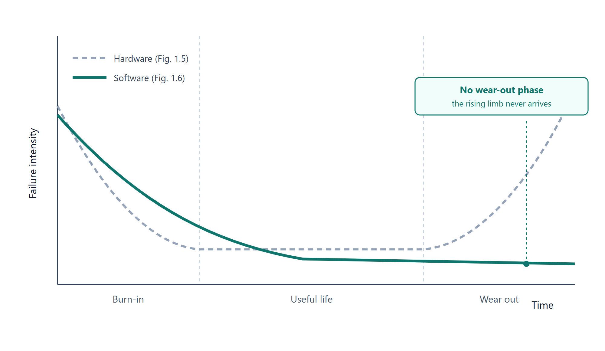

# T2 · Descriptive & Short-Answer (Interpretation) Questions
## Chapter 1 — Introduction

> **كيف تستخدم الملف.** اقرأ السؤال، اكتب جوابك، بعدين قارن بالبطاقة. **الجواب بالإنجليزي** — هذا اللي تترجمه بالورقة. **البطاقات الصفراء والحمراء بالعربي** — تنبيهات وفخاخ، اقرأها بسرعة وكمل.

**المصدر.** كتاب **Aggarwal & Singh, Software Engineering, 3rd ed.** (New Age International, 2007). النسخة اللي عدنا هي **نفس الكتاب** ممسوحة (`AliFahim_Software_Engineering.pdf`) — مو ملف شرائح. وأرقام الصفحات أدناه هي **أرقام الكتاب نفسه**، اللي مطبوعة أعلى كل صفحة. التمارين = ص.19 · النص = ص.1–16 · مفتاح أجوبة الـMCQ = ص.498. رموز المراجع بين القوسين `[FRIT68]` `[SCHA90]` `[BROW2K]` `[OMG2K]` `[PRES02]` `[HUMP89]` `[WIEG99]` هي مراجع الكتاب نفسه، منقولة كما هي.

> [!CONCEPT] طريقة قراءة الإجابات
> الكلام العريض مبني على المصدر، وقد يُبسّط بألفاظ أسهل. الكلام العادي صياغة أو استنتاج مختصر. الاقتباس الحرفي فقط يوضع بين علامتي تنصيص.

---

## Retrieval set — Official Exercises (1.1 – 1.25)

---

**1.1 · Why is the primary goal of software development now shifting from producing good quality software to good quality maintainable software?**
{: .keep-next }

> [!NOTE] Answer
> **Because the cost of maintaining software increased, the objective is now to produce software that is maintainable, delivered on time, within budget, and that satisfies its requirements.**
>
> **Aggarwal, §1.2.1, p.4.**
---

**1.2 · List the reasons for the "software crisis"? Why are CASE tools not normally able to control it?**
{: .keep-next }

> [!NOTE] Answer
> **Reasons.** Change in the ratio of hardware to software costs · increasing importance of maintenance · advances in software techniques · increased demand for software · demand for larger and more complex software systems.
>
> **Why CASE tools cannot control it.** A tool is not a silver bullet: **"no single development, either in technology or in management technique, that by itself promises even one order-of-magnitude improvement in productivity, in reliability, in simplicity."** **"Many companies have used these tools and spent large sums of money, but results were highly unsatisfactory."** **"The hard part of building software is the specification, design and testing of this conceptual construct, not the labour of representing it."**
>
> **Aggarwal, §1.4, p.12; §1.1.2, p.3.**
---

**1.3 · "The software crisis is aggravated by the progress in hardware technology?" Explain with examples.**
{: .keep-next }

> [!NOTE] Answer
> The chapter contrasts rapid hardware gains with slower software progress: **"No other technology, since civilization began, has seen six orders of magnitude in performance-price gain in 30 years. The progress in software technology is not that rosy due to certain difficulties with this technology. Some of the difficulties are complexity, changeability and invisibility."** Y2K and Ariane-5 illustrate software failures; they do not by themselves prove that hardware progress caused the crisis.
>
> Two examples from the failure list: **Y2K** — the four-digit date **"was shortened to 2-digit format, like 64"**; and **Ariane-5** — the guidance computer converting the sideways velocity **"from a 64-bit format to a 16-bit format"** produced an overflow after 36.7 seconds.
>
> **Aggarwal, §1.1.2, p.3; §1.4, p.12; §1.1.1, pp.2–3.**
> [!TRAP] فخ هذا السؤال
> لا تخلط بين تزامن تقدّم العتاد ومشكلات البرمجيات وبين إثبات علاقة سببية مباشرة. تغيّر نسبة كلفة العتاد إلى البرمجيات عامل مستقل يورده الكتاب ضمن أسباب الأزمة.

---

**1.4 · What is software crisis? Was Y2K a software crisis?**
{: .keep-next }

> [!NOTE] Answer
> **"Software crisis has become a fixture of everyday life"** — late delivery, cost overrun, residual faults, failures causing **"death of many human beings"**. **"This unpredictability is the basis of what has been referred to for the past 30 years as the 'Software Crisis'."**
>
> **Y2K** — **"the most crucial problem of last century"**: **"It was simply the ignorance about the adequacy or otherwise of using only last two digits of the year... Millions of rupees have been spent to handle this practically non-existent problem."**
>
> **Aggarwal, §1.1, pp.1–2; §1.2.4, p.10.**
> [!TRAP] لا تكتب إن Y2K دمّرت أنظمة
> الكتاب يسمي المشكلة نفسها **"practically non-existent"**، ويذكر أن الملايين صُرفت لمعالجتها.
> الضرر المذكور هنا هو كلفة المعالجة؛ لا تضف انهيار أنظمة ما لم يذكره المصدر.

---

**1.5 · What is the significance of software crisis in reference to software engineering discipline?**
{: .keep-next }

> [!NOTE] Answer
> The crisis is the reason the discipline exists: **"These myths, poor quality of software, increasing cost and delay in the delivery of the software have been the driving forces behind the emergence of software engineering as a discipline."**
>
> **Aggarwal, §1.4, p.12.**
---

**1.6 · How are software myths affecting software process? Explain with the help of examples.**
{: .keep-next }

> [!NOTE] Answer
> **"There are number of myths associated with software development community. Some of them really affect the way, in which software development should take place."** Nine myths:
>
> **1. Software is easy to change.** **"Every change requires that the complete system be re-verified."**
>
> **2. Computers provide greater reliability than the devices they replace.** **"Now, we have software error as well."**
>
> **3. Testing or 'proving' software correct can remove all the errors.** **"Testing can only show the presence of errors. It cannot show the absence of errors."**
>
> **4. Reusing software increases safety.** **"A false sense of security."**
>
> **5. Software can work right the first time.** **"No aeronautical engineer would build a jet fighter without a prototype."**
>
> **6. Software can be designed thoroughly enough to avoid most integration problems.** **"There is an old saying among software designers: 'Too bad, there is no compiler for specifications'."**
>
> **7. Software with more features is better software.** **"The best, most enduring programs are those which do one thing well."**
>
> **8. Addition of more software engineers will make up the delay.** It **"may further delay the project."**
>
> **9. Aim is to develop working programs.** **"The aim has been shifted from developing working programs to good quality, maintainable programs."**
>
> **Aggarwal, §1.4, pp.11–12.**
---

**1.7 · State the difference between program and software. Why have documents and documentation become very important?**
{: .keep-next }

> [!NOTE] Answer
> Software **"is more than programs"**: it **"consists of programs, documentation of any facet of the program and the procedures used to setup and operate the software system."** A program **"is a combination of source code and object code"**, and **"any program is a subset of software and it becomes software only if documentation and operating procedure manuals are prepared."**
>
> **Why documentation matters.** Documentation explains system design and operation; operating procedures guide setup and use. These materials help users and maintainers understand the system beyond its source and object code.
>
> **Aggarwal, §1.2.2, pp.4–5; Fig. 1.2 p.5, Fig. 1.3 p.6.**
> [!NOTE] توضيح
> ذكر الصيانة هنا تطبيق عملي لأهمية التوثيق؛ المصدر يعرّف مكونات البرمجيات ويصف دور الإجراءات في إعداد النظام وتشغيله.

---

**1.8 · What is software engineering? Is it an art, craft or a science? Discuss.**
{: .keep-next }

> [!NOTE] Answer
> **Definitions.** Fritz Bauer, at the 1968 conference [FRIT68]: **"The establishment and use of sound engineering principles in order to obtain economically developed software that is reliable and works efficiently on real machines."** Stephen Schach [SCHA90]: **"A discipline whose aim is the production of quality software, software that is delivered on time, within budget, and that satisfies its requirements."**
>
> **Art, craft or science.** Software engineering combines systematic engineering principles, scientific knowledge, and design judgement. Large programs require more than programming skill alone: **"The art of programming only is no longer sufficient to construct large programs"**, and software engineering is an important discipline of study, practice and research.
>
> **Aggarwal, §1.2.1, p.4; §1.6.4, p.16.**
> [!TRAP] فخ مباشر
> ميّز بين التعريفات الواردة في المصدر وبين موقفك المعلّل من كونها فناً أو حرفةً أو علماً.

---

**1.9 · What is the aim of software engineering? What does the discipline of software engineering discuss?**
{: .keep-next }

> [!NOTE] Answer
> **The aim:** **"Software engineering has the objective of solving these problems by producing good quality, maintainable software, on time, within budget. To achieve this objective, we have to focus in a disciplined manner on both the quality of the product and on the process used to develop the product."**
>
> **What the discipline discusses:** the evolving role of software and its failures · what software engineering is · program versus software · software process · software characteristics · the changing nature of software · software myths · terminology · the role of management.
>
> **Aggarwal, §1.2, p.4; §1.1–1.6, pp.1–16.**
---

**1.10 · Define the term "Software Engineering". Explain the major differences between software engineering and other traditional engineering disciplines.**
{: .keep-next }

> [!NOTE] Answer
> **Definitions.** Two, both accepted. Fritz Bauer, at the 1968 conference [FRIT68]: **"The establishment and use of sound engineering principles in order to obtain economically developed software that is reliable and works efficiently on real machines."** Stephen Schach [SCHA90]: **"A discipline whose aim is the production of quality software, software that is delivered on time, within budget, and that satisfies its requirements."**
>
> **Differences** (Table 1.1 — bridge against program): **the problem is well understood** / **only some parts of the problem are understood, others are not** · **there are many existing bridges** / **every program is different and designed for special applications** · **the requirement for a bridge typically do not change much during construction** / **requirements typically change during all phases of development** · **the strength and stability of a bridge can be calculated with reasonable precision** / **not possible to calculate correctness of a program with existing methods** · **when a bridge collapses, there is a detailed investigation and report** / **when a program fails, the reasons are often unavailable or even deliberately concealed** · **engineers have been constructing bridges for thousands of years** / **developers have been writing programs for 50 years or so** · **materials and techniques change slowly** / **hardware and software changes rapidly**.
>
> **Aggarwal, §1.2.1, p.4; Table 1.1, p.8.**
---

**1.11 · What is software process? Why is it difficult to improve it?**
{: .keep-next }

> [!NOTE] Answer
> **"The software process is the way in which we produce software."**
>
> **Four reasons** it is difficult to improve [HUMP89, WIEG99]: **not enough time** — unrealistic schedules leave no room to study what is wrong · **lack of knowledge** — developers do not read the literature on best-known practice · **wrong motivations** — initiatives launched to satisfy a contractor or a manager's CMM ambition · **insufficient commitment** — assessment without follow-through, no plan and no roadmap.
>
> Add Fig. 1.4: improvement **"will not have an impact on current productivity"** — the curve dips before it rises.
>
> **Aggarwal, §1.2.3, pp.6–7; Fig. 1.4, p.7.**
---

**1.12 · Describe the characteristics of software contrasting it with the characteristics of hardware.**
{: .keep-next }

> [!NOTE] Answer
> **1. Software does not wear out.** Hardware has three phases — burn-in, useful life, wear out (Fig. 1.5). **"We do not have this phase for the software as it does not wear out"**; **"software becomes reliable overtime instead of wearing out"** (one word: overtime). Software instead **"becomes obsolete, if the environment for which it was developed, changes."**
>
> **2. Software is not manufactured.** **"Making 1000 copies is not an issue and it does not involve any cost... We do not have assembly line in software development."**
>
> **3. Reusability of components.** Hardware is assembled from purchased parts; in software **"every project is a new project. We start from the scratch and design every unit"** — hence component based software engineering.
>
> **4. Software is flexible.** **"A program can be developed to do almost anything"**, which makes development **"difficult to plan, monitor and control"**; **"this unpredictability is the basis of what has been referred to for the past 30 years as the 'Software Crisis'."**
>
> **Aggarwal, §1.2.4, pp.8–10; Table 1.1, p.8.**
---

**1.13 · Write down the major characteristics of a software. Illustrate with a diagram that the software does not wear out.**
{: .keep-next }

> [!NOTE] Answer
> **The four characteristics** (§1.2.4): software **does not wear out** · software **is not manufactured** · **reusability of components** · software **is flexible**.
>
> **The diagram** — Fig. 1.6, drawn against the hardware curve in Fig. 1.5. Axes: **failure intensity** against **time**. Hardware has three phases — high intensity in **burn-in**, a flat low plateau through **useful life**, then a **rising** limb at **wear out**. Software shows only the **descending** curve, flattening as defects are found and fixed: the rising limb never arrives, because there is no physical wear-out mechanism.
>
> 
>
> **Aggarwal, §1.2.4, pp.8–9; Fig. 1.5 p.8, Fig. 1.6 p.9.**
---

**1.14 · What are the components of a software? Discuss how a software differs from a program.**
{: .keep-next }

> [!NOTE] Answer
> **Components** (Fig. 1.1): **Software = Program + Documentation + Operating Procedures.**
>
> Documentation manuals (Fig. 1.2) cover analysis/specification (formal specification, context diagram, data flow diagrams), design (flow charts, entity-relationship diagrams), implementation (source code listings, cross-reference listing) and testing (test data, test results). Operating procedure manuals (Fig. 1.3) cover user manuals (system overview, beginner's guide tutorial, reference guide) and operational manuals (installation guide, system administration guide). Their function: **"instructions to setup and use the software system and instructions on how to react to system failure."**
>
> **Difference from a program:** **"any program is a subset of software and it becomes software only if documentation and operating procedure manuals are prepared."** Adding code never converts a program into software; only documentation and procedures do.
>
> **Aggarwal, §1.2.2, pp.4–5; Fig. 1.1 p.4, Fig. 1.2 p.5, Fig. 1.3 p.6.**
---

**1.15 · Discuss major areas of the applications of the software.**
{: .keep-next }

> [!NOTE] Answer
> Eight areas (Fig. 1.7): **system software** — **"a collection of programs to provide service to other programs"** · **real time software** — monitors and analyses real-world events as they occur · **embedded software** — placed in ROM, controls the functions of a product, **"also termed as intelligent software"** · **business software** — **"the largest application area"** · **personal computer software** · **artificial intelligence software** — **"non-numerical algorithms to solve complex problems"** · **web based software** · **engineering and scientific software**.
>
> **Aggarwal, §1.3, pp.10–11; Fig. 1.7, p.10.**
---

**1.16 · Is software a product or process? Justify your answer with examples.**
{: .keep-next }

> [!NOTE] Answer
> **Product:** **"What is delivered to the customer, is called a product. It may include source code, specification document, manuals, documentation etc. Basically, it is nothing but a set of deliverables only."**
> **Process:** **"the way in which we produce software. It is the collection of activities that leads to (a part of) a product."**
>
> Applying the two definitions: the software artefact is the **product** — it is what is delivered — while designing, coding and testing are the **process** that produced it.
>
> **Aggarwal, §1.5.2, p.13.**
---

**1.17 · Differentiate between: (i) Deliverables and milestones (ii) Product and process (iii) Measures, metrics and measurement**
{: .keep-next }

> [!NOTE] Answer
> **(i) Deliverables and milestones.** Deliverables are produced — source code, user manuals, operating procedure manuals. Milestones are **"the events that are used to ascertain the status of the project"**, e.g. finalisation of specification, completion of design documentation.
>
> **(ii) Product and process.** Product = what is delivered to the customer. Process = the way in which we produce software.
>
> **(iii) Measures, metrics and measurement.** A **measure** **"provides a quantitative indication of the extent, dimension, size, capacity, efficiency, productivity or reliability of some attributes of a product or process."** **Measurement** is **"the act of evaluating a measure."** A **metric** is **"a quantitative measure of the degree to which a system, component, or process possesses a given attribute."**
>
> **Aggarwal, §1.5.1–1.5.3, p.13.**
---

**1.18 · What is software metric? How is it different from software measurement?**
{: .keep-next }

> [!NOTE] Answer
> **Metric:** **"a quantitative measure of the degree to which a system, component, or process possesses a given attribute."** **Measurement:** **"the act of evaluating a measure."** One is a quantity the system possesses; the other is the act of evaluating it.
>
> Pressman [PRES02]: **"When a single data point has been collected (e.g., the number of errors uncovered in the review of a single module), a measure has been established. Measurement occurs as the result of the collection of one or more data points... A software metric relates the individual measures in some way (e.g., the average number of errors found per review)."**
>
> **Aggarwal, §1.5.3, p.13.**
---

**1.19 · Discuss software process and product metrics with the help of examples.**
{: .keep-next }

> [!NOTE] Answer
> **Process metrics** **"quantify the attributes of software development process and environment"** — productivity, quality, failure rate, efficiency.
> **Product metrics** **"are measures for the software product"** — size, reliability, complexity, functionality.
>
> **Aggarwal, §1.5.4, p.13.**
---

**1.20 · What is productivity? How is it related to effort? What is the unit of effort?**
{: .keep-next }

> [!NOTE] Answer
> **Productivity** is **"the rate of output, or production per unit of effort, i.e., the output achieved with regard to the time taken but irrespective of the cost incurred."** Output is measured as lines of code (LOC); time in days or months.
>
> **Relation to effort:** productivity is output divided by effort — a rate, therefore inversely related to effort for a fixed output.
>
> **Unit of effort:** **"most appropriate unit of effort is Person Months (PMs), meaning thereby number of persons involved for specified months."** Hence productivity is measured as **LOC/PM**.
>
> **Aggarwal, §1.5.5, p.14.**
---

**1.21 · Differentiate between module and software component.**
{: .keep-next }

> [!NOTE] Answer
> **Module.** A wide range is accepted: **"a module is a FORTRAN subroutine"**, **"an Ada Package"**, **"Procedures and functions of PASCAL and C"**, **"C++ Java classes"**, **"Java packages"**, or even **"a module is a work assignment for an individual developer"** — **"All these definitions are correct."**
>
> **Component.** Alan W. Brown [BROW2K]: **"An independently deliverable piece of functionality providing access to its services through interfaces."** UML [OMG2K]: **"A component represents a modular, deployable, and replaceable part of a system that encapsulates implementation and exposes a set of interfaces."**
>
> **"A reusable module is an independent and deliverable software part that encapsulates a functional specification and implementation for reuse by a third party. However, a reusable component is an independent, deployable, and replaceable software unit that is reusable by a third party based on unit's specification, implementation, and well defined contracted interfaces."**
>
> **Aggarwal, §1.5.6, p.14.**
---

**1.22 · Distinguish between generic and customised software products. Which category accounts for more development projects, and what proportion does the source report?**
{: .keep-next }

> [!NOTE] Answer
> **Generic products** **"are developed for anonymous customers. The target is generally the entire world and many copies are expected to be sold. Infrastructure software like operating systems, compilers, analysers, word processors, CASE tools etc. are covered in this category."**
> **Customised products** **"are developed for particular customers. The specific product is designed and developed as per customer requirements."**
>
> **Which accounts for more development projects:** customised products — **"Most of the development projects (say about 80%) come under this category."**
>
> **Aggarwal, §1.5.7, p.14.**
> [!TRAP] دقّق بالوحدة قبل ما تكتب
> نسبة 80% تخص مشاريع التطوير، ولا تحدد حصة السوق أو عدد المستخدمين والنسخ.

---

**1.23 · Describe the role of management in software development with the help of examples.**
{: .keep-next }

> [!NOTE] Answer
> **"The management of software development is heavily dependent on four factors: People, Product, Process, and Project."**
>
> **"Software development is a people centric activity. Hence, success of the project is on the shoulders of the people who are involved in the development."**
>
> Manager selection is **"most crucial and critical"**, because **"a good manager cannot ensure the success of the project, but can increase the probability of success."** **"Proper selection, training, compensation, career development, work culture etc."** **"I am more afraid of an army of one hundred sheep led by a lion than an army of one hundred lions led by a sheep."**
>
> **"All four factors (People, Product, Process and Project) are important for the success of the project. Their relative importance helps us to organise development activities in more scientific and professional way."**
>
> **Aggarwal, §1.6 and §1.6.1, p.15; §1.6.4, p.16.**
---

**1.24 · What are various factors of management dependency in software development? Discuss each factor in detail.**
{: .keep-next }

> [!NOTE] Answer
> **"People, Product, Process, and Project."** — dependency order (Fig. 1.8): **People (1) → Product (2) → Process (3) → Project (4)**.
>
> **People.** **"Software development is a people centric activity. Hence, success of the project is on the shoulders of the people who are involved in the development."** Managers need **"mental toughness to endure inner pain"** and must **"plan for the best, be prepared for the worst, expect surprises, but continue to move forward anyway."** Manager selection is **"most crucial and critical"**; once a good manager is in place, **"project is in safe hands."**
>
> **Product.** **"A solution to his/her problems."** A **"best"** approach is selected **"within constraints imposed by delivery deadlines, budgetary restrictions, personnel availability, technical interfaces etc."** Without well-defined requirements **"it may be impossible to define reasonable estimates of the cost, development time and schedule."**
>
> **Process.** **"The process is the way in which we produce software. It provides the framework from which a comprehensive plan for software development can be established."** **"If the process is weak, the end product will undoubtedly suffer."** **"The process priority is after people and product, however, it plays very critical role for the success of the project."**
>
> **Project.** **"A proper planning is required to monitor the status of development and to control the complexity."** **"Most of the projects are coming late with cost overruns of more than 100%."** **"Warning before the occurrence of any surprise."**
>
> **Aggarwal, §1.6 and §1.6.1–1.6.4, pp.15–16; Fig. 1.8, p.15.**
---

**1.25 · What is more important: Product or process? Justify your answer.**
{: .keep-next }

> [!NOTE] Answer
> **"An efficient process is required to produce good quality products. If the process is weak, the end product will undoubtedly suffer, but an obsessive over-reliance on process is also dangerous."**
>
> **The focus should remain on product quality and the process used to develop it, with Product ranked before Process in the management dependency order.**
>
> Neither is universally more important: an effective process supports product quality, while excessive reliance on process can be harmful. The right balance depends on the product and its requirements.
>
> **Aggarwal, §1.5.2, p.13; §1.2, p.4; §1.6.3, p.16; Fig. 1.8, p.15.**
---

## Rapid self-test — recall prompts (no answers shown)

1. State the definition of software, with its three components.
2. Give the five contributing factors of the software crisis.
3. State what a silver bullet is, and why CASE tools are not one.
4. Name the three difficulties that make software technology's progress "not that rosy".
5. Give the four reasons why software process improvement is difficult.
6. List the four software characteristics, and name the one blamed for the crisis.
7. Distinguish measure, measurement and metric in one line each.
8. Name the eight application areas of software.
9. State the unit of effort, and give the four factors of management dependency **in the numbered order**.
10. State the percentage of development projects attributed to customised products — and say precisely what that percentage is a share of.
