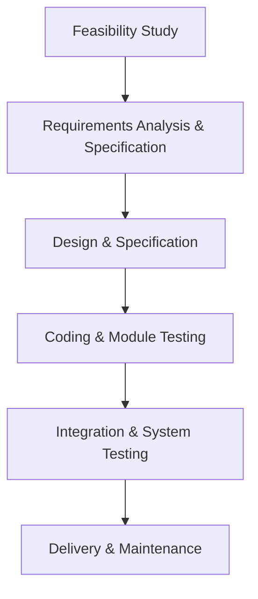

# Chapter 2 — T2 Descriptive Questions Pack

This pack contains the **14 direct descriptive, definitional, and procedural exercises** from printed page 52 of the primary course textbook: **B.B. Agarwal, S.P. Tayal, and M. Gupta, *Software Engineering & Testing: An Introduction* (2010)**.

---

### Exercise 01: Discuss the SDLC in brief.

**The Software Development Life Cycle (SDLC) is a systematic, cost-effective framework that guides an information system through a series of structured phases from initial conception to final operational retirement.** **Its primary objective is to produce high-quality, maintainable software in a predictable manner by enforcing structured development, early resource planning, and progress tracking.** **Each phase in the SDLC must define explicit entry criteria (prerequisites needed to start the phase) and exit criteria (deliverables and quality conditions required to complete it).** **Without clear entry and exit criteria, management cannot measure project progress or ensure quality.**

> **ملاحظة الطالب والفخ الامتحاني:**
> - ركّز على مفهوم معايير الدخول والخروج (Entry and Exit criteria)؛ غيابهما يعني استحالة تتبع تقدم المشروع إدارياً.
> - الهدف ليس مجرد البرمجة، بل بناء نظام قابل للصيانة (Maintainable) وبكلفة مقبولة وطريقة يمكن التنبؤ بها.

*Source: B.B. Agarwal et al. (2010), §2.1, pp. 29–30.*

---

### Exercise 02: Give the basic phases in the software-development life-cycle.

**The software-development life-cycle standardly comprises five to nine phases, typically averaging seven or eight distinct stages:**
1. **Project initiation and planning / Recognition of need / Preliminary investigation**
2. **Project identification and selection / Feasibility study**
3. **Project analysis (System Analysis)**
4. **System design (High-level and Detailed Design)**
5. **Coding (Implementation)**
6. **Testing (Verification and Validation)**
7. **Implementation (Deployment and User Training)**
8. **Maintenance (Operational Support and Evolution)**

> **ملاحظة الطالب والفخ الامتحاني:**
> - يحدد كتاب أغروال 2010 أن عدد مراحل SDLC يتراوح بين 5 إلى 9 مراحل، ومتوسطها الشائع هو 7 أو 8 مراحل.
> - احفظ هذا الترتيب بدقة؛ ولا تخلط بين مرحلة Implementation (التي تعني النشر وتدريب المستخدمين في هذا الكتاب) ومرحلة Coding.

*Source: B.B. Agarwal et al. (2010), §2.1, p. 30.*

---

### Exercise 03: What are the different steps in the software-development life-cycle? What are the end products at each step?

**The SDLC steps and their corresponding tangible deliverables (end products) are:**

1. **Step 1 — Recognition of Need:** Delivers the **problem definition** and **study proposal** submitted to management, defining deficiencies in the current system and establishing the basis for system change.
2. **Step 2 — Feasibility Study:** Delivers feasibility study findings evaluating alternative systems across **organizational, economic, technical, and operational feasibility** to propose the most viable system for development.
3. **Step 3 — Project Analysis:** Delivers the **system proposal** (supported by a detailed investigation report and an outline of the proposed system based on satisfying user requirements).
4. **Step 4 — System Design:** Delivers the system design specifications (defining required system outputs, input data requirements, file processing operations, and algorithms).
5. **Step 5 — Coding:** Delivers the **program code** written in a chosen programming language conforming to standards to implement the design.
6. **Step 6 — Testing:** Delivers the **test report and error report** (recording test cases, code execution results, and detected software defects).
7. **Step 7 — Implementation:** Delivers a **fully operational system** ready for operation (incorporating user training, site preparation, and file conversion).
8. **Step 8 — Maintenance:** Delivers maintenance changes across four categories: **corrective** (repairing errors), **adaptive** (adapting to environmental changes), **perfective** (enhancing efficiency), and **preventive** (anticipating future problems).

> **ملاحظة الطالب والفخ الامتحاني:**
> - السؤال مركب: يطلب الخطوة وناتجها (End Product). كل خطوة في هندسة البرمجيات تنتهي بمُسلَّم موثق (Deliverable / Milestone).
> - مخرج مرحلة Project Analysis في الخطوات الثمانية لكتاب أغروال (ص. 32) هو مقترح النظام (System Proposal) مع تقرير الفحص التفصيلي، بينما مصطلح الـ SRS يرتبط بمرحلة Requirements Analysis and Specification في نموذج الشلال (ص. 36–37).

*Source: B.B. Agarwal et al. (2010), §2.1, pp. 30–36.*

---

### Exercise 04: What are the important activities that are carried out during the feasibility study phase?

**The feasibility study investigates prospective user needs, estimates resource costs and benefits, and evaluates whether a proposed project is viable across four major dimensions:**

1. **Organizational Feasibility:** Evaluates whether the proposed system aligns with and advances the strategic business objectives of the organization.
2. **Economic Feasibility:** Assesses cost-benefit calculations, analyzing whether expected financial returns, increased revenue, or operating cost savings outweigh the total cost of development and deployment.
3. **Technical Feasibility:** Verifies whether capable, reliable hardware, software, networking, and technical skills can be acquired or developed within project deadlines.
4. **Operational Feasibility:** Evaluates the willingness and practical capability of end-users, employees, customers, and management to accept, operate, and integrate the new system into daily business workflows.

> **ملاحظة الطالب والفخ الامتحاني:**
> - جدول دراسة الجدوى في الكتاب (Table 2.1) يحصرها في أربعة محاور أساسية: Organizational, Economic, Technical, Operational. اذكر الأربعة مع تعريف مقتضب لكل منها.

*Source: B.B. Agarwal et al. (2010), §2.1, pp. 31–32 (Table 2.1).*

---

### Exercise 05: Explain the different categories of maintenance in the software-development lifecycle.

**Software maintenance constitutes all activities undertaken after software delivery to sustain operational integrity. It consumes 50% to 80% of total development cost and is categorized into four classes:**

1. **Corrective Maintenance:** Repairing runtime processing defects, software bugs, calculation errors, or system crashes identified after delivery.

2. **Adaptive Maintenance:** Modifying software functions to accommodate changes in the external environment, legal regulations, hardware platforms, or operating systems (such as updated taxation laws).

3. **Perfective Maintenance:** Enhancing system performance, optimizing execution efficiency, or adding new functional capabilities requested by users to satisfy changing business demands.

4. **Preventive Maintenance:** Re-engineering, restructuring, and reverse-engineering legacy systems to modernize underlying technology and prevent future architectural obsolescence.

> **ملاحظة الطالب والفخ الامتحاني:**
> - الصيانة ليست مجرد تصليح أخطاء؛ الصيانة التحسينية (Perfective) قد تشمل تحسين الأداء أو تعديل البرامج لتلبية طلبات المستخدمين.
> - الصيانة الوقائية (Preventive) تعتمد الهندسة العكسية وإعادة الهندسة لحماية النظام من التقادم (Dying out).

*Source: B.B. Agarwal et al. (2010), §2.1, pp. 35–36; §2.2, p. 40.*

---

### Exercise 06: What is the role of the testing phase in the software-development life-cycle?

**The primary role of the testing phase is quality control through systematic error detection; testing uncovers requirement, design, and coding defects in the program.** **A fundamental engineering principle of testing is that testing can only demonstrate the presence of errors, never their complete absence.**

**The testing phase performs several vital roles:**
1. **Verification and Validation:** Demonstrates whether the software satisfies specified functional and non-functional requirements documented in the SRS.
2. **Structured Execution:** Progresses systematically from unit testing ("testing in the small") to integration testing and finally full system testing ("testing in the large").
3. **Multi-level Acceptance:** Executes Alpha Testing (at the developer’s site), Beta Testing (with friendly users), and formal Acceptance Testing (conducted by customer staff to authorize deployment).
4. **Quality Accountability:** Produces detailed test reports and error logs, providing objective data on system reliability and stability before live deployment.

> **ملاحظة الطالب والفخ الامتحاني:**
> - احفظ القاعدة الذهبية لمؤلفي هندسة البرمجيات: "Testing cannot show the absence of defects; it can show only software errors present".
> - رتّب تسلسل الاختبار: يبدأ صغيراً (In the small) ثم يكبر تكاملياً (In the large)، وينتهي باختبارات القبول (Acceptance testing).

*Source: B.B. Agarwal et al. (2010), §2.1, p. 34; §2.2, p. 40.*

---

### Exercise 08: Explain the waterfall model in detail with the help of a diagram. State its advantages and also its limitations.

**The Waterfall Model is a classic linear sequential life-cycle model that structures development as a cascade of discrete phases: Feasibility Study $\rightarrow$ Requirements Analysis and Specification $\rightarrow$ Design and Specification $\rightarrow$ Coding and Module Testing $\rightarrow$ Integration and System Testing $\rightarrow$ Delivery $\rightarrow$ Maintenance.** **The output of each preceding phase serves as the frozen, formally documented input to the next.**

**Key Advantages:**
1. **Simplicity and Structure:** Highly intuitive, logical, and easy to manage due to rigid linear milestones.
2. **Disciplined Documentation:** Demands comprehensive, formal documentation and deliverables at the conclusion of each phase.
3. **Phased Quality Gates:** Reinforces the foundational principles of "define before design" and "design before code."

**Key Limitations:**
1. **Inability to Accommodate Changes:** Requirements are frozen early; late alterations are extremely disruptive and costly.
2. **Delayed Working Version:** An operational executable product is not visible to customers until late in the life-cycle.
3. **All-or-Nothing Delivery:** High risk of project collapse if miscommunications occur during upfront requirements engineering.
4. **Poor Scalability:** Highly unsuited for large, complex, or exploratory systems with volatile requirements.

> **ملاحظة الطالب والفخ الامتحاني:**
> - النموذج خطي تعاقبي (Linear Sequential)؛ نقطة قوته هي التوثيق الصارم والانضباط، ونقطة ضعفه القاتلة هي الجمود أمام التغيير (Disallows changes).
> - الرسم شلالي متتابع؛ والجواب الكامل يربط بين الرسم والمراحل والميزات والعيوب.

*Source: B.B. Agarwal et al. (2010), §2.2, pp. 36–41.*

---

### Exercise 10: What are the major advantages of first constructing a working prototype before developing the actual product?

**Constructing an exploratory, working prototype prior to building the full production software offers major engineering advantages:**
1. **Clarifying Ambiguous Requirements:** Customers frequently describe vague goals rather than concrete inputs and outputs; a working prototype makes interface behaviors and business logic tangible.
2. **Mitigating Technical and Algorithmic Risks:** Developers can evaluate unfamiliar hardware interfaces, controller response latencies, and algorithmic performance before committing to an architecture.
3. **Optimizing Graphical User Interfaces (GUI):** Enables users to evaluate visual layouts, interactive dialogues, screen transitions, and report formatting directly.
4. **Minimizing Expensive Downstream Rework:** Unfreezes requirements early, drastically reducing the massive cost of rewriting code during post-delivery maintenance.
5. **Managing Scope and Feature Expectations:** Categorizes suggested changes systematically into cosmetic, local, and global impacts.

> **ملاحظة الطالب والفخ الامتحاني:**
> - ميزة بناء البروتوتايب الأساسية هي تقليل المخاطر وفهم متطلبات العميل الغامضة قبل استثمار الميزانية في كود نهائي قد يُرفض لاحقاً.

*Source: B.B. Agarwal et al. (2010), §2.3, pp. 41–44.*

---

### Exercise 11: Write a short description of the evolutionary development model. Also state its advantages.

**The Evolutionary Development Model is an iterative life-cycle paradigm designed for projects where initial requirements are unstable or poorly understood.** **Rather than requiring a complete, monolithic specification upfront, the engineering team develops an initial core system and continuously evolves it through iterative cycles of Analysis-Design-Testing through Prototype-Implementation-Assessment-Evaluation until user satisfaction is attained.** **Unlike iterative enhancement, the evolutionary model implements requirements grouped by category (or concept stability) rather than strict operational priority, and intermediate iterations do not necessarily produce an externally deployable product.**

**Major Advantages:**
1. **Adaptability to Changing Requirements:** Seamlessly incorporates evolving business and market demands during active development.
2. **Suitability for Unfamiliar Technology:** Allows developers to explore emerging technologies and unproven frameworks incrementally without risking project failure.
3. **Continuous Stakeholder Consensus:** Regular user evaluations across evolution cycles guarantee that the final product directly matches operational reality.
4. **Early Risk Reduction:** Prevents project paralysis caused by attempting to specify complex, unfamiliar systems in a single monolithic phase.

> **ملاحظة الطالب والفخ الامتحاني:**
> - ركّز على الفارق الذي يذكره أغروال ص.46: التطوير التطوري يطبّق المتطلبات حسب التصنيف (By category) ولا يشترط تسليم منتج صالح للعمل للزبون في نهاية كل دورة، بخلاف Iterative Enhancement.

*Source: B.B. Agarwal et al. (2010), §2.5, pp. 46–47.*

---

### Exercise 12: Explain the iterative-enhancement model with the help of a suitable example.

**The Iterative Enhancement Model combines the structured discipline of the linear sequential model (applied cyclically) with the exploratory feedback of prototyping.** **The complete system is partitioned into several functional modules that are developed and delivered incrementally to the customer.** **The first increment delivers a core product addressing basic, essential requirements; subsequent increments add advanced capabilities based on real operational feedback.**

**Practical Example (Word-Processing Software from Textbook):**
- **Increment 1 (Core Product):** **Basic file management, editing, and document production functions.**
- **Increment 2:** **More sophisticated editing and document production capabilities.**
- **Increment 3:** **Spelling and grammar checking.**
- **Increment 4:** **Advanced page layout capability.**

**Each cycle undergoes planning, design, coding, testing, and delivery.** **Feedback gathered from the deployed core product directly refines the planning and implementation of subsequent increments.**

> **ملاحظة الطالب والفخ الامتحاني:**
> - مثال معالج الكلمات (Word-processing) هو المثال المعتمد في كتاب أغروال ص.47–48؛ احفظ تدرج الإصدارات الأربعة بدقة كما وردت في الكتاب.
> - في نموذج التحسين التكراري (Iterative Enhancement)، كل دورة تسلّم منتجاً قابلاً للاستخدام الفعلي للعميل (Usable product)، وهذا هو الفارق الجوهري عن النموذج التطوري (Evolutionary) الذي لا يشترط منتجاً قابلاً للاستخدام بنهاية كل دورة.
*Source: B.B. Agarwal et al. (2010), §2.6, pp. 47–48.*

---

### Exercise 14: How are the risks associated with a project handled in the spiral model of software development?

**In the Spiral Model, risk handling is the foundational governing mechanism of the entire life-cycle framework; it is explicitly a risk-driven model.** **Risks (potentially adverse circumstances that may impair the development process and product quality) are systematically addressed through the four quadrants of each cycle:**

1. **Quadrant 1 (Objectives and Alternatives):** **Identifies the objectives of the phase and explores possible alternative solutions.**
2. **Quadrant 2 (Alternative Evaluation based on Risk Perceptions):** **Evaluates different alternatives based on project objectives and constraints, where the evaluation is guided by the risk perceptions for the project.**
3. **Quadrant 3 (Risk Resolution Strategies):** **Emphasizes the development of strategies that resolve uncertainties and risks, deploying targeted activities such as benchmarking, simulation, and prototyping.**
4. **Quadrant 4 (Next-Cycle Objectives):** **Determines the specific objectives that should be fulfilled in the next cycle of software development in order to build the complete system.**

> **ملاحظة الطالب والفخ الامتحاني:**
> - حسب النص الصريح لكتاب أغروال (ص. 45)، تقييم البدائل بالمخاطر يتم في الربع الثاني (Quadrant 2)، بينما تنفيذ استراتيجيات حل المخاطر والشكوك (كالبروتوتايب والمحاكاة والـ Benchmarking) يُسند للربع الثالث (Quadrant 3).
> - الربع الرابع (Quadrant 4) وظيفته تحديد أهداف الدورة القادمة لاستكمال بناء النظام.

*Source: B.B. Agarwal et al. (2010), §2.4, pp. 44–46.*

### Exercise 15: What are the major phases in the spiral model of software development? Explain.

**In the Spiral Model, development is structured as a series of cyclic loops traversing a Cartesian diagram.** **Each cycle represents one major phase split into four sectors (quadrants):**

1. **First Quadrant:** **Identifies the objectives of the phase and the alternative solutions possible for the phase under consideration.**
2. **Second Quadrant:** **Evaluates different alternatives based on the objectives and constraints, where evaluation is based on the risk perceptions for the project.**
3. **Third Quadrant:** **Emphasizes the development of strategies that resolve uncertainties and risks, involving activities such as benchmarking, simulation, and prototyping.**
4. **Fourth Quadrant:** **Determines the objectives that should be fulfilled in the next cycle of software development in order to build the complete system.**

**Geometric Representation:**

- **Radial Dimension:** **Represents cumulative costs incurred so far in the project.**
- **Angular Dimension:** **Represents the progress made in completing each cycle of the spiral.**

> **ملاحظة الطالب والفخ الامتحاني:**
> - التزم بنص أغروال ص. 45 للقطاعات الأربعة: الربع الأول لتحديد الأهداف والبدائل، الثاني لتقييم البدائل حسب المخاطر، الثالث لتطوير استراتيجيات حل المخاطر (Benchmarking, Simulation, Prototyping)، والرابع لتحديد أهداف الدورة التالية.
> - أبعاد الرسم: نصف القطر (Radial) = التكلفة المتراكمة، والزاوية (Angular) = التقدم المحرز في العملية.

*Source: B.B. Agarwal et al. (2010), §2.4, pp. 44–46.*

---

### Exercise 16: List the various models of software development and explain the RAD model in detail.

**The primary course textbook defines six canonical software-development life-cycle models in Chapter 2:**

- **Waterfall Model (Linear Sequential Model)** (§2.2)
- **Prototyping Model** (§2.3)
- **Spiral Model** (§2.4)
- **Evolutionary Development Model** (§2.5)
- **Iterative Enhancement Model** (§2.6)
- **Rapid Application Development (RAD) Model** (§2.7)

**Detailed Explanation of the RAD Model:**
**The Rapid Application Development (RAD) model is an incremental process model designed to deliver fully functional systems within compressed timeframes (typically 60 to 90 days).** **It decomposes the system into independent, modular components that are developed concurrently by multiple specialized teams.**

**RAD encompasses five structured phases:**

1. **Business Modeling:** Identifies information flow, data generation, processing actors, and business drivers.
2. **Data Modeling:** Transforms business information flows into well-defined data objects, attributes, and relationships.
3. **Process Modeling:** Defines processing descriptions to manipulate data objects (adding, modifying, deleting, or retrieving data).
4. **Application Generation:** Utilizes automated fourth-generation tools (4GL) and pre-existing reusable components to assemble software rapidly.
5. **Testing and Turnover:** Focuses testing strictly on newly developed components and module integration, minimizing test duration because reusable components are pre-verified.

> **ملاحظة الطالب والفخ الامتحاني:**
> - النماذج الستة أعلاه هي النماذج المعتمدة في كتاب أغروال (الأقسام 2.2 إلى 2.7). يضاف إليها في المنهج نموذج Unified Process المأخوذ من شرائح د. علي / K.K. Aggarwal (سلايدات 23–36).
> - مراحل RAD الخمس في كتاب أغروال (p.49–50) هي: Business Modeling $\rightarrow$ Data Modeling $\rightarrow$ Process Modeling $\rightarrow$ Application Generation $\rightarrow$ Testing and Turnover. احفظها بهذا الترتيب والأسماء.

*Sources: Models list: B.B. Agarwal et al. (2010), §2.2–§2.7, pp. 36–50; RAD detailed explanation: §2.7, pp. 49–50.*

---

### Exercise 18: What is the need and use of the evolutionary development model?

**The Need for an Evolutionary Development Model arises from realistic software business constraints:**
1. **Unstable, Fluid Requirements:** Business environments, user workflows, and regulatory rules change dynamically during development, making frozen upfront specifications impossible.
2. **Aggressive Time-to-Market Pressures:** Competitive deadlines make delivering a complete, monolithic software product at once impossible, requiring early deployment of core capabilities.
3. **Partial Initial Understanding:** Core business requirements are well-understood, but detailed extensions and secondary features can only be discovered through actual user interaction.

**The Uses of the Evolutionary Model include:**
1. **Pioneering Technology Projects:** Crucial for systems employing novel or poorly understood technologies, frameworks, or hardware controllers where engineering feasibility must be validated incrementally.
2. **Large-Scale Complex Systems:** Essential for large systems where full functionality must ultimately be delivered as an integrated whole, but requirements cannot be specified accurately at the outset.
3. **User-Centric Exploratory Systems:** Deployed when continuous customer feedback across successive operational categories is necessary to evolve the target architecture.

> **ملاحظة الطالب والفخ الامتحاني:**
> - أغروال يفرّق بدقة بين "Need" (لماذا نحتاجه: تغيير المتطلبات وضغط السوق) وبين "Use" (أين نستخدمه: التكنولوجيا الجديدة والأنظمة المعقدة). اذكر الاثنين لتنال الدرجة الكاملة.

*Source: B.B. Agarwal et al. (2010), §2.5, pp. 46–47.*

---

## Retrieval set — Focused Active Recall Drill

**1. What operational distinction governs the release deliverables of Iterative Enhancement versus Evolutionary Development?**
> **In Iterative Enhancement, each cycle delivers an externally usable, fully operational increment directly to the customer (starting with the core product).** In contrast, Evolutionary Development groups and evolves requirements by conceptual category or technical stability, and intermediate iterations do not necessarily produce an externally deployable product.
>
> *Source: B.B. Agarwal et al. (2010), §2.5, pp. 46–47; §2.6, pp. 47–48.*

**2. Which category of software maintenance accounts for the majority of maintenance costs, and why?**
> **Perfective maintenance accounts for over 50% of all maintenance costs.** It dominates expenditure because successful software systems continually attract new user requests for enhanced capabilities, modified business rules, and optimized performance over years of operational use.
>
> *Source: B.B. Agarwal et al. (2010), §2.2, p. 40.*
