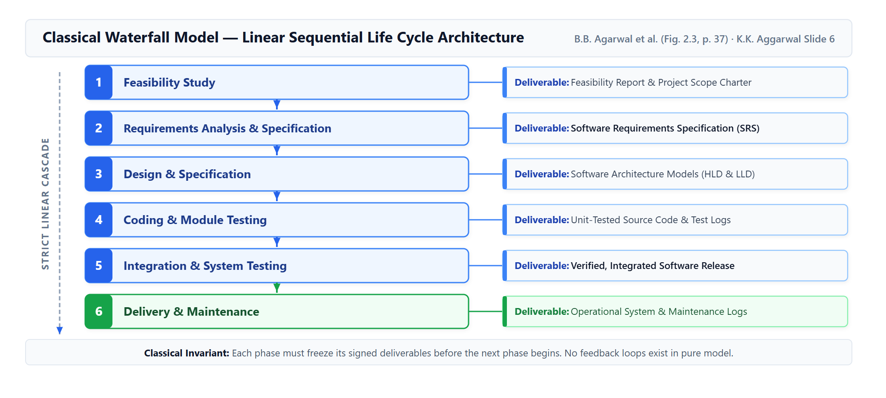
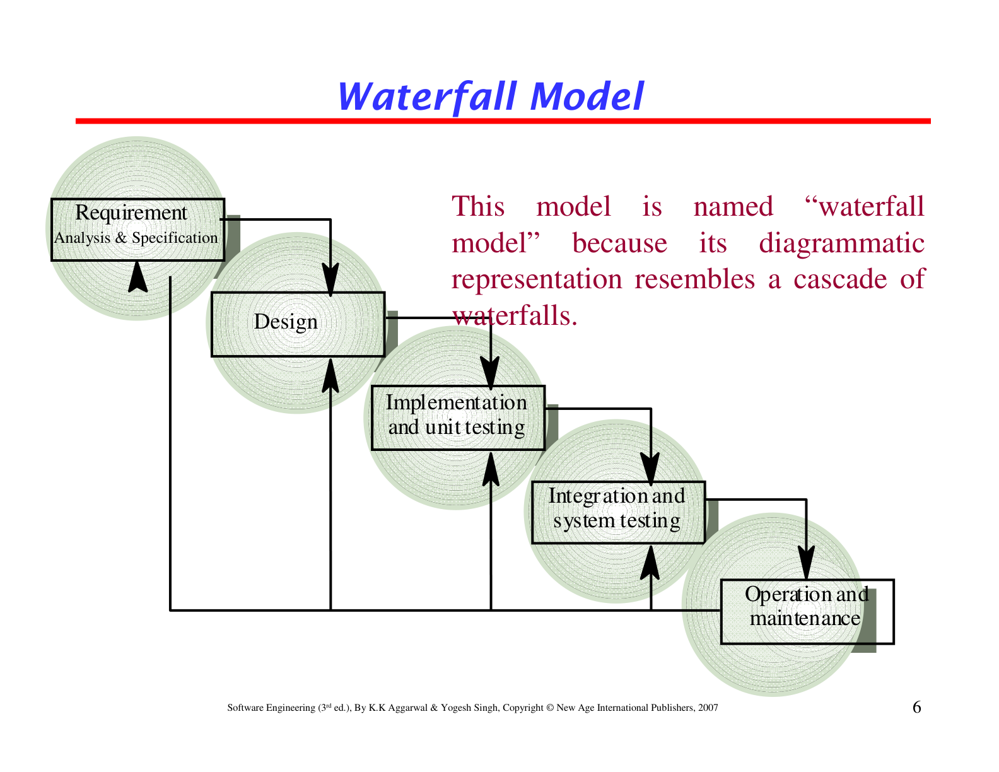
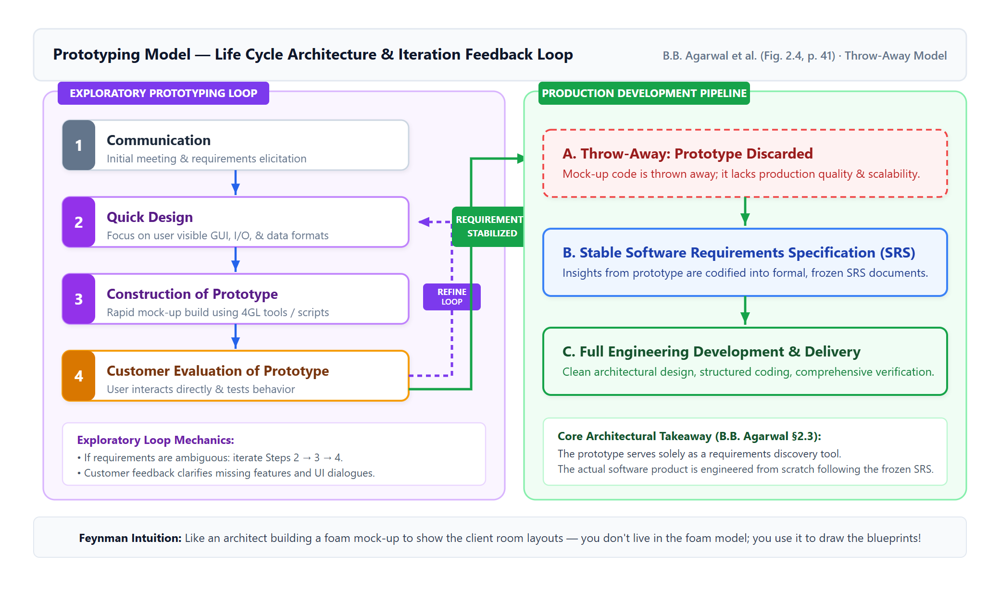
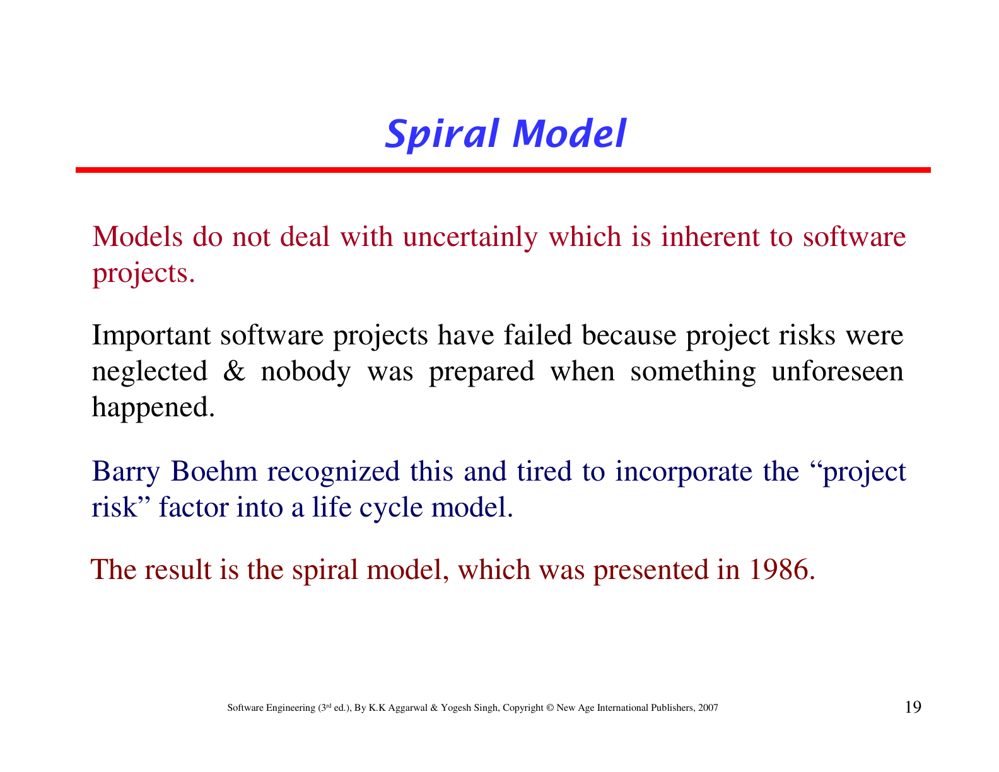
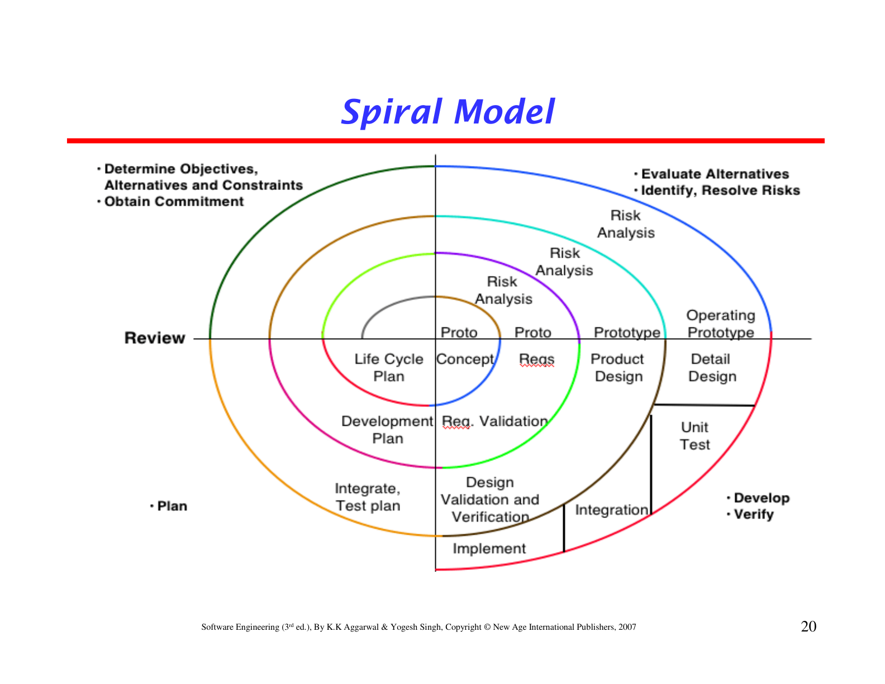
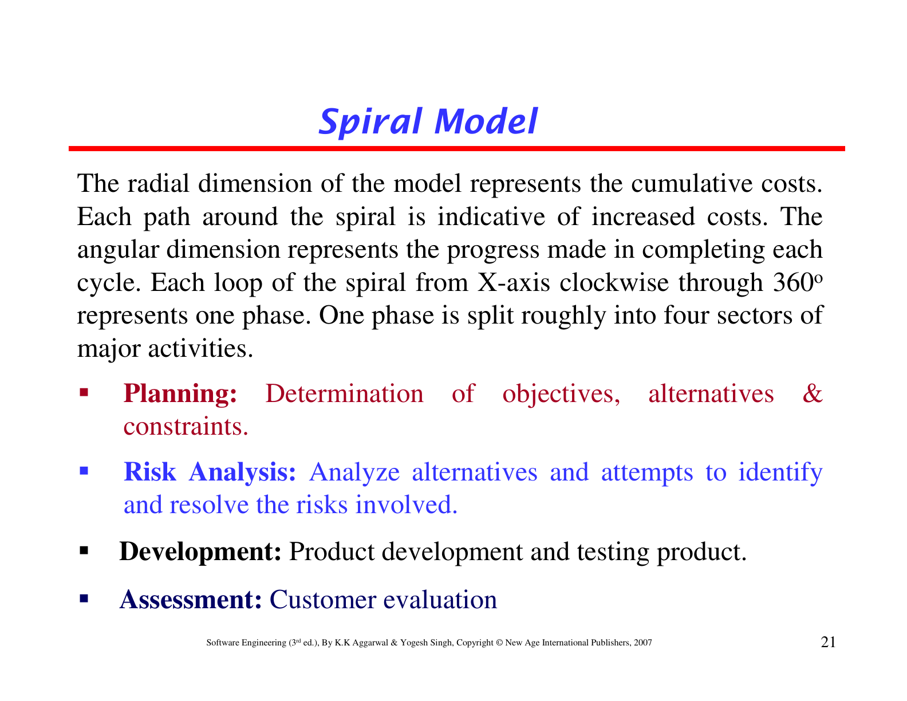
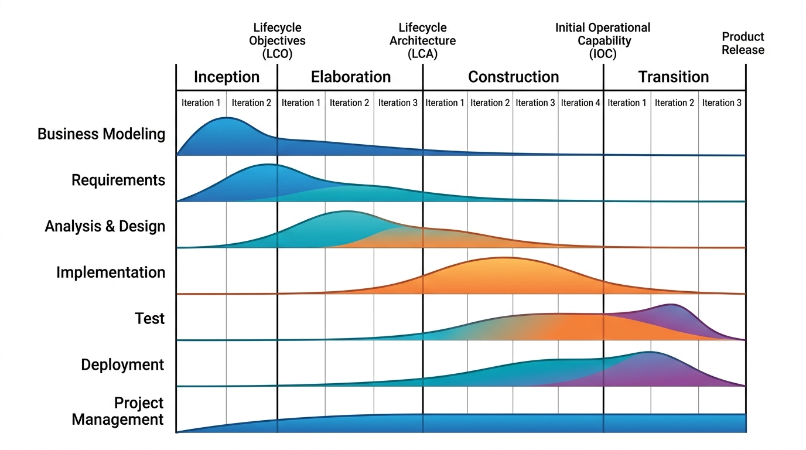
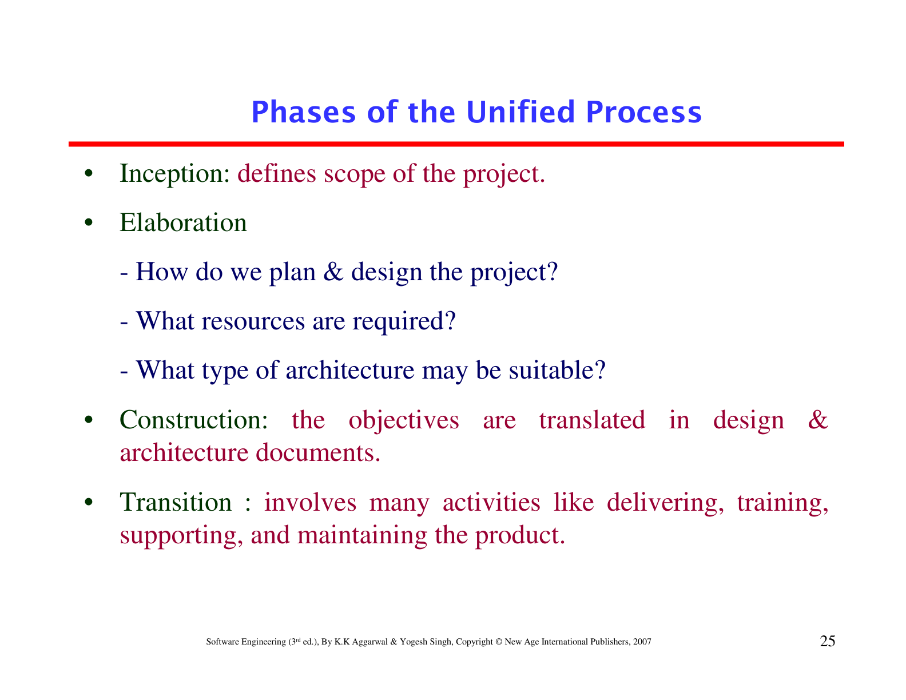
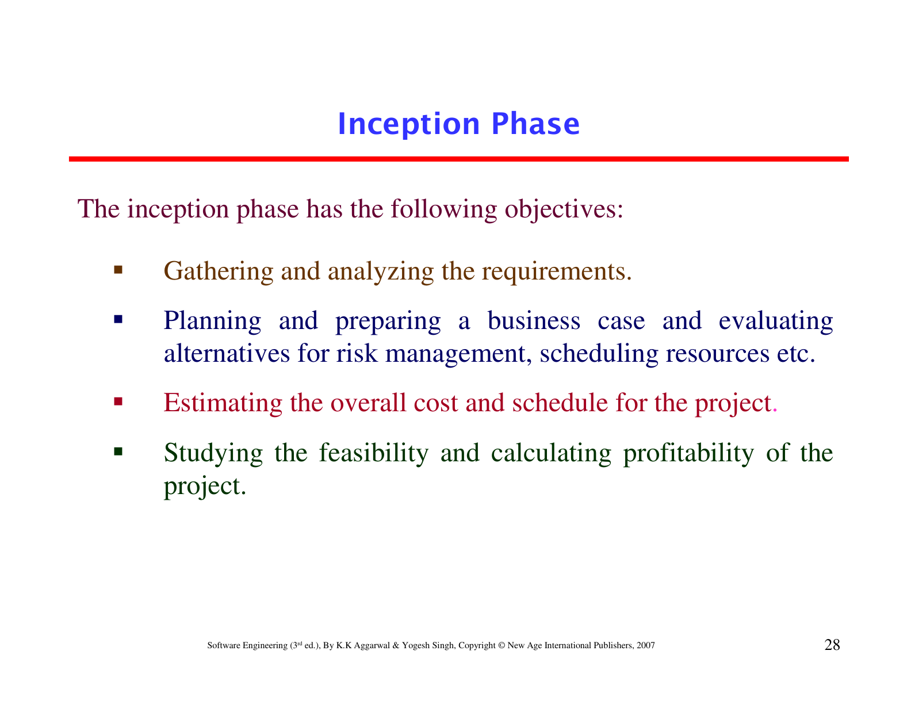

# Chapter 2 — T4 Diagrams & Architectural Models Pack

This pack contains the **architectural drawing, process geometry, and figure interpretation exercises** from the primary course textbook (B.B. Agarwal et al., 2010, p. 52: Exercises 7 and 9, and the diagrammatic components of Exercise 8), along with critical diagram interpretation tasks from the K.K. Aggarwal & Yogesh Singh companion materials (Exercises 2.8, 2.10, and 2.20).

> **Inviolable Diagram Standard:**
> - Per vault governance, **no raw ASCII text art or pseudo-code blocks** are permitted. All architectural models and schematics are presented via high-resolution vector figures from primary course materials.
> - Source-grounded content is formatted in **bold**; synthesis and structural descriptions remain in plain text.
> - Detailed Arabic notes and exam traps are placed separately outside the English model answers.

---

### Exercise 07: Draw the schematic diagram of the waterfall model of software development. Also discuss its phases in brief.

**The Waterfall Model structures software engineering as an unbranching, linear cascade where the output of each preceding phase becomes the frozen input to the subsequent phase:**

**Brief Phase Discussion:**
1. **Feasibility Study:** Analyzes problem scope at a global level; evaluates organizational, economic, technical, and operational viability to produce the feasibility report.
2. **Requirements Analysis and Specification:** Elicits and documents customer requirements into the formal Software Requirements Specification (SRS), establishing what the system must do without describing how.
3. **Design and Specification:** Transforms the SRS into software architecture through High-Level (Architectural) Design and Low-Level (Detailed) Design.
4. **Coding and Module Testing:** Translates modular designs into source code adhering to programming standards, accompanied by unit testing and debugging.
5. **Integration and System Testing:** Progressively integrates modules into a unified system, validating adherence to the SRS via Alpha, Beta, and Acceptance testing.
6. **Delivery and Maintenance:** Installs the validated system at customer sites and performs long-term operational maintenance (corrective, adaptive, perfective, preventive).

> **ملاحظة الطالب والفخ الامتحاني:**
> - في كتاب أغروال (الشكل 2.3 ص.37)، شلال المراحل يبدأ بـFeasibility Study وينتهي بـDelivery and Maintenance. احفظ التتابع الخطي الصارم.
> - التغذية الراجعة (Feedback loops) في الشلال الكلاسيكي الصرف غير مسموحة؛ كل مرحلة تجمّد وثائقها قبل الانتقال للمرحلة التالية.

*Source: B.B. Agarwal et al. (2010), §2.2, pp. 36–40 (Figure 2.3); K.K. Aggarwal & Singh (2007) Slide 6.*

---

### Exercise 09: What is a prototype? Draw the schematic diagram of the prototyping model of software development. Also discuss its phases in brief.

**A prototype is an early, working approximation or exploratory mock-up of a software system built specifically to help customers and developers visualize, understand, and clarify uncertain requirements.** **In a classic throw-away prototyping paradigm, the prototype code is not intended to serve as the final delivered product; instead, the insights gained are used to write a stable SRS, after which the actual system is cleanly developed:**

**Brief Phase Discussion:**
1. **Communication (Initial Requirements Gathering):** Developer and customer meet to define overall objectives and identify known functional areas, noting elements where requirements are ambiguous.
2. **Quick Design:** Focuses rapidly on visible customer interactions, Graphical User Interface (GUI) layouts, input dialogues, and output report formats rather than back-end architecture.
3. **Construction of Prototype:** Fast assembly of the mock-up utilizing 4GL tools, existing code libraries, or rapid scripting fragments to produce an executable version quickly.
4. **Customer Evaluation of Prototype:** The customer interacts directly with the working mock-up, clarifying misinterpretations and identifying missing or unwanted features.
5. **Tuning and Requirements Refinement:** An iterative feedback loop where the design and prototype are adjusted until user expectations stabilize, forming the basis for the final SRS and production software.

> **ملاحظة الطالب والفخ الامتحاني:**
> - تعريف البروتوتايب: ليس المنتج النهائي، بل وسيلة استكشاف (Working model for requirements clarification).
> - انتبه لمصطلح Throw-away: الكود يُرمى بعد تثبيت المتطلبات في الـSRS، لأن كتابته السريعة تجعله غير صالح لمعايير الصيانة والأداء.

*Source: B.B. Agarwal et al. (2010), §2.3, pp. 41–44 (Figure 2.4); K.K. Aggarwal & Singh (2007) Slide 18.*

---

### Slide Exercise 2.8 & 2.10: Sketch a neat diagram of the spiral model. Explain process flow, radial dimension, angular dimension, and sectors.
*(Consolidated architectural exercise from B.B. Agarwal et al., 2010, §2.4 and K.K. Aggarwal & Singh, 2007, Slides 20–21)*

**The Spiral Model, formulated by Barry Boehm, is an evolutionary, risk-driven metamodel depicted across four Cartesian quadrants:**

**Process Geometry and Dimensional Interpretation:**
1. **The Radial Dimension:** **The radius vector from the origin represents the cumulative financial and resource costs incurred up to that point in the project.** As development progresses outward through successive loops, cumulative costs increase monotonically.
2. **The Angular Dimension:** **The angular rotation within each cycle represents the progress made along the process flow path within that cycle.** Each complete 360-degree rotation represents the completion of one life-cycle phase or release loop.
3. **Outward Process Flow (Exercise 2.10):** **As we move outward along the process flow path of the spiral model, the software being developed progresses from an abstract concept $\rightarrow$ to operational requirements $\rightarrow$ to preliminary architecture $\rightarrow$ to detailed design $\rightarrow$ to a fully verified, deliverable product release.** Simultaneously, uncertainty diminishes while investment commitment increases.

**The Four Quadrant Sectors (Slide 21 & Textbook p. 45):**
- **Quadrant 1 (Top-Left / Planning):** **Determine objectives, alternative architectural solutions, and project constraints.**
- **Quadrant 2 (Top-Right / Risk Analysis & Alternative Evaluation):** **Evaluate alternatives based on objectives and project risk perceptions.**
- **Quadrant 3 (Bottom-Right / Risk Resolution & Engineering Development):** **Develop strategies that resolve uncertainties and risks (using prototyping, benchmarking, and simulation), and develop/verify product modules.**
- **Quadrant 4 (Bottom-Left / Assessment & Next-Cycle Objectives):** **Customer evaluation of deliverables, and determining objectives to be fulfilled in the next cycle to complete the system.**

> **ملاحظة الطالب والفخ الامتحاني:**
> - احفظ الأبعاد الرياضية للشكل: Radial = التكلفة التراكمية (Cumulative Costs)؛ Angular = التقدم المنجز في الدورة (Process Progress).
> - في السلايد 21 تُسمى القطاعات: (Planning, Risk Analysis, Development, Assessment)؛ بينما في نص كتاب أغروال ص. 45 يُفصّل أن الربع الثاني يقيّم البدائل حسب المخاطر، والربع الثالث يطوّر استراتيجيات حل المخاطر كالبروتوتايب والمحاكاة، والربع الرابع يحدد أهداف الدورة القادمة.

*Sources: B.B. Agarwal et al. (2010), §2.4, pp. 44–46; K.K. Aggarwal & Singh (2007) Slides 20–21; Slides 46–47 (Ex 2.8, 2.10).*

---

### Slide Exercise 2.20 & 2.21: Explain the Unified Process architecture, its phases, and the outcome/work products of each phase.
*(Consolidated architectural exercise from K.K. Aggarwal & Singh, 2007, Slides 24–36)*

**The Unified Process (UP / RUP) organizes software development across two orthogonal dimensions: horizontal time phases (Inception, Elaboration, Construction, Transition) and vertical technical workflows (Requirements, Analysis, Design, Implementation, Test, Deployment):**

**Phases, Objectives, and Concrete Work Products (Outcomes):**

1. **Inception Phase:**
   - **Objectives:** Define project scope, determine business viability, and establish economic feasibility.
   - **Outcomes / Work Products:** **Vision document, initial business case, project glossary, high-level use-case survey, initial risk assessment, and preliminary project plan.**
   - *(Milestone: Lifecycle Objectives - LCO)*

2. **Elaboration Phase:**
   - **Objectives:** Establish an executable architectural baseline, address highest-risk technical elements, and specify detailed requirements.
   - **Outcomes / Work Products:** **Executable architectural prototype, completed use-case model, supplementary non-functional requirements, detailed software architecture document, development plan, and revised risk ledger.**
   - *(Milestone: Lifecycle Architecture - LCA)*

3. **Construction Phase:**
   - **Objectives:** Fully implement system components, manage resources, optimize code, and test all functional features.
   - **Outcomes / Work Products:** **Initial Operational Capability (IOC) software release (Beta version), operational user manuals, installation documentation, complete test suites, and test result logs.**
   - *(Milestone: Initial Operational Capability - IOC)*

4. **Transition Phase:**
   - **Objectives:** Conduct user acceptance beta testing, train end-users, tune performance, repair remaining defects, and transition software into production.
   - **Outcomes / Work Products:** **Final Software Product Release, customer acceptance agreement, finalized operational documentation, and post-deployment evaluation reports.**
   - *(Milestone: Product Release - PR)*

> **ملاحظة الطالب والفخ الامتحاني:**
> - ميّز بين ناتج Construction (نسخة بيتا IOC) وناتج Transition (النسخة النهائية للمستهلك Product Release).
> - احفظ المخطط ثنائي الأبعاد: المراحل الأفقية تمثل خط الزمن، بينما مجاري العمل العمودية تتكرر بنسب مختلفة داخل كل مرحلة.

*Sources: K.K. Aggarwal & Singh (2007) Slides 24–36; Slide 48 (Ex 2.20, 2.21); Sommerville (9th ed.), §2.4, pp. 67–69.*

---

## Retrieval set — Focused Active Recall Drill

**1. In the polar coordinate representation of the Spiral Model, how do radial and angular dimensions interact to define project state?**
> **The radial dimension measures cumulative cost incurred so far, while the angular dimension indicates progress achieved within the current 360-degree cycle.** As the process path traverses outward through successive loops, cumulative expenditure grows while software maturity, detail, and stability increase concurrently.
>
> *Source: K.K. Aggarwal & Singh (2007) Slides 19–21; B.B. Agarwal et al. (2010), §2.4, pp. 44–46.*

**2. In the Unified Process two-dimensional architecture, what distinguishes dynamic phases from static engineering workflows?**
> **Horizontal phases (Inception, Elaboration, Construction, Transition) define the chronological timeline marked by tangible business milestones.** Vertical engineering workflows (such as Requirements, Analysis, Design, and Implementation) represent technical disciplines executed concurrently across all phases with dynamically shifting effort distributions.
>
> *Source: K.K. Aggarwal & Singh (2007) Slides 24–36; Sommerville (9th ed.), §2.4, pp. 67–69.*
