# ASE CHAPTER 3: SOFTWARE REQUIREMENTS: ANALYSIS & SPECIFICATIONS
## T4 Architectural Diagrams & Visual Modeling Pack

<!-- Print-hidden (opening format/source note); retained for Markdown/reference use.
> **Course:** Advanced Software Engineering (CS603)  
> **Instructor:** Asst. Prof. Dr. Ali Fahim Ni'ma  
> **Source Hierarchy:** Primary: K.K. Aggarwal & Yogesh Singh (3rd ed., printed pp. 40–138) & Companion Slides (140 slides) | Secondary Reference: B.B. Agarwal et al. (2010, pp. 53–84)  
> **Scope:** Core visual models, architectural workflows, behavioral diagrams (Use Cases, DFDs), data models (ERDs, Data Dictionary), and validation processes. High-resolution rendered 2x-retina vector diagrams and publisher source figures. Zero ASCII art.
-->

---

### Section 1: Core Architectural & Process Models (5 Model Units)

### Diagram 01. The Four Core Requirements Engineering Activities (Figure 3.1)

**Name the input, the four core requirements-engineering activities, and the output shown in the figure.**

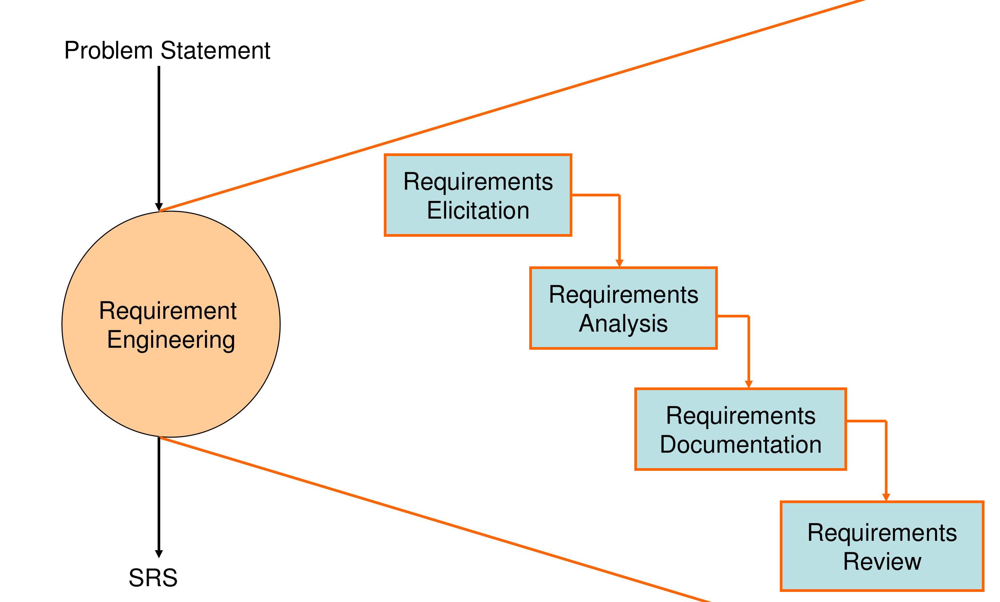

> **Process shown in the figure:**
>
> **Input:** Problem Statement.
>
> **Activities:** Requirements Elicitation → Requirements Analysis → Requirements Documentation → Requirements Review.
>
> **Output:** SRS.
>
> *Source: companion Slide 3; K.K. Aggarwal & Yogesh Singh (3rd ed.), Fig. 3.1, p. 41.*

> [!NOTE]
> الشكل يعرض ترتيب الأنشطة الأربع من دون أسهم رجوع؛ لا يوضّح وحده حلقات مراجعة أو قرار جدوى.

---

### Diagram 02. Use Case Model Architecture: Boundary, Actors, & Stereotypes

**Diagram and specify the structural architecture of a UML Use Case Model, illustrating system boundary, external actors, primary use cases, and the defining distinctions between `<<include>>` and `<<extend>>` relationships.**

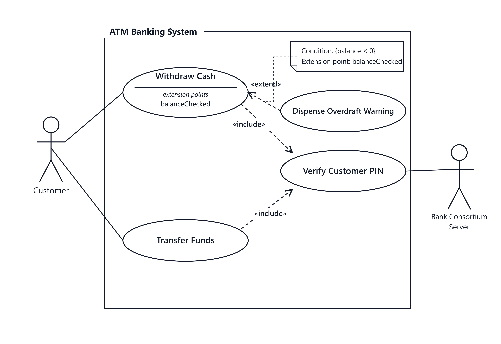

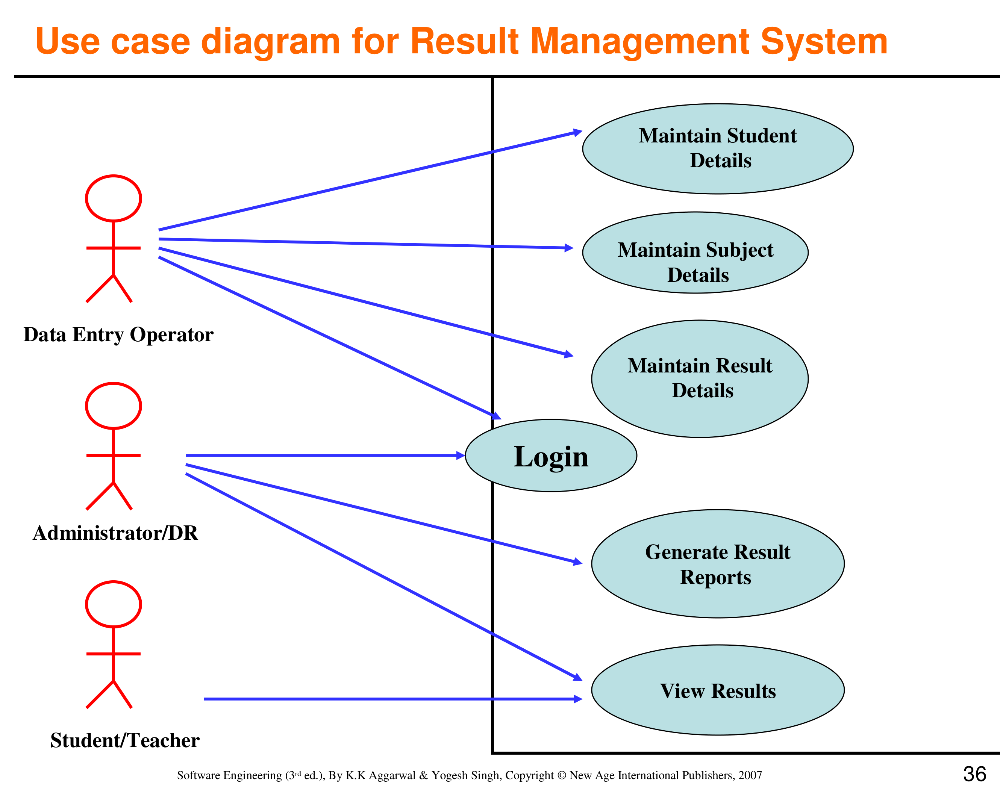

> **Structural & Behavioral Breakdown:**
>
> 1. **System Boundary:** The rectangular boundary encloses all automated software capabilities, explicitly separating internal functions from external entities.
> 2. **Primary and Secondary Actors:**
>     - `Customer` (Primary): Initiates interactions to achieve a business goal (`Withdraw Cash`, `Transfer Funds`).
>     - `Bank Consortium Server` (Secondary): External backend infrastructure that authenticates and processes transactions.
> 3. **The `<<include>>` Stereotype (Mandatory Dependency):**
>     - Unconditionally invoked whenever the base use case executes. Both `Withdraw Cash` and `Transfer Funds` unconditionally include `Verify Customer PIN`. The arrow points **from Base Use Case to Included Use Case**.
> 4. **The `<<extend>>` Stereotype (Conditional Extension):**
>     - Executed only if a specific condition is met at an extension point. `Dispense Overdraft Warning` extends `Withdraw Cash` only when the balance drops below zero. The arrow points **from Extending Use Case to Base Use Case**.
>
> *Source: K.K. Aggarwal & Yogesh Singh (3rd ed.), §3.3.4, pp. 58–61; companion Slide 36 for the system example; OMG UML 2.5.1 UseCases clause for include/extend semantics.*

> [!NOTE]
> **قاعدة السهم في الامتحان:**
>
> - في `<<include>>`: السهم ينطلق من الحالة الأصلية نحو الحالة التابعة (`Withdraw Cash` $\rightarrow$ `Verify PIN`).
> - في `<<extend>>`: السهم ينطلق من الحالة التوسعية الاختيارية عائداً إلى الحالة الأصلية (`Overdraft Warning` $\rightarrow$ `Withdraw Cash`).

---

### Diagram 03. Data Flow Diagram (DFD): Symbols and Separate Examples

**Name the four DFD symbols shown, then identify what the publisher examples on Slides 83 and 86 each represent.**

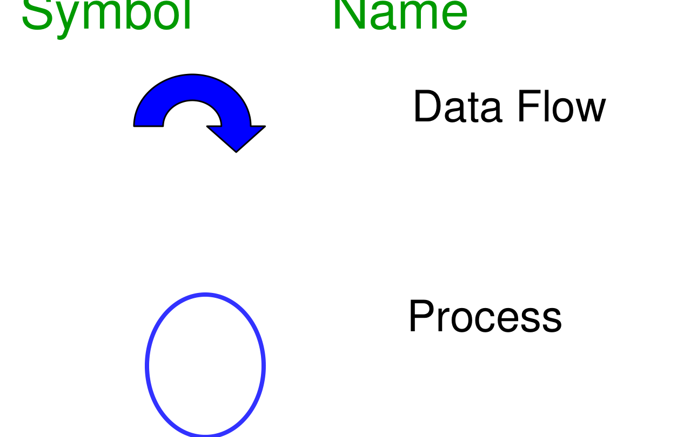

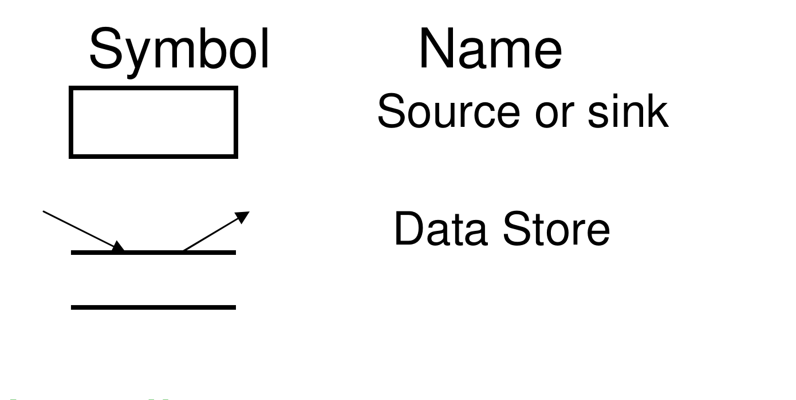

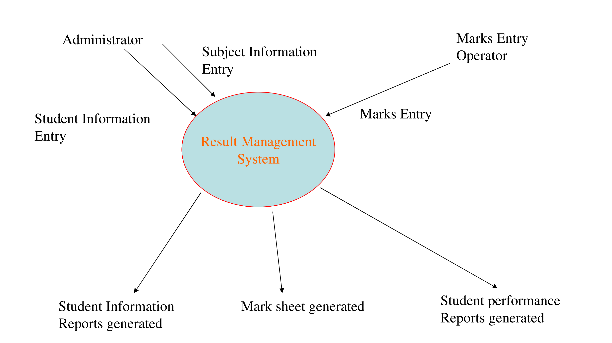

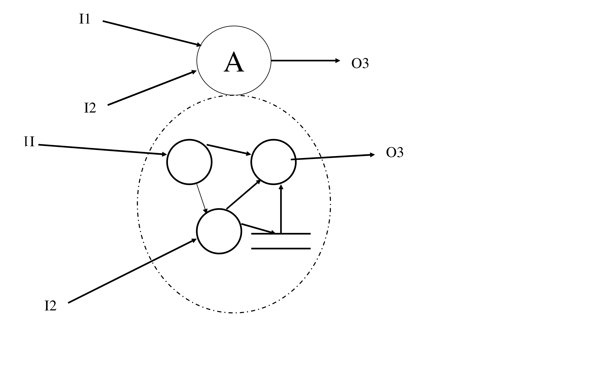

> **The four symbols:**
>
> - **Process:** circle or bubble.
> - **Data flow:** directed arrow.
> - **Data store:** open or parallel-line symbol.
> - **External entity:** rectangle.
>
> Slide 83 shows a Results Management context diagram. Slide 86 shows a separate generic context-to-levelled example using `I1`, `I2`, and `O3`. They are different examples, not a parent diagram and its balanced decomposition. In a genuine decomposition, the child diagram must preserve the parent process's external input and output flows.
>
> *Source: companion Slides 83–86; K.K. Aggarwal & Yogesh Singh (3rd ed.), §3.5.1, pp. 61–65.*

> [!NOTE]
> لا نخلط بين مخطط السياق وDFD المستوى الأول في الشريحة 86 وبين مخطط النتائج المستقل في الشريحة 83؛ الشريحتان لا تعرضان زوجاً متوازناً واحداً.

---

### Diagram 04. Entity-Relationship (ER) Architecture & Associative Entity Decomposition

**Diagram the core components of an Entity-Relationship Diagram (ERD), illustrate relationship degrees (Unary, Binary, Ternary), and show one relational mapping option for a Many-to-Many (M:N) relationship.**

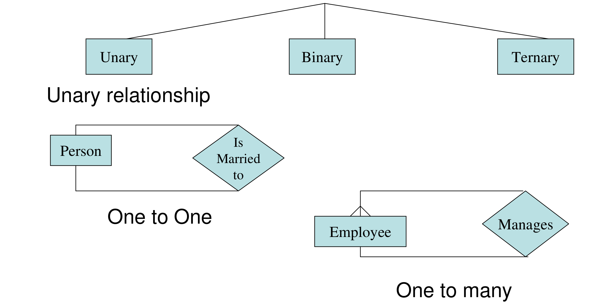

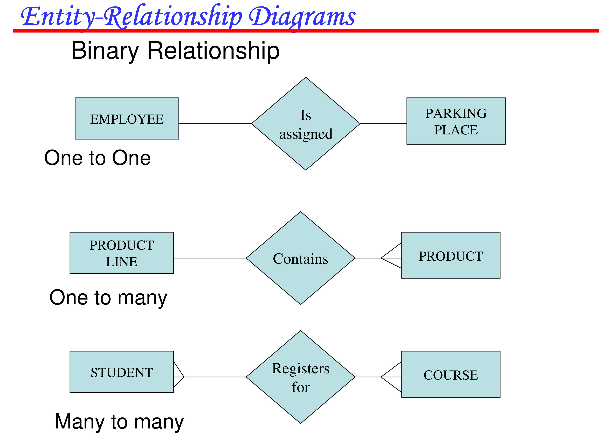

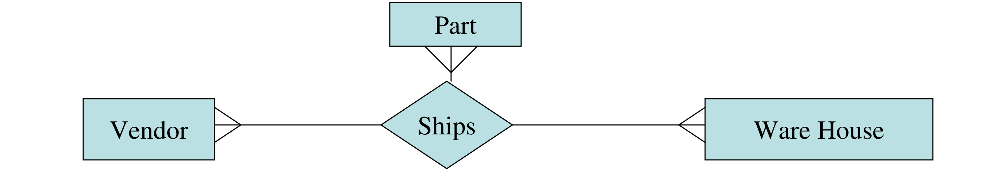

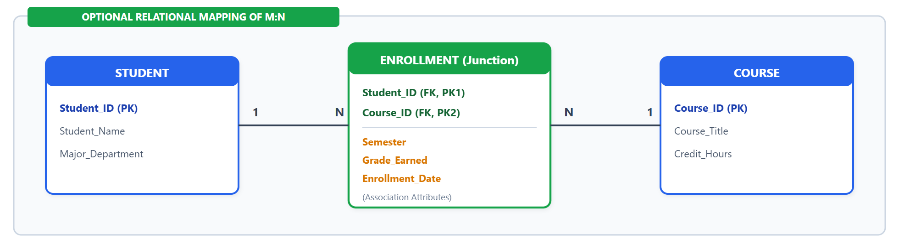

> **Structural & Relational Walkthrough:**
>
> 1. **Core ERD Constructs:**
>     - **Entity (Rectangle):** Real-world object having independent existence (`STUDENT`, `COURSE`).
>     - **Attribute (Ellipse):** Properties describing an entity (`Student_Name`, `Credit_Hours`).
>     - **Relationship (Diamond):** Association between entity instances.
> 2. **Relationship Degrees:**
>     - **Unary (Degree 1):** Associating instances of the same entity type (an `EMPLOYEE` manages other `EMPLOYEE`s).
>     - **Binary (Degree 2):** Associating instances of two distinct entity types (`STUDENT` and `COURSE`).
>     - **Ternary (Degree 3):** Simultaneous association among three entity types (`DOCTOR`, `PATIENT`, `MEDICATION`).
> 3. **A Relational Implementation of M:N:**
>     - The conceptual ER model can show a direct Many-to-Many relationship, including attributes of that relationship.
>     - When mapping that relationship to relational tables, one common implementation is an **Associative Entity / Junction Table (`ENROLLMENT`)** with foreign keys such as `(Student_ID, Course_ID)` and relationship attributes such as `Grade`, `Semester`, or `Registration_Date`. This is a relational mapping option, not a mandatory ER-diagram rule.
>
> *Source: K.K. Aggarwal & Yogesh Singh (3rd ed.), §3.5.2, pp. 66–68; companion Slides 89–95.*

> [!NOTE]
> **عند التحويل إلى جداول علائقية:** يمكن تمثيل علاقة (M:N) بأحد الخيارات باستخدام كيان رابط (*Associative Entity*) يحمل مفاتيح الكيانين وخصائص العلاقة، مثل الدرجة أو تاريخ التسجيل.

---

### Diagram 05. Requirements Review & Validation Process Workflow (Figure 3.21)

**List the six stages of the Requirements Review Process in the order shown.**

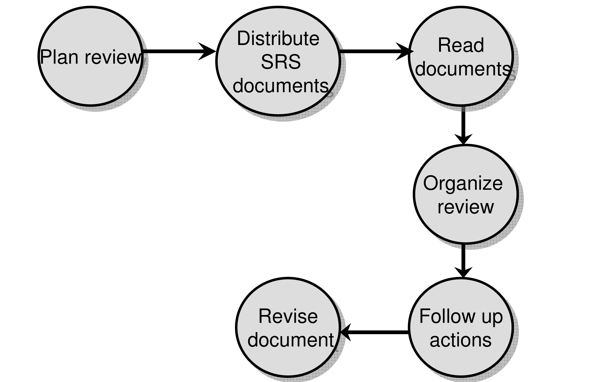

> **Six stages:**
>
> 1. Plan review.
> 2. Distribute SRS documents.
> 3. Read documents.
> 4. Organize review.
> 5. Follow up actions.
> 6. Revise document.
>
> *Source: companion Slide 113; K.K. Aggarwal & Yogesh Singh (3rd ed.), Fig. 3.21, pp. 92–94.*
>
> [!NOTE]
> الشرائح 114–115 تعرض إجراءات معالجة المشكلات وقائمة التحقق على نحو منفصل؛ الشكل هنا يعرض تسلسل المراحل الست فقط.

---

<!-- Print-hidden internal curriculum map; retained in Markdown for navigation.
## Curriculum Coverage Mapping Table

| Doctor's Vocabulary Heading | Covering Diagrams in Pack | Primary Knowledge Sources | Curriculum Gap Closed & Visual Value |
|:---|:---|:---|:---|
| **1. Requirements Engineering Process** | Diagram 01 | K.K. Aggarwal & Singh p. 41; Slide 3 | Shows the four activities from Problem Statement to SRS; no feedback loop is drawn in this figure. |
| **2. Types of Requirements** | — | K.K. Aggarwal & Singh pp. 45–48; Slides 6–9 | This diagram pack has no dedicated visual for requirement categories. |
| **3. Feasibility Study** | — | Not depicted in these figures | No feasibility gate is shown in Diagram 01. |
| **4. Requirements Elicitation** | Diagram 02 | K.K. Aggarwal & Singh pp. 58–61; Slides 27–50 | Visualizes Use Case boundaries, primary/secondary actors, and `<<include>>` vs `<<extend>>` arrows. |
| **5. Requirements Analysis & Modeling** | Diagram 03, Diagram 04 | K.K. Aggarwal & Singh pp. 61–68; Slides 83–95 | Shows DFD notation and separate source examples, plus ERD relationship degrees and an M:N mapping option. |
| **6. Requirements Specification (SRS)** | Diagram 01 | K.K. Aggarwal & Singh pp. 72–78; Slides 101–110 | Diagram 01 names SRS as the output; it does not show the SRS structure. |
| **7. Requirements Validation & Review** | Diagram 05 | K.K. Aggarwal & Singh pp. 92–94; Slides 112–115 | Diagram 05 shows the six-stage workflow; remediation actions and review checklist are separate material. |
-->

---

<!-- Print-hidden internal study instruction; retained for Markdown/reference use.
## Active Recall Self-Test Set

Use the questions earlier in this pack for active recall: cover each model answer, answer on paper, then uncover it. No extra prompts are added here because they repeat questions already covered in this pack.
-->
