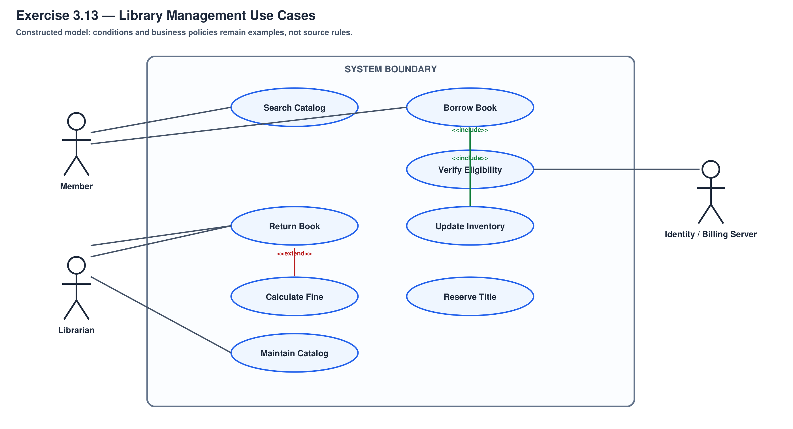
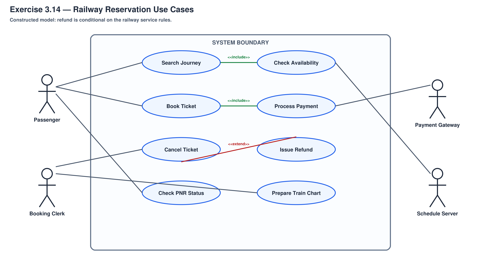
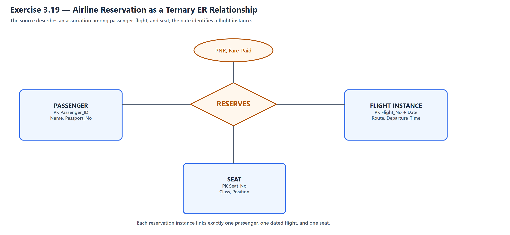
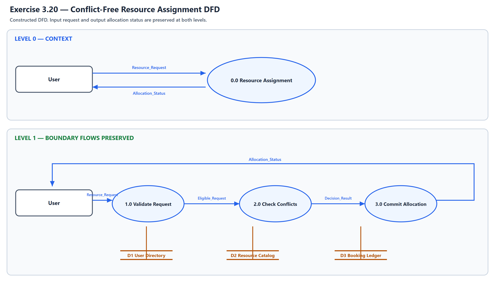
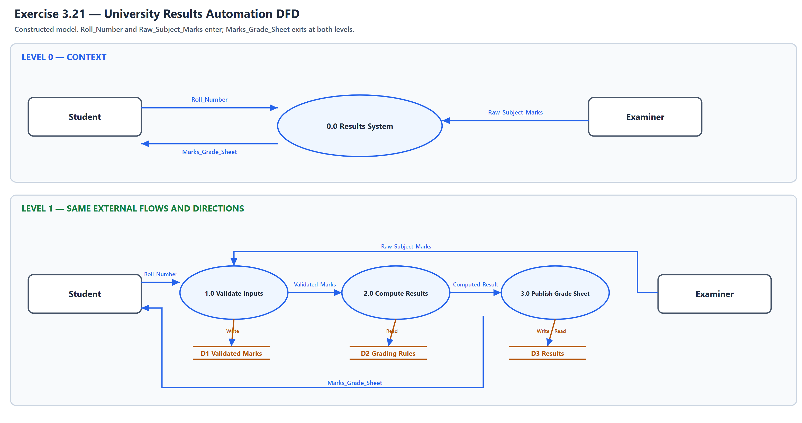
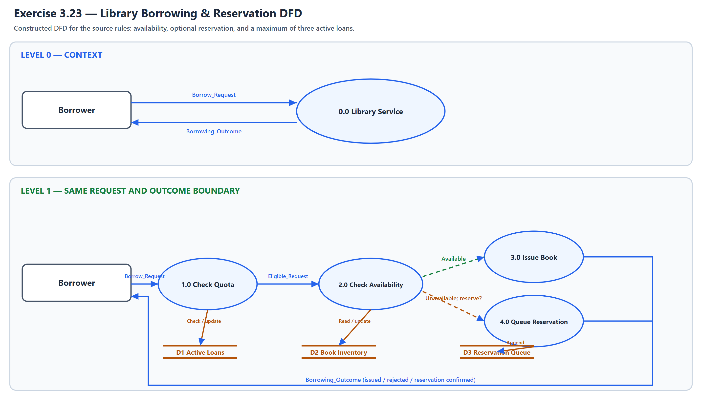
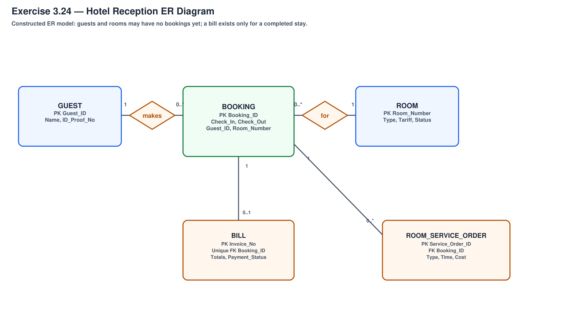

# ASE CHAPTER 3: SOFTWARE REQUIREMENTS: ANALYSIS & SPECIFICATIONS
## T5 Applied Engineering & System Creation Pack

<!-- Print-hidden (opening format/source note); retained for Markdown/reference use.
> **Course:** Advanced Software Engineering (CS603)  
> **Instructor:** Asst. Prof. Dr. Ali Fahim Ni'ma  
> **Source Hierarchy:** Primary: K.K. Aggarwal & Yogesh Singh (3rd ed., printed pp. 40–138) & Companion Slides (140 slides) | Secondary Reference: B.B. Agarwal et al. (2010, pp. 53–84)  
> **Applied Context:** Constructed system models (Library, Railway, Airline, Hotel, University Results) + synthetic SRS quality-audit practice. Zero ASCII art.
-->

<!-- Print-hidden (opening format/source note); retained for Markdown/reference use.
> **Model-answer note:** The textbook and slides provide the exercise prompts. Where a prompt leaves system rules unspecified, the worked design is a constructed example; it does not establish a textbook rule or a real institution's policy.
-->

---

### Section 1: Core Applied Textbook Systems & Scenarios (8 Items)

### Exercise 3.13. Library Management System: Problem Statement, Boundary, & Use Cases

<p class="no-break keep-next"><strong>For a Library Management System, design (i) a problem statement, (ii) its use-case diagram architecture, and (iii) formal structured use cases.</strong></p>



> **(i) Problem Statement:**
> A university library needs a system to manage its catalog, member borrowing, reservations, returns, and overdue fines. Members must be able to search for books and borrow eligible available copies; library staff must maintain catalog records and review circulation activity.
>
> **(ii) Use Case Architecture & Boundary:**
>
> - **System Boundary:** `Automated Library Information System (ALIS)`.
> - **Primary Actors:** `Member` (Student / Faculty), `Librarian`.
> - **Secondary External Actor:** `University Billing / Identity Server`.
> - **Core Use Cases:**
>     - `Search Catalog` (Public access)
>     - `Borrow Book` (Includes `Verify Member Eligibility` and `Update Inventory`)
>     - `Calculate Overdue Fine` (extends `Return Book` when the book is overdue)
>     - `Reserve Title` (Executed when zero available copies exist)
>     - `Catalog New Accession` (Restricted to Librarian)
>
> **(iii) Formal Structured Use Case (`Borrow Book`):**
>
> - **Use Case Name:** `Borrow Book`
> - **Primary Actor:** `Member` (facilitated by `Librarian` or Self-Checkout Kiosk)
> - **Preconditions:** The member is identified and eligible to borrow under the library's rules; a copy is available.
> - **Main Success Scenario (Happy Path):**
>     1. The member requests an available book.
>     2. The system checks the member's eligibility and confirms that a copy is available.
>     3. The system records the loan and sets a due date according to library policy.
>     4. The system updates the copy's status and confirms the loan to the member.
> - **Alternative & Exception Flows:**
>     - *Copy unavailable:* The system offers the member the option to reserve the book.
>     - *Borrowing limit reached:* The system rejects the loan and explains the restriction.
>     - *Account blocked by unpaid fines or another library rule:* The system explains what must be resolved before borrowing.
>
> *Prompt: K.K. Aggarwal & Yogesh Singh (3rd ed.), companion Slide 135. Use-case structure: §3.3.4, pp. 58–61. Worked design: constructed example.*

---

<div class="page-break"></div>

### Exercise 3.14. Railway Reservation System: Problem Statement, Actors, & Use Cases

**Consider the problem of a Railway Reservation System and design the following:**
**(i) Problem Statement**
**(ii) Use Case Diagram Architecture**
**(iii) Formal Structured Use Cases**
{: .keep-next }



> **(i) Problem Statement:**
> A railway agency needs an online system to manage train schedules, seat availability, passenger bookings, cancellations, and booking status. Passengers should be able to search for journeys, book available seats, and receive confirmation; staff should maintain schedule and service information.
>
> **(ii) Use Case Architecture & System Boundary:**
>
> - **System Boundary:** `Railway Reservation & Ticketing Engine`.
> - **Primary Actors:** `Passenger`, `Booking Clerk`.
> - **Secondary External Actors:** `Payment Gateway`, `Central Train Scheduling Server`.
> - **Core Use Cases:**
>     - `Search Journey` (includes `Check Availability`)
>     - `Book Journey Ticket` (includes `Process Payment`)
>     - `Cancel Ticket`
>     - `Issue Cancellation Refund` (extends `Cancel Ticket` when refund rules allow it)
>     - `Check PNR Status`
>     - `Prepare Train Chart` (scheduled staff/system task)
>
> **(iii) Formal Structured Use Case (`Book Journey Ticket`):**
>
> - **Use Case Name:** `Book Journey Ticket`
> - **Primary Actor:** `Passenger`
> - **Preconditions:** The passenger has selected a route and travel date and supplied the required booking details.
> - **Main Success Scenario:**
>     1. The passenger submits the journey and passenger details.
>     2. The system checks seat availability and temporarily holds an available seat while payment is processed.
>     3. The system invokes `<<include>> Process Payment` through the payment service.
>     4. If payment succeeds, the system confirms the booking, records it, and sends the passenger a ticket and booking reference.
> - **Extensions & Exceptions:**
>     - *No seat is available:* The system reports that the requested journey cannot be booked; it may offer a waitlist if the service supports one.
>     - *Payment fails:* The system cancels the pending booking, releases the temporary seat hold, and informs the passenger.
>
> *Prompt: K.K. Aggarwal & Yogesh Singh (3rd ed.), companion Slide 136. Use-case structure: §3.3.4, pp. 58–61. Worked design: constructed example.*

> [!NOTE]
> **قاعدة حجز المقاعد البرمجية:** حجز التذاكر في الأنظمة المتزامنة يعتمد على قفل مؤقت للمقعد (*Temporary Lock*) أثناء الدفع؛ فإذا فشلت بوابة الدفع يعود المقعد للمخزون فوراً لتجنب المقاعد المعلقة.

---

### Exercise 3.19. Airline Reservation E-R Modeling: Passenger, Flight, & Seat Associations

**An airline reservation is an association between a passenger, a flight, and a seat. Select a few pertinent attributes for each of these entity types and represent a reservation in an E-R diagram model.**
{: .keep-next }



> **Ternary E-R Model:**
>
> - `PASSENGER` (**Passenger_ID**, Full_Name, Passport_Number, Phone_Number)
> - `FLIGHT INSTANCE` (**Flight_Number, Flight_Date**, Origin, Destination, Departure_Time)
> - `SEAT` (**Seat_Number**, Class, Position)
> - A ternary `RESERVATION` relationship connects one passenger, one dated flight instance, and one seat. Relationship attributes may include `PNR`, `Booking_Time`, and `Fare_Paid`.
>
> **Cardinality and identity assumptions:**
>
> - One reservation instance refers to exactly one passenger, one flight instance, and one seat.
> - A passenger may make zero or many reservations; a dated flight may have zero or many reservations; a seat may be associated with many reservations across different flight dates.
> - To prevent double booking, assume a seat is assigned to at most one active reservation for a given dated flight. This is a business constraint on `(Flight_Number, Flight_Date, Seat_Number)`, not a general ER cardinality rule.
> - Treat the date as part of flight-instance identity because a flight number can operate on multiple dates.

> *Source: K.K. Aggarwal & Yogesh Singh (3rd ed.), §3.5.2, pp. 66–68; companion Slide 136.*

> [!NOTE]
> **قيد تشغيلي مفترض:** المقعد الواحد لا يُحجز مرتين على الرحلة ذات التاريخ المحدد. هذا قيد على بيانات الحجز، وليس قاعدة عامة لتعددية ER.

---

### Exercise 3.20. Conflict-Free Computer Resource Assignment System DFD

**A department of computer science has usual resources and usual users for these resources. A software is to be developed so that resources are assigned without conflict. Draw a DFD specifying the above system.**
{: .keep-next }



> **Functional Architecture & DFD Decomposition:**
>
> **Level-0 Context Diagram:**
>
> - **External Entity:** `User` (faculty member, researcher, or student); an administrator may act through the same system interface.
> - **Central Process:** `0.0 Resource Assignment & Scheduling System`.
> - **Input Flow:** `Resource_Request (User_ID, Resource_Type, Date, Time_Slot)`.
> - **Output Flow:** `Allocation_Status` (confirmation or rejection).
>
> **Level-1 Detailed Functional Processes:**
>
> 1. **Process 1.0: Validate User Eligibility & Request Format:**
>     - Accepts `Resource_Request`; checks `D1 User Directory` to verify active academic standing and resource quota privileges.
> 2. **Process 2.0: Conflict Detection & Schedule Matching:**
>     - Queries `D2 Resource Master Catalog` (listing Labs, Servers, Projectors, GPUs) and `D3 Schedule Booking Ledger`.
>     - Evaluates whether requested `Resource_ID` is free for `(Date, Time_Slot)`.
>     - *If available:* Computes assignment and passes to allocation process.
>     - *If conflict exists:* Formulates alternative available slots and triggers rejection/rescheduling notification.
> 3. **Process 3.0: Commit Allocation & Return Status:**
>     - Records an approved allocation in `D3 Schedule Booking Ledger`; returns `Allocation_Status` to the user whether the request is accepted or rejected.
>
> **Balancing & Conservation:**
> The context and Level-1 diagrams use the same external flows: `Resource_Request` enters from `User`, and `Allocation_Status` returns to `User`.
>
> *Source: K.K. Aggarwal & Yogesh Singh (3rd ed.), §3.5.1, pp. 61–65; companion Slide 137.*

> [!NOTE]
> **خوارزمية منع التضارب (Conflict-Free Guarantee):** قلب النظام يكمن في العملية 2.0؛ حيث يتم فحص جدول الحجوزات (`D3 Schedule Ledger`) بقفل متزامن للتأكد من عدم وجود حجز متداخل في نفس الفترة الزمنية قبل كتابة التأكيد.

---

### Exercise 3.21. University Result Preparation Automation System DFD

**Draw a DFD for result preparation automation system of B. Tech. courses (or MCA program) of any university. Clearly describe the working of the system. Also mention all assumptions made by you.**
{: .keep-next }



> **Operational Assumptions:**
>
> 1. Each semester offers a fixed curriculum of core and elective courses; for this constructed example, each subject has 40 internal and 60 external marks (100 total).
> 2. Minimum passing threshold is 40% in individual components and 50% aggregate.
> 3. Letter grades and Grade Point Averages (GPA) are calculated using standardized university conversion tables.
>
> **System Working & Functional Flow:**
>
> 1. **Marks Ingestion:** Faculty or examination evaluators enter raw internal and external assessment marks via roll numbers.
> 2. **Verification & Audit:** Marks are checked against maximum bounds (0–40, 0–60); anomalous entries are rejected.
> 3. **Result Calculation:** The engine computes total marks, maps scores to Grade Points, evaluates Pass/Fail/Backlog status, and calculates Semester Grade Point Average (SGPA).
> 4. **Tabulation & Publishing:** Generates an individual grade sheet for the student from the verified marks and calculated result.
>
> **Level-1 DFD Process Breakdown:**
>
> - **Process 1.0 (Validate Inputs):** Accepts `Roll_Number` from the student and `Raw_Subject_Marks` from the examiner; validates and stores the marks.
> - **Process 2.0 (Compute Results):** Applies the assumed grading rules to validated marks and stores the computed result.
> - **Process 3.0 (Generate Student Grade Sheet):** Formats and returns `Marks_Grade_Sheet` to the student using the computed result.
>
> *Source: K.K. Aggarwal & Yogesh Singh (3rd ed.), §3.5.1, pp. 61–65; companion Slide 137.*

> [!NOTE]
> **حدود المثال:** تقسيم 40/60 يظهر في نموذج الـSRS بالكتاب (ص. 124–125). عتبات النجاح وقواعد احتساب المعدل في هذا الحل افتراضات توضيحية؛ لا ينص عليها مثال الكتاب المذكور.

---

### Exercise 3.23. Library Book Borrowing & Reservation DFD with Business Constraints

**Draw a DFD for borrowing a book in a library which is explained below: "A borrower can borrow a book if it is available else he/she can reserve for the book if he/she so wishes. He/she can borrow a maximum of three books."**
{: .keep-next }



> **Functional Specification & Constraint Modeling:**
>
> **Level-1 DFD Processes & Data Stores:**
>
> 1. **Process 1.0: Check Borrower Eligibility & Quota Limit:**
>     - Input: `Borrower_ID` from `Borrower`.
>     - Reads: `D1 Borrower Master File` and counts current borrowed books in `D2 Circulation Active Loans`.
>     - **Constraint Check:** If $\text{Count} \ge 3$, dispatch `Quota_Exceeded_Notice` and terminate flow. If $\text{Count} < 3$, forward `Borrower_ID` to Process 2.0.
> 2. **Process 2.0: Check Book Inventory Availability:**
>     - Input: `Book_Accession_Number` from `Borrower`.
>     - Reads: `D3 Book Master Inventory`.
>     - **Branching Decision:**
>         - *Path A (Available):* Route to Process 3.0 (`Issue Book`).
>         - *Path B (Unavailable / Already Borrowed):* Prompt borrower with `Book_Not_Available_Notice` and offer option to route to Process 4.0 (`Process Reservation`).
> 3. **Process 3.0: Issue Book & Update Records:**
>     - Updates book status in `D3 Book Master Inventory` to `Borrowed`.
>     - Inserts new loan record in `D2 Circulation Active Loans` with due date.
>     - Outputs: `Issued_Book` and `Issue_Slip` to `Borrower`.
> 4. **Process 4.0: Queue Title Reservation:**
>     - If borrower accepts reservation offer:
>     - Appends `(Borrower_ID, Book_ID, Timestamp)` to `D4 Reservation Queue`.
>     - Outputs: `Reservation_Confirmation_Slip` indicating current position in queue.
>
> *Source: K.K. Aggarwal & Yogesh Singh (3rd ed.), §3.5.1, pp. 61–65; companion Slide 137.*

---

### Exercise 3.24. Hotel Reception Desk Management E-R Diagram Architecture

**Draw the E–R diagram for a hotel reception desk management system.**
{: .keep-next }



> **Core Entities, Attributes, & Relationships:**
>
> 1. **`GUEST` Entity:**
>     - Primary Key: `Guest_ID`
>     - Attributes: `Full_Name`, `ID_Proof_Type` (Passport / National ID), `ID_Proof_Number`, `Address`, `Contact_Number`
> 2. **`ROOM` Entity:**
>     - Primary Key: `Room_Number`
>     - Attributes: `Room_Type` (Single, Double, Suite), `Daily_Tariff`, `Floor_Number`, `Operational_Status` (Vacant, Occupied, Cleaning, Maintenance)
> 3. **`BOOKING` (Associative Entity):**
>     - Bridges `GUEST` and `ROOM` across time.
>     - Primary Key: `Booking_ID`; Foreign Keys: `Guest_ID`, `Room_Number`
>     - Attributes: `Check_In_Date`, `Check_Out_Date`, `Number_of_Occupants`, `Advance_Deposit`
> 4. **`BILL` Entity:**
>     - Primary Key: `Bill_Invoice_Number`
>     - Foreign Key: `Booking_ID`
>     - Attributes: `Room_Charges_Total`, `Service_Charges_Total`, `Taxes_Amount`, `Discount`, `Grand_Total`, `Payment_Status` (Paid, Unpaid), `Payment_Mode`
> 5. **`ROOM_SERVICE` Entity:**
>     - Primary Key: `Service_Order_ID`
>     - Foreign Key: `Booking_ID`
>     - Attributes: `Order_Timestamp`, `Service_Type` (Dining, Laundry), `Itemized_Cost`
>
> **Cardinality Constraints:**
>
> - `GUEST` to `BOOKING`: A guest has `0..*` bookings; each booking belongs to exactly one guest.
> - `ROOM` to `BOOKING`: A room has `0..*` bookings over time; each booking reserves exactly one room.
> - `BOOKING` to `BILL`: A booking has `0..1` finalized bill; each bill belongs to exactly one booking.
> - `BOOKING` to `ROOM_SERVICE`: One-to-Many (`0..*`) — a booking may accumulate zero or more service charges.
>
> *Source: K.K. Aggarwal & Yogesh Singh (3rd ed.), §3.5.2, pp. 66–68; companion Slide 137.*

> [!NOTE]
> **التصميم المعماري للفندق:** الخطأ الشائع هو ربط النزيل بالغرفة مباشرة؛ هذا غير صحيح لأن الغرفة يشغلها نزلاء مختلفون عبر الزمن. الكيان الرابط `BOOKING` هو الذي يحدد من يسكن في أي غرفة ومن أي تاريخ إلى أي تاريخ.

---

### Exercise 3.34. Concrete Construction of an Inconsistent and Incomplete SRS

**Construct an example of an inconsistent (incomplete) SRS.**
{: .keep-next }

> **Constructed Example Answer to Exercise 3.34 (Inconsistent and Incomplete SRS):**
>
> ```markdown
> [DEFECTIVE SPECIFICATION EXCERPT]
>
> Section 2.3: System Safety & Emergency Alert Rules
> Requirement SAF-01: When patient blood pressure systolic drops below 85 mmHg 
> or pulse exceeds 120 bpm, the bedside monitor shall sound an audible tone of 
> 75 dB and immediately dispatch an urgent network packet to the nursing station.
>
> Section 3.5: Night Shift Operating Modes
> Requirement NIT-04: Between 22:00 and 06:00, all bedside patient monitor audible 
> tones shall be muted completely to preserve patient sleep; alert messages shall 
> be visual only on the local screen.
>
> Section 4.1: Heart Rate Data Ingestion
> Requirement HR-02: The software shall sample heart rate readings from sensor 
> port A and display the updated numerical value on screen every 2 seconds.
>
> Section 5.2: Network Outage Recovery
> Requirement NET-08: The system shall be resilient to network disconnects.
> ```
>
> **Formal Defect Analysis:**
>
> 1. **Inconsistency (Contradiction) Defect:**
>     - `SAF-01` mandates that emergency vitals **must sound an audible alarm of 75 dB**.
>     - `NIT-04` contradicts this by stating that between 22:00 and 06:00 **all audible tones must be muted completely**.
>     - *Consequence:* If a patient experiences cardiac collapse at 02:00, the system encounters mutually conflicting requirements: sounding the alarm violates `NIT-04`, while muting it violates `SAF-01`.
>
> 2. **Incompleteness (Omission) Defect:**
>     - In `HR-02`, the specification defines normal sampling behavior, but **completely omits what happens if sensor port A disconnects, transmits corrupt packet noise, or delivers out-of-range impossible values** (e.g., negative pulse or zero voltage).
>     - In `NET-08`, the statement *"The system shall be resilient to network disconnects"* is completely incomplete: it does not define buffer size, how long data must be retained locally, or the synchronization protocol upon reconnect.
>
> *Source for the exercise prompt: K.K. Aggarwal & Yogesh Singh, Exercise 3.34; companion Slide 139. The hospital scenario and its requirements are an authored illustrative example.*

> [!NOTE]
> **مثال حي للامتحان:** تذكر هذا المثال دائماً: التناقض يظهر بين إطلاق جرس الإنذار الطبي وكتم الأصوات ليلاً، بينما النقص يظهر في إهمال سلوك النظام عند انقطاع حساس النبض تماماً.

---

<div class="page-break"></div>

### Section 2: Curriculum Gap-Closing Synthesis (Applied SRS Audit Drill)

### Synthesis 09. Synthetic SRS Quality Audit Drill

**For each fictional requirement below, identify the quality problem and write a clearer, verifiable version. The examples are authored for practice; they are not quotations or excerpts from student project files.**
{: .keep-next }

> **Practice cases and model answers:**
>
> 1. **Implementation detail:** *“The system shall be written in Java 17 and use MySQL.”* If these technologies are not externally mandated, this constrains design without stating the required system behavior. **Model answer:** *“The system shall store each student's record and retrieve it when an authorized user submits that student's ID.”* If a technology is mandated, document it as an approved constraint rather than treating it automatically as a defect.
> 2. **Ambiguity and verifiability:** *“Search shall be fast and user-friendly.”* **Model answer:** *“For the agreed test workload, the system shall return matching records within [approved response-time target] for at least [approved percentage] of searches.”* The stakeholders must set the values and define the test workload.
> 3. **Inconsistency:** *“A student passes if the total is at least 50/100.”* A second clause says passing also requires at least 25/40 internally and 30/60 externally. A student with 20 internal and 30 external satisfies the first clause but fails the second. **One possible resolution, if both component minima are intended:** *“A student passes if and only if the internal mark is at least 25/40 and the external mark is at least 30/60.”* This is an illustrative policy assumption, not a real university rule.
> 4. **Omission:** *“The system shall calculate semester GPA when Submit is clicked.”* The requirement omits what happens when grades are missing. **Model answer:** *“When Submit is clicked, the system shall check that a mark exists for every enrolled course. If any mark is missing, it shall identify the course and withhold the GPA; otherwise, it shall calculate and display the GPA using the institution-approved formula.”*
> 5. **Unverifiable absolute:** *“The system shall be completely secure and have zero downtime.”* **Model answer:** *“The system shall meet the security controls approved for its risk level and maintain at least [stakeholder-approved availability target] over the defined measurement period.”* The controls, target, exclusions, and measurement period must be agreed before acceptance testing.
>
> *Quality-criteria sources: IEEE Std 830-1998 and K.K. Aggarwal & Yogesh Singh (3rd ed.), §3.6.2, pp. 73–75. The five practice cases are authored examples, not source quotations.*

> [!NOTE]
> **مهارة فحص الـSRS الحقيقية:** في التدقيق المهني لوثائق الـSRS، ابحث دائماً عن:
>
> 1. إقحام أدوات البرمجة وقواعد البيانات في المتطلبات الوظيفية (*Design Infiltration*).
> 2. الكلمات غير القابلة للقياس مثل "سريع" و"آمن جداً" (*Ambiguity*).
> 3. النقص عند الحالات الاستثنائية (*Incompleteness*).

---

<!-- Print-hidden internal curriculum map; retained in Markdown for navigation.
## Curriculum Coverage Mapping Table

| Doctor's Vocabulary Heading | Covering Exercises in Pack | Primary Knowledge Sources | Curriculum Gap Closed & Applied Value |
|:---|:---|:---|:---|
| **1. Requirements Engineering Process** | Ex 3.13, 3.14 | K.K. Aggarwal & Singh pp. 58–61; Slides 135–136 | End-to-end operationalization of the RE process for complex transaction systems (Library, Railway). |
| **2. Types of Requirements** | Synthesis 09 | IEEE Std 830-1998; K.K. Aggarwal & Singh, §§3.2–3.2.1, pp. 45–46 | Synthetic practice distinguishing functional requirements from design constraints and quality attributes. |
| **3. Feasibility Study** | Ex 3.20 | K.K. Aggarwal & Singh pp. 61–65; Slide 137 | Models resource availability and conflict-free allocation feasibility constraints. |
| **4. Requirements Elicitation** | Ex 3.13, 3.14 | K.K. Aggarwal & Singh pp. 58–61; Slides 27–50 | Constructs formal multi-scenario Use Cases with explicit alternative and exception branches. |
| **5. Requirements Analysis & Modeling** | Ex 3.19, 3.20, 3.21, 3.23, 3.24 | K.K. Aggarwal & Singh pp. 61–68; Slides 136–137 | Comprehensive modeling drills: Airline ERD, Resource DFD, University Results DFD, Book Borrowing DFD, Hotel ERD. |
| **6. Requirements Specification (SRS)** | Ex 3.34, Synthesis 09 | K.K. Aggarwal & Singh, Exercise 3.34; §3.6.2, pp. 73–75; IEEE Std 830-1998 | Constructed practice examples apply verifiability, completeness, consistency, and design-independence criteria. |
| **7. Requirements Validation & Review** | Ex 3.34, Synthesis 09 | K.K. Aggarwal & Singh, Exercise 3.34; Slides 112–115 | The constructed examples practice finding inconsistency, omission, ambiguity, and unverifiable statements. |
-->

---

<!-- Print-hidden internal study instruction; retained for Markdown/reference use.
## Active Recall Self-Test Set

Use the questions earlier in this pack for active recall: cover each model answer, answer on paper, then uncover it. No extra prompts are added here because they repeat questions already covered in this pack.
-->
