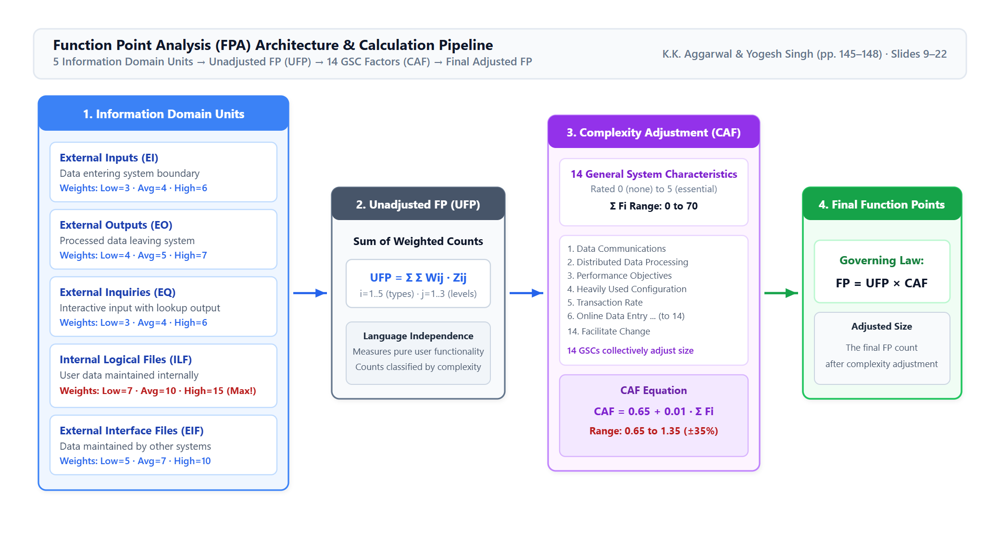
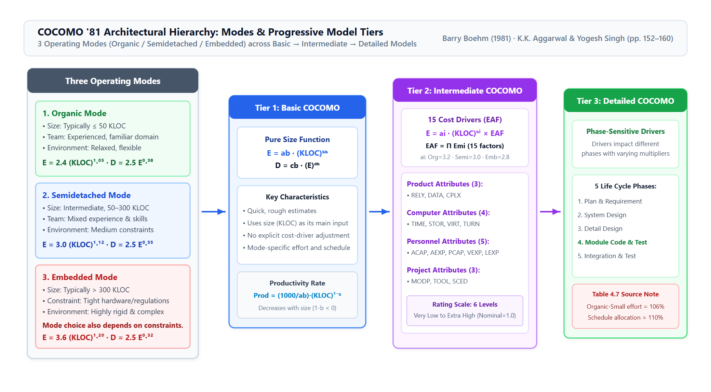
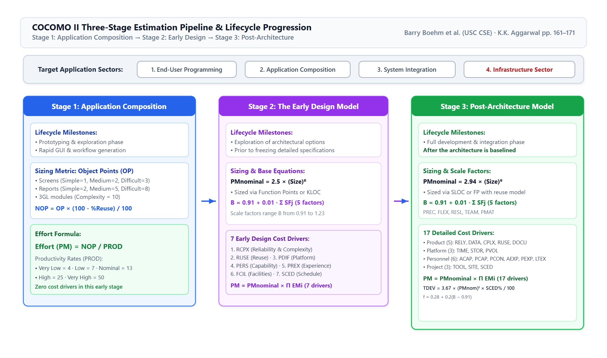
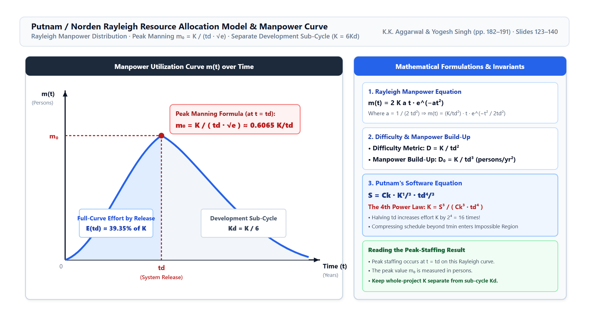
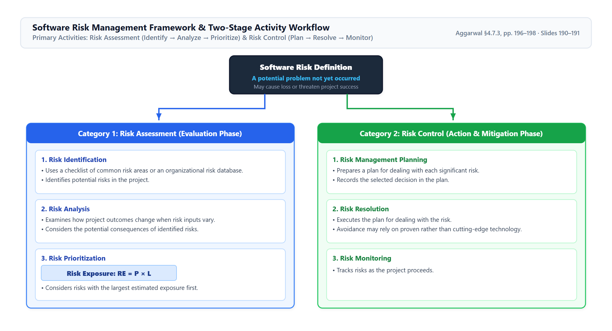

# Chapter 4 — T4 Architectural Diagrams & Visual Models Pack
<!--

This pack contains detailed visual walkthroughs and technical specifications for the **5 core architectural diagrams and mathematical curves** of Chapter 4. Every figure is rendered as a clean, publication-grade vector graphic at 2x retina resolution, completely replacing flawed legacy diagrams and eliminating ASCII art.

> **Academic & Invariant Standard:**
>
> - Technical walkthroughs and structural analyses are presented in **100% formal academic English**.
> - Mathematical relationships and textbook principles are formatted in **bold**; pedagogical framing remains in plain text.
> - Detailed Arabic notes (*ملاحظات الطالب والفخاخ الامتحانية*) are placed in dedicated callouts strictly outside the English walkthroughs.
> - The Rayleigh peak formula is shown with the source-supported **$\sqrt{e}$** term.
> - Citations distinguish primary textbook printed pages (pp. 139–202) from companion slide numbers (slides 1–207).

---

-->
## Section 1: Core Architectural & Mathematical Visual Units (5 Units)

### Diagram 01. Function Point Analysis (FPA) Architecture & Calculation Pipeline

**Diagram and specify the architectural pipeline of Albrecht's Function Point Analysis (FPA), illustrating how the 5 information domain characteristics, Unadjusted Function Points (UFP), and 14 General System Characteristics (CAF) synthesize into final adjusted Function Points.**
{: .keep-next }

> **Architectural & Mathematical Walkthrough:**
>
> - **1. Step 1 — Information Domain Units (5 Functional Characteristics):**
>    The system's functional boundary is decomposed into five components:
>    - **External Inputs (EI):** Transactions capturing external data that alters internal files (Weights: Low=3, Average=4, High=6).
>    - **External Outputs (EO):** Transactions generating processed reports or derived calculations leaving the system (Weights: Low=4, Average=5, High=7).
>    - **External Inquiries (EQ):** Interactive input-output lookups that retrieve data without altering internal state (Weights: Low=3, Average=4, High=6).
>    - **Internal Logical Files (ILF):** User-identifiable data groups maintained entirely inside the application boundary (Weights: Low=7, Average=10, High=15 — the highest weight in FPA).
>    - **External Interface Files (EIF):** Reference data files maintained by external systems across interfaces (Weights: Low=5, Average=7, High=10).
> - **2. Step 2 — Unadjusted Function Points (UFP) Calculation:**
>    Each identified component is multiplied by its complexity weight and summed across all five categories:
>    $$\text{UFP} = \sum_{i=1}^5 \sum_{j=1}^3 W_{ij} \cdot Z_{ij}$$
> - **3. Step 3 — Complexity Adjustment Factor (CAF) Scaling:**
>    The system is rated against **14 General System Characteristics (GSCs)** ($F_1$ to $F_{14}$) on a 0 to 5 scale ($\sum F_i$ ranges from $0$ to $70$). The Complexity Adjustment Factor is computed as:
>    $$\text{CAF} = 0.65 + 0.01 \times \sum_{i=1}^{14} F_i$$
>    This linearly scales the baseline UFP within a bounded range of **$0.65$ to $1.35$ ($\pm 35\%$)**.
> - **4. Step 4 — Final Function Points & Metrics:**
>    The final adjusted size is computed as $\text{FP} = \text{UFP} \times \text{CAF}$. The output is the adjusted function-point size estimate. Any later use in productivity or quality measures requires separately defined project data
>
> *Source: K.K. Aggarwal & Yogesh Singh (3rd ed.), §4.3.2, pp. 145–148; Companion Slides 9–22.*

> [!NOTE]
> **ملاحظة الطالب والفخ الامتحاني:**
>
> - في الامتحان، احرص على تذكر أوزان المستوى المتوسط (Average): المدخلات 4، المخرجات 5، الاستعلامات 4، الملفات الداخلية 10، ملفات الواجهات 7.
> - معامل التعديل (CAF) لا يمكن أن يقل عن 0.65 ولا أن يزيد عن 1.35؛ فإذا حصلت على رقم خارج هذا النطاق فاعلم أن حساباتك خاطئة.

---

### Diagram 02. COCOMO '81 Architectural Hierarchy: Modes & Model Tiers

**Diagram and explain the structural hierarchy of Barry Boehm's COCOMO '81 model, showing the progression across the three operating modes and three model tiers.**
{: .keep-next }

> **Architectural Breakdown:**
>
> - **1. The Three Operating Modes (Environmental Complexity):**
>    - **Organic Mode:** Typically smaller projects with experienced teams, familiar domains, and relatively flexible constraints.
>      $$\text{Effort: } E = 2.4 (\text{KLOC})^{1.05} \text{ PM}, \quad \text{Schedule: } D = 2.5 (E)^{0.38} \text{ Months}$$
>    - **Semidetached Mode:** Typically intermediate projects with mixed team experience and constraints.
>      $$\text{Effort: } E = 3.0 (\text{KLOC})^{1.12} \text{ PM}, \quad \text{Schedule: } D = 2.5 (E)^{0.35} \text{ Months}$$
>    - **Embedded Mode:** Projects operating under tight hardware, software, or operational constraints.
>      $$\text{Effort: } E = 3.6 (\text{KLOC})^{1.20} \text{ PM}, \quad \text{Schedule: } D = 2.5 (E)^{0.32} \text{ Months}$$
> - **2. Tier 1 — Basic COCOMO:** Single-variable power function of size alone. Useful as an initial estimate when only size and mode are available.
> - **3. Tier 2 — Intermediate COCOMO:** Modifies nominal effort by the **Effort Adjustment Factor (EAF)** derived from **15 cost drivers** grouped into Product (3), Computer (4), Personnel (5), and Project (3) attributes:
>    $$E = a_i (\text{KLOC})^{b_i} \times \prod_{j=1}^{15} EM_j \quad (a_{\text{organic}}=3.2, a_{\text{semi}}=3.0, a_{\text{embedded}}=2.8)$$
> - **4. Tier 3 — Detailed COCOMO:** Acknowledges that cost drivers impact phases unevenly. Employs **phase-sensitive effort multipliers** to allocate effort by phase. Table 4.7 includes a Plan & Requirement row and reports raw Organic-Small percentages that sum to 106% for effort and 110% for schedule; it should not be presented as a normalized five-phase 100% distribution.
>
> *(Table 4.7 source values are preserved as printed: the listed Organic-Small effort entries sum to 106%, and the schedule entries sum to 110%.)*
>
> *Source: K.K. Aggarwal & Yogesh Singh (3rd ed.), §4.4.1–§4.4.3, pp. 152–160; Companion Slides 41–65.*

> [!NOTE]
> **ملاحظة الطالب والفخ الامتحاني:**
>
> - لاحظ أن معامل الأساس ($a_i$) في Intermediate COCOMO يختلف عن ($a_b$) في Basic:
>   - في Organic: يتحول المعامل من 2.4 إلى 3.2.
>   - في Semidetached: يبقى 3.0.
>   - في Embedded: يتحول من 3.6 إلى 2.8.
> - الأس ($b$) يبقى ثابتاً (1.05، 1.12، 1.20) في كلا النموذجين.

---

### Diagram 03. COCOMO II Three-Stage Lifecycle Estimation Pipeline

**Diagram the three estimation stages of COCOMO II, illustrating lifecycle milestones, sizing metrics, scale factor mechanics, and cost driver allocations.**
{: .keep-next }

> **Lifecycle Pipeline Breakdown:**
>
> - **1. Target Project Categories (Top Banner):**
>    COCOMO II identifies four application categories: End-User Programming, Application Composition, System Integration, and the **Infrastructure Sector** (deep systems software such as OS, DBMS, compilers).
> - **2. Stage 1 — Application Composition Model:**
>    - **When Applied:** Prototyping and UI exploration phase.
>    - **Sizing:** **Object Points (OP)** derived from screen, report, and 3GL module counts, adjusted for reuse: $\text{NOP} = \text{OP} \times (100 - \% \text{Reuse}) / 100$.
>    - **Effort Equation:** $\text{Effort (PM)} = \frac{\text{NOP}}{\text{PROD}}$, where PROD ranges from 4 (Very Low) to 50 (Very High).
> - **3. Stage 2 — The Early Design Model:**
>    - **When Applied:** High-level architectural exploration before detailed subsystem specifications are frozen.
>    - **Sizing:** Unadjusted Function Points (UFP) converted to KLOC.
>    - **Base Formula:** $\text{PM}_{\text{nominal}} = 2.5 \times (\text{Size})^B$, where exponent $B$ is derived from **5 Scale Factors** ($SF_j$):
>      $$B = 0.91 + 0.01 \times \sum_{j=1}^5 SF_j \quad (B \text{ ranges from } 0.91 \text{ to } 1.23)$$
>    - **Cost Drivers:** Adjusted using **7 Early Design Effort Multipliers**: RCPX, RUSE, PDIF, PERS, PREX, FCIL, SCED.
> - **4. Stage 3 — Post-Architecture Model:**
>    - **When Applied:** Full development and integration phase after software architecture is baselined.
>    - **Sizing:** Source Lines of Code (SLOC) or Function Points with comprehensive reuse formulas.
>    - **Cost Drivers:** Adjusted using **17 detailed Post-Architecture Cost Drivers** spanning Product (5), Platform (3), Personnel (6), and Project (3) attributes.
>    - **Schedule Formula:** $\text{TDEV} = [3.67 \times (\text{PM}_{\text{nominal}})^F] \times \frac{\text{SCED\%}}{100}$, where $F = 0.28 + 0.2(B - 0.91)$.
>
> *Source: K.K. Aggarwal & Yogesh Singh (3rd ed.), §4.5, pp. 161–171; Companion Slides 73–86.*

> [!NOTE]
> **ملاحظة الطالب والفخ الامتحاني:**
>
> - في COCOMO II، عوامل المقياس الخمسة (PREC, FLEX, RESL, TEAM, PMAT) تُستخدم في كل من مرحلة Early Design ومرحلة Post-Architecture لحساب الأس $B$.
> - الاختلاف بين المرحلتين يكمن في محركات الكلفة: 7 محركات مجمعة في Early Design مقابل 17 محركاً مفصلاً في Post-Architecture.

---

### Diagram 04. Putnam / Norden Rayleigh Resource Allocation Model & Curve

**Diagram and mathematically specify the Putnam Resource Allocation Model, illustrating the Rayleigh manpower curve, the peak-manning point $m_0$, cumulative effort by $t_d$, the separate development sub-cycle, and the fourth-power schedule law.**
{: .keep-next }

> **Mathematical & Visual Walkthrough:**
>
> - **1. The Rayleigh Manpower Equation:**
>    Manpower utilization $m(t)$ over time is represented by the Norden/Rayleigh staffing equation:
>    $$m(t) = 2 K a t \cdot e^{-at^2}$$
>    Substituting the shape parameter $a = \frac{1}{2 t_d^2}$ yields:
>    $$m(t) = \frac{K}{t_d^2} \cdot t \cdot e^{-\frac{t^2}{2 t_d^2}}$$
> - **2. Peak Manning Verification (At $t = t_d$):**
>    Setting $t = t_d$ yields maximum team staffing:
>    $$m_0 = m(t_d) = \frac{K}{t_d^2} \cdot t_d \cdot e^{-1/2} = \mathbf{\frac{K}{t_d \sqrt{e}}} \approx \mathbf{0.6065 \frac{K}{t_d}}$$
>    **Formula Check:** The peak is $m_0 = \frac{K}{t_d\sqrt{e}}$. Example 4.12 (printed p. 184) uses $K=95$ person-years and $t_d=1.75$ years, giving about 33 persons. Example 4.13 (printed p. 185) uses $K=600$ person-years and $t_d=3.5$ years, giving about 104 persons. Both source examples confirm the radical.
> - **3. Effort accumulated by release versus development sub-cycle:**
>    Integrating the full-project curve to $t_d$ gives $E(t_d)=K(1-e^{-1/2})\approx0.3935K$. Total development-sub-cycle effort is separately defined by $K=6K_d$; do not label these two quantities as the same.
> - **4. Governing Metrics:**
>    - **Difficulty Metric:** $D = \frac{K}{t_d^2}$ (persons/year).
>    - **Manpower Build-Up Metric:** $D_0 = \frac{K}{t_d^3}$ (persons/year$^2$).
>    - **Putnam's Software Equation & 4th Power Law:**
>      $$S = C_k \cdot K^{1/3} \cdot t_d^{4/3} \implies K = \frac{S^3}{C_k^3 \cdot t_d^4} \implies \mathbf{K \propto \frac{1}{t_d^4}}$$
>      Halving delivery time increases effort by $2^4 = 16$ times!
>
> *Source: K.K. Aggarwal & Yogesh Singh (3rd ed.), §4.6, printed pp. 182–191; Companion Slides 123–140, 149–165.*

> [!NOTE]
> **ملاحظة الطالب والفخ الامتحاني:**
>
> - تأكد دائماً من كتابة الجذر التربيعي لـ $e$ في قانون ذروة التوظيف: $m_0 = \frac{K}{t_d \sqrt{e}}$.
> - الصعوبة $D=K/t_d^2$، ومعدل بناء القوى العاملة $D_0=K/t_d^3$. والجهد التراكمي حتى $t_d$ على منحنى المشروع ($0.3935K$) يختلف عن جهد دورة التطوير $K_d=K/6$.

---

### Diagram 05. Software Risk Management Framework & Workflow

**Diagram the complete software risk management architecture, detailing the two primary categories (Risk Assessment and Risk Control), their six sequential sub-activities, and the quantitative Risk Exposure formula.**
{: .keep-next }

> **Architectural Breakdown:**
>
> - **1. Core Risk Definition:**
>    A risk is a problem that may cause loss or threaten project success but has not happened yet.
> - **2. Category 1 — Risk Assessment (Evaluation Phase):**
>    - **Risk Identification:** Uncovers possible threats using a checklist of common risk areas or an organizational database of previously identified risks.
>    - **Risk Analysis:** Examines how project outcomes might change when risk input variables change.
>    - **Risk Prioritization:** Orders risks by computing **Risk Exposure (RE)**:
>      $$\mathbf{\text{RE} = P \times L}$$
>      Give attention first to the risks with the largest estimated exposure.
> - **3. Category 2 — Risk Control (Mitigation & Monitoring Phase):**
>    - **Risk Management Planning:** Prepares a plan for dealing with each significant risk and records the decision.
>    - **Risk Resolution:** Executes the plan for dealing with the risk.
>    - **Risk Monitoring:** Tracks risks during the project.
>
> *Source: K.K. Aggarwal & Yogesh Singh (3rd ed.), §4.7.3, pp. 196–198; Companion Slide 190.*

> [!NOTE]
> **ملاحظة الطالب والفخ الامتحاني:**
>
> - احفظ التقسيم والأنشطة الستة كما تظهر في الشكل؛ الشريحة تعرض هيكل الأنشطة ولا تثبت حلقة تغذية راجعة أو RMMM.

---

## Topic-to-Question Map

| Diagram / Unit | Topic Area | Primary Course Sources | Key Visual Invariants & Formulas |
|:---|:---|:---|:---|
| **Diagram 01** | Size Estimation (FPA) | K.K. Aggarwal pp. 145–148; Slides 9–22 | 5 Domain Units, UFP weighted sum, 14 GSC factors ($\pm 35\%$), $\text{FP} = \text{UFP} \times \text{CAF}$. |
| **Diagram 02** | COCOMO '81 Architecture | K.K. Aggarwal pp. 152–160; Slides 41–65 | 3 Modes (Organic, Semi, Embedded), Basic vs Intermediate (15 drivers), Detailed phase-sensitive multipliers. |
| **Diagram 03** | COCOMO II Pipeline | K.K. Aggarwal pp. 161–171; Slides 73–86 | 4 application sectors, Stage 1 (Object Points/NOP), Stage 2 (Early Design), Stage 3 (Post-Architecture). |
| **Diagram 04** | Putnam Resource Model | K.K. Aggarwal printed pp. 182–191; Slides 123–140, 149–165 | Norden/Rayleigh Curve, Peak manning $m_0 = \frac{K}{t_d \sqrt{e}}$, full-curve cumulative effort by release, separate development sub-cycle, 4th-power law ($K \propto t_d^{-4}$). |
| **Diagram 05** | Software Risk Framework | K.K. Aggarwal pp. 196–198; Slides 190–191 | Risk Assessment and Risk Control, their six activities, and Risk Exposure $\text{RE} = P \times L$. |

---

<!--
## Active Recall Self-Test Set

Use the visual models in this pack for active recall: practice sketching the Rayleigh manpower curve with its peak formula and the COCOMO II three-stage pipeline on paper, then check against the vector diagrams to ensure flawless visual recall and mathematical precision.
-->
