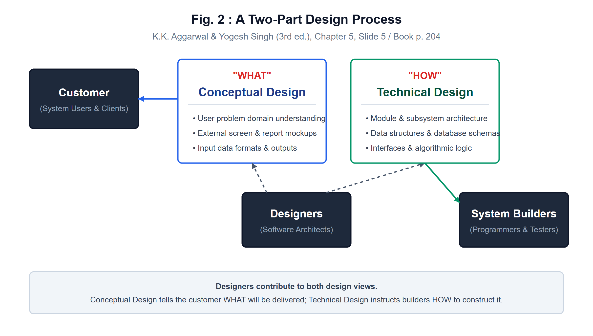
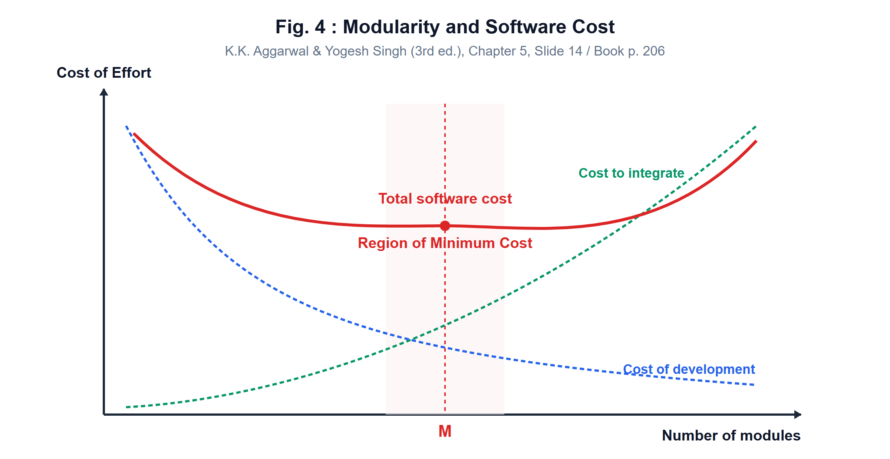
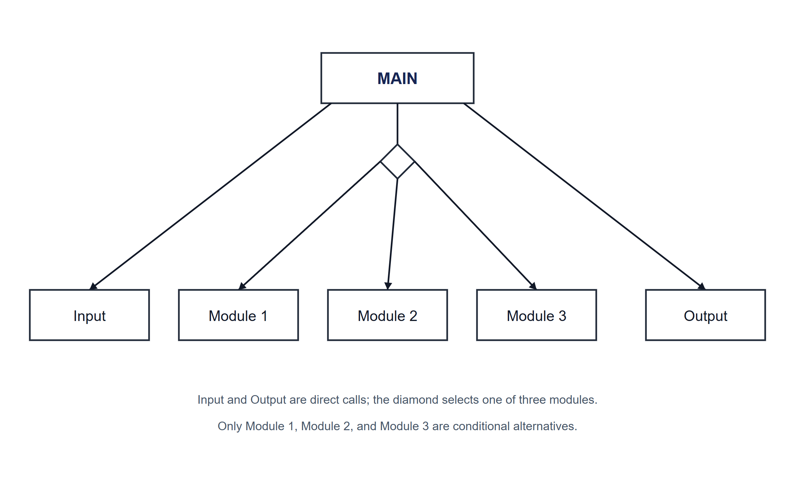
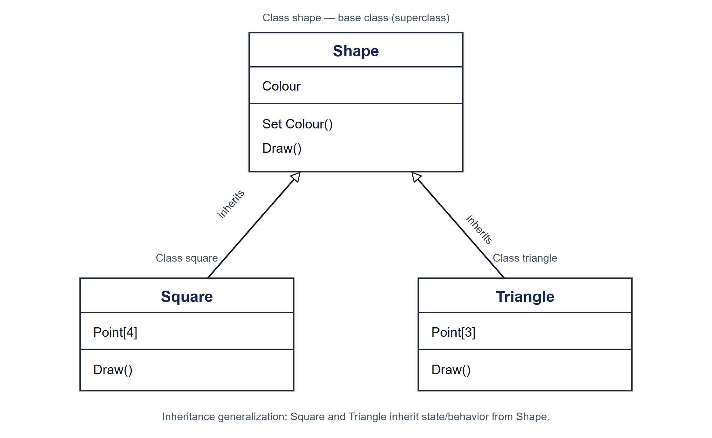
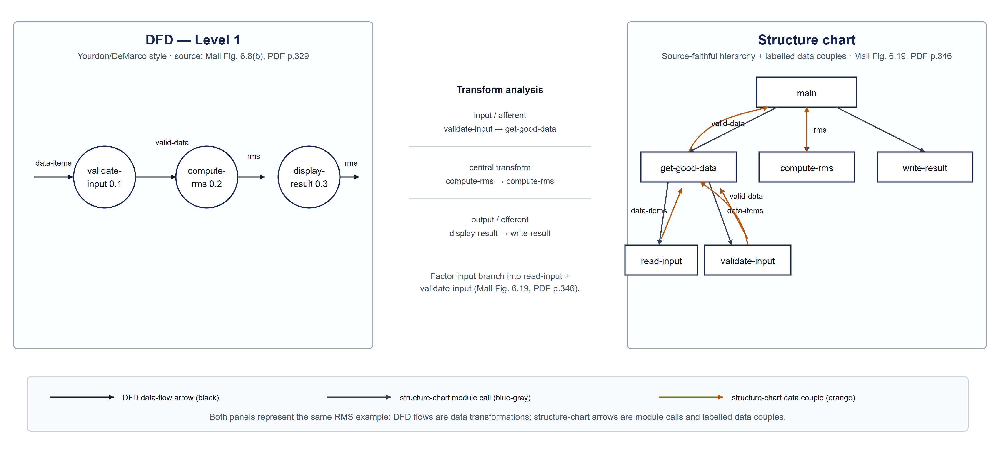

# Chapter 5: Software Design — Visual Models & Diagram Pack
<!--

> **Selected visual set:** Contains five selected Chapter 5 figures/redraws: the two-part design process, modularity/cost curve, transaction-centered structure chart, UML class generalization, and an RMS DFD-to-structure-chart teaching example. Other source figures and diagram families are listed in the diagram atlas but are not all reproduced here.

---

-->
## Section 1: The Process & Economic Dimensions of Design

### Q5.V01. Conceptual and Technical Design: Two-Part Design Process

> **Interpretation:** The figure separates Conceptual Design, which addresses **what** the system should do, from Technical Design, which addresses **how** it is built. Designers connect to both views. The customer is linked with Conceptual Design; System Builders are linked with Technical Design.
>
> *Source: K.K. Aggarwal & Yogesh Singh (3rd ed.), printed pp. 204–205; Companion Slide 5, Fig. 2.*
>
> [!NOTE]
> **ملاحظة الطالب:** الشكل يربط العميل بالتصميم المفهومي، ومطوري النظام بالتصميم الفني؛ والمصممون يعملون على جانبي التصميم.
---

### Q5.V02. Modularity and Software Cost Curve

> **Interpretation:** The horizontal axis is the number of modules and the vertical axis is cost of effort. The figure shows a decreasing development-cost curve, an increasing integration-cost curve, and total software cost with a minimum region marked **M**. The drawing is qualitative and gives no numerical scale.
>
> *Source: K.K. Aggarwal & Yogesh Singh (3rd ed.), printed p. 206; Companion Slide 14, Fig. 4.*
>
> [!NOTE]
> **ملاحظة الطالب:** فكرته نوعية: كلفة التطوير تقل مع زيادة التقسيم، وكلفة التكامل تزيد؛ وM تشير إلى منطقة أقل كلفة كلية في الرسم.
---

## Section 2: Structural Architecture & Notations

### Q5.V03. Transaction-Centered Structure Chart

> **Interpretation:** `MAIN` calls `Input` and `Output` directly. The conditional-call diamond selects one of `Module 1`, `Module 2`, or `Module 3`. A structure chart shows module calls and hierarchy; the diamond does not make Input or Output conditional alternatives.
>
> *Source: K.K. Aggarwal & Yogesh Singh (3rd ed.), printed pp. 216–220; Companion Slides 42, 44, Fig. 19.*
>
> [!NOTE]
> **ملاحظة الطالب:** الاختيار الشرطي يخص الوحدات الثلاث فقط؛ إدخال البيانات والإخراج استدعاءان مباشران من MAIN.
---

### Q5.V04. UML Class Generalization and Object-Oriented Inheritance Hierarchy

> **Architectural Analysis & Model Interpretation:**
>
> **1. UML Class Box Notation (Three Compartments):**
>
> Figure 23 follows standard OMG UML 2.5 notation, rendering classes as three-compartment rectangles:
>
> 1. **Top Compartment (Class Name):** Identifies the type (`Shape`, `Square`, `Triangle`).
> 2. **Middle Compartment (Attributes / State):** Declares data fields:
>    - `Shape`: `Colour` (common state shared by all shapes).
>    - `Square`: `Point[4]` (an array of 4 coordinate vertices specific to squares).
>    - `Triangle`: `Point[3]` (an array of 3 coordinate vertices specific to triangles).
> 3. **Bottom Compartment (Operations / Methods):** Declares callable behavior:
>    - `Shape`: `Set Colour()` and `Draw()`.
>    - `Square`: `Draw()`.
>    - `Triangle`: `Draw()`.
>
> **2. Generalization Relationship (Inheritance Semantics):**
>
> - The arrows with large, hollow (unfilled) triangular heads point from the derived subclasses (`Square` and `Triangle`) to the generalized superclass (`Shape`).
> - **Arrowhead Invariant:** In UML, the generalization arrowhead always points toward the more general classifier (base class), representing the conceptual "is-a" relationship.
>
> **3. Inheritance and Polymorphic Overriding:**
>
> - Both `Square` and `Triangle` inherit the `Colour` attribute and `Set Colour()` method from `Shape` without re-declaring them, promoting code reuse.
> - Both subclasses re-declare the `Draw()` operation. This models **polymorphic method overriding**: at runtime, when a client invokes `Draw()` on a reference of type `Shape`, dynamic dispatch invokes the specific rendering logic of the concrete object (`Square::Draw()` or `Triangle::Draw()`).
>
> *Source: K.K. Aggarwal & Yogesh Singh (3rd ed.), printed pp. 228–230; Companion Slide 68, Fig. 23.*

> [!NOTE]
> **ملاحظة الطالب والفخ الامتحاني:**
>
> - في مخطط الأصناف (UML Class Diagram):
>   - سهم الوراثة والتجريد (Generalization) يكون دائماً برأس مثلث مفرغ (Hollow Triangle) ويتجه من الصنف المشتق (Subclass) نحو الصنف العام (Superclass).
>   - إعادة تعريف الدالة `Draw()` في الأصناف المشتقة تجسد مفهوم تعدد الأشكال وتجاوز التابع (Polymorphic Method Overriding).

---

## Section 3: Synthesis & Transformation Case Study (Doctor Seminar Gap)

### Q5.V05. DFD-to-Structure-Chart Transformation Walkthrough (RMS Case Study)

> **Architectural Analysis & Step-by-Step Transformation Walkthrough:**
>
> **1. Context & Objective:**
>
> During the academic seminar review, the instructor highlighted the omission of the formal methodology used to systematically convert a Data Flow Diagram (DFD) into an architectural Structure Chart. This case study demonstrates the rigorous application of **Transform Analysis** on the Root Mean Square (RMS) calculation system (Rajib Mall 4th ed., §6.4.1).
>
> **2. Step-by-Step Transform Analysis Methodology:**
>
> - **Step 1: Inspect the Level-1 DFD and Trace Information Flow:**
>   - The Level-1 DFD contains three processes connected in a linear pipeline:
>     1. Process 0.1 (`validate-input`): Takes raw `data-items` and emits `valid-data`.
>     2. Process 0.2 (`compute-rms`): Ingests `valid-data` and computes `rms`.
>     3. Process 0.3 (`display-result`): Ingests `rms` and presents results externally.
>
> - **Step 2: Identify the Boundaries of the Central Transform:**
>   - Identify the point where incoming data ceases to be an input stream and becomes internal logical data: this occurs at the exit of `validate-input` (`valid-data`).
>   - Identify the point where internal data becomes an outgoing result stream: this occurs at the output of `compute-rms` (`rms`).
>   - Therefore, Process 0.2 (`compute-rms`) constitutes the **Central Transform** of the system.
>
> - **Step 3: Establish the Three Structural Branches:**
>   - **Afferent (Input) Branch:** Consists of processes that read, format, and validate raw inputs into usable internal representations (`validate-input` / `get-good-data`).
>   - **Central Transform:** Performs core algorithmic and mathematical computation (`compute-rms`).
>   - **Efferent (Output) Branch:** Consists of processes that format and emit internal results to external displays, printers, or storage (`display-result` / `write-result`).
>
> - **Step 4: Construct the Structure Chart Hierarchy:**
>   - Synthesize a root executive coordinator: `main`.
>   - Introduce first-level managers directly beneath `main` for each branch:
>     - Input Manager: `get-good-data`
>     - Computation Manager: `compute-rms`
>     - Output Manager: `write-result`
>   - Factor the input manager into operational leaf modules: `get-good-data` calls `read-input` (to fetch raw data) and `validate-input` (to verify bounds and data integrity).
>
> - **Step 5: Annotate Data Couples and Control Flags:**
>   - Module calls are depicted as directed gray arrows.
>   - Data couples are depicted as annotated orange arrows with circular tails, showing the exact variables passed between callers and callees:
>     - `read-input` returns `data-items` to `get-good-data`.
>     - `get-good-data` passes `data-items` to `validate-input`, which returns `valid-data`.
>     - `get-good-data` returns `valid-data` to `main`.
>     - `main` passes `valid-data` to `compute-rms`, which returns `rms`.
>     - `main` passes `rms` to `write-result`.
>
> **3. Core Invariant: Data Flow vs. Module Call Semantics:**
>
> Notice that in the DFD, data flows autonomously through process bubbles without any coordinator. In the Structure Chart, **modules do not call each other horizontally**. All coordination is strictly hierarchical: `main` mediates data transfer between input, computation, and output branches, achieving low coupling and high cohesion.
>
> *Source: Rajib Mall (4th ed.), §6.4.1, printed pp. 344–349; Figs. 6.8(b) and 6.19.*

> [!NOTE]
> **ملاحظة الطالب والفخ الامتحاني:**
>
> - خطوات تحويل DFD إلى Structure Chart عبر تحليل التحويل (Transform Analysis):
>   1. رسم حدود المعالجة المركزية (Central Transform) بين تدفقات الدخل والخرج.
>   2. تقسيم النظام إلى ثلاثة فروع: فرع الدخل (Afferent)، فرع المعالجة المركزية (Central Transform)، وفرع الخرج (Efferent).
>   3. إنشاء وحدة تحكم عليا (`main`) واستدعاء مديري الفروع الثلاثة.
>   4. تفكيك فرع الدخل إلى وحدتي قراءة وتحقق (`read-input` و `validate-input`).
>   5. توضيح معلمات البيانات (Data Couples) الممررة صعوداً وهبوطاً.

---

## Topic-to-Question Map

| Topic Area | Questions Covering Item | Primary Course Sources | Key Concepts Covered |
|:---|:---|:---|:---|
| **1. Software Design Framework** | Q5.V01 | K.K. Aggarwal pp. 204–205; Slide 5, Fig. 2 | Conceptual vs Technical design, Customer-Designer-Builder roles, "What" vs "How" boundaries. |
| **2. Modularity & Economics** | Q5.V02 | K.K. Aggarwal p. 206; Slide 14, Fig. 4 | Modularity vs software cost curve, development vs integration cost trade-off, optimal modularity $M$. |
| **3. Structure Charts & Dispatching** | Q5.V03 | K.K. Aggarwal pp. 216–220; Slides 42–44, Fig. 19 | Structure chart notation, module invocation, conditional call diamond, transaction dispatching. |
| **4. UML Object-Oriented Modeling** | Q5.V04 | K.K. Aggarwal pp. 228–230; Slide 68, Fig. 23 | UML class box notation (3 compartments), generalization arrow semantics, polymorphic method overriding. |
| **5. DFD Transform Analysis** | Q5.V05 | Rajib Mall §6.4.1, pp. 344–349 | Level-1 DFD, central transform boundaries, afferent/efferent branches, structure chart derivation with data couples. |

---

<!--
## Active Recall Self-Test Set

Use the visual models and architectural analyses earlier in this pack for active recall: cover the written analyses, inspect the diagrams directly, and reconstruct the underlying engineering principles, notation rules, and transformation steps on paper.

-->