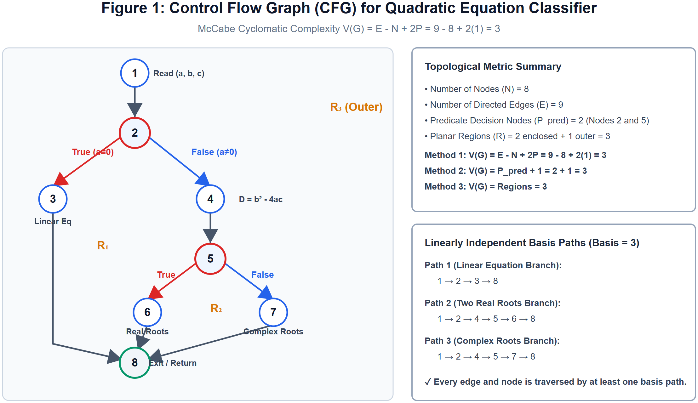
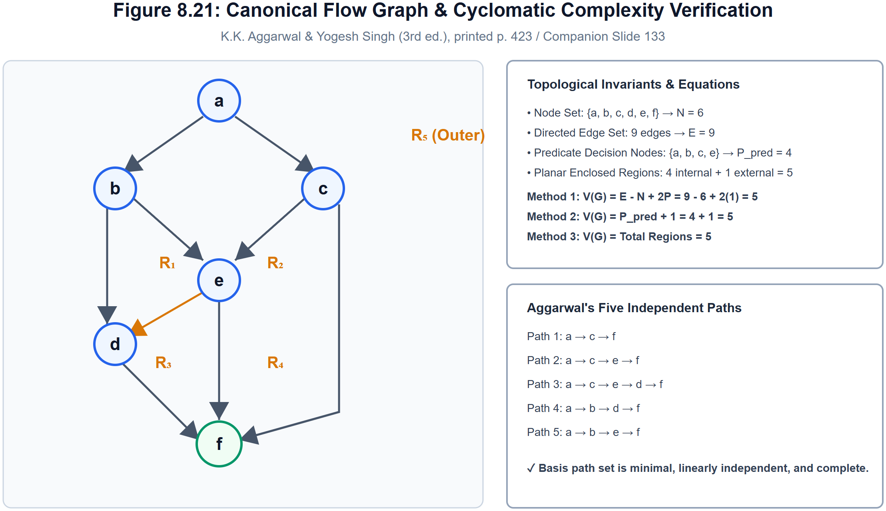
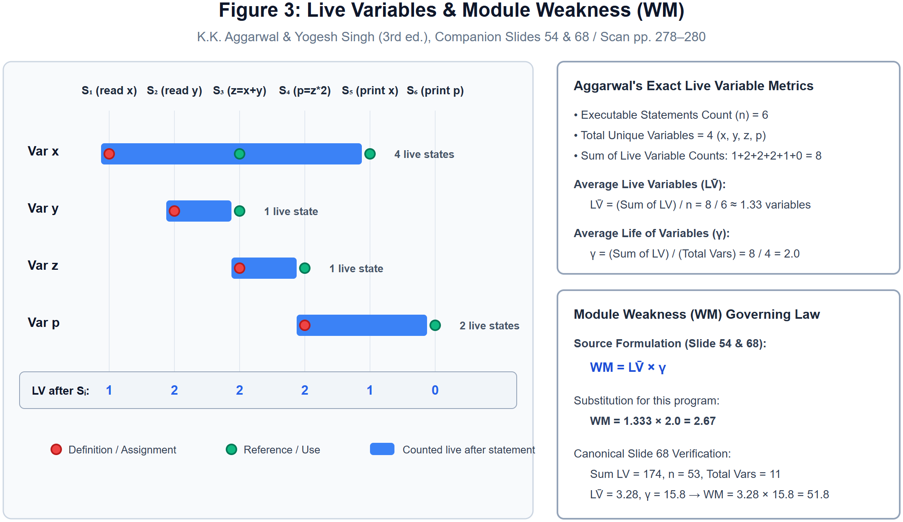
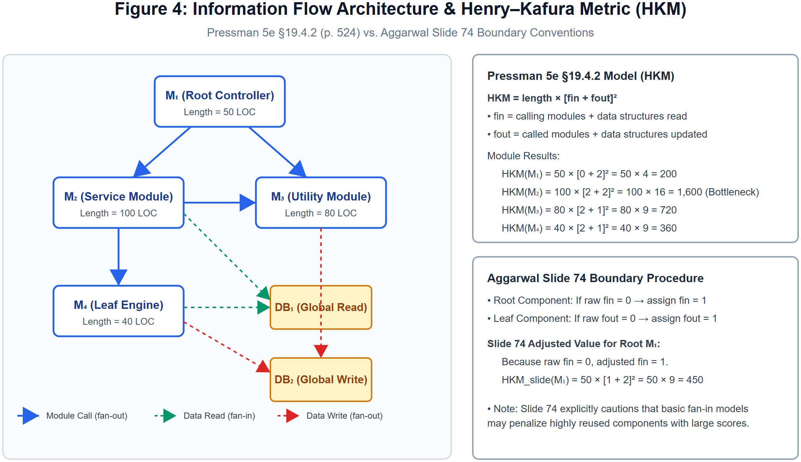
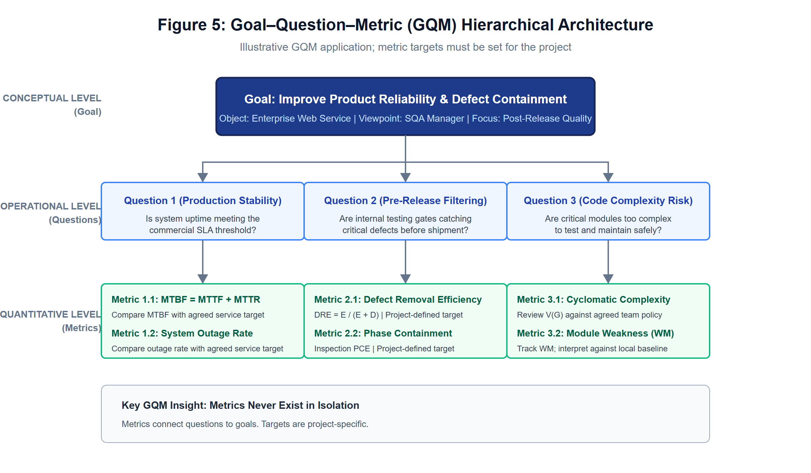
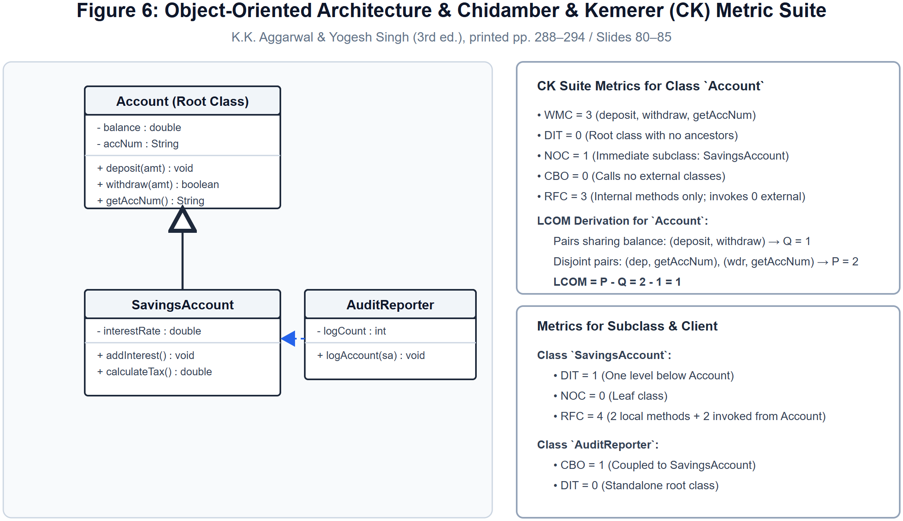

# Chapter 6: Software Metrics — Structural Diagrams & Tracing Pack
<!--

> **Draft Diagram & Tracing Pack:** Contains 6 high-resolution vector visual models and statement-by-statement execution traces supporting Chapter 6. Covers Control Flow Graphs (CFGs) for McCabe Cyclomatic Complexity, Aggarwal's canonical Figure 8.21, statement-by-statement Live Variable ($LV$) lifespans and Module Weakness ($WM = \overline{LV} \times \gamma$), Information Flow Architecture (Pressman §19.4.2 HKM and Slide 74 boundary rules), Goal–Question–Metric (GQM) trees, and Object-Oriented Class Inheritance graphs for the CK suite. All diagrams are rendered as high-resolution vector assets in `diagrams/` for visual verification.

---

-->
## Section 1: Control Flow Graph (CFG) & Cyclomatic Complexity Models

### Q6.DGM01. Control Flow Graph Construction and Cyclomatic Complexity Derivation for Quadratic Equation Classifier

> **Topological Graph Analysis & Cyclomatic Complexity:**
>
> 1. **Topological Graph Specification ($G$):**
>    - **Node Set ($N = 8$):** $\{1, 2, 3, 4, 5, 6, 7, 8\}$
>    - **Directed Edge Set ($E = 9$):** Directed transfers of control between sequential nodes and branching paths.
>    - **Predicate Decision Nodes ($P_{pred} = 2$):** Node 2 (`if a == 0`) and Node 5 (`if D > 0`), each having out-degree 2.
>    - **Connected Components ($P$):** $P = 1$ (single coherent program flow).
>
> 2. **Cyclomatic Complexity Derivation ($V(G)$):**
>    - **Method 1 (Edge-Node Formula):**
>      $$V(G) = E - N + 2P = 9 - 8 + 2(1) = 3$$
>    - **Method 2 (Predicate Decision Nodes Formula):**
>      $$V(G) = P_{pred} + 1 = 2 + 1 = 3$$
>    - **Method 3 (Planar Regions Formula):**
>      $$V(G) = \text{Enclosed Regions} + \text{Outer Region} = 2 + 1 = 3$$
>
> 3. **Linearly Independent Basis Paths (Basis = 3):**
>    - **Path 1:** $1 \rightarrow 2 \rightarrow 3 \rightarrow 8$ (Linear equation branch)
>    - **Path 2:** $1 \rightarrow 2 \rightarrow 4 \rightarrow 5 \rightarrow 6 \rightarrow 8$ (Two real roots branch)
>    - **Path 3:** $1 \rightarrow 2 \rightarrow 4 \rightarrow 5 \rightarrow 7 \rightarrow 8$ (Complex / equal roots branch)
>
> *Source: K.K. Aggarwal & Yogesh Singh (3rd ed.), printed pp. 422–425; companion slides Ch.8.*

> [!NOTE]
> **ملاحظة الطالب والفخ الامتحاني:**
>
> - تتطابق الطرق الثلاث لحساب التعقيد الإعصاري:
>   1. $E - N + 2 = 9 - 8 + 2 = 3$.
>   2. عقد القرار + 1 = $2 + 1 = 3$.
>   3. عدد المناطق المحصورة + المنطقة الخارجية = $2 + 1 = 3$.
> - يلزم اختيار 3 مسارات أساسية مستقلة وفق $V(G)=3$؛ هذا لا يضمن وحده تغطية كل شرط أو كل حافة.

---

### Q6.DGM02. Aggarwal & Singh's Canonical Flow Graph (Figure 8.21 / Slide 133) Analysis

> **Topological Verification of Canonical Figure 8.21:**
>
> 1. **Graph Specification:**
>    - **Nodes ($N = 6$):** $\{a, b, c, d, e, f\}$, with $a$ as entry and $f$ as exit.
>    - **Directed Edges ($E = 9$):** $(a \rightarrow b), (a \rightarrow c), (b \rightarrow d), (b \rightarrow e), (c \rightarrow e), (c \rightarrow f), (d \rightarrow f), (e \rightarrow d), (e \rightarrow f)$.
>    - **Predicate Decision Nodes:** Four nodes ($a, b, c, e$) possess out-degree 2.
>    - **Connected Components ($P$):** $P = 1$.
>
> 2. **Cyclomatic Complexity Evaluation:**
>    - **Method 1:** $V(G) = E - N + 2P = 9 - 6 + 2(1) = 5$
>    - **Method 2:** $V(G) = P_{pred} + 1 = 4 + 1 = 5$
>    - **Method 3:** Planar regions = 4 internal enclosed regions ($R_1, R_2, R_3, R_4$) + 1 external region ($R_5$) = 5.
>
> 3. **The Five Linearly Independent Execution Paths:**
>    - **Path 1:** $a \rightarrow c \rightarrow f$
>    - **Path 2:** $a \rightarrow c \rightarrow e \rightarrow f$
>    - **Path 3:** $a \rightarrow c \rightarrow e \rightarrow d \rightarrow f$
>    - **Path 4:** $a \rightarrow b \rightarrow d \rightarrow f$
>    - **Path 5:** $a \rightarrow b \rightarrow e \rightarrow f$
>
> *Source: K.K. Aggarwal & Yogesh Singh (3rd ed.), printed p. 423, Fig. 8.21; companion slide 133.*

> [!NOTE]
> **ملاحظة الطالب والفخ الامتحاني:**
>
> - هذا الرسم القياسي من كتاب أغروال (Fig. 8.21) يمتلك 6 عقد و9 حواف و4 عقد قرار، ولهذا ينتج تعقيد إعصاري $V(G) = 5$ و5 مسارات مستقلة تماماً.

---

## Section 2: Data Structure Tracing & Lifespan Traces

### Q6.DGM03. Variable Cross-Reference List Construction & Data Extraction (Exercise 6.14)
> **Given Source Code Listing:**
> - Line 1: `int a, b, c, sum, avg;` (Declarations)
> - Line 2: `read(a);`
> - Line 3: `read(b);`
> - Line 4: `read(c);`
> - Line 5: `sum = a + b + c;`
> - Line 6: `avg = sum / 3;`
> - Line 7: `print(avg);`
> - Line 8: `print(sum);`
>
> **Structured Variable Cross-Reference Ledger:**
>
> - **Variable `a`:** Declared at Line 1; Defined at Line 2; Referenced at Line 5. Total Occurrences = 3.
> - **Variable `b`:** Declared at Line 1; Defined at Line 3; Referenced at Line 5. Total Occurrences = 3.
> - **Variable `c`:** Declared at Line 1; Defined at Line 4; Referenced at Line 5. Total Occurrences = 3.
> - **Variable `sum`:** Declared at Line 1; Defined at Line 5; Referenced at Lines 6 and 8. Total Occurrences = 4.
> - **Variable `avg`:** Declared at Line 1; Defined at Line 6; Referenced at Line 7. Total Occurrences = 3.
>
> **Extracted Data Characteristics:**
> - Total distinct variables ($VARS$ / $\eta_2$): $5$ (`a`, `b`, `c`, `sum`, `avg`).
> - Total variable token occurrences ($N_2$): $16$ occurrences across the 8 statements.
>
> *Source: K.K. Aggarwal & Yogesh Singh (3rd ed.), printed pp. 273–275; companion slides 41–44. Exercise 6.14.*

> [!NOTE]
> **ملاحظة الطالب والفخ الامتحاني:**
>
> - قائمة الإسناد المتبادل (Cross-Reference List) توثق لكل متغير سطر الإعلان وسطر الإسناد (Assignment) وأسطر الاستخدام (References) بدقة لتتبع مسار البيانات داخل الكود.

---

### Q6.DGM04. Trace live variables, average variable life ($\gamma$), variable spans ($SP$), and module weakness ($WM$) in the six-statement example.

> **Authored practice trace using the course definitions** (the six-statement data below are a constructed example, not a transcription of a textbook exercise).
>
> **Conventions:** Count live variables immediately **after** each statement. A variable is live at that point when it has been defined and will be used later before being redefined. For spans, count only statements between successive uses; a definition is not a use.
>
> 1. **Trace:**
>    - $S_1$: `x = read()`; $\{x\}$, so $LV(S_1)=1$.
>    - $S_2$: `y = read()`; $\{x,y\}$, so $LV(S_2)=2$.
>    - $S_3$: `z = x + y`; `y` has its last use; $\{x,z\}$, so $LV(S_3)=2$.
>    - $S_4$: `p = z * 2`; `z` has its last use; $\{x,p\}$, so $LV(S_4)=2$.
>    - $S_5$: `print(x)`; `x` has its last use; $\{p\}$, so $LV(S_5)=1$.
>    - $S_6$: `print(p)`; `p` has its last use; $\emptyset$, so $LV(S_6)=0$.
>
> 2. **Live-variable metrics:** There are $n=6$ executable statements and four distinct variables. Thus $\sum LV=1+2+2+2+1+0=8$, $\overline{LV}=8/6\approx1.33$ variables per statement, and $\gamma=8/4=2.0$ statement-count units per variable under this convention.
>
> 3. **Module weakness:**
>    $$WM=\overline{LV}\times\gamma=(8/6)\times2=8/3\approx2.67.$$
>
> 4. **Variable span:** Between successive uses, $SP=b-a-1$. `x` is used at $S_3$ and $S_5$, so $SP(x)=5-3-1=1$. The other variables have only one use each and add no span. Therefore $SP_{avg}=1/1=1$ statement for the single observed span.
>
> *Source for definitions and formulas: K.K. Aggarwal & Yogesh Singh (3rd ed.), printed pp. 275–280; companion slides 45–68. Numerical trace is authored practice.*

> [!NOTE]
> **ملاحظة الطالب والفخ الامتحاني:**
>
> - المثال هنا مصنوع للتدريب، مو نص تمرين من الكتاب. الرسم والحل يستخدمان اصطلاح العدّ بعد تنفيذ التعليمة، لذلك صارت القيم نفسها في الاثنين.

---

### Q6.DGM05. Multi-Tier Information Flow Call Graph & Henry–Kafura Metric (HKM)

> **Architectural Topology & Metric Comparison:**
>
> 1. **Modular Parameters (Pressman 5e §19.4.2 Model):**
>    - **Root $M_1$ (50 LOC):** $fin = 0$ callers, 0 reads = $0$; $fout = 2$ calls ($M_2, M_3$), 0 writes = $2$.
>      $$HKM(M_1) = 50 \times [0 + 2]^2 = 50 \times 4 = 200$$
>    - **Service $M_2$ (100 LOC):** $fin = 1$ caller ($M_1$) + 1 read ($DB_1$) = $2$; $fout = 2$ calls ($M_3, M_4$) + 0 writes = $2$.
>      $$HKM(M_2) = 100 \times [2 + 2]^2 = 100 \times 16 = 1,600 \text{ (largest calculated value in this example)}$$
>    - **Utility $M_3$ (80 LOC):** $fin = 2$ callers ($M_1, M_2$) + 0 reads = $2$; $fout = 0$ calls + 1 write ($DB_2$) = $1$.
>      $$HKM(M_3) = 80 \times [2 + 1]^2 = 80 \times 9 = 720$$
>    - **Leaf $M_4$ (40 LOC):** $fin = 1$ caller ($M_2$) + 1 read ($DB_1$) = $2$; $fout = 0$ calls + 1 write ($DB_2$) = $1$.
>      $$HKM(M_4) = 40 \times [2 + 1]^2 = 40 \times 9 = 360$$
>
> 2. **Course Slide 74 Boundary Procedure Comparison:**
>    - For root component $M_1$, because raw $fin = 0$, slide convention sets $fin = 1$:
>      $$HKM_{slide}(M_1) = 50 \times [1 + 2]^2 = 50 \times 9 = 450$$
>    - Slide 74 explicitly notes that basic fan-in models can penalize reused utility components.
>
> *Source: Pressman, R., 5th ed., printed p. 524; K.K. Aggarwal & Yogesh Singh (3rd ed.), companion slides 69–77.*

> [!NOTE]
> **ملاحظة الطالب والفخ الامتحاني:**
>
> - انتبه لتطبيق اصطلاح الشريحة 74: إذا كان $fan\_in = 0$ للوحدة الجذرية العليا يعوض بـ 1 لمنع تصفير القيمة.
> - يشمل $fan\_in$ الدوال المستدعية + هياكل البيانات المقروءة.
> - يشمل $fan\_out$ الدوال المستدعاة + هياكل البيانات المحدثة أو المكتوبة.

---

### Q6.DGM06. Goal–Question–Metric (GQM) Hierarchical Architectural Tree

> **Three-Tier GQM Hierarchical Mapping:**
>
> 1. **Conceptual Level (Goal):**
>    - *Goal:* Improve software operational reliability and post-release defect containment.
>    - *Object:* Enterprise Web Portal; *Viewpoint:* SQA Manager; *Context:* Production Release.
>
> 2. **Operational Level (Questions):**
>    - *Question 1 (Production Stability):* Is system uptime meeting contractual SLAs?
>    - *Question 2 (Pre-Release Filtering):* Are internal QA gates successfully catching defects before shipment?
>    - *Question 3 (Structural Complexity Risk):* Are core modules too complex to test and maintain safely?
>
> 3. **Quantitative Level (Metrics):**
>    - *For Q1:* Track $MTBF = MTTF + MTTR$ and unplanned downtime; compare both with service targets defined for this project.
>    - *For Q2:* Track $DRE = \frac{E}{E + D}$ and phase-containment effectiveness; compare them with targets chosen from local baselines.
>    - *For Q3:* Track McCabe Cyclomatic Complexity $V(G)$ against project policy and Module Weakness $WM = \overline{LV} \times \gamma$ against a local baseline.
>
> Targets and metric choices in this authored example are illustrative; no numeric threshold is asserted as universal.
> *Source: Leach, R., printed pp. 39–40 (GQM hierarchy).*

---

### Q6.DGM07. Object-Oriented Architecture & Chidamber & Kemerer (CK) Metric Suite

> **Structural Analysis of 3-Class Design:**
>
> 1. **Class `Account` (Root Classifier):**
>    - Attributes: `balance`, `accNum`. Methods: `deposit()`, `withdraw()`, `getAccNum()`.
>    - **WMC = 3** (unit method complexities).
>    - **DIT = 0** (root class, maximum path to root is 0).
>    - **NOC = 1** (direct child is `SavingsAccount`).
>    - **CBO = 0** (no external class dependencies).
>    - **RFC = 3** (local methods only, invokes 0 external methods).
>    - **LCOM = 1:** Methods pair $(deposit, withdraw)$ shares `balance` ($Q = 1$); pairs $(deposit, getAccNum)$ and $(withdraw, getAccNum)$ share no variables ($P = 2$). Thus, $LCOM = P - Q = 2 - 1 = 1$.
>
> 2. **Class `SavingsAccount` (Subclass of `Account`):**
>    - **DIT = 1** (one step from root `Account`).
>    - **NOC = 0** (leaf class).
>    - **RFC = 4** (2 local methods + 2 invoked from `Account`).
>
> 3. **Class `AuditReporter` (Client Collaborator):**
>    - **CBO = 1** (coupled to `SavingsAccount`).
>    - **DIT = 0** (standalone root class).
>
> *Source: K.K. Aggarwal & Yogesh Singh (3rd ed.), printed pp. 288–294; companion slides 80–85.*

> [!NOTE]
> **ملاحظة الطالب والفخ الامتحاني:**
>
> - حزمة CK الستة:
>   - WMC: مجموع أوزان دوال الكلاس.
>   - DIT: أطول مسار إلى الجذر (Root).
>   - NOC: عدد الأبناء المباشرين.
>   - CBO: عدد الكلاسات الأخرى المرتبطة بهذا الكلاس.
>   - RFC: عدد دوال الكلاس + الدوال الخارجية التي تستدعيها.
>   - LCOM: مقياس غياب التماسك ($P - Q$).

---

<!--
## Retrieval Set & Active Recall Self-Test

Use the structural diagrams and traces in this pack for active recall:
-->
- Trace the three basis paths of Figure 1 and calculate $V(G)$ using all 3 methods.
- Trace the five paths shown in Aggarwal's Figure 8.21 and verify the corresponding graph paths without looking at the worked explanation.
- Re-derive the live variable set and lifespan $\gamma$ for statements $S_1$ to $S_6$.
- Explain the difference between Slide 74 boundary rules and Pressman's HKM for root components.
- Calculate WMC, DIT, NOC, CBO, RFC, and LCOM for the `Account` class in Figure 6.
