# ASE Chapter 7 — T4 Visual Models & Diagram Interpretation Pack

<!--
Internal metadata; keep out of the exported pack.
Course: Advanced Software Engineering (CS603) — Asst. Prof. Dr. Ali Fahim Ni'ma
Source scope: K.K. Aggarwal & Yogesh Singh, Software Engineering (3rd ed.), Chapter 7, pp. 308–364; companion slides 1–126.
Visual assets: High-resolution raster crops rendered from original companion-slide figures; no ASCII drawings.
-->

### Q7.V01 · Hardware Bathtub Curve and Software Reliability Curve (Exercise 7.2)

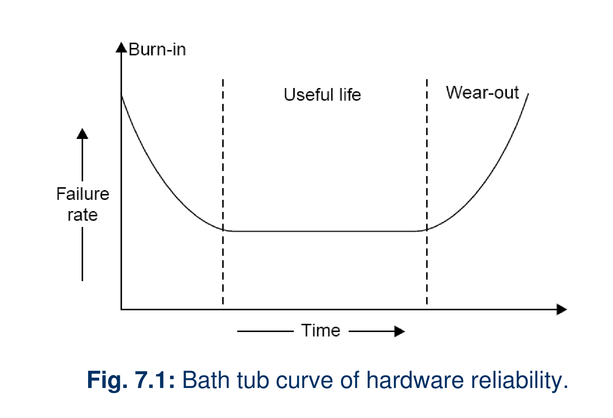

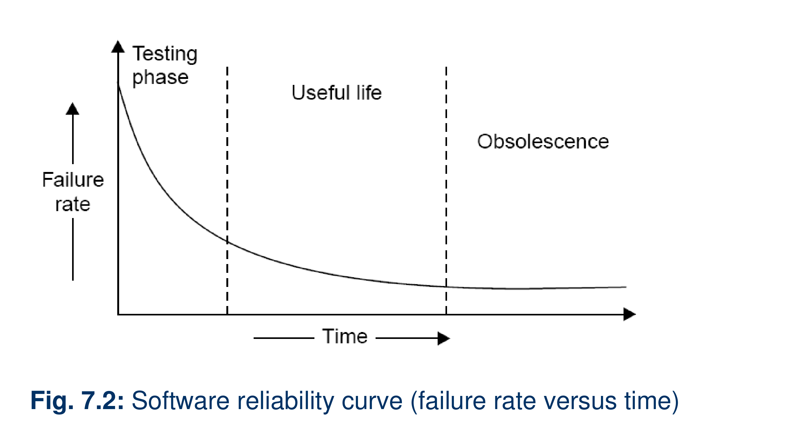

>
> 1. **Figure 7.1:** Hardware failure rate falls during burn-in, stays nearly constant through useful life, then rises during wear-out.
> 2. **Figure 7.2:** Software failure rate falls during testing, remains low through useful life, and reaches the obsolescence phase. This plotted curve has no hardware-style wear-out phase.

> [!NOTE]
> **ملاحظة المخطط:**
> يوضح الشكل الأول ارتفاع فشل العتاد بعد مرحلة العمر النافع، بينما يوضح الثاني انخفاض فشل البرمجيات أثناء الاختبار واستقراره خلال العمر النافع ثم تقادمها.

**Source:**
K.K. Aggarwal & Yogesh Singh (3rd ed.), §7.1.1, pp. 308–310; companion slides 3–4, Figs. 7.1–7.2.

---

### Q7.V02 · Input Space and Example Input-State Probabilities (Exercise 7.6)

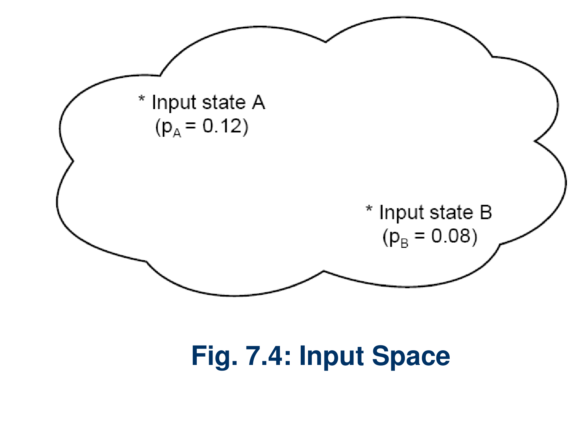

>
> - The cloud labelled **Input Space** shows two example states: A with probability 0.12 and B with probability 0.08.
> - These labels associate occurrence probabilities with the two states; the figure does not mark a failure domain.

> [!NOTE]
> **ملاحظة المخطط:**
> الشكل يعرض حالتي إدخال واحتماليهما؛ لا يرسم منطقة فشل.

**Source:**
K.K. Aggarwal & Yogesh Singh (3rd ed.), §7.1.4, pp. 314–316; companion slide 18, Fig. 7.4.

---

### Q7.V03 · Probability Portions in an Operational Profile (Exercise 7.6)

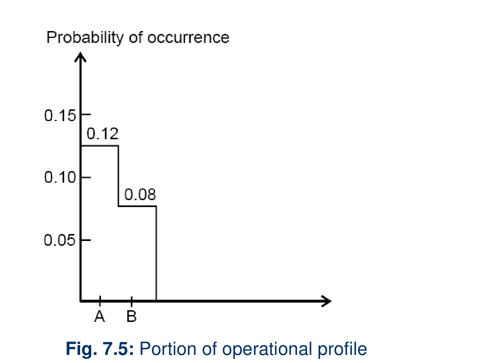

>
> - The vertical axis is probability of occurrence; the input states A and B are shown with probabilities 0.12 and 0.08.
> - The caption identifies this as a portion of an operational profile, not a complete branching tree.

> [!NOTE]
> **ملاحظة المخطط:**
> يبين الجزء المعروض احتمال ظهور الحالة A والحالة B؛ لا يعرض شجرة تشغيلية.

**Source:**
K.K. Aggarwal & Yogesh Singh (3rd ed.), §7.1.5, pp. 316–318; companion slide 19, Fig. 7.5.

---

### Q7.V04 · McCall Quality Factors and Criteria (Exercises 7.10 & 7.11)

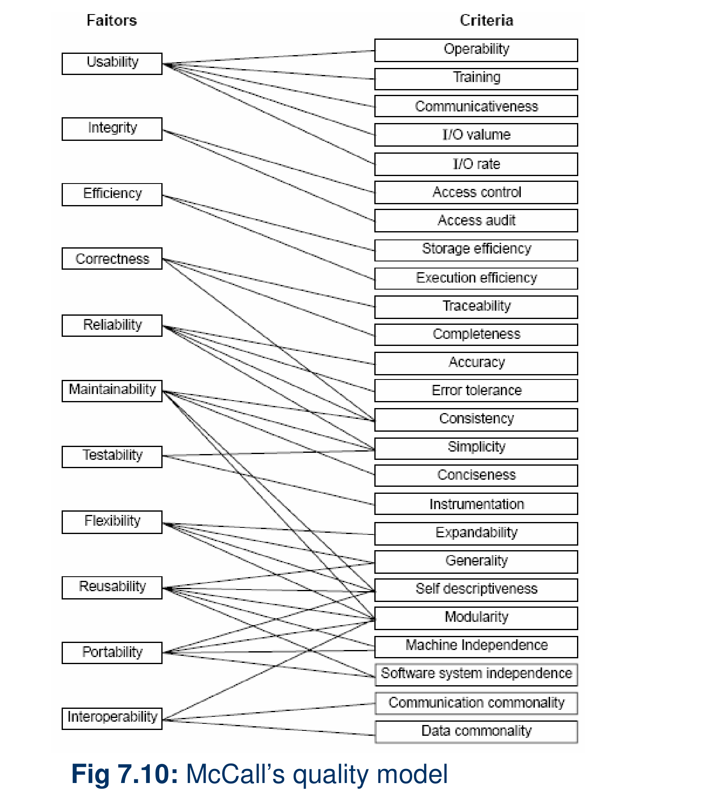

>
> - The figure maps 11 quality factors to 25 quality criteria. Its connecting lines show which criteria are associated with each factor; a criterion can connect to more than one factor.
> - This is a factor-to-criteria map; it does not show the separate Product Operation, Product Revision, and Product Transition grouping.

> [!NOTE]
> **ملاحظة المخطط:**
> يربط الشكل 11 عاملاً للجودة بـ25 معياراً؛ تجميع Operation وRevision وTransition يخص شكلاً آخر.

**Source:**
K.K. Aggarwal & Yogesh Singh (3rd ed.), §7.2.1, p. 322; companion slide 35, Fig. 7.10.

---

### Q7.V05 · Boehm Software Quality Model (Exercise 7.12)

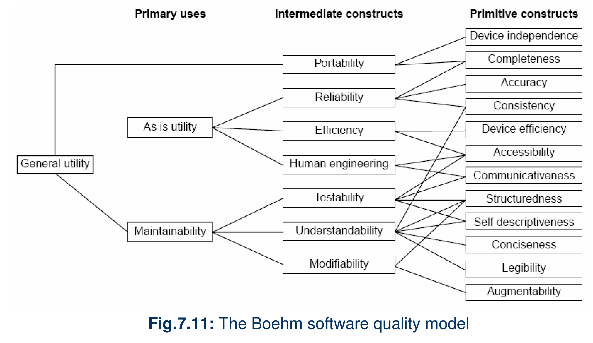

>
> - The figure shows three levels: primary uses, intermediate constructs, and primitive constructs.
> - General Utility links directly to Portability and Maintainability. As-is Utility links to Reliability, Efficiency, and Human Engineering; Maintainability links to Testability, Understandability, and Modifiability.
> - The figure contains 7 intermediate constructs and 12 primitive constructs.

> [!NOTE]
> **ملاحظة المخطط:**
> يتدرج نموذج Boehm من الاستخدامات إلى التراكيب الوسيطة ثم الخصائص الأولية؛ يضم الشكل 7 تراكيب وسيطة و12 خاصية أولية.

**Source:**
K.K. Aggarwal & Yogesh Singh (3rd ed.), §7.2.2, pp. 324–325; companion slide 40, Fig. 7.11.

---

### Q7.V06 · ISO 9126 Quality Model (Exercise 7.13)

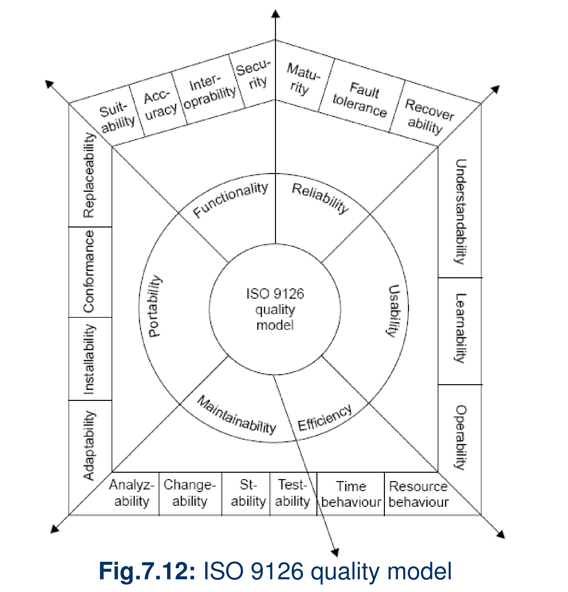

>
> The figure groups 20 subcharacteristics under six characteristics:
>
> 1. **Functionality:** Suitability, Accuracy, Interoperability, Security.
> 2. **Reliability:** Maturity, Fault tolerance, Recoverability.
> 3. **Usability:** Understandability, Learnability, Operability.
> 4. **Efficiency:** Time behaviour, Resource behaviour.
> 5. **Maintainability:** Analyzability, Changeability, Stability, Testability.
> 6. **Portability:** Adaptability, Installability, Conformance, Replaceability.

> [!NOTE]
> **ملاحظة المخطط:**
> الشكل يعرض 6 خصائص رئيسية و20 فرعية؛ Conformance تابعة لـPortability.

**Source:**
K.K. Aggarwal & Yogesh Singh (3rd ed.), §7.2.3, pp. 326–328; companion slide 46, Fig. 7.12.

---

### Q7.V07 · Basic and Logarithmic Poisson Failure-Intensity Curves (Exercises 7.15 & 7.17)

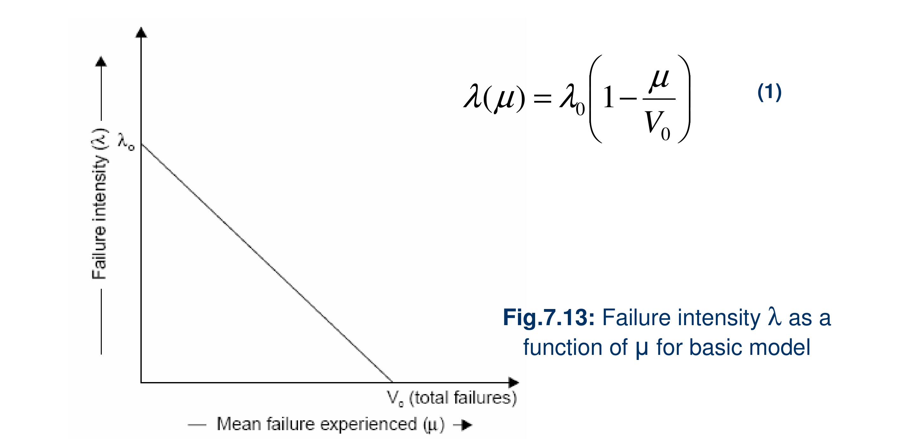

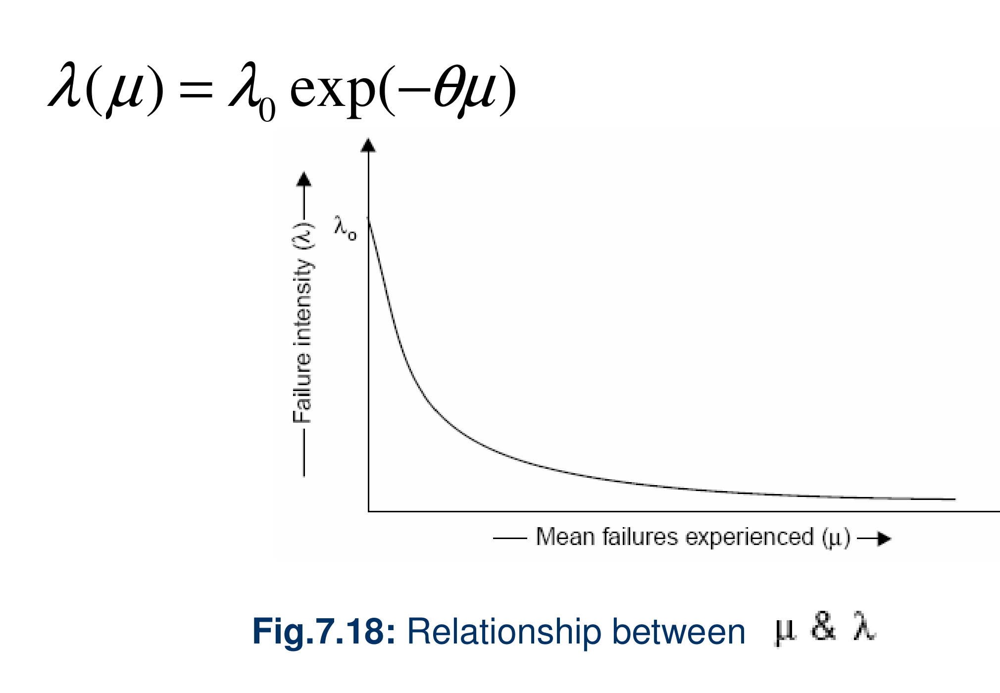

>
> 1. **Basic model, Figure 7.13:** Plots failure intensity λ against mean failures experienced μ. The straight line falls from λ₀ at μ = 0 to zero at μ = V₀; the displayed equation is λ(μ) = λ₀(1 − μ/V₀).
> 2. **Logarithmic Poisson model, Figure 7.18:** Also plots λ against μ, using λ(μ) = λ₀ exp(−θμ). Its curve falls steeply at first, then gradually flattens toward zero.

> [!NOTE]
> **ملاحظة المخطط:**
> الشكلان كلاهما λ مقابل μ: الأساسي خط مستقيم، واللوغاريتمي منحنى يتناقص ثم يتسطح.

**Source:**
K.K. Aggarwal & Yogesh Singh (3rd ed.), §7.3.1, p. 330, and §7.3.2, p. 336; companion slides 47 and 59, Figs. 7.13 and 7.18.

---

### Q7.V08 · Calendar-Time to Execution-Time Ratio and Limiting Resources (Exercise 7.23)

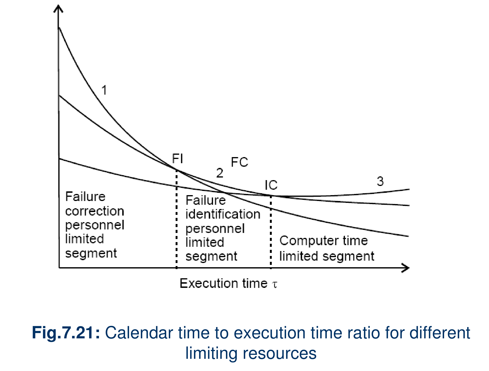

>
> - The plot relates the calendar-time/execution-time ratio to execution time τ.
> - It labels three resource-limited segments: failure-correction personnel, failure-identification personnel, and computer time.

> [!NOTE]
> **ملاحظة المخطط:**
> القطاعات الثلاثة المعلّمة هي محدودية موظفي التصحيح، ثم موظفي تحديد الفشل، ثم وقت الحاسوب.

**Source:**
K.K. Aggarwal & Yogesh Singh (3rd ed.), §7.3.3, pp. 340–342; companion slide 77, Fig. 7.21.

---

### Q7.V09 · Jelinski–Moranda Failure-Intensity Steps (Exercise 7.25)

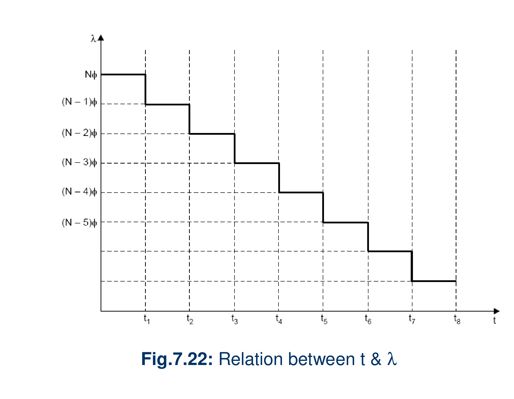

>
> - The plot shows failure intensity λ against time t. The rate remains constant between failures and drops by φ at successive failure times, from Nφ to (N − 1)φ and onward.

> [!NOTE]
> **ملاحظة المخطط:**
> يبقى λ ثابتاً بين أزمنة الفشل، ثم ينخفض بمقدار φ عند كل خطوة لاحقة.

**Source:**
K.K. Aggarwal & Yogesh Singh (3rd ed.), §7.3.4, pp. 343–345; companion slide 90, Fig. 7.22.

---

### Q7.V10 · SEI CMM Maturity Levels and Characterizations (Exercises 7.27 & 7.28)

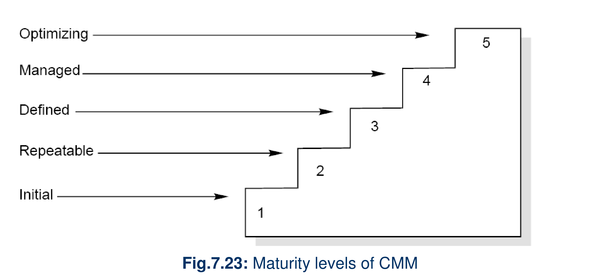

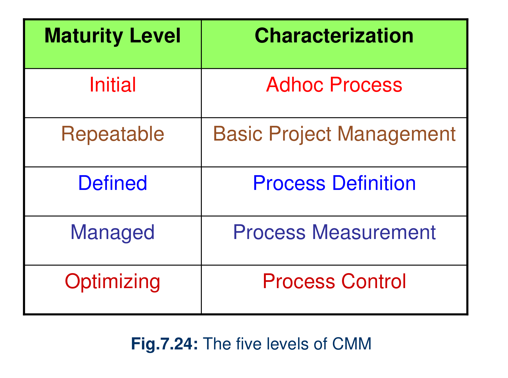

>
> - Figure 7.23 orders the five levels: Initial (1), Repeatable (2), Defined (3), Managed (4), and Optimizing (5).
> - Figure 7.24 pairs them with these characterizations: Adhoc Process, Basic Project Management, Process Definition, Process Measurement, and Process Control, respectively.

> [!NOTE]
> **ملاحظة المخطط:**
> الشكل الأول يبيّن ترتيب المستويات الخمسة، والثاني يربط كل مستوى بوصفه المقابل.

**Source:**
K.K. Aggarwal & Yogesh Singh (3rd ed.), §7.4.1, pp. 347–350; companion slides 94 and 96, Figs. 7.23–7.24.

<!--
Internal retrieval practice set — unanswered prompts retained for agent use; do not print.
## Retrieval set
1. Sketch the hardware bathtub curve and identify its three chronological phases.
2. Compare the phases on the hardware and software reliability curves; does the software plot show a wear-out rise?
3. Read the two input-state probabilities shown in Figure 7.4.
4. Explain what the probabilities in Figure 7.5 represent in this portion of an operational profile.
5. Count the factors and criteria in McCall's figure and explain what its connecting lines map.
6. Contrast the top-level nodes of Boehm's quality model with those of McCall.
7. Explain the visual difference in slope between the Basic Execution Time Model curve and the Logarithmic Poisson curve.
8. Chronologically order the three resource-limited segments in the calendar time to execution time graph.
9. Describe the geometric shape of the hazard rate curve in the Jelinski–Moranda model.
10. List the 5 maturity levels of the SEI CMM in their exact evolutionary order.
-->
