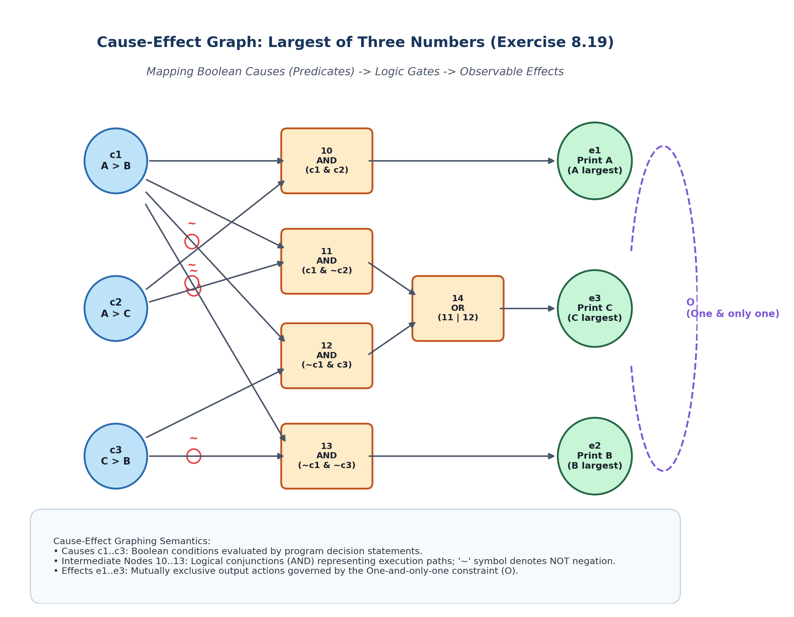
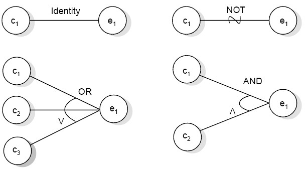
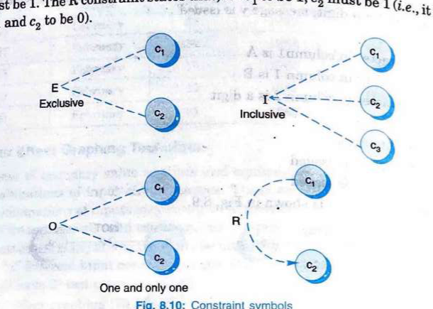
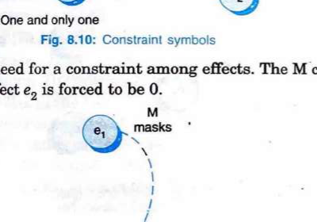
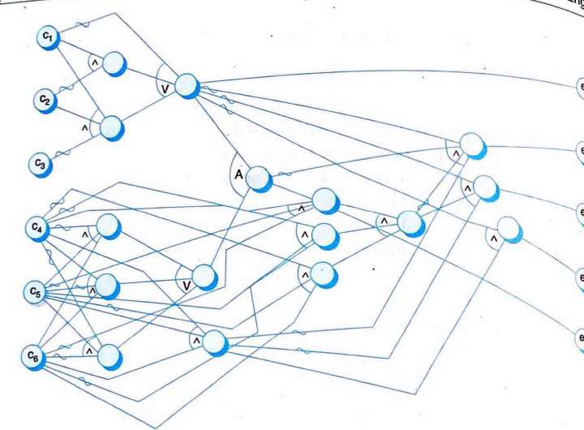
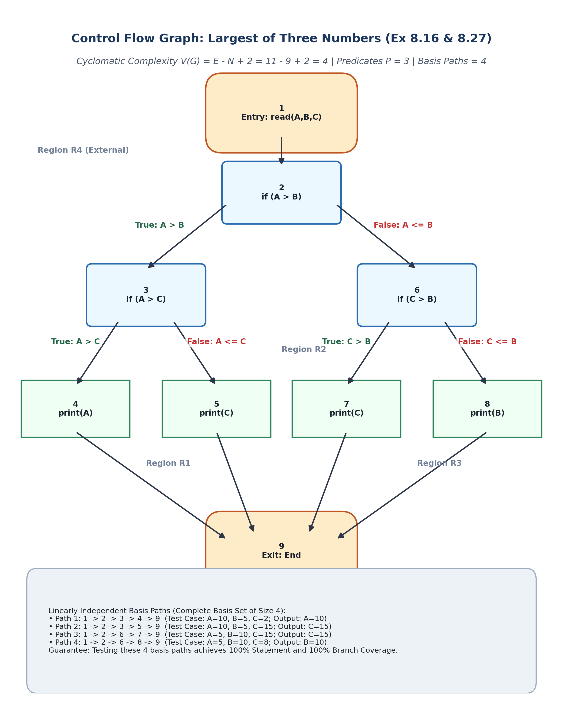
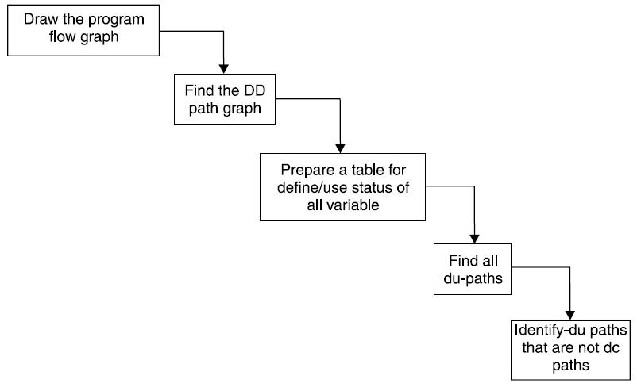
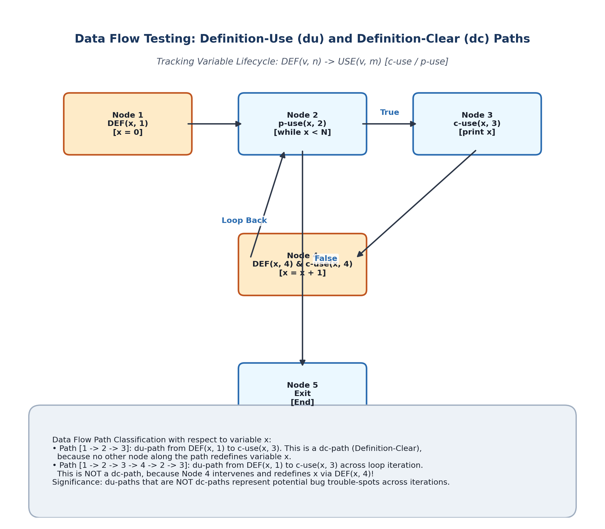

# ASE Chapter 8 — T4 Structural Models & Visual Diagram Interpretation Pack

<!-- Print-hidden metadata: 4 core structural and graphical modeling exercises from Aggarwal & Singh (3rd ed., pp. 455–458). -->

---

<div class="no-break">

### Question 8.19 · Cause-Effect Graph for Largest of Three Numbers (Exercise 8.19)

Draw the cause effect graph of the program given in exercise 8.16.
{: .keep-next }
> **Architectural Derivation & Cause-Effect Graph Analysis for the Largest of Three Numbers:**
>
> **1. Specification & Code Analysis (from Exercise 8.16):**
> The program reads three floating-point values ($A, B, C$) and determines the largest value using nested conditional selections:
> ```c
> if (A > B) {
>     if (A > C) printf("%f\n", A);
>     else       printf("%f\n", C);
> } else {
>     if (C > B) printf("%f\n", C);
>     else       printf("%f\n", B);
> }
> ```
>
> **2. Identification of Causes (Input Conditions) and Effects (Outputs):**
> - **Causes (Boolean Predicates):**
>   - **$c_1$:** $A > B$ (Variable $A$ is strictly greater than $B$)
>   - **$c_2$:** $A > C$ (Variable $A$ is strictly greater than $C$)
>   - **$c_3$:** $C > B$ (Variable $C$ is strictly greater than $B$)
> - **Effects (Observable Output Actions):**
>   - **$e_1$:** Print $A$ ($A$ is the largest value)
>   - **$e_2$:** Print $B$ ($B$ is the largest value)
>   - **$e_3$:** Print $C$ ($C$ is the largest value)
>
> **3. Logical Synthesis of Intermediate Nodes:**
> - **Intermediate Node 10 (Conjunction $c_1 \land c_2$):** Both $A > B$ and $A > C$ hold true $\implies$ triggers **$e_1$** (Print $A$).
> - **Intermediate Node 11 (Conjunction $c_1 \land \neg c_2$):** $A > B$ is true, but $A > C$ is false ($C \ge A$) $\implies$ implies $C > B$, triggering **$e_3$** (Print $C$).
> - **Intermediate Node 12 (Conjunction $\neg c_1 \land c_3$):** $A > B$ is false ($B \ge A$) and $C > B$ is true $\implies$ implies $C > A$, triggering **$e_3$** (Print $C$).
> - **Intermediate Node 13 (Conjunction $\neg c_1 \land \neg c_3$):** $A > B$ is false ($B \ge A$) and $C > B$ is false ($B \ge C$) $\implies$ triggers **$e_2$** (Print $B$).
> - **Intermediate Node 14 (Disjunction Node 11 $\lor$ Node 12):** Combines both paths leading to $C$ being the largest value, directly activating **$e_3$**.
>
> **4. Constraints Formulation:**
> - **Output Constraint (One and Only One 'O'):** Exactly one effect from $\{e_1, e_2, e_3\}$ can occur for any valid execution.



> [!NOTE]
> **ملاحظة الطالب والفخ الامتحاني:**
>
> في مخطط السبب والنتيجة لبرنامج أكبر الأرقام الثلاثة: الأسباب هي الشروط الثلاثة ($c_1: A>B, c_2: A>C, c_3: C>B$) والنتائج هي طباعة الرقم الأكبر ($e_1, e_2, e_3$). لاحظ أن النتيجة $e_3$ (طباعة C) يمكن الوصول إليها من مسارين منطقيين مختلفين لذلك دمجت ببوابة OR (العقدة 14). ويفرض قيد 'O' (One and only one) على المخرجات لأن البرنامج يطبع ناتجاً واحداً فقط.

**Source:**
Aggarwal & Singh (3rd ed.), §8.2.4, pp. 388–397; companion slides 91–102, 205.

</div>

---

<div class="no-break">

### Question 8.20 · Cause-Effect Graphing Technique: Foundations, Notations & Workflow (Exercise 8.20)

Discuss cause effect graphing technique with an example.
{: .keep-next }
> **Comprehensive Examination of the Cause-Effect Graphing Technique:**
>
> **1. Foundational Purpose and Concept:**
> - **Cause-Effect Graphing is a formal black-box test design technique** that translates requirements stated in natural language into a formal boolean graph.
> - It systematically models combinatorial logic between inputs (**Causes**) and actions (**Effects**), bridges the gap between requirements and decision tables, and highlights specification ambiguities and incompleteness.
>
> **2. Fundamental Graphic Notations & Boolean Operators:**
> - **Identity Relation:** If Cause $c_1 = 1$, then Effect $e_1 = 1$; otherwise $e_1 = 0$.
> - **NOT Relation ($\sim$):** If Cause $c_1 = 1$, then Effect $e_1 = 0$; if $c_1 = 0$, then $e_1 = 1$.
> - **OR Relation ($\lor$):** If any of Causes $c_1, c_2, \dots, c_k$ is 1, Effect $e_1 = 1$.
> - **AND Relation ($\land$):** Only if ALL Causes $c_1, c_2, \dots, c_k$ are 1, Effect $e_1 = 1$.



> **3. Graphic Constraint Notations:**
> In real-world software, certain combinations of causes or effects are physically or logically impossible. Constraints are imposed using dashed lines:
> - **Exclusive Constraint (E):** At most one cause can be 1 (never both).
> - **Inclusive Constraint (I):** At least one cause must be 1 (they cannot both be 0).
> - **One and Only One Constraint (O):** Exactly one cause must be 1.
> - **Requires Constraint (R):** For cause $c_1$ to be 1, cause $c_2$ must be 1 ($c_1 \implies c_2$).
> - **Mask Constraint (M):** Applied to effects; if effect $e_1$ is 1, it forces effect $e_2$ to be 0 (masks it).





> **4. Standard 4-Step Operational Workflow:**
> - **Step 1 (Decomposition):** Analyze requirements specification to identify all distinct Causes (inputs/preconditions) and Effects (outputs/postconditions), assigning unique identifier tokens.
> - **Step 2 (Graph Construction):** Connect causes to effects using Boolean logic gates (AND, OR, NOT) and add intermediate state nodes where necessary.
> - **Step 3 (Constraint Annotation):** Annotate the graph with domain and physical constraints ($E, I, O, R, M$).
> - **Step 4 (Decision Table Generation):** Trace paths through the graph to synthesize a limited-entry Decision Table, where each non-redundant column forms an executable test case.
>
> **5. Canonical Worked Example (Triangle Problem — Example 8.12, p. 405):**
> - **Causes ($c_1$ to $c_6$):**
>   - **$c_1$:** Side $x$ is less than sum of sides $y$ and $z$ ($x < y + z$)
>   - **$c_2$:** Side $y$ is less than sum of sides $x$ and $z$ ($y < x + z$)
>   - **$c_3$:** Side $z$ is less than sum of sides $x$ and $y$ ($z < x + y$)
>   - **$c_4$:** Side $x$ is equal to side $y$ ($x = y$)
>   - **$c_5$:** Side $x$ is equal to side $z$ ($x = z$)
>   - **$c_6$:** Side $y$ is equal to side $z$ ($y = z$)
> - **Effects ($e_1$ to $e_5$):**
>   - **$e_1$:** Not a triangle
>   - **$e_2$:** Scalene triangle
>   - **$e_3$:** Isosceles triangle
>   - **$e_4$:** Equilateral triangle
>   - **$e_5$:** Impossible stage (e.g., side conditions violate triangle inequality or contradictory equalities)



> [!NOTE]
> **ملاحظة الطالب والفخ الامتحاني:**
>
> تقنية مخططات السبب والنتيجة تمر بـ 4 خطوات إلزامية: تجزئة المواصفات إلى أسباب ونتائج، رسم المخطط المنطقي، تثبيت القيود المنطقية ($E, I, O, R, M$)، ثم تحويل المخطط إلى جدول قرار (Decision Table).
> احذر في مسألة المثلث (Example 8.12): الأسباب الستة هي متباينات الأضلاع $c_1, c_2, c_3$ ($x < y+z, \dots$) ثم تساويات الأضلاع $c_4: x=y, c_5: x=z, c_6: y=z$. أما النتائج فمرتبة بالمصدر كالتالي: $e_1$ ليس مثلثاً، $e_2$ مختلف الأضلاع (Scalene)، $e_3$ متساوي الساقين (Isosceles)، $e_4$ متساوي الأضلاع (Equilateral)، والنتيجة الخامسة $e_5$ هي الحالة المستحيلة (Impossible stage) لتغطية التوليفات المتناقضة أو المستحيلة هندسياً. قيد الحجب Masking (M) يخص المخرجات فقط لحجب ناتج عند تحقق ناتج آخر.

**Source:**
Aggarwal & Singh (3rd ed.), §8.2.4, pp. 388–397; companion slides 91–103, 205.

</div>

---

<div class="no-break">

### Question 8.27 · Control Flow Graph & Basis Paths for Largest of Three Numbers (Exercise 8.27)

Draw the flow graph for program of largest of three numbers as shown in exercise 8.16. Find out all independent paths that will guarantee that all statements in the program have been tested.
{: .keep-next }
> **Control Flow Graph Construction, Complexity Analysis & Basis Path Derivation:**
>
> **1. Control Flow Graph Topology:**
> Analyzing the C implementation from Exercise 8.16 yields 9 distinct nodes and 11 directed edges:
> - **Node 1:** Program Entry and Input: `read(A, B, C);`
> - **Node 2:** Predicate Decision 1: `if (A > B)`
> - **Node 3:** Predicate Decision 2: `if (A > C)` (True branch of Node 2)
> - **Node 4:** Action Statement: `printf("%f", A);` (True branch of Node 3)
> - **Node 5:** Action Statement: `printf("%f", C);` (False branch of Node 3)
> - **Node 6:** Predicate Decision 3: `if (C > B)` (False branch of Node 2)
> - **Node 7:** Action Statement: `printf("%f", C);` (True branch of Node 6)
> - **Node 8:** Action Statement: `printf("%f", B);` (False branch of Node 6)
> - **Node 9:** Program Exit and Return



> **2. Cyclomatic Complexity Calculation (Three Formal Methods):**
> - **Method 1 (Edges and Nodes Formula):**
>   $$V(G) = E - N + 2P = 11 - 9 + 2(1) = 4$$
> - **Method 2 (Predicate Nodes Formula):**
>   The predicate decision nodes are Nodes 2, 3, and 6 ($P = 3$).
>   $$V(G) = P + 1 = 3 + 1 = 4$$
> - **Method 3 (Enclosed Planar Regions Formula):**
>   The graph encloses 3 bounded internal regions ($R_1, R_2, R_3$) plus 1 unbounded external region ($R_4$).
>   $$V(G) = \text{Number of Regions} = 3 + 1 = 4$$
>
> **3. Linearly Independent Basis Paths (Basis Set of Size 4):**
> McCabe's theorem dictates that a basis set of exactly 4 linearly independent paths must be executed to guarantee 100% Statement Coverage and 100% Branch Coverage:
> - **Path 1:** $1 \to 2 \to 3 \to 4 \to 9$
>   - **Predicate Truth Values:** Node 2 = True ($A > B$), Node 3 = True ($A > C$).
>   - **Test Vector:** $A = 10, B = 5, C = 2$.
>   - **Expected Output:** $A = 10$ printed.
> - **Path 2:** $1 \to 2 \to 3 \to 5 \to 9$
>   - **Predicate Truth Values:** Node 2 = True ($A > B$), Node 3 = False ($A \le C$).
>   - **Test Vector:** $A = 10, B = 5, C = 15$.
>   - **Expected Output:** $C = 15$ printed.
> - **Path 3:** $1 \to 2 \to 6 \to 7 \to 9$
>   - **Predicate Truth Values:** Node 2 = False ($A \le B$), Node 6 = True ($C > B$).
>   - **Test Vector:** $A = 5, B = 10, C = 15$.
>   - **Expected Output:** $C = 15$ printed.
> - **Path 4:** $1 \to 2 \to 6 \to 8 \to 9$
>   - **Predicate Truth Values:** Node 2 = False ($A \le B$), Node 6 = False ($C \le B$).
>   - **Test Vector:** $A = 5, B = 10, C = 8$.
>   - **Expected Output:** $B = 10$ printed.
>
> **4. Statement Coverage Guarantee Proof:**
> Every node in $\{1, 2, 3, 4, 5, 6, 7, 8, 9\}$ is traversed by at least one of these 4 paths. Thus, executing these 4 basis paths mathematically guarantees **100% Statement Coverage** and **100% Branch Coverage**.

> [!NOTE]
> **ملاحظة الطالب والفخ الامتحاني:**
>
> احذر عند عد الحواف: الحواف الصادرة من العقد 4 و 5 و 7 و 8 تتلاقى جميعاً عند عقدة النهاية 9، مما يعطي 11 حافة و 9 عقد. التعقيد السايكلوماتي $V(G) = 4$ بالطرق الثلاث (الحواف والعقد، العقد الشرطية $P+1$، والمناطق المستوية). المسارات الأربعة المحددة تحقق تغطية 100% لجميع جمل وفروع البرنامج.

**Source:**
Aggarwal & Singh (3rd ed.), §8.3.1, pp. 403–410; companion slides 103–122, 208.

</div>

---

<div class="no-break">

### Question 8.34 · Data Flow Testing: Lifecycle Definitions, du-Paths & Non-dc Paths (Exercise 8.34)

Explain data flow testing. Consider an example and show all “du” paths. Also identify those “du” paths that are not “dc” paths.
{: .keep-next }
> **Comprehensive Architectural Analysis of Data Flow Testing:**
>
> **1. Core Concept and Mathematical Definitions:**
> - **Data Flow Testing** is a white-box testing technique that targets the lifecycle and state transitions of data variables rather than purely control flow branching.
> - **Defining Node $\text{DEF}(v, n)$:** Node $n$ is a defining node for variable $v$ if the value of $v$ is assigned, bound, or input at statement $n$ (e.g., `x = 5`, `scanf("%d", &x)`).
> - **Usage Node $\text{USE}(v, n)$:** Node $n$ is a usage node for variable $v$ if $v$ is referenced or read at statement $n$. Usage is partitioned into:
>   - **Computational Use ($c$-use):** Variable $v$ appears in an arithmetic calculation, assignment right-hand side, or output statement (e.g., `y = x + 1`, `printf("%d", x)`).
>   - **Predicate Use ($p$-use):** Variable $v$ appears directly in a relational decision condition or loop predicate (e.g., `if (x > 0)`, `while (x < N)`).
> - **Definition-Use Path ($du$-path):** A path $[n_1, n_2, \dots, n_k]$ in the program flow graph such that node $n_1$ is $\text{DEF}(v, n_1)$ and node $n_k$ is $\text{USE}(v, n_k)$.
> - **Definition-Clear Path ($dc$-path):** A $du$-path $[n_1, n_2, \dots, n_k]$ with respect to variable $v$ such that **no intermediate node $n_i$ ($1 < i < k$) is a defining node of $v$** (i.e., variable $v$ is not modified or overwritten along the path).



> **2. Worked Illustrative Example:**
> Consider a canonical iteration program tracking counter variable $x$:
> ```c
> /* Node 1 */ x = 0;
> /* Node 2 */ while (x < N) {
> /* Node 3 */     printf("%d", x);
> /* Node 4 */     x = x + 1;
>              }
> /* Node 5 */ return;
> ```
> - **Variable Definitions & Uses for variable $x$:**
>   - $\text{DEF}(x, 1)$: Initial assignment `x = 0`.
>   - $\text{DEF}(x, 4)$: Loop increment assignment `x = x + 1`.
>   - $p\text{-use}(x, 2)$: Loop predicate condition `while (x < N)`.
>   - $c\text{-use}(x, 3)$: Output statement `printf("%d", x)`.
>   - $c\text{-use}(x, 4)$: Right-hand side evaluation of `x + 1`.



> **3. Enumeration of $du$-Paths and Identification of Non-$dc$ Paths:**
>
> - **Path A: $[1 \to 2]$:**
>   - Initial node $\text{DEF}(x, 1)$, final node $p\text{-use}(x, 2)$.
>   - Intermediate nodes: None.
>   - **Classification:** Valid **$dc$-path** (Definition-Clear).
>
> - **Path B: $[1 \to 2 \to 3]$:**
>   - Initial node $\text{DEF}(x, 1)$, final node $c\text{-use}(x, 3)$.
>   - Intermediate nodes: Node 2 (predicate use only).
>   - **Classification:** Valid **$dc$-path** (Definition-Clear).
>
> - **Path C: $[1 \to 2 \to 3 \to 4]$:**
>   - Initial node $\text{DEF}(x, 1)$, final node $c\text{-use}(x, 4)$.
>   - Intermediate nodes: Nodes 2, 3 (no re-definition).
>   - **Classification:** Valid **$dc$-path** (Definition-Clear).
>
> - **Path D: $[1 \to 2 \to 3 \to 4 \to 2 \to 3]$ (Across Loop Iteration):**
>   - Initial node $\text{DEF}(x, 1)$, final node $c\text{-use}(x, 3)$ on the second iteration.
>   - Intermediate nodes include Node 4, where $\text{DEF}(x, 4)$ redefines variable $x$!
>   - **Classification:** **THIS IS A $du$-PATH THAT IS NOT A $dc$-PATH!**
>   - **Engineering Reason:** The intermediate assignment at Node 4 overwrites the definition from Node 1 before reaching the usage at Node 3.
>
> - **Path E: $[4 \to 2 \to 3]$:**
>   - Initial node $\text{DEF}(x, 4)$, final node $c\text{-use}(x, 3)$.
>   - Intermediate nodes: Node 2.
>   - **Classification:** Valid **$dc$-path** for the loop-updated value.
>
> **4. Significance in Defect Detection:**
> **$du$-paths that are NOT definition-clear are critical bug hot-spots.** They reveal variables whose values are prematurely overwritten, intermediate variables corrupted by loop cycles, uninitialized references, or dead data calculations.

> [!NOTE]
> **ملاحظة الطالب والفخ الامتحاني:**
>
> فحص تدفق البيانات يركز على دورة حياة المتغير (تعريف DEF، واستخدام حسابي c-use، واستخدام شرطي p-use). مسار du-path يربط بين تعريف المتغير واستخدامه. يكون المسار dc-path (صافياً) إذا لم يتم إعادة تعريف المتغير في أي عقدة وسطية. أما إذا مر المسار بعقدة أعادت كتابة قيمة المتغير (مثل مسار عبر حلقة تكرارية يحتوي $x = x + 1$)، فإن المسار يصبح Non-dc path، وهو يمثل بؤرة خطرة للأخطاء البرمجية.

**Source:**
Aggarwal & Singh (3rd ed.), §8.4, pp. 420–427; companion slides 156–166, 209.

</div>

---

<!-- Print-hidden study guidance retained for screen use.
## Retrieval Set & Active Recall Self-Test

1. For the Largest of Three Numbers program, state the 3 causes, the 3 effects, and the logic gate that combines paths leading to effect e3.
2. What are the four primary Boolean relation symbols used in Cause-Effect Graphing, and what are the five constraint types?
3. State the four standard steps required to build an executable test suite using the Cause-Effect Graphing technique.
4. For Exercise 8.27, compute the Cyclomatic Complexity using all three formal methods and state the exact size of the basis set.
5. Provide the four test vectors for the basis set of Exercise 8.27 and demonstrate that 100% statement coverage is achieved.
6. Formulate the precise definitions of DEF(v, n), c-use(v, n), and p-use(v, n) in Data Flow Testing.
7. Define a du-path and a dc-path with respect to a variable v.
8. In an iterative loop containing x = x + 1, explain why a path traversing the loop back to an earlier use is a du-path but NOT a dc-path.
9. Why are du-paths that are not definition-clear considered primary testing targets?
-->
