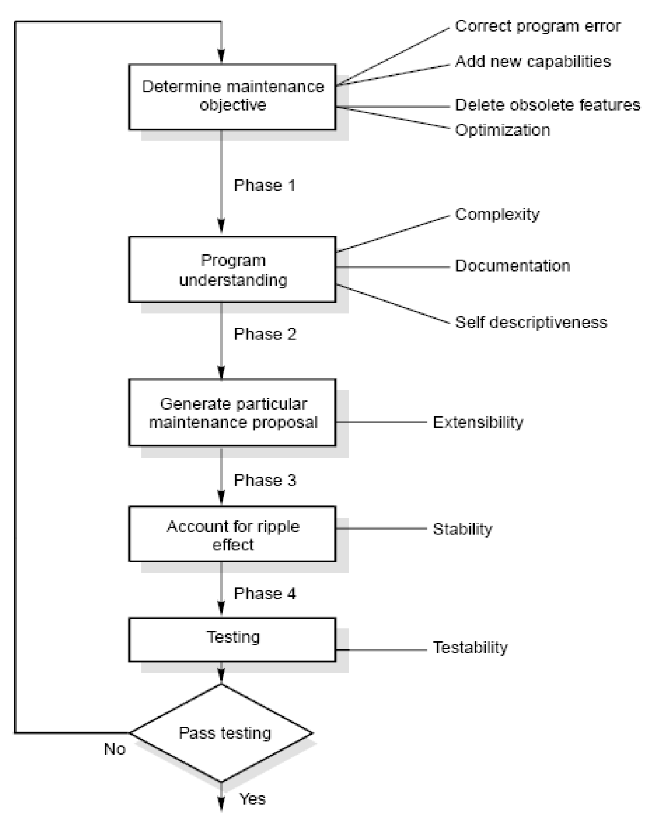
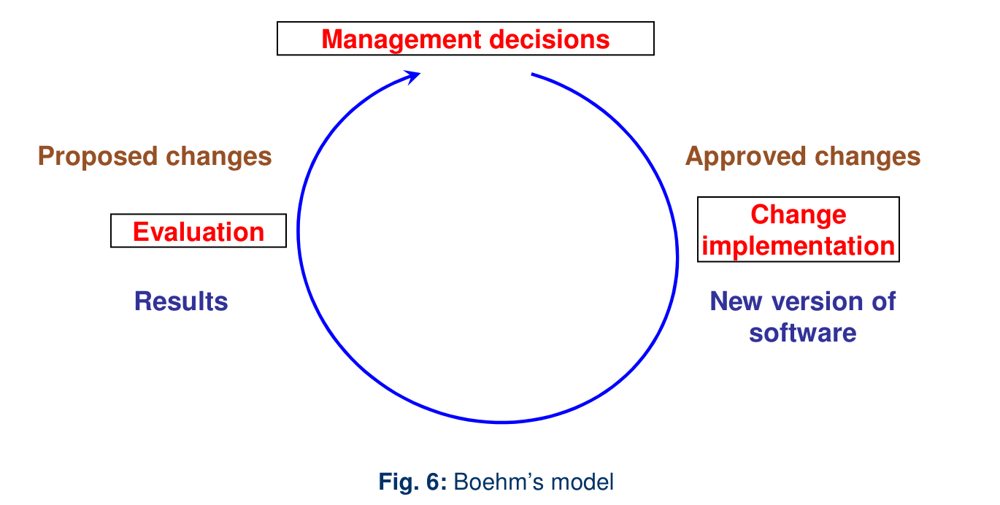
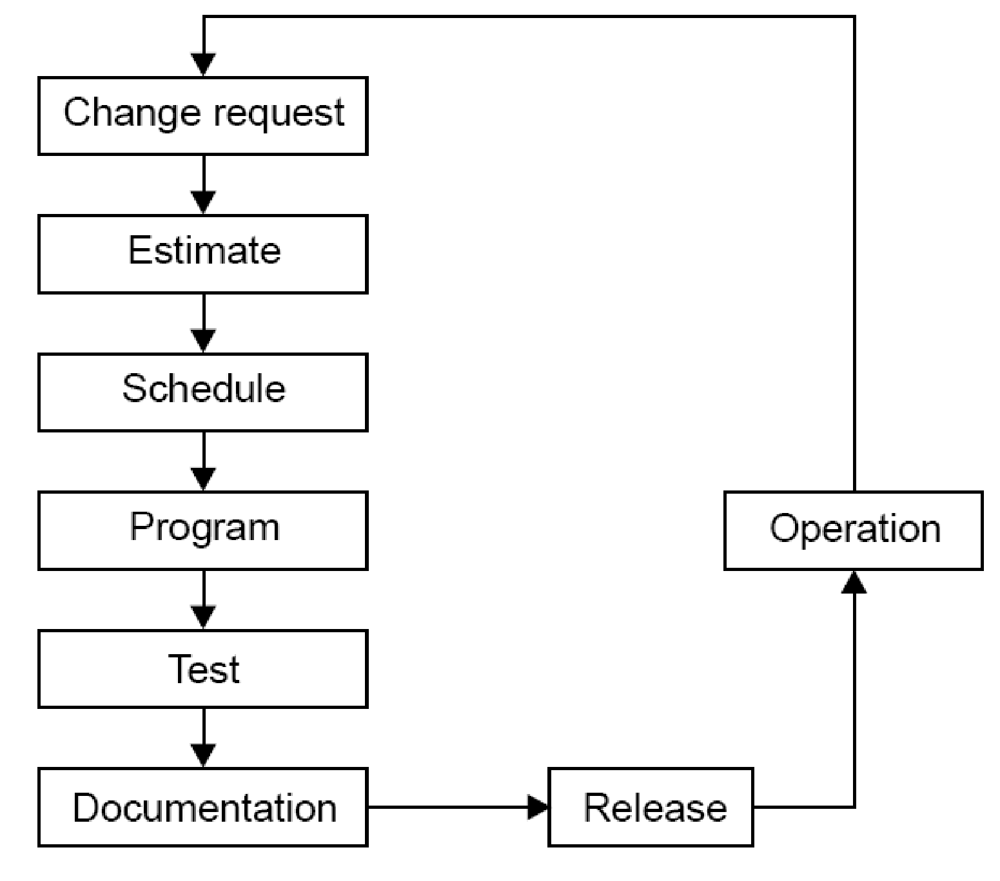
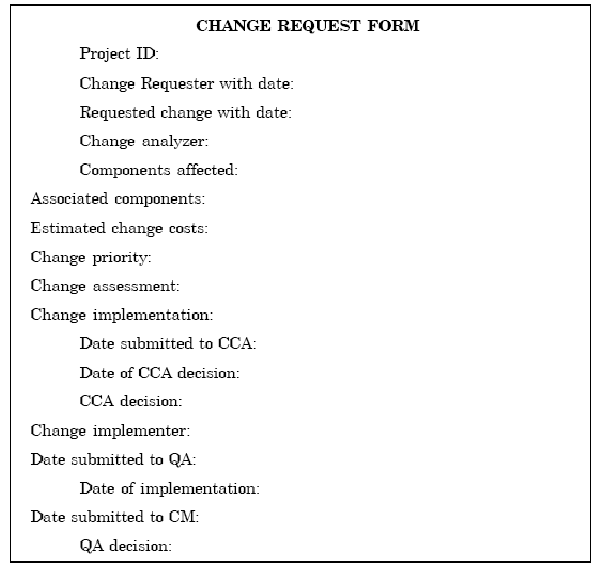
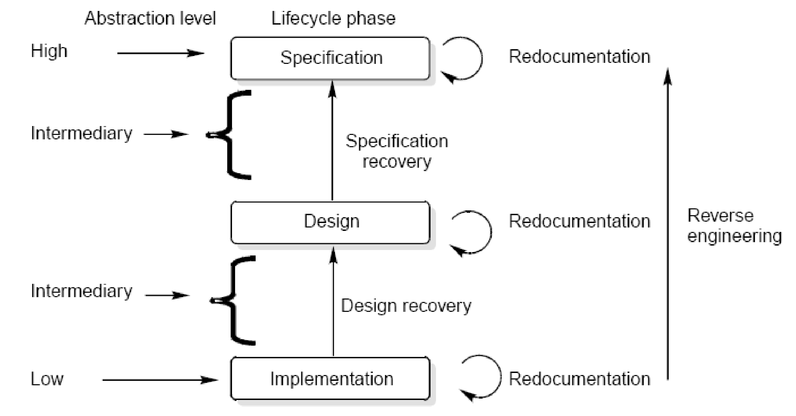
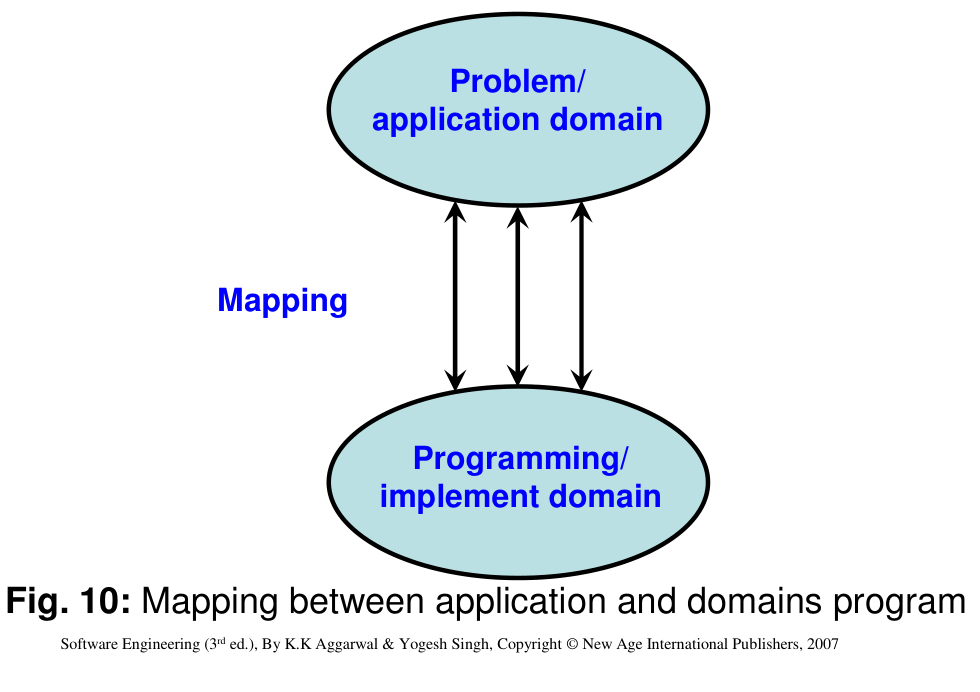

# Advanced Software Engineering — Chapter 9: Software Maintenance
## T4: Structural Diagrams & Process Workflows

### Q9.F1 (Exercise 9.7): Software Maintenance Process Workflow
**Prompt:** Explain the steps of software maintenance with the help of a diagram (Exercise 9.7).

**Source:** Aggarwal & Singh, *Software Engineering* (3rd ed.), Fig. 9.2, pp. 463–465; Slide 10.

---

### Q9.F2 (Exercise 9.13): Boehm's Decision-Driven Maintenance Model
**Prompt:** Explain Boehm's maintenance model with the help of a diagram (Exercise 9.13).

**Source:** Aggarwal & Singh, *Software Engineering* (3rd ed.), Fig. 9.6, p. 468; Slide 19.

---

### Q9.F3 (Exercise 9.15): Taute Maintenance Model Workflow
**Prompt:** Describe the Taute maintenance model. What are the various phases of this model? (Exercise 9.15).

**Source:** Aggarwal & Singh, *Software Engineering* (3rd ed.), Fig. 9.7, p. 469; Slide 20.

---

### Q9.F4 (Exercise 9.32): Configuration Management Change Request Form
**Prompt:** What are configuration management activities? Draw the performa of change request form (Exercise 9.32).

**Source:** Aggarwal & Singh, *Software Engineering* (3rd ed.), Fig. 9.14, pp. 484–485; Slide 58.

---

### Q9.F5 (Exercise 9.25): Reverse Engineering Abstraction Levels & Domain Mapping
**Prompt:** What is reverse engineering? Discuss levels of reverse engineering (Exercise 9.25).

**Source:** Aggarwal & Singh, *Software Engineering* (3rd ed.), Figs. 9.10–9.11, pp. 476–478; Slides 42 & 45.

<!--
## Retrieval Set & Active Recall Self-Test

1. In Fig. 9.2 (Maintenance Process), list the four core phases and state the specific software quality attribute associated with each phase.
2. What role does the "Pass testing?" decision diamond play in Fig. 9.2, and what action occurs when testing fails?
3. In Boehm's maintenance model (Fig. 9.6), how are emergency fixes handled compared to routine maintenance?
4. Enumerate the eight sequential phases of the Taute maintenance model (Fig. 9.7).
5. State the name of the change approval authority in Fig. 9.14 and list at least six core fields of the Change Request Form.
6. Based on Fig. 9.11, distinguish between Redocumentation and Design Recovery in terms of abstraction levels.
-->
