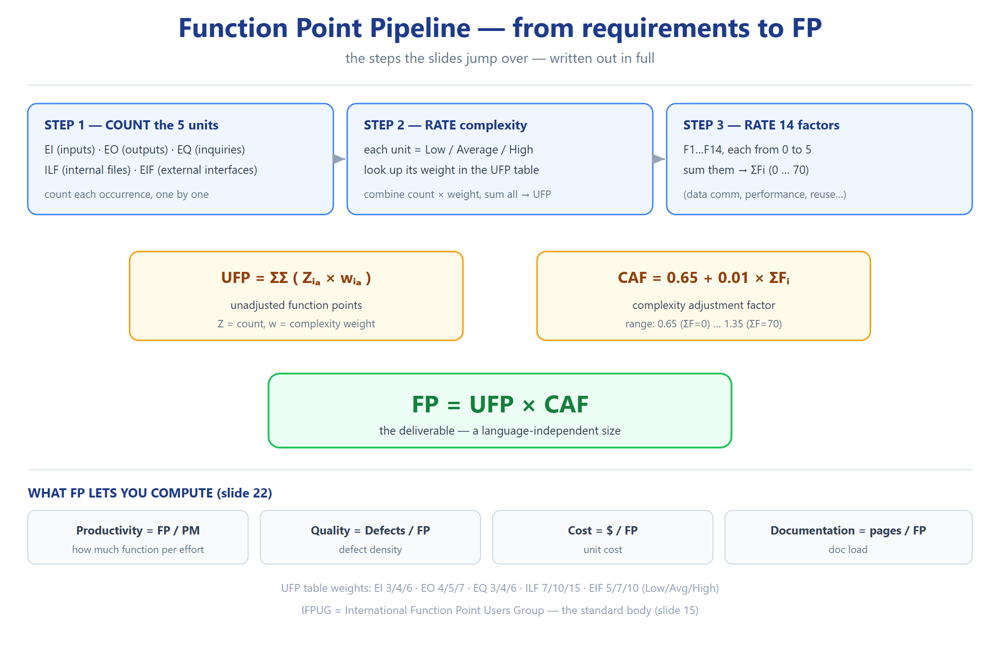

# T1 — MCQ (Ch04 · Software Project Planning) ★★☆

> **شنو هذا الملف؟** أسئلة الاختيار من متعدد. القسم الأول = **الرسمية** (4.1–4.25) بأجوبتها ومصدرها. القسم الثاني = **إضافية** بنفس النمط.

---

## أ) MCQ الرسمية 4.1 ← 4.25

| # | السؤال | أ | ب | ج | د | **الجواب** |
|---|---|---|---|:---:|---|
| 4.1 | بعد SRS، شنو نقدّر؟ | Size | Cost | Dev.time | All | **d** |
| 4.2 | مو مقياس حجم؟ | LOC | Function Count | Cyclomatic Complexity | Halstead length | **c** |
| 4.3 | Function count طوّرها | B.Beizer | B.Boehm | M.Halstead | Alan Albrecht | **d** |
| 4.4 | عدد functional units | 2 | 5 | 4 | 1 | **b** |
| 4.5 | IFPUG = | Initial FPUG | Int'l FPUG | Int'l FP **Users** G | Initial FPUG | **c** |
| 4.6 | FP = | UFP×CAF | UFP×FAC | UFP×Cost | UFP×Productivity | **a** |
| 4.7 | Putnam مبني على | Function points | Norden/Rayleigh | Putnam theory | Boehm obs. | **b** |
| 4.8 | manpower build-up | K/td² /yr² | K/td³ /yr² | K/td² /yr | K/td³ /yr | **b** |
| 4.9 | COCOMO طوّرها | B.W.Boehm | Rothermal | Beizer | Rajiv Gupta | **a** |
| 4.10 | COCOMO = | Common Cost | **Constructive Cost** | Complete Cost | Comprehensive | **b** |
| 4.11 | organic effort | E=2.4K^1.05 | E=3.4K^1.06 | E=2.0K^1.05 | E=2.4K^1.07 | **a** |
| 4.12 | الحجم يعتمد على | Cost | Schedule | Time | None | **d** |
| 4.13 | عدد CAF = | 10 | 20 | 14 | 12 | **c** |
| 4.14 | COCOMO-II مبني على | Complex | **Algorithm** | Bottom-up | Top-down | **b** |
| 4.15 | Cost estimation يشمل | Software | Hardware | Personnel | All | **d** |
| 4.16 | 2–50 KLOC ⇒ | Organic | Semidetached | Embedded | None | **a** |
| 4.17 | COCOMO-II طُوّرت في | Maryland | **Southern California** | IBM | AT&T | **b** |
| 4.18 | مو فئة COCOMO-II | End-user prog | Infrastructure | **Requirement Sector** | System integration | **c** |
| 4.19 | مو infrastructure | OS | DBMS | Compilers | **Result mgmt** | **d** |
| 4.20 | مراحل COCOMO-II | 2 | 3 | 4 | 5 | **b** |
| 4.21 | مو مرحلة | App.Composition | Early design | Post-arch | **Comprehensive** | **d** |
| 4.22 | Rayleigh eq | 2at·e^(−at²) | 2Kt·e^(−at²) | **2Kat·e^(−at²)** | 2Kbt·e^(−at²) | **c** |
| 4.23 | technology factor C | **SK^(−1/3)td^(−4/3)** | SK^(1/3)td^(4/3) | SK^(1/3)td^(−4/3) | SK^(−1/3)td^(4/3) | **a** |
| 4.24 | أنشطة risk = | 3 | **2** | 5 | 10 | **b** |
| 4.25 | مو نشاط risk | Assessment | Control | **Generation** | None | **c** |

**⚠️ فخاخ مضمونة:**
- **4.24 = 2** (مو 5 — الـ5 هي تصنيفات Jones **للمخاطر**، مو فئات الأنشطة).
- **4.12 = None** (الحجم يُقدَّر قبل cost/schedule).
- **4.18/4.19/4.21** — أسئلة نفي ("مو") — انتبه.

---

## ب) MCQ إضافية (بنفس النمط)

| # | السؤال | الجواب | المصدر |
|---|---|---|---|
| R1 | أقصى قيمة `CAF` | **1.35** | ΣFi=70 |
| R2 | أدنى قيمة `CAF` | **0.65** | ΣFi=0 |
| R3 | وزن ILF عالية التعقيد | **15** | جدول UFP |
| R4 | أي mode أعلى b_b | **Embedded (1.20)** | جدول 4(a) |
| R5 | عدد cost drivers بـintermediate | **15** | سلايد 53 |
| R6 | D₀=27 يعني | **إعادة بناء من موجود** | سلايد 143 |
| R7 | عدد scale factors (early design) | **5** | Table 12 |
| R8 | عدد drivers بـpost-architecture | **17** | Table 16 |
| R9 | الـorganic بـintermediate a_i = | **3.2** | Table 6 |
| R10 | peak manning `m₀` = | **K/(td·e)** | سلايد 130 |
| R11 | difficulty `D` = | **K/td²** | سلايد 137 |
| R12 | عدد مراحل COCOMO II = | **3** | Table 8 |
| R13 | FPA تقسم النظام إلى | **5 functional units** | سلايد 12 |
| R14 | `Kd` (dev sub-cycle) = | **K/6** | سلايد 155 |
| R15 | `tod` = | **td/√6** | سلايد 154 |
| R16 | Technology factor C range | **610–57314** | سلايد 149 |
| R17 | Productivity ∝ | **D^(−2/3)** | سلايد 147 |
| R18 | عدد F1–F14 factors | **14** | سلايد 21 |
| R19 | Who noticed Rayleigh in software | **Norden (IBM)** | سلايد 123 |
| R20 | الاستنتاج من Modularity (U-curve) | **نقطة مثلى** | Fig 4 (Ch5 concept) |

---

## ج) أخطاء شائعة يجب الحذر منها
| الفخ | الصحيح |
|---|---|
| "أنشطة risk = 5" | **2** (Assessment + Control) |
| "الحجم يعتمد على الـcost" | **مستقل** — يُقدَّر من المتطلبات |
| "a_b = a_i للorganic" | **2.4 ≠ 3.2** |
| "COCOMO II فئتان" | **3 مراحل، 4 فئات** |
| "Rayleigh = m(t)=2at·e^(−at²)" | **تضم K**: `2Kt·e^(−at²)` |

---

## Retrieval set (active recall)

| السؤال | الجواب |
|---|---|
| 4.4 عدد functional units؟ | **5** |
| 4.9 من طوّر COCOMO؟ | **B.W. Boehm** |
| 4.11 organic effort؟ | E=2.4(KLOC)^1.05 |
| 4.14 COCOMO-II مبني على؟ | Algorithm approach |
| 4.17 طُوّرت في؟ | University of Southern California |
| 4.19 مو infrastructure؟ | Result management system |
| 4.21 مو مرحلة؟ | Comprehensive cost estimation model |

---
*المصدر: سلايدات 194–199 (MCQ رسمية) + توليد بنفس النمط — بُني 2026-10-12*