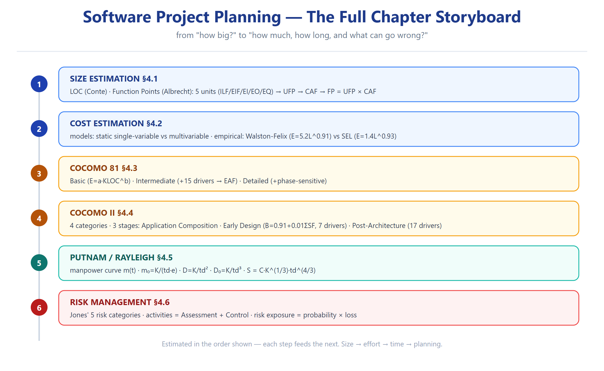

# T2 — مقالي وصفي (Ch04 · Software Project Planning) ★☆☆

> **شنو هذا الملف؟** الأسئلة المقالية الرسمية (Exercises) بـ**خطة جواب كاملة** لكل واحدة — العناوين + النقاط + المصدر.
> **الاستخدام:** احفظ **الهيكل** (العناوين)، لا النص الحرفي.

---

### Q2.1 — ما هي الأنشطة خلال software project planning؟ *(Exercise 4.1)*
**الهيكل:**
1. **Size Estimation** — كم سطر/كم FP؟
2. **Cost Estimation** — كم شخص-شهر؟
3. **Development Time** — كم شهر؟
4. **Resource/Manpower Allocation** — كم مطوّر ومتى؟
5. **Risk Management** — شنو ممكن يغلط؟
**شكل مساعد:** Fig 1 (سلايد 4).

---

### Q2.2 — صف تقنيتَي تقدير الحجم *(Exercise 4.2)*
**الهيكل:** (اختر LOC + FP)
1. **LOC (Conte):** "any line of program text that is not a comment or blank line". القوة: بسيط. الضعف: لغة-معتمد.
2. **Function Points (Albrecht):** يقيس الوظيفة (5 units). القوة: لغة-مستقل، من المتطلبات. الضعف: يحتاج خبرة بالتصنيف.
**المصدر:** سلايد 5–19.

---

### Q2.3 — عدّ الـ`;` بـC مقابل LOC (قوّة/ضعف) *(Exercise 4.3)*
**الهيكل:**
- **قوّة الـ`;`:** يرتبط بالمنطق (كل جملة = فاصلة منقوطة)، أدق من LOC اللي يتأثر بالتنسيق.
- **ضعف:** `;` داخل السلاسل النصية تُعدّ خطأً، والـ`;` لا تعكس كل التعقيد (حلقات/شروط مركّبة).
- **مقابل LOC:** LOC أسهل قياساً لكن أقل دقة؛ الـ`;` أدق لكن لغة-معتمد بشدة.
**المصدر:** سلايد 8 + [تحليل].

---

### Q2.4 — صمّم LOC counter *(Exercise 4.4)*
**الهيكل:**
1. اقرأ الملف سطراً سطراً.
2. استثنِ الأسطر الفارغة والتعليقات (`//`, `/* */`).
3. عدّ الباقي.
**لغة-معتمد؟** نعم — تعريف "السطر المنطقي" يختلف (مثلاً C مقابل Python).
**القيود:** السلاسل النصية، أسطر المتابعة (continuation)، الأدوات المولّدة (generated code).
**المصدر:** سلايد 5–8.

---

### Q2.5 — مفهوم FP + ليش مقبولة صناعياً؟ *(Exercise 4.6)*
**الهيكل:**
1. **التعريف:** يقيس النظام من منظور المستخدم (inputs/outputs/files)، بمعزل عن اللغة.
2. **ليش مقبولة:** ① لغة-مستقل ② تُحسب من المتطلبات بدري ③ تخدم البيئات الـnon-procedural ④ أعدل مع GUI/قواعد البيانات.
**المصدر:** سلايد 9–15.

---

### Q2.6 — ما هي size metrics؟ ومحاسن FP على LOC *(Exercise 4.7)*
**الهيكل:**
1. **المقاييس:** LOC · Function Points · Object Points.
2. **محاسن FP:** لغة-مستقل، من المتطلبات، يخدم الأنظمة غير الإجرائية.
3. **مثال:** نفس الوظيفة = 100 سطر assembly = 10 أسطر C++ ⇒ LOC ظالم.

---

### Q2.7 — هل يمكن تقدير الحجم قبل الكود؟ *(Exercise 4.8)*
**الهيكل:** نعم — FP تُحسب من SRS: عدّ المدخلات/المخرجات/الاستعلامات/الملفات (بنود المتطلبات) ← UFP ← FP. **المثال:** نظام مخزون بسيط ⇒ 3 files, 5 inputs, 4 outputs ⇒ FP محسوبة قبل أي كود.
**المصدر:** سلايد 10–16.

---

### Q2.8 — Albrecht's function count + مثال *(Exercise 4.9)*
**الهيكل:**
1. عدّ الـ5 units (EI/EO/EQ/ILF/EIF).
2. صنّف التعقيد (Low/Avg/High)، خذ الأوزان.
3. UFP = Σ(count×weight).
4. CAF = 0.65 + 0.01ΣFi.
5. FP = UFP × CAF.
**المثال:** Example 4.1 (سلايد 23) — FP=672.

---

### Q2.9 — قارن Walston-Felix وSEL *(Exercise 4.12)*
**الهيكل (جدول):**

| | Walston-Felix | SEL (Doty) |
|---|---|---|
| Effort | E = 5.2 L^0.91 | E = 1.4 L^0.93 |
| Duration | D = 4.1 L^0.36 | D = 4.6 L^0.26 |
| Docs | — | DOC = 30.4 L^0.90 |
| الطابع | متحفظ | أتفاؤل |

**الفرق الجوهري:** W-F يعطي **LOC أقل لنفس الجهد** (a أكبر). **التوصية:** W-F للمحافظة، SEL للأنظمة المُختبَرة.
**المصدر:** سلايد 36–40.

---

### Q2.10 — أنواع COCOMO + phase distribution *(Exercise 4.15)*
**الهيكل:**
1. **3 modes:** organic (صغير/مألوف) · semidetached (وسط) · embedded (قيود صارمة).
2. **المعادلات:** E=a(KLOC)^b، D=c(E)^d.
3. **Phase distribution (سلايد 60):** design 16–18% · programming 48–68% · integration&test الباقي.
**المصدر:** سلايد 43, 60.

---

### Q2.11 — كل مستويات COCOMO *(Exercise 4.16 — جزئه النظري)*
**الهيكل:**
1. **Basic:** الحجم فقط (a_b/c_b).
2. **Intermediate:** + 15 cost driver → EAF (a_i/c_i).
3. **Detailed:** + phase-sensitive + 3-level hierarchy.
**الفرق الجوهري بين المستويات:** الـdrivers = سبب اختلاف المعاملات.

---

### Q2.12 — COCOMO-II بالتفصيل *(Exercise 4.22)*
**الهيكل:**
1. **4 فئات:** End-user prog · Infrastructure · Application generators · System integration.
2. **3 مراحل:** Application Composition (object points) · Early Design (B + 7 drivers) · Post-Architecture (17 drivers).
3. **الميزة:** الأس B متغيّر (0.91←1.23)، والأس من 5 scale factors.
**المصدر:** سلايد 73–74.

---

### Q2.13 — Infrastructure Sector *(Exercise 4.23)*
**الهيكل:** يشمل OS، DBMS، compilers، communications، network software. **خصائصه:** عمر طويل، مستخدمون كثيرون، متطلبات صارمة. يُقدَّر بـpost-architecture model.
**المصدر:** سلايد 73, 106.

---

### Q2.14 — مراحل COCOMO-II — أيها الأشهر؟ *(Exercise 4.24)*
**الهيكل:**
- **الأشهر = Early Design** — لأنه يوازن الدقة (5 scale factors + 7 drivers) والسرعة، ويُستخدم قبل اكتمال الـarchitecture.
- **السبب:** أكثر المشاريع متوسطة الحجم ما عنده وقت للـpost-architecture الكامل، والـearly design يعطي تقديراً كافياً.
**المصدر:** سلايد 85.

---

### Q2.15 — Putnam model + قيوده *(Exercise 4.26)*
**الهيكل:**
1. **الأساس:** منحنى Norden/Rayleigh لتوزيع الجهد.
2. **المعادلات:** m(t)، y(t)، m₀، D، D₀.
3. **العلاقة:** S = C·K^(1/3)·td^(4/3).
4. **القيود:** يفترض منحنى مثالي · لا يصمد للصغيرة · حساس لـtd · يعتمد على بيانات تاريخية.
**المصدر:** سلايد 123–156.

---

### Q2.16 — Risk؟ ما هي typical software risks؟ *(Exercise 4.32)*
**الهيكل (تصنيفات Jones الخمسة):**
1. **Dependencies** — trained staff, inter-group, customer items, subcontractors.
2. **Requirements issues** — uncertain, unprioritized, rapidly changing.
3. **Management issues** — inadequate planning, unclear ownership, poor communication.
4. **Lack of knowledge** — training, domain experience, new tech.
5. **Other** — testing facilities, staff turnover, unachievable performance.
**أثر staff turnover:** فقدان معرفة ضمنية، إعادة تدريب، تراجع productivity.
**المصدر:** سلايد 184–189.

---

### Q2.17 — Risk management activities؟ تُرتَّب؟ *(Exercise 4.33)*
**الهيكل:**
1. **فئتان:** Risk Assessment (Identification, Analysis, Prioritization) + Risk Control (Planning, Monitoring, Resolution).
2. **هل تُرتَّب؟** نعم — حسب **risk exposure** = probability × magnitude.
**المصدر:** سلايد 190–191.

---

### Q2.18 — Risk exposure + تقنيات السيطرة *(Exercise 4.34)*
**الهيكل:**
- **RE** = probability(loss) × magnitude(loss).
- **التقنيات:** Avoidance (لا تسوي) · Transfer (أمّن) · Mitigation (قلّل الاحتمال) · Acceptance (تقبّل + خطة طوارئ).
**المصدر:** سلايد 191–192.

---

### Q2.19 — ليش نقدّر بدري؟ ومتى لا؟ *(Exercise 4.31)*
**الهيكل:**
- **ليش:** التخطيط، العقود، الجدولة، توزيع الموارد، الميزانية — كلها تحتاج تقدير مبدئي.
- **متى لا:** إذا المتطلبات ما زالت تتغيير جذرياً (تقدير مضلّل)، أو المشروع استكشافي (R&D).
**المصدر:** سلايد 33–34.

---

### Q2.20 — Is risk management economical؟ *(Exercise 4.35)*
**الهيكل:**
- **الاقتصاد:** الإدارة تقلل "surprise factor" — الاستثمار الوقائي (تدريب، اختبار) أرخص من الإصلاح بعد الفشل.
- **الأثر على الكلفة:** يرفع الكلفة المخططة قليلاً لكن يقلل احتمال الكلفة الكارثية.
**المصدر:** سلايد 180–183.

---

## Retrieval set (active recall)

| السؤال | الجواب |
|---|---|
| أنشطة planning الخمسة؟ | size, cost, time, resources, risk |
| تقنيتا تقدير الحجم؟ | LOC + FP |
| تصنيفات Jones الخمسة؟ | Dependencies, Requirements, Management, Knowledge, Other |
| أنشطة risk الستة؟ | Identification, Analysis, Prioritization, Planning, Monitoring, Resolution |
| ليش نقدّر بدري؟ | للتخطيط/العقود/الجدولة |

---
*المصدر: Exercises 4.1–4.36 — بُني 2026-10-12*