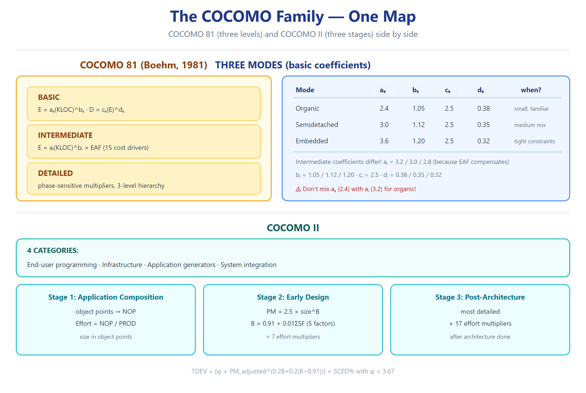

# T3 — الفهم (Ch04 · Software Project Planning) ★☆☆

> **شنو هذا الملف؟** أسئلة تختبر **الفهم** — ليش هيك؟ كيف يشتغل؟ شنو العلاقة؟
> إذا جاوبت "احفظت" ما راح تكفي — لازم تعيد الصياغة بمثالك.

---

**Q3.1** ليش نقيس الحجم **قبل** الكود؟
> لأن الحجم مدخل لباقي التقديرات (cost, time, resources). لو انتظرنا الكود — فات وقت التخطيط. FP يساعد: تُحسب من SRS. *(سلايد 10–16)*

**Q3.2** ليش LOC **ظالمة** للغات عالية المستوى؟
> نفس الوظيفة: 100 سطر assembly = 10 أسطر C++. LOC تعاقب اللغات المختصرة رغم أنها أكثر إنتاجية. *(سلايد 7–8)*

**Q3.3** ليش الـCAF يتغيّر بين 0.65 و1.35؟
> لأن المعادلة `0.65 + 0.01×ΣFi`، وΣFi بين 0 و70 ⇒ المدى [0.65, 1.35]. *(سلايد 21)*

**Q3.4** شنو يعني إن الـ14 عامل تعقيد مو كلها بنفس الأهمية؟
> كل عامل يُقيَّم 0←5؛ العامل بـ5 يضيف 0.05 للـCAF (يزيد الجهد)، والعامل بـ0 ما يضيف. المعنى: النظام "المعقّد" عنده ΣFi عالي ⇒ CAF أعلى ⇒ FP أعلى. *(سلايد 21)*

**Q3.5** ليش COCOMO عنده **3 مودات** مو واحد؟
> لأن "الحجم + البيئة" يغيّرون العلاقة. Organic = بيئة ودّية (a=2.4)، Semidetached = وسط (3.0)، Embedded = قيود صارمة على hardware/الجدول (3.6 ⇒ جهد أعلى). *(سلايد 43)*

**Q3.6** ليش معامل `a` بـintermediate (3.2) **مختلف** عن basic (2.4) للorganic؟
> لأن intermediate يضرب بـEAF. لو EAF=1، لازم يعطي نفس النتيجة ⇒ a_i مُعاير ليغطي أن EAF عادةً < 1. *(سلايد 57)*

**Q3.7** ليش الأس `b` في `E=a(KLOC)^b` دائماً **> 1**؟
> لأن الجهد ينمو **أسرع** من الحجم (diseconomies of scale) — التنسيق والتفاعلات تزيد. b=1.05 (organic) ← 1.20 (embedded). *(استنتاج من سلايد 45)*

**Q3.8** ليش `D=c(E)^d` بـd **< 1**؟
> لأن الوقت ينمو **أبطأ** من الجهد — يمكنك توظيف المزيد (لكن بحدود). d=0.38 ← 0.32. *(سلايد 45)*

**Q3.9** شنو منطق الـ15 cost driver بأربع مجموعات؟
> كل مجموعة تمثل بُعداً: **Product** (شنو نبيعه) · **Hardware** (على شنو نشتغل) · **Personnel** (مَن يشتغل) · **Project** (كيف نشتغل). كل driver يعدّل الجهد صعوداً/نزولاً. *(سلايد 53–56)*

**Q3.10** ليش `B` في COCOMO II **متغيّر** مو ثابت؟
> لأن معادلته `B = 0.91 + 0.01×ΣSF`. الخمسة scale factors (precedentness, flexibility, arch/risk, team cohesion, process maturity) تصف "نضج المشروع". مشروع مألوف ومنظّم ⇒ B قريب 0.91 (economies). جديد ومبعثر ⇒ قريب 1.23 (diseconomies). *(سلايد 85–88)*

**Q3.11** ليش نموذج Putnam سُمّي Rayleigh؟
> لأن Norden (IBM) لاحظ أن توزيع جهد مشاريع الـhardware يتبع **توزيع Rayleigh الاحتمالي** — يبدأ بطيئاً، يذرو، ثم ينزل. Putnam أكّد أنه تقريب جيد للـsoftware. *(سلايد 123–125)*

**Q3.12** شنو معنى "difficulty D=K/td²"؟
> يقيس **إجهاد التطوير**: مشروع فيه جهد كبير K ووقت قصير td ⇒ D عالي ⇒ صعب. ∝ الجهد، ∝ 1/الوقت². *(سلايد 137–138)*

**Q3.13** ليش `D₀=K/td³` يأخذ قيم 8/15/27؟
> D₀ يقيس **نمط بناء الفريق**: مشروع جديد بتفاعلات (8، نمو أبطأ)، standalone (15)، إعادة بناء (27، نمو أسرع لأن الأساس موجود). *(سلايد 143)*

**Q3.14** ليش نستخدم `Kd=K/6` و`tod=td/√6` بالـdevelopment sub-cycle؟
> لأن مرحلة التطوير = جزء من دورة الحياة الكاملة (95% من T&C يُكمل بالتطوير). العلاقة مشتقة من تساوي الميل عند t=0. *(سلايد 153–155)*

**Q3.15** شنو معنى "risk = tomorrow's problem"؟
> الخطر **لم يحدث بعد** لكنه محتمل. إدارته = توقّعه قبل يصير مشكلة. *(سلايد 182)*

**Q3.16** ليش نقسّم أنشطة risk إلى **assessment** و**control**؟
> Assessment = نفهم الخطر (تعرّف/تحليل/ترتيب). Control = نسويه (تخطيط/مراقبة/حل). التقسيم = فرق بين "المعرفة" و"العمل". *(Fig 9, سلايد 190)*

**Q3.17** شنو معنى "risk exposure"؟
> RE = probability × magnitude. يسمح **بترتيب** المخاطر: الأولوية للـRE الأعلى. *(سلايد 191)*

**Q3.18** ليش `FP = UFP × CAF` مو جمع؟
> لأن CAF **معامل تعديل نسبي** (0.65–1.35) يضاعف الأساس — مو إضافة ثابتة. *(سلايد 19)*

**Q3.19** كيف Object Points يختلف عن FP؟
> كلا يقيس الحجم، لكن object points يقيس **screens/reports/3GL components** (لـCOCOMO II App Composition) بينما FP يقيس functional units. *(سلايد 76–80)*

**Q3.20** ليش التقدير المبكر غالباً **غير دقيق**؟
> لأن المعلومات محدودة (متطلبات أولية). الحل: تقدير حدودي (range) + تحديث مع تقدّم المشروع. *(Exercise 4.31)*

**Q3.21** شنو الفرق بين "static single-variable" و"multivariable"؟
> Single-variable: الجهد = دالة الحجم فقط (مثل W-F, SEL). Multivariable: الجهد = دالة الحجم **+ drivers** (مثل COCOMO intermediate). *(سلايد 34)*

**Q3.22** ليش "reuse" يخفض الـNOP؟
> لأن معادلته `NOP = object_points × (100−%reuse)/100` — كل ما زادت إعادة الاستخدام، قلّ الجهد لبناء الجديد. *(سلايد 83)*

**Q3.23** كيف تُختار الـmode الصحيح؟
> 3 مؤشرات: **الحجم** (KLOC) · **الخبرة** (فريق) · **البيئة/القيود**. صغير+مألوف=organic؛ قيود+معقّد=embedded. *(سلايد 43)*

**Q3.24** شنو معنى "productivity ∝ D^(−2/3)"؟
> كل ما زادت الصعوبة (D)، قلّت الإنتاجية (P). العلاقة عكسية غير خطية (قوة −2/3). *(سلايد 147)*

**Q3.25** ليش "cost to detect & fix faults" يزيد كل ما تأخر الاكتشاف؟
> لأن الخطأ بالمتطلبات، لو انكشف بالتصميم، يكلف إعادة تصميم. لو انكشف بالتشغيل، يكلف إعادة بناء كاملة. *(سلايد 32)*

---

## Retrieval set (active recall)

| السؤال | الجواب |
|---|---|
| مدى CAF؟ | 0.65 – 1.35 |
| ليش b>1؟ | diseconomies of scale |
| ليش d<1؟ | الوقت ينمو أبطأ من الجهد |
| ليش B متغيّر؟ | 5 scale factors |
| ليش Putnam سُمّي Rayleigh؟ | توزيع Norden الاحتمالي |
| معنى D=K/td²؟ | إجهاد التطوير |
| معنى D₀؟ | نمط بناء الفريق (8/15/27) |

---
*المصدر: سلايدات 1–207 — تحليل مباشر — بُني 2026-10-12*