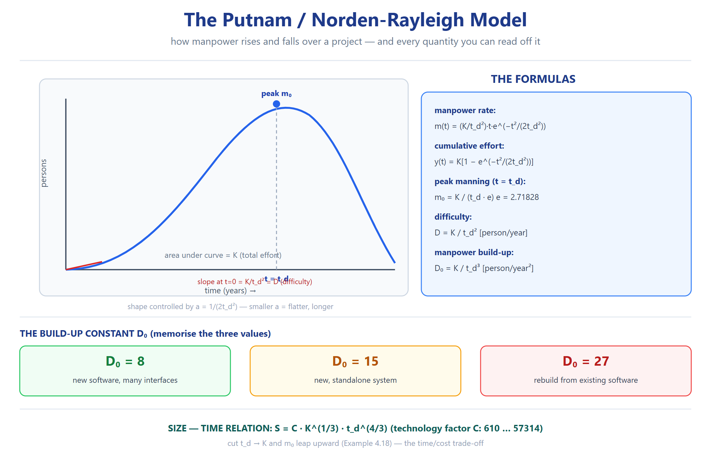

# T4 — التحليل (Ch04 · Software Project Planning) ★★☆

> **شنو هذا الملف؟** أسئلة تفكيك واشتقاق واستنتاج — تتطلب ربط معلومتين أو أكثر (multi-hop).

---

## أ) الاشتقاق (Derivation)

**Q4.1** من `E=a(KLOC)^b`، اشتق علاقة: كيف يتغير E لو **تضاعف** الحجم؟
> `E'/E = (2L)^b / L^b = 2^b`.
> - Organic (b=1.05): `2^1.05 = 2.07` ⇒ +107%
> - Semidetached (1.12): `2^1.12 = 2.17` ⇒ +117%
> - Embedded (1.20): `2^1.20 = 2.30` ⇒ +130%
> **الاستنتاج:** المودات الأقسى تعاني **أكثر** من تضاعف الحجم (§diseconomies of scale).

**Q4.2** من منحنى Rayleigh `m(t)=(K/td²)·t·e^(−t²/(2td²))`، أثبت أن الذروة عند t=td.
> `dm/dt = (K/td²)·e^(−t²/(2td²))·[1 − t²/td²] = 0` ⇒ `t² = td²` ⇒ `t = td`. ✓

**Q4.3** اشتق العلاقة التالية:
> `S = 0.3935·φ·K^(1/3)·td^(4/3)`
>
> انطلاقاً من معادلة الإنتاجية:
>
> `P = φ·D^(−2/3)`
>
> **الحل:**
> `P = S/E` ⇒ `S = P·E = φ·D^(−2/3)·E`
>
> نعوّض:
>
> `E = y(td) = K(1−e^(−1/2)) = K·0.3935`
>
> و:
>
> `D = K/td²`
>
> فيصبح:
>
> `S = φ·(K/td²)^(−2/3)·(0.3935K) = φ·K^(−2/3)·td^(4/3)·0.3935·K = 0.3935·φ·K^(1/3)·td^(4/3)`. ✓

**Q4.4** من العلاقتين التاليتين، اشتق علاقة الحجم بالوقت:
> `E = a·(KLOC)^b`  ·  `D = c·(E)^d`

> **الحل:**
> `D = c·(a·KLOC^b)^d = c·a^d·KLOC^(b·d)`
>
> للـorganic: `b·d = 1.05 × 0.38 = 0.399` ⇒ `D ∝ KLOC^0.399` ⇒ الوقت ينمو أبطأ بكثير من الحجم.

**Q4.5** أثبت العلاقة بين `m₀` و`D` التالية: `D = m₀·td/e`.
> **الحل:** نبدأ من:
>
> `m₀ = K/(td·e)`  ·  `D = K/td²`
>
> نعوّض K في D:
>
> `D = K/td² = (m₀·td·e)/td² = m₀·e/td`
>
> ⇒ `m₀ = D·td/e`. *(سلايد 139)*

---

## ب) تحليل الحساسية (Sensitivity)

**Q4.6** بـ`D = K/td²`: لو خفّضنا td بـ10%، كيف يتغير D؟
> نحسب:
>
> `D' = K/(0.9·td)² = K/(0.81·td²) = 1.235·D`
>
> ⇒ D يزيد ~**23.5%**.
> **الاستنتاج:** D حسّاس جداً للوقت (تربيعي عكسي).

**Q4.7** أي أكثر تأثيراً على D: تغيير K أو تغيير td؟
> بالمشتقات: `∂D/∂K = 1/td²` (خطي) · `∂D/∂td = −2K/td³` (تربيعي).
> **الاستنتاج:** td أكثر تأثيراً بكثير. (مثال سلايد 141: Project A `D'(td)=−40` مقابل `D'(K)=1`). ⇒ **المشروع time-sensitive**.

**Q4.8** لو حسّنت `ACAP` من low (1.46) إلى high (0.86)، كيف يتغير الجهد الكلي (نسبة)؟
> الـEAF يتغير بمعامل `0.86/1.46 = 0.589` ⇒ الجهد ينخفض ~**41%** (لو باقي العوامل ثابتة).
> **الاستنتاج:** قدرة المحلل = رافعة قوية.

**Q4.9** لمشروع organic، كم ينخفض الجهد لو ارتفع `MODP` من low إلى high؟
> تأخذ القيم من Table 5: MODP low ≈ 1.24, high ≈ 0.82 ⇒ النسبة `0.82/1.24 = 0.66` ⇒ انخفاض ~**34%**.
> **الاستنتاج:** الممارسات البرمجية الحديثة توفّر ثلث الجهد.

---

## ج) الاستنتاج من الجداول

**Q4.10** من Table 4(a)، أي mode "يعاقب" الحجم الكبير أكثر؟ لماذا؟
> **Embedded** — أعلى b_b (1.20) ⇒ أسرع نمو للجهد. السبب: قيود صارمة + تعقيد ⇒ التنسيق يكلف أكثر مع الحجم.

**Q4.11** قارن الجهد (نسبة) بين organic وembedded لنفس الحجم.
> `E_emb/E_org = (3.6/2.4)·(KLOC)^(1.20−1.05) = 1.5·(KLOC)^0.15`.
> - عند 10 KLOC: `1.5×1.41 = 2.12×`
> - عند 100 KLOC: `1.5×1.99 = 2.99×`
> **الاستنتاج:** الفجوة **تتسع** مع الحجم.

**Q4.12** من علاقة FP←LOC (Table 19)، أي لغة "أكثف"؟
> **Spreadsheet (6)** و**Report Generator (6)** الأكثف (FP واحدة = 6 أسطر)، ثم C++ (29) وANSI Cobol (85) الأقل كثافة (سطر أكثر لكل FP).
> **المعنى:** FP تعطي حجماً متساوياً عبر اللغات، LOC لا.

**Q4.13** حلّل: ليش Q7.7 (600 KLOC) يظهر E للـembedded أكبر **بكثير** لكن D أكبر **قليلاً**؟
> لأن `E ∝ KLOC^1.20` (نمو سريع)، لكن `D ∝ E^0.32` (نمو بطيء). ⇒ الجهد يقفز، الوقت يزيد ببطء (يعني فريق أكبر).

---

## د) تحليل سيناريوهات

**Q4.14** مشروع تعقيد متوسط، خبرة متوسطة، وقت ضيق. شنو أول رافعة تستخدم؟
> `SCED` (required schedule) — لكن احذر: تقليل الوقت يرفع الجهد (EAF) ويرفع الذروة m₀. **الأفضل:** خفّض المتطلبات (نطاق) بدل ضغط الوقت.

**Q4.15** خطر "staff turnover" مرتفع. كيف يظهر تحليلياً؟
> يرفع `PCAP`/`PEXP`/`LTEX` (قدرة/خبرة) ⇒ الـEAF يرتفع ⇒ الجهد يزيد. الحل: إدارة معرفة + توثيق + pair programming.

**Q4.16** مشروع FP=1000، discovered 50 defects، effort=100 PM. استخرج المقاييس.
> `Productivity = 1000/100 = 10 FP/PM` · `Quality = 50/1000 = 0.05 defects/FP` · `Cost per FP = total_cost/1000`.

**Q4.17** جدولين لنفس النظام: الأول FP=500 (ΣFi=42)، الثاني FP=520 (ΣFi=56). فسّر الفرق.
> نفس UFP تقريباً (≈467) لكن ΣFi أعلى ⇒ CAF أعلى (1.21 vs 1.07) ⇒ FP أعلى. **المعنى:** النظام الثاني "أكثر تعقيداً" وليس أكبر وظيفياً.

**Q4.18** لماذا قد يعطي Putnam **نتيجة مختلفة** عن COCOMO لنفس المشروع؟
> COCOMO مبنية على بيانات مشاريع (regression)، Putnam على نموذج رياضي (Rayleigh). الأول = empirical، الثاني = analytical ⇒ قد يختلفان. الحل: استخدم الاثنين كـ**range**.

**Q4.19** من Example 4.18، فسّر تناقض: "تخفيض الوقت يقلل K لكن يرفع m₀".
> K = D₀·td³ ⇒ تقليل td يقلل K (جهد كلي أقل). لكن m₀ = K/(td·e) — النقصان بالبسط أبطأ من المقام ⇒ m₀ يرتفع ⇒ **فريق أكبر بوقت أقل**. *(سلايد 170–172)*

**Q4.20** إذا كانت `D₀=27` (إعادة بناء) — شنو يعني للمشروع؟
> الفريق يُبنى بسرعة (build-up عالي) لأن الأساس/الكود موجود. ⇒ وقت أقل، لكن خطر: الاعتماد على كود قديم.

---

## Retrieval set (active recall)

| السؤال | الجواب |
|---|---|
| E'/E لو تضاعف الحجم؟ | 2^b (organic 2.07) |
| D حسّاس لأي؟ | td (تربيعي) أكثر من K (خطي) |
| ACAP low←high؟ | −41% جهد |
| E_emb/E_org عند 100 KLOC؟ | ~2.99× |
| ليش تخفيض td يرفع m₀؟ | K ينقص أبطأ من td |

---
*المصدر: سلايدات + جداول Chapter 4 — تحليل مشتق — بُني 2026-10-12*