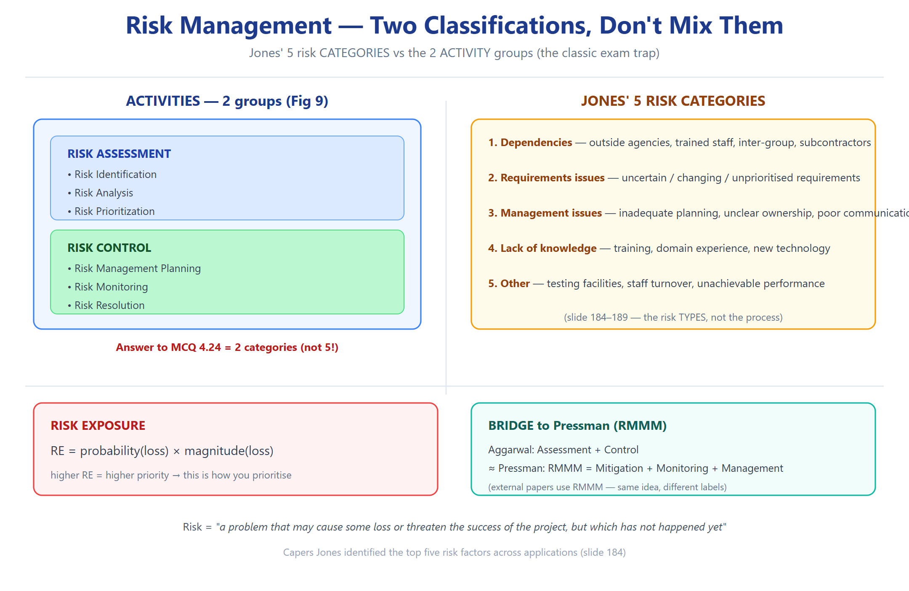

# T5 — التقييم (Ch04 · Software Project Planning) ★☆☆

> **شنو هذا الملف؟** أسئلة "أيّها أفضل ولماذا؟" — تتطلب **حكماً + تبريراً**، مو سرد.
> **القاعدة:** كل جواب = خيار + معيار + تبرير + استثناء.

---

**Q5.1** أي تقنية تقدير حجم تختار لمشروع متنوع اللغات؟ ولماذا؟
> **FP** (مو LOC). **المعيار:** استقلال عن اللغة. **التبرير:** LOC تظلم اللغات المختصرة وتضخّم المطوّلة؛ FP تقيس الوظيفة. **الاستثناء:** إذا الفريق كلّه بلغة واحدة معتاد عليها ⇒ LOC أسرع.

**Q5.2** أي مديل COCOMO تختار لمشروع 20 KLOC ببيئة مألوفة؟
> **Basic (organic)** أو **Intermediate**. **المعيار:** الحجم + الحاجة للدقة. **التبرير:** صغير ومألوف ⇒ Relations بسيطة، Basic كافي؛ لو فيه drivers مؤثرة ⇒ Intermediate. **لا تختار** Detailed/Putnam (مبالغة).

**Q5.3** أي مديل تختار لمشروع control system بقيود صارمة على الذاكرة والوقت؟
> **Intermediate/Detailed COCOMO (embedded)** أو **COCOMO II Post-Architecture**. **المعيار:** القيود hardware + الدقة المطلوبة. **التبرير:** embedded + drivers (TIME, STOR) تحتاج intermediate؛ COCOMO II post-arch أدق.

**Q5.4** Walston-Felix أم SEL؟ *(Exercise 4.12)*
> يعتمد على **السياق**. **W-F:** أكثر تحفظاً (a=5.2) ⇒ للمشاريع غير المؤكدة/المحافظة. **SEL:** أتفاؤل (a=1.4) ⇒ للأنظمة الكبيرة المُختبَرة بمعهد SEL. **المعيار:** طبيعة البيانات التاريخية.

**Q5.5** هل COCOMO II أفضل من COCOMO 81؟ برّر.
> **نعم للتطبيقات الحديثة.** **المعيار:** عصر المشروع + التقنيات. **التبرير:** COCOMO II يدعم reuse، object points، وB المتغيّر (5 scale factors) ⇒ يعكس الواقع المعاصر. **الاستثناء:** مشروع تقليدي صغير ⇒ COCOMO 81 كافي وأبسط.

**Q5.6** Putnam مقارنة بـCOCOMO — أيّهما تختار للمشاريع الكبيرة؟
> **استخدم الاثنين** (range). **المعيار:** طبيعة النموذج. **التبرير:** Putnam (تحليلي) يعطي منحنى manpower دقيق للكبيرة؛ COCOMO (empirical) أسهل وأشمل. **الاستثناء:** المشاريع الصغيرة ⇒ Putnam لا يصمد.

**Q5.7** أي مقياس كلفة تختار: Cost per LOC أم Cost per FP؟
> **Cost per FP.** **المعيار:** الاستقرار عبر اللغات/التقنيات. **التبرير:** LOC يتغيّر جذرياً بين اللغات ⇒ cost/LOC غير قابل للمقارنة؛ FP مستقر.

**Q5.8** هل "تقصير الجدول" فكرة جيدة؟ *(Example 4.18)*
> **لا غالباً.** **المعيار:** trade-off Putnam. **التبرير:** تقليل td ⇒ K وm₀ يقفزان، وقد ينخفض الـsoftware المُنتَج. **الاستثناء:** إذا الوقت حرج تنظيمياً ⇒ اقبل الكلفة الأعلى + قلّل النطاق.

**Q5.9** أي استراتيجية risk أفضل: reactive أم proactive؟
> **Proactive.** **المعيار:** كلفة التوقع مقابل كلفة الإصلاح. **التبرير:** اكتشاف الخطر بدري أرخص بكثير (سلايد 32: cost to fix يتضاعف مع التأخير). **الاستثناء:** مخاطر غير متوقعة ⇒ تحتاج خطة reactive احتياطية.

**Q5.10** هل risk management اقتصادية؟ *(Exercise 4.35)*
> **نعم.** **المعيار:** العائد على الاستثمار الوقائي. **التبرير:** الإدارة تقلل "surprise factor"؛ الاستثمار الوقائي أقل من كلفة الفشل. **الاستثناء:** مشاريع صغيرة جداً ⇒ قد تكون مبالغة.

**Q5.11** LOC أم Function Points لمشروع AI متطوّر بسرعة؟
> **FP** (أو object points). **المعيار:** تقلّب المتطلبات/التقنية. **التبرير:** LOC غير معروفة بدري وغير مستقرة؛ FP تُحسب من الوظائف. **الاستثناء:** لو التقنية غير مستقرة، استخدم **قدم estimation / story points** [Agile practice].

**Q5.12** أي مستوى COCOMO II أكثر ملاءمة لمشروع متوسط؟
> **Early Design.** **المعيار:** توازن الدقة/التكلفة. **التبرير:** 5 scale factors + 7 drivers يعطي تقديراً جيداً قبل اكتمال الـarchitecture. **الاستثناء:** مشروع ضخم بمخاطر معمارية ⇒ post-architecture.

**Q5.13** لمشروع يتوظّف مبتدئين: أي drivers تعطيها الأولوية للتحسين؟
> **ACAP/PCAP/PEXP/LTEX.** **المعيار:** التأثير على EAF. **التبرير:** قدرة/خبرة الفريق = رافعة قوية (ACAP low←high ≈ −41% جهد). **الاستثناء:** مع dev فطري، الطلبة أقل مرونة؛ بدلاً منها قلّل TOOL/SCED.

**Q5.14** أي تقدير "أصدق": expert judgement أم model؟
> **كلاهما معاً.** **المعيار:** مقايضة السرعة والدقة. **التبرير:** expert سريع لكن ذاتي؛ model موضوعي لكن يعتمد على بيانات تاريخية. **الأفضل:** Delphi (إجماع خبراء) + model للمقارنة.

**Q5.15** بأي حالة ترفض تقدير COCOMO كلياً؟
> إذا المتطلبات **غامضة تماماً** أو التقنية **جديدة كلياً** (بلا بيانات تاريخية). **المعيار:** صلاحية المعايرة. **التبرير:** COCOMO مُعاير على مشاريع مماثلة؛ بلا تشابه ⇒ تقدير مضلّل. **البديل:** prototype + تعلم تدريجي.

---

## Retrieval set (active recall)

| السؤال | الجواب |
|---|---|
| FP أم LOC لمشروع متنوع؟ | **FP** (لغة-مستقل) |
| أفضل risk strategy؟ | **Proactive** |
| أي مديل لمشروع صغير مألوف؟ | Basic (organic) |
| أي مديل للـembedded؟ | Intermediate/Detailed أو COCOMO II post-arch |
| هل تقصير الجدول جيد؟ | لا — trade-off سيّئ |
| أي cost metric؟ | Cost per FP |

---
*المصدر: الفصل + المقارنات المعيارية — بُني 2026-10-12*