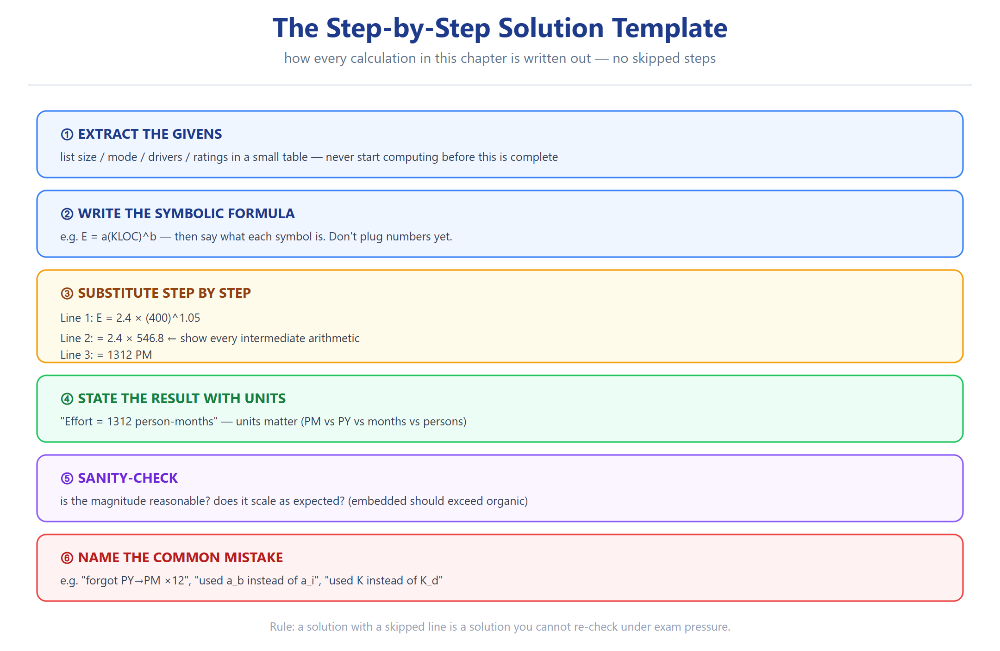

# T6 — التصميم/الإنشاء (Ch04 · Software Project Planning) ★★☆

> **شنو هذا الملف؟** أسئلة "صمّم/اقترح/ابنِ" — تتطلب **مُخرَجاً** (خطة، جدول، استراتيجية).
> **الطبيعة:** مفتوحة (عدة أجوبة صحيحة) — المهم **منهجية** واضحة.



---

**Q6.1** صمّم خطة تقدير كاملة لمشروع: نظام e-commerce، ~40 KLOC متوقّعة، فريق متوسط الخبرة، قيود أمنية عالية.
**الخطة:**
1. **الحجم:** استخدم FP (يُحسب من المتطلبات: مدخلات/مخرجات/ملفات/استعلامات).
2. **الموديل:** COCOMO **semidetached** (حجم متوسط + خبرة متوسطة)، أو **intermediate** (لبعض drivers: RELY عالية للأمان).
3. **الحساب:** `E = 3.0×(40)^1.12 × EAF`، `D=2.5(E)^0.35`.
4. **التوزيع:** phase-wise (design/code/test).
5. **المخاطر:** RELY عالية (أمان) = خطر؛ أضف RMMM.
6. **التحقق:** قارن مع Putnam كـrange.

**Q6.2** صمّم RMMM plan لخطر "requirements volatility".
| المرحلة | الإجراء |
|---|---|
| **Mitigation** | تثبيت المتطلبات الأساسية مبكراً · استخدام incremental/iterative · أدوات تتبع تغيير |
| **Monitoring** | تتبع عدد التغييرات أسبوعياً · تحليل أثر كل تغيير |
| **Management** | هامش contingency 30% + خطة لتعليق الميزات غير الحرجة |

**Q6.3** صمّم استراتيجية تقدير لمشروع صغير بمتطلبات غامضة.
← **Iterative estimation:** تقدير مبدئي خشن (range) ← prototype ← تحديث بعد كل iteration ← استخدم story points بدل LOC. لا تعتمد LOC.

**Q6.4** أعطيتك: 50 KLOC، تعقيد عالٍ، موثوقية عالية، خبرة مبرمجين منخفضة، الباقي nominal. صمّم التقدير كاملاً.
```
الموديل: semidetached (حجم كبير + تعقيد) أو embedded إن كان فيه قيود hardware
EAF: CPLX(high=1.15) × RELY(high=1.15) × PCAP(low=1.17) × الباقي(1.0) = 1.55
50^1.12 = 79.9551 ≈ 79.96
E = 3.0 × (50)^1.12 × 1.55 = 3.0 × 79.96 × 1.55 = 371.79 PM
D = 2.5 × (371.79)^0.35 = 2.5 × 7.9360 = 19.84 months
SS = 371.79/19.84 = 18.74 persons
```

**Q6.5** صمّم خطة بناء فريق (manpower profile) باستخدام Rayleigh لمشروع K=200 PY، td=3 years.
```
m₀ = 200/(3×1.648) = 40.5 persons (ذروة)
منحنى: يبدأ قليلاً، يذرو عند t=3y، ينزل.
الفريق: ~10 (سنة1) → ~40 (ذروة) → ~10 (نهاية).
المجموع (المساحة تحت المنحنى) = 200 PY = K.
```

**Q6.6** اعمل جدول مقارنة لاختيار mode لمشروعين.
| | مشروع A | مشروع B |
|---|---|---|
| الحجم | 15 KLOC | 200 KLOC |
| القيود | لا شيء | صارمة (embedded) |
| الخبرة | عالية | متوسطة |
| **الـmode** | **Organic** | **Embedded** |
| **a_b** | 2.4 | 3.6 |

**Q6.7** اقترح جدول تقدير كلفة كامل (cost breakdown) لمشروع 100 KLOC.
| البند | % تقديري | ملاحظة |
|---|---|---|
| Requirements & design | ~16% | مرحلة أولى |
| Coding & unit test | ~48% | الأكبر |
| Integration & test | ~20% | يزيد مع RELY |
| Documentation | ~10% | حسب DOCU driver |
| Management & contingency | ~6% | + هامش |

**Q6.8** صمّم "risk register" لمشروع طالب.
| Risk | Category (Jones) | Prob | Impact | RE |
|---|---|---|---|---|
| وقت ضيق | Management | عالي | عالي | عالي |
| خبرة قليلة | Lack of knowledge | عالي | متوسط | عالي |
| متطلبات غامضة | Requirements | متوسط | عالي | متوسط-عالٍ |
| أدوات جديدة | Lack of knowledge | متوسط | متوسط | متوسط |
| فقدان عضو | Dependencies | منخفض | عالي | متوسط |

**Q6.9** اقترح استراتيجية لتقليل الجهد 30% دون زيادة الوقت.
← ① حسّن `ACAP/PCAP` (تدريب) ② استخدم `TOOL` (أدوات حديثة) ③ `MODP` (ممارسات حديثة) ④ reuse (`RUSE` — يخفض NOP).
**التبرير:** هذي كلها تخفض الـEAF (معامل < 1) بلا ضغط الجدول.

**Q6.10** صمّم خطة تحويل FP ← LOC لمشروع مكتوب بـC++.
```
FP المحسوبة = 500
من Table 19: C++ = 29 SLOC/UFP
LOC = 500 × 29 = 14,500 LOC
ثم E = a(KLOC)^b مع KLOC = 14.5
```

**Q6.11** اقترح معايير قبول (acceptance criteria) لموديل تقدير.
← ① لا يزيد عبر المشاريع المماثلة >25% من الفعلي ② يُعاد معايرته بمشروعنا ③ يُستخدم كـrange لا رقم واحد ④ يُقاس مقابل مقاييس حقيقية (productivity, defects).

**Q6.12** اكتب skeleton لبرنامج COCOMO (Exercise 4.19).
```
INPUT: KLOC, mode, driver ratings
1. select (a_b, b_b, c_b, d_b) by mode
2. E = a_b × KLOC^b_b ; D = c_b × E^d_b
3. if drivers provided: EAF = Π(ratings) ; E *= EAF
4. SS = E/D ; P = KLOC×1000/E
OUTPUT: E (PM), D (months), SS (persons), P (LOC/PM)
```


---

## Retrieval set (active recall)

| السؤال | الجواب |
|---|---|
| مكوّنات RMMM؟ | Mitigation, Monitoring, Management |
| خطوات تصميم تقدير؟ | حجم ← موديل ← E/د ← توزيع ← مخاطر |
| كيف نبني manpower profile؟ | منحنى Rayleigh (m₀ عند td) |
| كيف نخفض الجهد بلا زيادة وقت؟ | ACAP/PCAP/TOOL/MODP/reuse |

---
*المصدر: الفصل + سيناريوهات مُولّدة — بُني 2026-10-12*