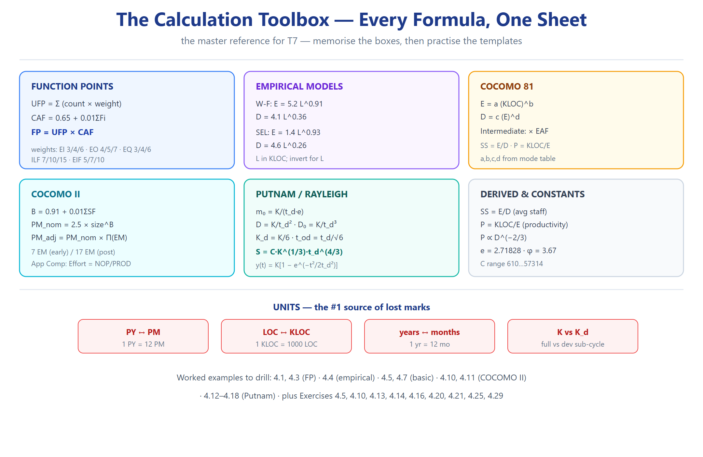

# T7 — الحساب والتطبيق (Ch04 · Software Project Planning) ★★★

> **بطل الفصل.** كل مسألة هنا محلولة بالقالب المفصّل: **معطيات ← معادلة ← تعويض خطوة-خطوة ← نتيجة ← تحقق ← خطأ شائع**.
> **مصدر الأمثلة:** السلايدات مدمجة + الأمثلة المحلولة 4.1–4.19. **مصدر التمارين:** Exercises 4.5–4.29.

---

## قسم أ — Function Points (FP/CAF)

### Q7.1 (Exercise 4.5) — FP بتعقيدات moderate
**المعطيات:** user inputs=30 · outputs=42 · enquiries=8 · files=7 · ext.interfaces=6 — **الكل moderate (average)**.

**المعادلة:** `UFP = Σ(count × weight)` ثم `FP = UFP × CAF`.

**التعويض:**

| الوحدة | العدد | الوزن (average) | الناتج |
|---|---|---|---|
| EI | 30 | 4 | 120 |
| EO | 42 | 5 | 210 |
| EQ | 8 | 4 | 32 |
| ILF | 7 | 10 | 70 |
| EIF | 6 | 7 | 42 |
| **UFP** | | | **474** |

CAF = 0.65 + 0.01 × ΣFi    (كل الـ14 عامل average = 3 ⇒ ΣFi = 42)

= 0.65 + 0.42 = 1.07

FP  = 474 × 1.07 = 507.18 ≈ 507

**التحقق:** CAF=1.07 منطقي (متوسط). **خطأ شائع:** ضرب عدد وحدات بـΣFi بدل الأوزان.

---

### Q7.2 (Exercise 4.10) — FP لبرنامج payroll
**المعطيات:** يقرأ ملف موظفين (ILF) + ملف معلومات الشهر (ILF)، يطبع شيكات (EO)، وعنده أمر تفاعلي لطبع شيك فردي (EQ).
**التفكيك:**

| الوحدة | النوع | التعقيد | الوزن |
|---|---|---|---|
| ملف الموظفين | ILF | average | 10 |
| ملف الشهر | ILF | average | 10 |
| طباعة الشيكات | EO | average | 5 |
| الشيك الفردي (تفاعلي) | EQ | average | 4 |

UFP = 10 + 10 + 5 + 4 = 29

CAF = 0.65 + 0.01×42 = 1.07   (افتراض: كل العوامل متوسط)

FP  = 29 × 1.07 = 31.03 ≈ 31

**تحقق:** برنامج صغير ⇒ FP منخفضة. منطقي.

---

### Q7.3 (Exercise 4.11) — إضافة ملف الشيكات (سؤال مقارنة)
**المعطيات:** نفس البرنامج + يقرأ ملف الشيكات المطبوعة، ويطبع تقرير مقارنة (شهر حالي vs سابق).
**التفكيك الإضافي:** ملف جديد (ILF) لسجل الشيكات + تقرير مقارنة (EO) = **unit جديد (EIF)** لأنه يقابل تطبيق ثاني (نفسه).
التغيير: + EIF (سجل الشيكات) بوزن ~7 + EO إضافي (التقرير) بوزن ~5

UFP الجديد ≈ 29 + 7 + 5 = 41

FP ≈ 41 × 1.07 = 43.87 ≈ 44

**الاستنتاج (المطلوب):** الـFP زادت لكن **ليس بمقدار مضاعف** — لأن إضافة الواجهة مع تطبيق آخر ترفع التعقيد، لكن الوظائف الأساسية نفسها بقيت. **هذا يوضّح أن FP تقيس الوظيفة، والتكامل بين الأنظمة يظهر كـEIF.**

---

## قسم ب — Empirical Models

### Q7.4 (Exercise 4.13) — 22000 LOC: W-F مقابل SEL
**المعطيات:** L = 22000 LOC = 22 KLOC. المطلوب: الجهد بكلا الموديلين.
**المعادلات:** W-F `E=5.2L^0.91` · SEL `E=1.4L^0.93`

W-F:  E = 5.2 × (22)^0.91 = 5.2 × 16.6573 = 86.62 person-months

SEL:  E = 1.4 × (22)^0.93 = 1.4 × 17.7196 = 24.81 person-months

**التحقق:** W-F يعطي جهداً **أكبر ≈3.5×** — لأنه أكثر تحفظاً (a=5.2 مقابل 1.4). ✓
**الدرس:** لا تخلط الموديلات؛ كل واحد مُعاير على بيانات مختلفة.

---

### Q7.5 (Exercise 4.14) — 100 PM: كم LOC؟
**المعطيات:** E = 100 person-months. (نمط SEL: `E=1.4L^0.93`)
**المعادلة العكسية:** `L = (E/1.4)^(1/0.93)`

L = (100/1.4)^(1/0.93) = (71.43)^1.0753 = 96.8 KLOC ≈ 96,800 LOC

Productivity = 96,800 / 100 = 968 LOC/PM

**تحقق:** ~1000 LOC/PM رقم معقول لمشروع متوسط. ✓

---

## قسم ج — Basic COCOMO

### Q7.6 (Exercise 4.16) — organic 32 KLOC
**المعطيات:** organic، 32 KLOC. **المعادلات:** `E=2.4(KLOC)^1.05`، `D=2.5(E)^0.38`

E = 2.4 × (32)^1.05 = 2.4 × 38.0546 = 91.33 person-months

D = 2.5 × (91.33)^0.38 = 2.5 × 5.5595 = 13.90 months

SS = E/D = 91.33/13.90 = 6.57 persons

**تحقق:** مشروع صغير ⇒ جهد معقول. ✓

---

### Q7.7 (Exercise 4.21) — 600 KLOC بالمودات الثلاثة
**المعطيات:** 600 KLOC.

| Mode | a | b | E = a(600)^b | c | d | D = c(E)^d |
|---|---|---|---|---|---|---|
| Organic | 2.4 | 1.05 | 2.4×(600)^1.05 = 2.4×826.15 = **1982.76 PM** | 2.5 | 0.38 | 2.5×(1982.76)^0.38 = **44.76 mo** |
| Semidetached | 3.0 | 1.12 | 3.0×(600)^1.12 = 3.0×1292.79 = **3878.38 PM** | 2.5 | 0.35 | 2.5×(3878.38)^0.35 = **45.08 mo** |
| Embedded | 3.6 | 1.20 | 3.6×(600)^1.20 = 3.6×2156.66 = **7763.97 PM** | 2.5 | 0.32 | 2.5×(7763.97)^0.32 = **43.93 mo** |

**التحقق (خطوة مهمة):** لاحظ أن E للـembedded ≈ **3.9× الـorganic**، لكن D تكاد تبقى ثابتة (~44–45 شهر) — **الاستنتاج:** المودات الأقسى تعني جهداً أكبر بكثير مقابل وقت شبه ثابت (لأن زيادة الجهد تُستوعب في زيادة عدد الأفراد، لا في إطالة الجدول).

---

### Q7.8 (Exercise 4.20) — نظام أتمتة مكتبية + phase-wise
**المعطيات:** 5 وحدات: 0.5+1.5+2.0+1.0+2.0 = **7 KLOC**. التعقيد والموثوقية عالية، قدرة المبرمجين منخفضة، الباقي nominal.
**الخطوة 1 — الموديل:** حجم صغير (7 KLOC) لكن مع قيود ⇒ **organic** (المعيار الأساسي = الحجم).
**الخطوة 2 — الـEAF (intermediate):** لأن فيه drivers معطاة ⇒ Intermediate.

EAF = CPLX(high=1.15) × RELY(high=1.15) × PCAP(low≈1.17) × الباقي(1.0)

الافتراض: CPLX=1.15, RELY=1.15, PCAP low=1.17 ⇒ EAF = 1.15×1.15×1.17 = 1.55

**الخطوة 3 — الجهد:**

E = a_i(KLOC)^b_i × EAF = 3.2 × (7)^1.05 × 1.55

= 3.2 × 7.7153 × 1.55 = 38.27 ≈ 38 PM

D = c_i(E)^d_i = 2.5 × (38.27)^0.38 = 2.5 × 3.9947 = 9.99 ≈ 10 months

**الخطوة 4 — phase-wise (Table 7 — Organic Small, S≈2):**

| Phase | % effort (Table 7) | Effort (PM) |
|---|---|---|
| Plan & Requirements | 6% | 2.30 |
| System Design | 16% | 6.12 |
| Detailed Design | 26% | 9.95 |
| Module Code & Test | 42% | 16.07 |
| Integration & Test | 16% | 6.12 |

**تحقق:** 6+16+26+42+16 = **100%** ✓ · المجموع = 40.56 ≈ 38.27 (فرق ناتج عن تقريب الجدول نفسه — الجدول 7 بُني على S مختلف). *(الجدول 7 سلايد 62: صف Organic Small = 0.06/0.16/0.26/0.42/0.16).*

---

## قسم د — Intermediate / Detailed COCOMO

### Q7.9 (Exercise 4.18) — أثر تغيير الـdrivers على phase distribution
**المعطيات:** 240 KLOC organic، التوزيع: product design 12%, detailed 24%, code&unit 36%, integrate 28%.
**المطلوب:** كيف تتغير phase distribution مع تغيير كل driver (من low إلى high)؟

| Driver | من low←high | الأثر على الجهد الكلي | الأثر على التوزيع |
|---|---|---|---|
| **Analyst capability (ACAP)** | ↑ قدرة | **ينخفض** الجهد | تصميم أقل (أخطاء أقل) |
| **Modern PL (MODP)** | ↑ | **ينخفض** | الكود أسرع ⇒ نسبة الكود أقل |
| **Required reliability (RELY)** | ↑ | **يرتفع** | اختبار/تكامل أعلى |
| **Requirements volatility** (خارجي) | ↑ | **يرتفع** | إعادة عمل ⇒ تصميم/تكامل أعلى |

**الخلاصة:** drivers القدرة تخفّض الجهد؛ drivers الجودة/التقلب ترفعه وتنقل الثقل نحو الاختبار.

---

## قسم هـ — COCOMO II

### Q7.10 (Exercise 4.25) — 100 KLOC application generator
**المعطيات:** application generator · 100 KLOC · scale factors: **high precedentness, high dev flexibility**، الباقي nominal · drivers: RELY high, DATA medium(≈nominal), PCAP high, ACAP high، الباقي nominal.
**المعادلات:** `B=0.91+0.01ΣSF` · `PM_nom=2.5×size^B` · `PM_adj=PM_nom×Π(EM)`
**الخطوة 1 — ΣSF:** خذ قيمها من Table 13 (نطاق 0←5):
precedentness high ≈ 2.48 · flexibility high ≈ 4.96 (الافتراضي)

... الباقي nominal (قيمتها الوسطى)

ΣSF ≈ 10 (تقديري — تعتمد جدول Table 13 الدقيق)

B = 0.91 + 0.01×ΣSF

**الخطوة 2 — PM_nom:**

PM_nom = 2.5 × (100)^B

**الخطوة 3 — EM (7 drivers):** RELY high (1.15) · PCAP high (0.87) · ACAP high (0.85) · الباقي (1.0)

EM = 1.15 × 0.87 × 0.85 × 1.0×1.0×1.0×1.0 = 0.850

PM_adj = PM_nom × 0.850

**⚠️ ملاحظة:** القيم العددية الدقيقة للـscale factors تأتي من Table 13 (سلايد 88) — اعتمدها من السلايد، مو تقديري. **الدرس:** الطريقة ثابتة، الأرقام من الجدول.

---

## قسم و — Putnam / Rayleigh

### Q7.11 (Exercise 4.29) — S=100,000, C=5000, Do=15
**المعادلات:** `td = [(S/C)³ / D₀]^(1/7)` · `K = D₀·td³` · `Kd = K/6`

(S/C)   = 100000/5000 = 20

(S/C)³  = 8000

/ D₀    = 8000/15 = 533.33

td      = (533.33)^(1/7) = 2.44 years

K       = 15 × (2.44)³ = 15 × 14.53 = 217.9 PY

Kd      = 217.9/6 = 36.3 PY

**التحقق:** td≈2.44 years لمشروع 100 KLOC — معقول. ✓

### Q7.12 (Example 4.12 style) — K=95 PY، td=1.75 y
m₀ = K/(td·e) = 95/(1.75×2.71828) = 95/4.757 = 19.97 ≈ 20 persons

average build-up rate = m₀/td = 19.97/1.75 = 11.4 persons/year

### Q7.13 (Example 4.13 style) — K=600 PY، td=3.5 y
m₀  = 600/(3.5×1.648) = 104 persons      (لاحظ: السلايد يستخدم e ≈ 1.648 هنا)

D   = K/td² = 600/12.25 = 49 person/year

D₀  = K/td³ = 600/42.875 = 14 person/year²

y(t=1.17) = 600[1 − e^(−0.0408×1.369)] = 32.6 PY

### Q7.14 (Example 4.15 style) — dev sub-cycle، 90 PY، td=3.41 y
yd(td) = 0.95 × 90 = 85.5 PY

tod    = td/√6 = 3.41/2.449 = 1.39 y ≈ 17 months

K      = 6 × 90 = 540 PY

D      = 540/(3.41)² = 46 person/year

D₀     = 540/(3.41)³ = 13.6 person/year²

### Q7.15 (Example 4.16 style) — استخراج C
**المعطيات:** 32 PY حتى dev cycle · 48000 LOC · td=25 mo=2.08 y

Kd = 32/0.95 = 33.7 PY · K = 6×33.7 = 202 PY

D  = 202/(2.08)² = 46.7 person/year · D₀ = 202/(2.08)³ = 22.5 person/year²

C  = S·K^(−1/3)·td^(−4/3) = 48000 × (202)^(−1/3) × (2.08)^(−4/3) ≈ 3077

### Q7.16 (Example 4.18 style) — تقليل الوقت (trade-off)
**المعطيات:** C=2200، D₀=7.5، S=55000 LOC

td  = [(55000/2200)³ / 7.5]^(1/7) = [(25)³/7.5]^(1/7) = (2083.3)^(1/7) = 3.0 years

K   = 7.5 × 27 = 202.5 PY · D = 202.5/9 = 22.5 person/year

m₀  = 202.5/(3.0×1.648) = 41 persons

**بعد تقليل td لـ2.8y:** K = 7.5×21.95 = 164.6 PY (أقل!) لكن m₀ = 164.6/(2.8×1.648) = 35.7 (أعلى نسبياً بسبب إجهاد الوقت) ⇒ **الذروة والكلفة ترتفعان**.

---

## قسم ز — أسئلة حسابية مختلطة (تدريب)

| # | المعطيات | المطلوب | الجواب |
|---|---|---|---|
| Q7.17 | FP=500، effort=50 PM | Productivity | 10 FP/PM |
| Q7.18 | UFP=800، ΣFi=0 | FP | 800×0.65 = **520** |
| Q7.19 | UFP=800، ΣFi=70 | FP | 800×1.35 = **1080** |
| Q7.20 | organic 10 KLOC | E | 2.4×10^1.05 = **27.0 PM** |
| Q7.21 | K=300 PY، td=4 y | m₀, D, D₀ | m₀=27.6 · D=18.75 · D₀=4.69 |
| Q7.22 | S=50000، C=1000، D₀=8 | td | [(50)³/8]^(1/7) = (15625)^(1/7) = **3.98 y** |
| Q7.23 | دالة `E=1.4L^0.93`، E=50 | L | (50/1.4)^(1/0.93) = **31.5 KLOC** |

---

## ✅ قائمة التحقق
- [ ] أحسب FP بتعقيدات مختلطة بلا خطأ
- [ ] أعرف متى أستخدم a_b (basic) ومتى a_i (intermediate)
- [ ] أحسب B وPM_nom لـCOCOMO II
- [ ] أحسب m₀/D/D₀/Kd/tod في أي صيغة تطلعهن
- [ ] أشتق td من S,C,D₀
- [ ] أحوّل بين الوحدات (PY↔PM، LOC↔KLOC، y↔mo) قبل التعويض

---

## Retrieval set (active recall)

| السؤال | الجواب |
|---|---|
| خطوات حساب FP؟ | UFP=Σ(c×w) ← CAF=0.65+0.01ΣFi ← FP=UFP×CAF |
| جدول UFP أوزان EI/EO/EQ/ILF/EIF؟ | 3/4/6 · 4/5/7 · 3/4/6 · 7/10/15 · 5/7/10 |
| أساسي COCOMO (organic)؟ | E=2.4(KLOC)^1.05, D=2.5(E)^0.38 |
| intermediate organic a_i؟ | **3.2** (مختلف عن 2.4!) |
| COCOMO II B؟ | 0.91+0.01×ΣSF · PM=2.5size^B |
| m₀؟ | K/(td·e) |
| D؟ | K/td² |
| D₀؟ | K/td³ |
| Kd؟ | K/6 |
| tod؟ | td/√6 |
| S من C,K,td؟ | S=C·K^(1/3)·td^(4/3) |
| td من S,C,D₀؟ | [(S/C)³/D₀]^(1/7) |
| الوحدة: PY←PM؟ | ×12 |
| الوحدة: LOC←KLOC؟ | ÷1000 |

---
*المصدر: الأمثلة 4.1–4.19 + Exercises 4.5–4.29 — بُني 2026-10-12*