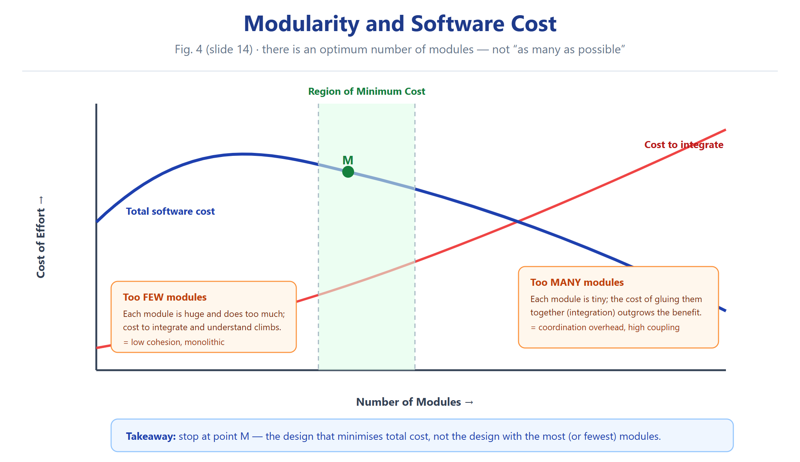

# النوع 1 — أسئلة الاختيار من متعدد (MCQ)

### ASE · Chapter 5 · Software Design

**المصدر:** Aggarwal & Singh، *Software Engineering* (3rd ed., New Age International)، سلايدات الفصل 5 — الأسئلة الرسمية 5.1–5.12 موجودة في السلايدات 94–96.

---

## الرسوم المرجعية (راجعها قبل الحل)

---

## ملاحظة مهمة عن مفتاح الإجابة

> **السلايدات 94–96 تحمل الأسئلة الرسمية و**خياراتها فقط، **ولا يوجد فيها قسم أجوبة رسمي** — تأكدت من ذلك بفحص السلايدات 94، 95، 96، 97، 98، 99. لذلك **كل جواب في المجموعة أ مُشتقّ من نص الفصل نفسه** (الترتيب الموثّق في Fig. 7 سلايد 19 و Fig. 11 سلايد 27، والتعريفات في السلايدات 20–30)، ومقارَن بالملفات المُتحقق منها سابقًا.
>
> ملاحظة ثانية: السلايد 96 يعرض السؤالين 5.12 قبل 5.11 (ترتيب مطبعي مقلوب) — أثبتّ الترقيم الرسمي كما هو وأعدت الترتيب المنطقي 5.1 ← 5.12.

---

## المجموعة أ — المقاييس الرسمية (Official MCQs 5.1–5.12)

### A-5.1 — Most desirable coupling

**5.1 The most desirable form of coupling is:**

(a) Control Coupling

(b) **Data Coupling**

(c) Common Coupling

(d) Content Coupling

**Correct answer: (b) Data Coupling**

**Justification:** Fig. 7 places Data coupling at the top of the ladder and labels it "Best" [slide 19]. Data coupling exists when two modules communicate only by passing data, and other than that they are independent [slide 20].

**التبرير:** البيانات هي أفضل شكل اقتران حسب سلّم Fig. 7، لأن الوحدتين تتواصلان بتمرير البيانات فقط وما عدا ذلك مستقلتان.

---

### A-5.2 — Worst coupling

**5.2 The worst type of coupling is:**

(a) **Content coupling**

(b) Common coupling

(c) External coupling

(d) Data coupling

**Correct answer: (a) Content coupling**

**Justification:** Fig. 7 labels Content coupling "Worst" [slide 19]. Content coupling occurs when module A changes the data of module B, or when control is passed from one module to the middle of another [slide 23].

**التبرير:** الاقتران بالمحتوى أسوأ شكل لأنه يعني وحدة تغيّر بيانات وحدة ثانية أو تدخل في منتصفها.

---

### A-5.3 — Most desirable cohesion

**5.3 The most desirable form of cohesion is:**

(a) Logical cohesion

(b) Procedural cohesion

(c) **Functional cohesion**

(d) Temporal cohesion

**Correct answer: (c) Functional cohesion**

**Justification:** Fig. 11 places Functional cohesion at the top and labels it "Best (high)" [slide 27]. In functional cohesion, A and B are part of a single functional task, which is a very good reason for them to be in the same procedure [slide 28].

**التبرير:** الترابط الوظيفي أفضل شكل لأن كل العناصر جزء من مهمة وظيفية واحدة.

---

### A-5.4 — Worst cohesion

**5.4 The worst type of cohesion is:**

(a) Temporal cohesion

(b) **Coincidental cohesion**

(c) Logical cohesion

(d) Sequential cohesion

**Correct answer: (b) Coincidental cohesion**

**Justification:** Fig. 11 labels Coincidental cohesion "Worst (low)" [slide 27]. Coincidental cohesion exists in modules that contain instructions having little or no relationship to one another [slide 30].

**التبرير:** الترابط العشوائي أسوأ شكل لأن التعليمات بلا علاقة بينها.

---

### A-5.5 — Not a design strategy

**5.5 Which one is not a strategy for design?**

(a) Bottom up design

(b) Top down design

(c) **Embedded design**

(d) Hybrid design

**Correct answer: (c) Embedded design**

**Justification:** The chapter covers exactly three strategies — Bottom-Up Design [slide 33], Top-Down Design [slide 34] and Hybrid Design [slide 35]. "Embedded design" never appears as a strategy.

**التبرير:** الاستراتيجيات ثلاث فقط: من الأسفل للأعلى، ومن الأعلى للأسفل، والمختلطة. والتصميم المدمج ليس منها.

---

### A-5.6 — Temporal cohesion

**5.6 Temporal cohesion means:**

(a) Cohesion between temporary variables

(b) Cohesion between local variable

(c) **Cohesion with respect to time**

(d) Coincidental cohesion

**Correct answer: (c) Cohesion with respect to time**

**Justification:** A module exhibits temporal cohesion when it contains tasks that are related by the fact that all tasks must be executed in the same time-span [slide 29].

**التبرير:** الترابط الزمني يعني ارتباط المهام بأنها تُنفَّذ كلها في نفس الفترة الزمنية.

---

### A-5.7 — Functional cohesion

**5.7 Functional cohesion means:**

(a) **Operations are part of single functional task and are placed in same procedures**

(b) Operations are part of single functional task and are placed in multiple procedures

(c) Operations are part of multiple tasks

(d) None of the above

**Correct answer: (a) Operations are part of a single functional task and are placed in the same procedure**

**Justification:** "A and B are part of a single functional task. This is very good reason for them to be contained in the same procedure" [slide 28]. Option (b) contradicts the definition, because it places the operations of one task into multiple procedures.

**التبرير:** العمليات جزء من مهمة وظيفية واحدة وتُوضع في نفس الإجراء، ولذلك الخيار (ب) خاطئ لأنه يوزّعها على إجراءات متعددة.

---

### A-5.8 — Shared global data area

**5.8 When two modules refer to the same global data area, they are related as:**

(a) External coupled

(b) Data coupled

(c) Content coupled

(d) **Common coupled**

**Correct answer: (d) Common coupled**

**Justification:** "With common coupling, module A and module B have shared data. Global data areas are commonly found in programming languages" [slide 21]. Example of common coupling on [slide 22].

**التبرير:** تشارك منطقة بيانات شاملة بين وحدتين = اقتران مشترك.

---

### A-5.9 — Flow of control

**5.9 The module in which instructions are related through flow of control is:**

(a) Temporal cohesion

(b) Logical cohesion

(c) **Procedural cohesion**

(d) Functional cohesion

**Correct answer: (c) Procedural cohesion**

**Justification:** "Procedural Cohesion occurs in modules whose instructions although accomplish different tasks yet have been combined because there is a specific order in which the tasks are to be completed" [slide 29].

**التبرير:** الترابط الإجرائي: التعليمات تؤدي مهامًا مختلفة لكنها جُمعت لوجود ترتيب محدد (تدفق سيطرة) لإنجازها.

---

### A-5.10 — Relationship of data elements inside a module

**5.10 The relationship of data elements in a module is called:**

(a) Coupling

(b) **Cohesion**

(c) Modularity

(d) None of the above

**Correct answer: (b) Cohesion**

**Justification:** "Cohesion is a measure of the degree to which the elements of a module are functionally related" [slide 25]. Coupling, by contrast, is the degree of interdependence **between** modules [slide 15].

**التبرير:** العلاقة بين عناصر الوحدة **الداخلية** = ترابط. أما الاقتران فهو الاعتماد **بين** الوحدات.

---

### A-5.11 — Closed system

**5.11 A system that does not interact with external environment is called:**

(a) **Closed system**

(b) Logical system

(c) Open system

(d) Hierarchal system

**Correct answer: (a) Closed system**

**Justification:** A closed system does not interact with its external environment, whereas an open system does. **[Foundational Knowledge / Standard Concept]**

**ملاحظة:** هذا المصطلح مستخدم في الفصل لكن السلايدات لا تحمل تعريفًا صريحًا له بمفردها.

**التبرير:** النظام اللي ما يتفاعل مع البيئة الخارجية هو النظام المغلق (مصطلح معياري عام).

---

### A-5.12 — Degree of dependence between modules

**5.12 The extent to which different modules are dependent upon each other is called:**

(a) **Coupling**

(b) Cohesion

(c) Modularity

(d) Stability

**Correct answer: (a) Coupling**

**Justification:** "Coupling is the measure of the degree of interdependence between modules" [slide 15].

**التبرير:** مدى اعتماد الوحدات على بعضها = اقتران [سلايد 15].

---

## المجموعة ب — المقاييس الخارجية (External Bank MCQs)

> المصدر: 3 بنوك أسئلة (توتوريالز MAIT ETCS-252، بنك NRCMEC، بنك GitHub KPRIT) — 11 سؤالًا متعدد الخيارات مُجمّعة سابقًا في الملف 03، وهنا كل واحد بصيغة كاملة مع التبرير ووسم المصدر.

---

### B-1 — Worst coupling (external)

**Q2. The worst type of coupling is:**

(a) Data

(b) Control

(c) Stamp

(d) **Content**

**Correct answer: (d) Content**

**Justification:** Matches Fig. 7 "Worst" [slide 19] and the definition on [slide 23].

**Source tag:** [External — MAIT ETCS-252 Tutorial, Q2]

**التبرير:** الاقتران بالمحتوى أسوأ شكل، مطابق لسلايد 19.

---

### B-2 — Same input and output data

**Q9. Modules X and Y operate on the same input and output data, then the cohesion is:**

(a) Sequential

(b) **Communicational**

(c) Procedural

(d) Logical

**Correct answer: (b) Communicational**

**Justification:** Communicational cohesion is where all functions operate on the same data structure, sitting between Procedural and Sequential in Fig. 11 [slide 27]. Sequential, by contrast, requires the output of one to be the input of the next [slide 28].

**Source tag:** [External — MAIT ETCS-252 Tutorial, Q9]

**التبرير:** الوحدتان تعملان على نفس البيانات = ترابط تواصلي، أما التسلسلي فيشترط أن مخرج أحدهما مُدخل الآخر.

---

### B-3 — Desired level of coupling

**Q16. The desired level of coupling is:**

(a) No coupling

(b) Control

(c) Common

(d) **Data**

**Correct answer: (d) Data**

**Justification:** Data coupling is labelled "Best" in Fig. 7 [slide 19]. Note: "No coupling" (uncoupled, no dependencies) is a theoretical state only, drawn on [slide 15] but not achievable in a working system; the design goal is the **lowest possible** coupling, i.e. data coupling [slide 20].

**Source tag:** [External — MAIT ETCS-252 Tutorial, Q16]

**التبرير:** المطلوب أقل اقتران ممكن = الاقتران بالبيانات، والانعدام التام غير عملي.

---

### B-4 — Coupling and cohesion representation

**Q19. Coupling and cohesion can be represented using a:**

(a) Cause-effect graph

(b) Dependence matrix

(c) **Structure chart**

(d) SRS

**Correct answer: (c) Structure chart**

**Justification:** The structure chart shows the hierarchical module decomposition and the data/control that passes between modules, so it exposes both the coupling between modules and the cohesion inside them. Structure charts are listed among the function-oriented design notations [slide 40] and described as partitioning a system into black boxes [slide 41].

**Source tag:** [External — MAIT ETCS-252 Tutorial, Q19]

**التبرير:** مخطط البنية يُظهر كيف تتفاعل الوحدات وشنو البيانات الممررة بينها، فيكشف الاقتران والترابط.

---

### B-5 — OO feature that enables code reuse

**Q23. The feature of the OO paradigm which helps code reuse is:**

(a) Object

(b) Class

(c) **Inheritance**

(d) Aggregation

**Correct answer: (c) Inheritance**

**Justification:** "The low level classes (known as subclasses or derived classes) inherit state and behavior from this high level class (known as a super class or base class)" [slide 68] — inheritance is the mechanism that lets common features be defined once and reused.

**Source tag:** [External — MAIT ETCS-252 Tutorial, Q23]

**التبرير:** الوراثة هي الآلية اللي تسمح بإعادة استخدام الحالة والسلوك من الصنف الأساسي.

---

### B-6 — What an object encapsulates

**Q29. An object encapsulates:**

(a) Data

(b) Behaviour

(c) State

(d) **Both Data and behaviour**

**Correct answer: (d) Both Data and behaviour**

**Justification:** An object is "an entity able to save a state (information) and which offers a number of operations (behavior) to either examine or affect this state" [slide 60]. Encapsulation = separation of the external aspects of an object from its internal implementation details [slide 69].

**Source tag:** [External — MAIT ETCS-252 Tutorial, Q29]

**التبرير:** الكائن يغلّف البيانات والسلوك معًا: حالة مخزونة وعمليات تؤثر بها.

---

### B-7 — Aggregation

**Q31. Aggregation represents:**

(a) is_a

(b) **part_of**

(c) composed_of

(d) none

**Correct answer: (b) part_of**

**Justification:** "Aggregations are stronger form of association. An aggregation is a relationship between a whole and its parts" [slide 78] — i.e. a whole/part ("part_of") relationship. Note the book itself does not use the UML term "composed_of" here; only "whole and its parts" appears.

**Source tag:** [External — MAIT ETCS-252 Tutorial, Q31]

**التبرير:** التجميع علاقة "كل بجزء" (part_of) وليس وراثة (is_a).

---

### B-8 — Structured charts are a product of

**Q39. Structured charts are a product of:**

(a) Requirements gathering

(b) Requirements analysis

(c) **Design**

(d) Coding

**Correct answer: (c) Design**

**Justification:** "Design notations are largely meant to be used during the process of design and are used to represent design or design decisions. For a function oriented design, the design can be represented ... Structure Charts" [slide 40].

**Source tag:** [External — MAIT ETCS-252 Tutorial, Q39]

**التبرير:** مخططات البنية أدوات تصميم بامتياز، تُستخدم لتمثيل قرارات التصميم [سلايد 40].

---

### B-9 — Pseudocode can replace

**Q42. Pseudocode can replace:**

(a) **Flowcharts**

(b) Structure charts

(c) Decision tables

(d) Cause-effect graphs

**Correct answer: (a) Flowcharts**

**Justification:** Both flow charts and pseudocode express the detailed logic/algorithm inside a module. Pseudocode "can be used in both the preliminary and detailed design phases" and describes system characteristics using short English phrases structured by keywords such as If-Then-Else, While-Do, and End [slide 46]; and flow charts are listed as a form of body notation at Level 3 alongside structured chart and English pseudocode [slide 49].

**Source tag:** [External — MAIT ETCS-252 Tutorial, Q42]

**التبرير:** كل من المخطط الانسيابي والـ pseudocode يعبّر عن المنطق التفصيلي داخل الوحدة، فيمكن أحدهما أن يحل محل الآخر.

---

### B-10 — Top-down approach for

**Q61. Top-down approach is used for:**

(a) Development

(b) Identification of faults

(c) **Testing and validation**

(d) Reverse engineering

**Correct answer: (c) Testing and validation**

**Justification:** The chapter explains that a bottom-up approach is essential near the bottom of the hierarchy because "the need for bottom-up testing is greater" there, while top-down testing/validation starts from the highest-level module [slide 35]. **[Foundational Knowledge / Standard Concept]**

**ملاحظة:** صيغة السؤال من البنك الخارجي؛ الفصل يدعم الفكرة في slide 35 دون صياغة السؤال حرفيًا.

**Source tag:** [External — MAIT ETCS-252 Tutorial, Q61]

**التبرير:** النهج من الأعلى للأسفل يُستخدم في الاختبار والتحقق بدءًا من الوحدة العليا. المصدر: سلايد 35.

---

### B-11 — Which is true (ADT vs object)

**Q15. Which of the following is true:**

(a) ADTs are classes

(b) ADTs don't allow inheritance

(c) Classes can't inherit the same base

(d) **Objects have state and behaviour**

**Correct answer: (d) Objects have state and behaviour**

**Justification:** "Objects have: Behavior (they do things); State (which changes when they do things)" [slide 59], and an object saves a state and offers operations to examine or affect that state [slide 60]. Option (a) is false because every class is an ADT but not every ADT is a class (a class additionally supports inheritance). Option (b) is false because inheritance is a separate mechanism, not excluded by ADT-ness.

**Source tag:** [External — MAIT ETCS-252 Tutorial, Q15]

**التبرير:** الكائنات لها حالة وسلوك [سلايد 59]، أما (أ) فخاطئة لأن كل صنف نوع مجرد وليس العكس.

---

## المجموعة ج — مقاييس إضافية عميقة (Extra Deep MCQs)

> **12 سؤالًا جديدًا** بنفس أسلوب الفصل الرسمي، لكن على نقاط أعمق ومُميّزة. كل جواب مشتقّ من نص الفصل مباشرة (مع رقم السلايد)، ولا يوجد أي اختراع.

---

### C-1 — Why content coupling is worst

**C1. Content coupling is considered the worst form of coupling mainly because:**

(a) It passes a complete data structure from one module to another

(b) **One module changes the data of another module or branches into the middle of another module**

(c) Both modules are tied to an external environment such as an I/O device

(d) A control flag is passed to direct the order of execution

**Correct answer: (b)**

**Justification:** "Content coupling occurs when module A changes data of module B or when control is passed from one module to the middle of another" [slide 23]. Option (a) is stamp coupling [slide 20], (c) is external coupling, and (d) is control coupling [slide 21].

**التبرير:** المحتوى أسوأ لأنه يخترق داخلية وحدة أخرى: إما تغيير بياناتها أو الدخول في منتصفها.

---

### C-2 — Scenario: passing a `flag`

**C2. Module A calls module B and passes a flag that tells B whether to update or to insert a record. The type of coupling between A and B is:**

(a) Data coupling

(b) Stamp coupling

(c) **Control coupling**

(d) Common coupling

**Correct answer: (c) Control coupling**

**Justification:** "Module A and B are said to be control coupled if they communicate by passing of control information. This is usually accomplished by means of flags that are set by one module and reacted upon by the dependent module" [slide 21].

**التبرير:** تمرير علم تحكم (flag) يُحدد للوحدة الثانية شنو تسوي = اقتران بالتحكم [سلايد 21].

---

### C-3 — Scenario: passing a whole record

**C3. Module A passes an entire student record structure to module B, although B actually needs only the student ID. The coupling is:**

(a) Data coupling

(b) **Stamp coupling**

(c) Content coupling

(d) External coupling

**Correct answer: (b) Stamp coupling**

**Justification:** "Stamp coupling occurs between module A and B when complete data structure is passed from one module to another" [slide 20]. This is why the chapter advises: "Avoid passing undesired data to calling module" [slide 17].

**التبرير:** تمرير بنية بيانات كاملة بدل عنصر واحد = اقتران بالطابع [سلايد 20].

---

### C-4 — Best/worst ordering

**C4. Which sequence arranges coupling from BEST to WORST?**

(a) Data → Control → Stamp → External → Common → Content

(b) **Data → Stamp → Control → External → Common → Content**

(c) Data → Stamp → External → Control → Content → Common

(d) Content → Common → External → Control → Stamp → Data

**Correct answer: (b)**

**Justification:** Fig. 7 lists Best → Worst as: Data, Stamp, Control, External, Common, Content [slide 19].

**التبرير:** الترتيب الصحيح من الأفضل للأسوأ: بيانات، طابع، تحكم، خارجي، مشترك، محتوى. المصدر: سلايد 19.

---

### C-5 — Best/worst ordering of cohesion

**C5. Which sequence arranges cohesion from BEST to WORST?**

(a) Functional → Sequential → Procedural → Communicational → Temporal → Logical → Coincidental

(b) **Functional → Sequential → Communicational → Procedural → Temporal → Logical → Coincidental**

(c) Functional → Communicational → Sequential → Procedural → Logical → Temporal → Coincidental

(d) Coincidental → Logical → Temporal → Procedural → Communicational → Sequential → Functional

**Correct answer: (b)**

**Justification:** Fig. 11 gives Best (high) → Worst (low) as: Functional, Sequential, Communicational, Procedural, Temporal, Logical, Coincidental [slide 27].

**التبرير:** الترتيب الصحيح: وظيفي، تسلسلي، تواصلي، إجرائي، زمني، منطقي، عشوائي [سلايد 27].

---

### C-6 — Scenario: output feeds input

**C6. Module M computes a value, and that value is then used directly as the input to the next part of the same module. The cohesion is:**

(a) Communicational cohesion

(b) **Sequential cohesion**

(c) Procedural cohesion

(d) Functional cohesion

**Correct answer: (b) Sequential cohesion**

**Justification:** "Module A outputs some data which forms the input to B. This is the reason for them to be contained in the same procedure" [slide 28]. It is one rank below functional in Fig. 11 [slide 27].

**التبرير:** مخرج جزء أول هو مُدخل الجزء التالي = ترابط تسلسلي [سلايد 28].

---

### C-7 — Scenario: initialisation / shutdown module

**C7. A single module performs initialise-terminal, initialise-memory and initialise-files, all grouped because they must run at program start-up. The cohesion is:**

(a) Logical cohesion

(b) Procedural cohesion

(c) **Temporal cohesion**

(d) Sequential cohesion

**Correct answer: (c) Temporal cohesion**

**Justification:** "Module exhibits temporal cohesion when it contains tasks that are related by the fact that all tasks must be executed in the same time-span" [slide 29]. Logical cohesion would be grouping by logical class (all input, all error handling) [slide 30].

**التبرير:** الجمع سببه نفس الفترة الزمنية (بداية التشغيل) = ترابط زمني [سلايد 29].

---

### C-8 — Scenario: all error-handling functions

**C-8. A module groups "print-error", "log-error" and "display-error" because they all belong to the same logical class of operations. The cohesion is:**

(a) Functional cohesion

(b) **Logical cohesion**

(c) Coincidental cohesion

(d) Communicational cohesion

**Correct answer: (b) Logical cohesion**

**Justification:** "Logical cohesion occurs in modules that contain instructions that appear to be related because they fall into the same logical class of functions" [slide 30]. Note: such a module typically needs a flag to choose which function to run, which drags in control coupling [slide 21].

**التبرير:** الجمع بسبب الانتماء لنفس الصنف المنطقي للدوال = ترابط منطقي [سلايد 30].

---

### C-9 — The meaning of the modularity cost curve

**C-9. The U-shaped curve of Fig. 4 ("Modularity and software cost") shows that total software cost is minimised in a "Region of Minimum Cost" because:**

(a) Increasing the number of modules always reduces total cost, since each module becomes simpler

(b) **Before that region, cost is driven by integrating too few and overly large modules; after it, the cost to integrate many small modules rises again**

(c) Coupling and cohesion are unrelated to the number of modules

(d) The number of modules should be reduced to exactly one

**Correct answer: (b)**

**Justification:** I rendered slide 14 and read the figure directly: the vertical axis is "Cost of Effort", the horizontal axis is "Number of Modules", the rising curve is labelled "Cost to integrate", and the dotted U-shaped curve labelled "Total Software Cost" bottoms out in a band labelled "Region of Minimum Cost" with a marker "M". Any modularity below the region leaves very large modules whose understanding cost dominates; beyond it, integration cost of many small modules dominates.

**التبرير:** منحنى U: قبل المنطقة المثلى المشكلة وحدات كبيرة ضخمة، وبعدها تكلفة دمج وحدات كثيرة صغيرة تعلو، والحل في "منطقة التكلفة الدنيا". المصدر: سلايد 14.

---

### C-10 — Which property survives a requirements change

**C-10. According to the chapter's reasoning about why object-oriented design improves software, which property of the design is most likely to survive a change in requirements?**

(a) The set of functions the program performs

(b) The hierarchical function decomposition

(c) **The set of objects/entities of the problem, modelled with their attributes and behaviour**

(d) The structure chart of the previous version

**Correct answer: (c)**

**Justification:** Object Oriented Design "begins with an examination of the real world 'things' that are part of the problem to be solved. These things (which we will call objects) are characterized individually in terms of their attributes and behavior" [slide 58], and it "is not dependent on any specific implementation language. Problems are modeled using objects" [slide 59]. **Note:** the chapter's own wording is that OOD is not dependent on any specific implementation language and is orthogonal to function-oriented design — the "survives change" phrasing is a standard extension of that argument. **[Foundational Knowledge / Standard Concept]** for the wording, [slide 58–59] for the substance.

**التبرير:** الكائنات تمثّل أشياء الواقع، فأي تغيير بالمتطلبات غالبًا يمسّ الدوال لا الكائنات نفسها. المصدر: سلايد 58–59.

---

### C-11 — ADT versus class

**C-11. Which statement about abstract data types and classes is correct?**

(a) Every ADT is a class

(b) **Every class is an ADT, but not every ADT is a class**

(c) ADTs and classes are entirely unrelated concepts

(d) A class cannot be instantiated into objects

**Correct answer: (b)**

**Justification:** "An ADT hides the way data is stored internally and lists a set of allowed operations ... A class supports that, and additionally supports inheritance and the other object-orientation properties. Therefore a language that supports abstract data types but does not support inheritance is called an object-based language, not an object-oriented language, and Ada is an example." [Book text, Ch.5 §5.23; supported by slide 69 on encapsulation and slide 68 on inheritance]. A class is "a set of objects that share a common structure and a common behavior" [slide 62] — so it is instantiable, unlike a bare ADT specification.

**التبرير:** كل صنف نوع بيانات مجرد، لكن ليس كل نوع مجرد صنفًا، لأن الصنف يدعم الوراثة إضافةً. المصدر: سلايد 62، 68، 69.

---

### C-12 — Aggregation vs association vs dependency vs generalization

**C-12. In the class diagram, "a Department has Teachers" (a whole and its parts relationship) is modelled as:**

(a) Association — a semantic connection between classes

(b) Dependency — a unidirectional relationship showing one class depends on the definitions in another

(c) **Aggregation — a relationship between a whole and its parts**

(d) Generalization — an inheritance relationship between two classes

**Correct answer: (c) Aggregation**

**Justification:** The chapter lists four class-diagram relationships: "Association are semantic connection between classes" [slide 77]; "Dependencies connect two classes. Dependencies are always unidirectional" [slide 78]; "Aggregations are stronger form of association. An aggregation is a relationship between a whole and its parts" [slide 78]; "Generalizations are used to show an inheritance relationship between two classes" [slide 78].

**التبرير:** أربع علاقات بالمخطط الصفي: اقتران دلالي، واعتماد أحادي الاتجاه، وتجميع (كل/جزء)، وتعميم (وراثة). المصدر: سلايد 77–78.

---

### C-13 — Structure chart versus flowchart

**C-13. Compared with a flow chart, a structure chart:**

(a) Represents the sequence of control steps inside a single algorithm

(b) **Represents the hierarchical module organisation and the data/control passed between modules, and contains no decision boxes**

(c) Is produced during requirements gathering, before design starts

(d) Cannot show library modules or repetition symbols

**Correct answer: (b)**

**Justification:** A structure chart "partition a system into block boxes. A black box means that functionality is known to the user without the knowledge of internal design" [slide 41], and its notations (Fig. 17) include modules, control-flow arrows, data-flow arrows, library modules, selection symbols and repetition symbols [slide 42]. Flow charts appear instead as one possible notation for the *body* of a module at Level 3 [slide 49]. So option (d) is wrong because library and repetition symbols are part of the structure chart notation itself.

**التبرير:** مخطط البنية = تنظيم هرمي للوحدات وبيانات متبادلة، ومخطط سير العمليات = منطق داخلي خطوة بخطوة. المصدر: سلايد 41–42، 49.

---

### C-14 — Design views and SDD attributes

**C-14. According to IEEE STD 1016-1998, the number of design views in the SDD and the number of design entity attributes are respectively:**

(a) Three design views and eight attributes

(b) **Four design views and ten attributes**

(c) Ten design views and four attributes

(d) Two design views and six attributes

**Correct answer: (b)**

**Justification:** Table 2 [slide 57] lists four design views: Decomposition description, Dependency description, Interface description, Detail description. The entity attributes are listed (a) through (j) — Identification, Type, Purpose, Function, Subordinates, Dependencies, Interface, Resources, Processing, Data [slide 53] = **ten**.

**التبرير:** أربع صيغ تصميم (تفكيك، اعتماد، واجهة، تفصيل) وعشر صفات لكيان التصميم من (a) إلى (j). المصدر: سلايد 53، 57.

---

## جدول الأجوبة السريع (Quick-Answer Table)

| # | السؤال | الجواب | المجموعة |
|---|---|---|---|
| 5.1 | Most desirable coupling | **(b) Data Coupling** | أ |
| 5.2 | Worst coupling | **(a) Content coupling** | أ |
| 5.3 | Most desirable cohesion | **(c) Functional cohesion** | أ |
| 5.4 | Worst cohesion | **(b) Coincidental cohesion** | أ |
| 5.5 | Not a design strategy | **(c) Embedded design** | أ |
| 5.6 | Temporal cohesion means | **(c) Cohesion with respect to time** | أ |
| 5.7 | Functional cohesion means | **(a) Single task, same procedure** | أ |
| 5.8 | Same global data area | **(d) Common coupled** | أ |
| 5.9 | Instructions related by flow of control | **(c) Procedural cohesion** | أ |
| 5.10 | Relationship of data elements in a module | **(b) Cohesion** | أ |
| 5.11 | No interaction with external environment | **(a) Closed system** | أ |
| 5.12 | Extent of dependence between modules | **(a) Coupling** | أ |
| B-1 | Worst coupling (external) | **(d) Content** | ب |
| B-2 | Same input/output data | **(b) Communicational** | ب |
| B-3 | Desired level of coupling | **(d) Data** | ب |
| B-4 | Representing coupling & cohesion | **(c) Structure chart** | ب |
| B-5 | OO reuse feature | **(c) Inheritance** | ب |
| B-6 | Object encapsulates | **(d) Both data and behaviour** | ب |
| B-7 | Aggregation represents | **(b) part_of** | ب |
| B-8 | Structured charts = product of | **(c) Design** | ب |
| B-9 | Pseudocode can replace | **(a) Flowcharts** | ب |
| B-10 | Top-down used for | **(c) Testing and validation** | ب |
| B-11 | Which is true | **(d) Objects have state and behaviour** | ب |
| C-1 | Why content coupling is worst | **(b) Changes data / branches into middle** | ج |
| C-2 | Flag passed between modules | **(c) Control coupling** | ج |
| C-3 | Whole record passed | **(b) Stamp coupling** | ج |
| C-4 | Coupling best-to-worst | **(b) Data, Stamp, Control, External, Common, Content** | ج |
| C-5 | Cohesion best-to-worst | **(b) Functional, Sequential, Communicational, Procedural, Temporal, Logical, Coincidental** | ج |
| C-6 | Output feeds next input | **(b) Sequential cohesion** | ج |
| C-7 | Start-up / shutdown grouping | **(c) Temporal cohesion** | ج |
| C-8 | All error-handling grouped | **(b) Logical cohesion** | ج |
| C-9 | U-curve meaning | **(b) Region of Minimum Cost trade-off** | ج |
| C-10 | Property surviving change | **(c) Objects/entities of the problem** | ج |
| C-11 | ADT vs class | **(b) Every class is an ADT, not vice versa** | ج |
| C-12 | Whole/part relationship | **(c) Aggregation** | ج |
| C-13 | Structure chart vs flowchart | **(b) Hierarchical modules, no decision boxes** | ج |
| C-14 | SDD views & attributes | **(b) 4 views, 10 attributes** | ج |

**الإجمالي: 12 سؤالًا رسميًا + 11 سؤالًا خارجيًا + 14 سؤالًا عميقًا = 37 سؤال اختيار من متعدد.**

---

*المصدر الأساسي: `Ch05_Software_Design.pdf` (99 سلايد) — الأسئلة الرسمية في السلايدات 94–96، والأجوبة مشتقّة من السلايدات 14–57 و 77–78 وslide 19 و 27. الملفات المُستخدمة للمقارنة: `01_TIER1_MODEL_QUESTIONS.md`، `03_EXTERNAL_QUESTIONS_AND_DEEPER_CONTENT.md`، `Ch05_MCQ_Solved.md`.*