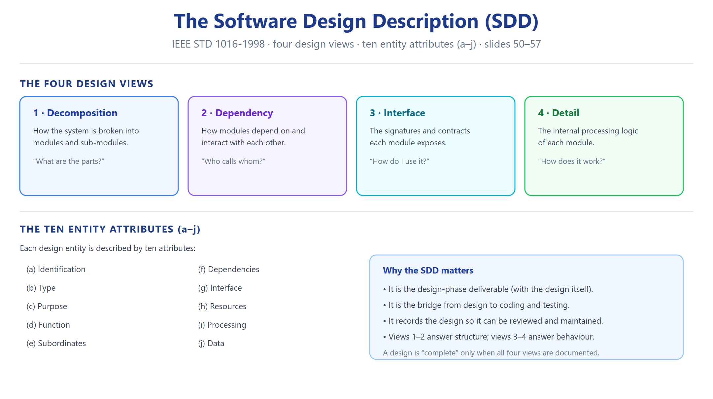

# النوع 2 — الأسئلة المقالية (Essay / Descriptive)

### ASE · Chapter 5 · Software Design

**Source:** Aggarwal & Singh, *Software Engineering* (3rd ed.), Chapter 5 — slide deck `Ch05_Software_Design.pdf` (99 slides) + printed book pp. 202–251. Official Exercises 5.1–5.24 are on **slides 97–99**.

**Format:** Q + model answer in English; one short Arabic justification line after each answer. Every answer cites its slide/book source. Blank lines are inserted between blocks (RTL-safe).

---

## Reference diagrams (review before solving)

---

## PART A — الأسئلة الرسمية (Exercises 5.1–5.24)

> Every official exercise verbatim from slides 97–99, each with a full exam-grade model answer.

---

**Exercise 5.1 — What is design? Describe the difference between conceptual design and technical design.**

**Model answer.** Design is the process of applying various techniques and principles for the purpose of defining a device, a process or a system in sufficient detail to permit its physical realisation; in software it is the activity that produces a *model of the system before it is built*. It is a two-part process (Fig. 2). **Conceptual design** answers *what* the system will do: where the data comes from, what happens to the data inside the system, how the system will look to users, what choices are offered, the timing of events, and how reports and screens look. **Technical design** describes *how* the system will be realised: hardware configuration, software needs, communication interfaces, system I/O, software architecture and network architecture — in short, anything that translates the requirements into a solution to the customer's problem. Conceptual design is thus the customer-facing, requirements-oriented view; technical design is the builder-facing, solution-oriented view.

*ملخص عربي:* التصميم ينتج نموذجًا للنظام قبل بنائه — **Conceptual (ما)** يجاوب شنو يسوي النظام للمستخدم، و**Technical (كيف)** يجاوب شلون ننفّذه تقنيًا (عتاد، شبكة، معمارية). المصدر: سلايد 4–7؛ كتاب ص.203.

---

**Exercise 5.2 — Discuss the objectives of software design. How do we transform an informal design to a detailed design?**

**Model answer.** The four design objectives are that the design must be **correct & complete**, **understandable**, **at the right level** (of abstraction/detail), and **maintainable**. Transformation: the design moves through progressive refinement (Fig. 3): an **informal design outline** → an **informal design** → a **more formal design** → the **finished design**. At each step detail is added while the validity established at the previous step is preserved, so that an initially sketchy idea is progressively hardened into a specification a programmer can implement directly.

*ملخص عربي:* أهداف التصميم أربعة (صح وكامل، مفهوم، بالمستوى الصحيح، قابل للصيانة)، والتحوّل يصير بتدريج: مخطط مبدئي ← تصميم غير رسمي ← أكثر رسمية ← تصميم نهائي. المصدر: سلايد 8–9؛ كتاب ص.204.

---

**Exercise 5.3 — Do we design software when we "write" a program? What makes software design different from coding?**

**Model answer.** Yes — writing any program involves design decisions (how to structure, name, and interface the parts), but the *degree* of conscious design varies. Coding, however, is only the *translation* of a design into a specific programming language. Software design differs from coding because it deals with structure, module boundaries, interfaces and abstraction, and it can be expressed in language-independent notations (structure charts, pseudocode, DFDs). A design can exist fully before a single line of code is written, and it can be reviewed and validated against the requirements; coding merely implements an already-decided structure. Mixing the two is the classic error: low-level decisions get taken before the architecture is settled.

*ملخص عربي:* نعم، أي برنامج فيه قرارات تصميم؛ بس **التصميم** يهتم بالبنية والواجهات ومستقل عن اللغة، و**الترميز** مجرد ترجمة للتصميم للغة. المصدر: سلايد 3؛ كتاب ص.203–204.

---

**Exercise 5.4 — What is modularity? List the important properties of a modular system.**

**Model answer.** Modularity is the single attribute of software that allows a program to be **intellectually manageable**. A modular system consists of well-defined, manageable units with well-defined interfaces among the units (a "module" ranges from a Fortran subroutine, an Ada package, Pascal/C procedures, C++/Java classes, Java packages, up to a work assignment for one programmer). Its properties: (i) a well-defined subsystem; (ii) a well-defined purpose; (iii) it can be separately compiled and stored in a library; (iv) a module can use other modules; (v) a module should be *easier to use than to build*; and (vi) it should be *simpler from the outside than from the inside*. Modularity enhances design clarity, which eases implementation, debugging, testing, documentation and maintenance.

*ملخص عربي:* الوحداتية هي الصفة اللي تخلي البرنامج "قابل للإدارة ذهنيًا" — وحدات بأهداف وواجهات واضحة، تُترجم منفصلة، وأسهل استخدامًا من بنائها. المصدر: سلايد 10–13؛ كتاب ص.205–206.

---

**Exercise 5.5 — Define module coupling and explain different types of coupling.**

**Model answer.** Coupling is the **measure of the degree of interdependence between modules** (from uncoupled — no dependencies — to loosely coupled — few — to highly coupled — many). Its types, best → worst, are:
**Data coupling** — modules communicate only by passing data; apart from that they are independent (best);
**Stamp coupling** — a complete data structure is passed from one module to another;
**Control coupling** — modules communicate by passing control information, usually flags set by one module and reacted upon by another;
**External coupling** — both modules are tied to an external format, protocol or device (e.g. an external data format);
**Common coupling** — modules share a global data area, so any change to the common data forces a trace of all modules that access it;
**Content coupling** — one module changes the data of another or control passes into the middle of another module's code (worst).
Coupling can be reduced by controlling the number of parameters passed, avoiding passing undesired data to the calling module, maintaining a strict parent/child relationship between caller and called, and passing *data* not *control* information.

*ملخص عربي:* الاقتران = درجة الترابط بين الوحدات، من الأفضل للأسوأ: **Data ← Stamp ← Control ← External ← Common ← Content**. الهدف: أقل اقتران ممكن، وتجنّب تمرير معلومات التحكم بدل البيانات. المصدر: slide 15–21؛ book p.207–210.

---

**Exercise 5.6 — Define module cohesion and explain different types of cohesion.**

**Model answer.** Cohesion is the **measure of the degree to which the elements of a module are functionally related** — the "strength of relations within a module". Its types, best (high) → worst (low), are:
**Functional** — all elements are part of a single functional task (best);
**Sequential** — the output of one element is the input of the next;
**Communicational** — elements operate on the same data;
**Procedural** — elements accomplish different tasks but must be executed in a specific order of flow of control;
**Temporal** — tasks are related only in that they must all be executed within the same time span (e.g. all initialisation at start-up);
**Logical** — elements appear related because they fall into the same logical class of functions (e.g. one "input all kinds" routine);
**Coincidental** — elements have little or no relationship to one another (worst).
A good design aims at **high cohesion** — ideally functional/sequential/communicational.

*ملخص عربي:* التلاحم = قوة الترابط داخل الوحدة، من الأفضل للأسوأ: **Functional ← Sequential ← Communicational ← Procedural ← Temporal ← Logical ← Coincidental**. المطلوب تلاحم عالٍ. المصدر: slide 25–30؛ book p.211–212.

---

**Exercise 5.7 — Discuss the objectives of modular software design. What are the effects of module coupling and cohesion?**

**Model answer.** The objective of modular design is to organise the program's modules so that they are easy to develop and, later, easy to change — i.e. to deal with the size and complexity of programs by producing modules that are independently understandable, testable and reusable. This is why a good design strategy organises modules for development and change, and why pre-existing code must still be understood, organised and pieced together. **Effect of coupling:** high coupling spreads change (the ripple effect) — a change in one module forces changes in the modules that depend on it, errors propagate across boundaries, and stability drops. **Effect of cohesion:** high cohesion keeps each module focused on one task, making it easier to name, understand, test and reuse. The combined goal is **high cohesion + low coupling**, which yields **functional independence** and prevents a "host of seemingly trivial enhancements" from killing the project (Fig. 12).

*ملخص عربي:* الهدف: وحدات سهلة التطوير والتغيير؛ الاقتران العالي ينشر التغيير (Ripple Effect)، والتلاحم العالي يخلي الوحدة مركّزة — والمحصلة **High Cohesion + Low Coupling**. المصدر: slide 31–32؛ book p.213.

---

**Exercise 5.8 — If a module has logical cohesion, what kind of coupling is this module likely to have with others?**

**Model answer.** A logically cohesive module contains instructions that *appear* related only because they fall in the same logical class of functions (e.g. one routine that inputs from any of several sources), and the choice of which function to execute is deferred to run time. Therefore the caller must tell the module *which* logical function to perform — usually by passing a **flag**, i.e. **control coupling** — and such "utility" modules frequently operate on shared/global areas, i.e. **common coupling**. So a logically cohesive module is typically **control coupled** with its caller and often **common coupled** with its peers. Being low on the cohesion scale, it also usually drags the whole design toward worse coupling.

*ملخص عربي:* التلاحم المنطقي يخلّي الوحدة تحتاج flag يحدد شنو تشتغل ← **Control Coupling**، وغالبًا تلمس بيانات عامة ← **Common Coupling**. المصدر: سلايد 21، 30؛ كتاب ص.212.

---

**Exercise 5.9 — What problems are likely to arise if two modules have high coupling?**

**Model answer.** With high coupling: (1) a change in one module forces changes in the others — the **ripple effect** — so maintenance cost and effort rise sharply; (2) errors propagate across the boundary, since internal details of one module are visible to or shared with another; (3) the modules can no longer be understood, tested, debugged or reused independently; (4) the design becomes hard to read because the interfaces are implicit (e.g. shared globals) rather than explicit; and (5) the parent/child structure is violated, making the hierarchy meaningless. At the extreme (content coupling) one module reaches into another's internals, and a single local change can silently break distant behaviour with no compiler warning.

*ملخص عربي:* الاقتران العالي يسبب: Ripple Effect، انتشار الأخطاء، استحالة الاختبار والصيانة المستقلة، وواجهات غامضة — ويزيد كلفة التطوير والصيانة. المصدر: سلايد 15–18، 23؛ كتاب ص.207–210.

---

**Exercise 5.10 — What problems are likely to arise if a module has low cohesion?**

**Model answer.** A module with low cohesion (logical, temporal or coincidental) performs several unrelated responsibilities, so: it is difficult to give it a meaningful name; it is hard to understand, since no single purpose explains its parts; it is hard to test, because each caller exercises only a fraction of it while the rest is dead weight for that call; it is hard to reuse, since a caller that needs one function must drag in the others; it must change for many different reasons, so it becomes a maintenance hot-spot; and it typically pulls in **control coupling** (flags) and extra shared data, degrading the design around it. Over time such modules grow into "blob" modules that touch many parts of the system, and each change risks unexpected side effects.

*ملخص عربي:* التلاحم المنخفض يخلّي الوحدة بلا هدف واحد واضح ← صعب فهمها وتسميتها واختبارها وإعادة استخدامها، وتتغيّر لأسباب كثيرة، وتجذب اقترانًا سيئًا حولها. المصدر: سلايد 26–30؛ كتاب ص.211–212.

---

**Exercise 5.11 — Describe the various strategies of design. Which design strategy is most popular and practical?**

**Model answer.** There are three strategies. **Bottom-up design** starts from the lowest-level modules, builds and tests them, and collects them together in a **library** from which higher-level modules are then composed. **Top-down design** starts by identifying the major modules, decomposes them into lower-level modules and iterates until the desired level of detail is reached — this is **stepwise refinement**, from abstract design to more concrete levels until a level is reached where no further refinement is needed and implementation can begin directly. **Hybrid design** combines the two: a top-down overall skeleton, with bottom-up work where it matters — to permit common sub-modules, to exploit pre-written library modules for reuse, and near the bottom of the hierarchy where there are many modules and the need for bottom-up testing is greater. The **hybrid** strategy is the most popular and practical, because pure top-down cannot exploit existing code and pure bottom-up cannot guarantee a coherent architecture.

*ملخص عربي:* ثلاث استراتيجيات: **Bottom-up** (من الوحدات الدنيا وتجميعها بمكتبة)، **Top-down** (تفكيك تدريجي من الأعلى)، و**Hybrid** — و**الهجينة هي الأكثر شيوعًا وعملية** لأنها تجمع مزايا الاثنتين. المصدر: سلايد 32–35؛ كتاب ص.214–215.

---

**Exercise 5.12 — If some existing modules are to be re-used in building a new system, which design strategy is used and why?**

**Model answer.** The **bottom-up** strategy is used, because it begins from available/pre-written modules and assembles them upward into larger units — which is exactly how a modifiable library of reusable modules is exploited. Existing modules are collected in a library form (Fig. 13), so the design can be built by composing them and adding only the glue that is missing. Pure top-down would force the designer to re-derive the architecture without reference to what already exists, discarding reusable assets; in practice, therefore, reuse means a bottom-up component inside an otherwise top-down or hybrid design. The choice is driven by the economic goal: reusing a tested module reduces development effort and risk.

*ملخص عربي:* نستخدم **Bottom-up** لأنها تبدأ من وحدات جاهزة مجمّعة بمكتبة وتصعد للأعلى — وهذا بالضبط جوهر إعادة الاستخدام، بينما Top-down تهمل الموجود. المصدر: سلايد 33، 35؛ كتاب ص.214–215.

---

**Exercise 5.13 — What is the difference between a flow chart and a structure chart?**

**Model answer.** A **flow chart** describes the *logic and sequence of control inside a single program* — decision points, loops and processes, i.e. the algorithmic detail of one module. A **structure chart** describes the *hierarchical module decomposition of the whole system* — which module calls which, and what data and control information pass between caller and called (it partitions the system into black boxes whose functionality is known to the user without knowledge of the internal design). In short: a flow chart is an **intra-module** view (the "how" inside one unit); a structure chart is an **inter-module/architectural** view (the "what structures what"). A function-oriented design may use both, but structure charts are the design notation while flow charts are a low-level/implementation-level notation.

*ملخص عربي:* الـ**Flow chart** يبيّن منطق وتتابع التحكم داخل برنامج واحد، والـ**Structure chart** يبيّن التفكيك الهرمي بين الوحدات ومن ينادي من وشنو البيانات العابرة — داخلي مقابل معماري. المصدر: سلايد 40–43؛ كتاب ص.217–219.

---

**Exercise 5.14 — Explain why it is important to use different notations to describe software designs.**

**Model answer.** No single notation can express every view of a design. Different notations serve different purposes, audiences and stages: **data flow diagrams** and **data dictionaries** capture the functional/process and data views; **structure charts** and **transaction-centred structures** capture the module hierarchy and interfaces; **pseudocode** describes system characteristics in short structured English; **functional procedure layers** carry function parameters, globals, side-effects, assertions, local data and body; and, in the object-oriented world, **UML diagrams** (use case, activity, interaction, class, state chart, component/deployment) each address one aspect (static vs dynamic, logical vs physical). Using the right notation for each view (i) communicates different aspects to different readers (designer, developer, tester), (ii) supports the different SDD design views required by IEEE STD 1016, and (iii) improves the clarity, precision and correctness of the design description, exposing ambiguities that prose alone would hide.

*ملخص عربي:* ما توجد تدوينة واحدة تغطي كل الأوجه؛ كل تدوينة (DFD، Structure Chart، Pseudocode، UML…) تكشف منظورًا مختلفًا لجمهور مختلف — وهذا يرفع الوضوح والدقة ويطابق متطلبات IEEE STD 1016. المصدر: slide 40، 46–57؛ book p.216–222.

---

**Exercise 5.15 — List a few well-established function oriented software design techniques.**

**Model answer.** The well-established function-oriented design techniques are: **Data Flow Diagrams (DFD)** — graphical representation of the functional/process view; **Data Dictionaries** — defining the data items and structures used; **Structure Charts** — partitioning the system into black-box modules in a hierarchy, including the **transaction-centred structure**; **Pseudocode / PDL** — short, concise structured English using keywords such as If-Then-Else, While-Do and End, usable in both preliminary and detailed design; and **Functional Procedure Layers** — layered notation (Level 0 name/relationship/purpose/author; Level 1 parameters/globals/called routines/side-effects/IO assertions; Level 2 local data/timing/exceptions/limits; Level 3 body) for specifying a procedure in progressively greater detail.

*ملخص عربي:* التقنيات: **DFD، Data Dictionaries، Structure Charts (بما فيها Transaction-centred)، Pseudocode/PDL، Functional Procedure Layers (مستويات 0–3)**. المصدر: slide 40–49؛ book p.216–221.

---

**Exercise 5.16 — Define the following terms: Objects, Message, Abstraction, Class, Inheritance and Polymorphism.**

**Model answer.** **Object** — an entity able to save a state (information) and offering a number of operations (behaviour) to examine or affect that state; an object is characterised by its operations and a state that remembers their effect. **Message** — objects communicate by message passing; a message consists of the identity of the target object, the name of the requested operation and any other information needed; messages are often implemented as procedure or function calls. **Abstraction** — the elimination of the irrelevant and the amplification of the essentials, used in OOD to manage complexity. **Class** — a set of objects that share a common structure and a common behaviour; it is useful because it acts as a blueprint for objects (e.g. the class "car" with Indica, Santro, Maruti, Indigo as instances). **Inheritance** — the mechanism by which low-level classes (subclasses/derived classes) inherit state and behaviour from a high-level class (superclass/base class), created by abstracting common features into a new class (e.g. Shape). **Polymorphism** — abstracting just the *interface* of an operation and leaving the implementation to subclasses, so a polymorphic operation can be applied uniformly to different types.

*ملخص عربي:* الكائن (حالة + عمليات)، الرسالة (طلب من كائن لآخر)، التجريد (إلغاء غير المهم)، الصنف (مجموعة كائنات ببنية وسلوك مشترك)، الوراثة (subclass يكتسب من superclass)، تعدد الأشكال (الواجهة فقط والمُحقّقة بالـsubclass). المصدر: سلايد 60–69؛ كتاب ص.226–229.

---

**Exercise 5.17 — What is the relationship between abstract data types and classes?**

**Model answer.** An **abstract data type (ADT)** is the *specification* idea: a data type defined by the operations that may be performed on it, with its representation hidden from users. A **class** is the *implementation* realisation of that idea: it binds data (attributes) and operations (methods) into one unit, hides its representation (encapsulation/information hiding), and serves as a blueprint from which objects can be instantiated. So a class is effectively a concrete, instantiable ADT: the ADT says *what* operations exist and what they mean, while the class says *how* they are stored and computed and lets objects be created. Encapsulation is the property that connects them — the separation of the external aspects of an object from its internal implementation details.

*ملخص عربي:* **ADT** = مواصفة (بيانات + عمليات مع إخفاء التمثيل)، و**Class** = تحقيق فعلي قابل للإنشاء لتلك المواصفة — أي الـClass هو ADT ملموس يتجسّد بكائنات. المصدر: سلايد 62، 69؛ كتاب ص.227–230.

---

**Exercise 5.18 — Can we have inheritance without polymorphism? Explain.**

**Model answer.** Yes. **Inheritance** is a *mechanism*: a subclass acquires state (attributes) and behaviour (operations) from a superclass. **Polymorphism** is a *capability*: abstracting just the interface of an operation and leaving the implementation to subclasses, so the same operation name can behave differently per type. A subclass can inherit attributes and operations that it never overrides, so inheritance exists in complete isolation from polymorphism. Inheritance is in fact the *enabling* mechanism through which polymorphic substitution is implemented in languages like C++ and Java — a subtype must first inherit the supertype's interface — but the inheritance can be used purely for code sharing with no polymorphic reuse at all. Therefore inheritance without polymorphism is common and perfectly valid.

*ملخص عربي:* نعم — **الوراثة آلية** (اكتساب الخصائص) و**تعدد الأشكال قدرة** (إعادة تعريف الواجهة تبعًا للنوع)؛ فيمكن نرث عمليات بدون ما نعيد تعريفها تعدد-أشكاليًا. المصدر: سلايد 66–69؛ كتاب ص.229–230.

---

**Exercise 5.19 — Discuss the reasons for improvement using object-oriented design.**

**Model answer.** OOD begins with an examination of the real-world "things" that are part of the problem — objects characterised by attributes and behaviour — so the model is **natural and understandable**. The reasons for improvement are: (1) **Stability under change** — requirements changes tend to add or modify operations on entities rather than replace entities, so the design's skeleton survives; (2) **Encapsulation (information hiding)** — the internal implementation of an object is separated from its external aspects, so a change is localised to the affected class; (3) **Inheritance** — common structure and behaviour are factored into superclasses and reused, reducing duplication; (4) **Polymorphism** — new behaviour is added by subclassing rather than by rewriting existing code, supporting extensibility; (5) **Hierarchy** — sub-types can be treated generically, reducing complexity; and (6) **Language independence** — OOD is not dependent on any specific implementation language. The result is software that is easier to maintain, extend and understand.

*ملخص عربي:* أسباب التحسّن: نموذج طبيعي مستقر، تغليف يعزل التغيير، وراثة تعيد الاستخدام، تعدد أشكال يوسّع بدون تعديل، هرمية تبسّط، واستقلال عن اللغة. المصدر: سلايد 58–59، 69؛ كتاب ص.225–230.

---

**Exercise 5.20 — Explain the design guidelines that can be used to produce "good quality" classes or reusable classes.**

**Model answer.** Guidelines for good/reusable classes: (1) give each class a **single, coherent responsibility** — a class should represent one well-defined concept (e.g. Square, Triangle), not a grab-bag; (2) **encapsulate** — keep attributes hidden and expose only a small, complete, well-named interface (information hiding); (3) **maximise cohesion inside** the class and **minimise coupling between** classes, so a class can be understood and changed in isolation; (4) design **general, parameterised behaviour** rather than special cases, so the class can be reused in new contexts; (5) use **inheritance only for genuine "is-a" generalisation** and avoid deep, fragile hierarchies (the Shape/Square/Triangle example shows the right way — abstract the common features once); (6) keep the **interface stable** and documented, since reusers depend on it; and (7) keep classes **independent of implementation language** so they can be translated/reused. Well-designed classes are the unit of reuse and the building block of maintainable OO systems.

*ملخص عربي:* قواعد الصنف الجيد: مسؤولية واحدة، تغليف، تلاحم عالٍ واقتران منخفض، سلوك عام قابل لإعادة الاستخدام، وراثة حقيقية غير عميقة، وواجهة مستقرة موثّقة. المصدر: سلايد 62–69؛ كتاب ص.227–230.

---

**Exercise 5.21 — List the points of a simplified design process.**

**Model answer.** The simplified design process (Fig. 25 — book Fig. 5.25; six steps) is: (i) **Create the use case model** — identify the actors interacting with the system, write the use cases and draw the use case diagram; (ii) **Draw the activity diagram** (if required) — models the dynamic nature of the system by the flow of control from activity to activity; (iii) **Draw the interaction diagram** — identify the objects for every use case and draw sequence and collaboration diagrams; (iv) **Draw the class diagram** — the relationship among classes (association, dependency, aggregation, generalisation); (v) **Draw the state chart / object diagram** (if required) — the state space of a class, the events causing transitions and the resulting actions; (vi) **Draw the component and deployment diagrams** — the static implementation view and the mapping of physical components to hardware — after which the **design documents** are produced. Six points in total.

*ملخص عربي:* ست خطوات مرقّمة: (1) use case model (2) activity diagram (3) interaction diagram (4) class diagram (5) state chart/object diagram (6) component & deployment diagram ← ثم مستندات التصميم. المصدر: slide 71–80؛ book p.231–235.

---

**Exercise 5.22 — Discuss the differences between object oriented and function oriented design.**

**Model answer.** **Function-oriented design** is an approach in which the design is decomposed into a set of interacting units, each with a clearly defined *function* — the system is designed from a *functional viewpoint*, documented with DFDs, structure charts and pseudocode, and typically refined top-down as a tree of modules. **Object-oriented design** results from focusing attention not on the function performed by the program but instead on the *data* that are to be manipulated by the program — it is **orthogonal** to function-oriented design, begins with the real-world "things" of the problem, and models problems using objects (state + behaviour), classes, inheritance, polymorphism and encapsulation, documented with UML. In short: FO decomposes by **what the system does** (processes), OO decomposes by **the things the system manipulates** (data/entities). FO suits algorithmic/process-dominated systems; OO suits entity-dominated systems and is generally more robust to requirement change.

*ملخص عربي:* **Function-oriented** تفكّك حسب الوظائف (شنو يسوي النظام)، و**Object-oriented** تفكّك حسب الكيانات/البيانات (شنو يتعامل معه) — منظوران متعامدان؛ FO للأنظمة الخوارزمية وOO للأنظمة الكيانية. المصدر: سلايد 36، 58؛ كتاب ص.215–225.

---

**Exercise 5.23 — What documents should be produced on completion of the design phase?**

**Model answer.** The document produced is the **Software Design Description (SDD)**, per **IEEE STD 1016-1998** ("IEEE Recommended Practice for Software Design Descriptions"). It is a representation of a software system used as a medium for communicating software design information, and it shows how the software will be structured to satisfy the requirements in the SRS — it is the blueprint for implementation. The SDD contains, in the recommended organisation: **Scope**, **References** (e.g. IEEE STD 830-1998 for SRS, IEEE STD 610.12-1990 glossary), **Definitions** (design entity, design view, entity attributes, SDD), and **Design Description Information Content** (introduction, design entities, design entity attributes). It is organised into the **four design views** (Table 2): the **Decomposition description**, the **Dependency description**, the **Interface description** and the **Detail description**, built from the **ten entity attributes (a–j)**: Identification, Type, Purpose, Function, Subordinates, Dependencies, Interface, Resources, Processing and Data.

*ملخص عربي:* الوثيقة هي **SDD** حسب **IEEE STD 1016-1998**؛ تحتوي Scope/References/Definitions/Content، وتُنظَّم بأربع **design views** (Decomposition–Dependency–Interface–Detail) مبنية على **عشر خصائص للكيان (a–j)**. المصدر: slide 50–57؛ book p.221–224.

---

**Exercise 5.24 — Can a system ever be completely "decoupled"? That is, can the degree of coupling be reduced so much that there is no coupling between modules?**

**Model answer.** No. For a system to work, its modules must collaborate, and collaboration requires *some* exchange — at a minimum the passing of data through a call or a shared interface — so some coupling always remains. The "uncoupled (no dependencies)" state of Fig. 5 is a limiting ideal, not an achievable design point for a real system: two modules that never interact cannot combine to deliver a function. The realistic goal is therefore not to *eliminate* coupling but to reduce it to its **best form — data coupling** — where modules communicate only by passing primitive data and are otherwise independent, and to avoid control, common and content coupling. Coupling can be reduced by controlling the number of parameters passed, avoiding passing undesired data, keeping a clean parent/child relationship between caller and called, and passing data rather than control information.

*ملخص عربي:* لا — أي نظام شغّال يحتاج تبادلًا بين وحداته فيبقى اقتران دائم؛ الهدف الواقعي هو الوصول لأفضل شكل (**Data Coupling**) لا إلغاء الاقتران كليًا. المصدر: سلايد 15–17؛ كتاب ص.207–208.

---

## PART B — أسئلة مقالية بالنمط الامتحاني (from the 6 real-exam axes)

> NEW questions written in the real-exam phrasing, derived from the 6 recurring axes in `04_EXAM_PATTERN_BANK.md` (Software Architecture · Design Concepts/Principles · Coupling & Cohesion · OOD Process · Data Design · Design Quality). Mark estimates in the header.

---

**B1 (14M) — Define software architecture. Explain why it may be necessary to design the system architecture before writing detailed specifications.**

**Model answer.** Software architecture is the high-level structure of a system: the organisation of its components, their interrelationships, and the principles that guide their design and evolution. It is not a diagram but a set of decisions about decomposition, interfaces and responsibility. It must precede detailed specification because it is the **context that gives meaning to every lower-level decision**: module boundaries, interfaces and data structures cannot be chosen coherently until the overall structure is fixed. If detailed design begins first, its decisions are made against assumptions that the architecture may later invalidate, and all that detailed work must be redone — the architecture is also the framework within which the *requirements* themselves become implementable. Furthermore, requirements can only be fully *validated* once a candidate architecture exists to test them against (feasibility, performance, distribution). Changing the architecture late is by far the most expensive kind of change, because it invalidates everything beneath it. Hence the architecture is fixed first, and detailed design refines each component within it.

*ملخص عربي:* المعمارية = البنية العليا (مكوّنات + علاقات + مبادئ)؛ ولازم تسبق التصميم التفصيلي لأنها السياق اللي يعطي معنى لكل قرار أدنى، وأي تغيير متأخر فيها يُبطل كل ما تحتها. المصدر: سلايد 3–5؛ كتاب ص.203؛ المحور 1.

---

**B2 (14M) — Describe the characteristics and criteria for a good design, and explain how each is achieved.**

**Model answer.** A good design must satisfy **four criteria** (slide 8): (i) **Correct & complete** — it satisfies every requirement identified in the SRS, with no requirement unmet and no design element unrequested; (ii) **Understandable** — it is structured so that coders, testers and reviewers can read and reason about it, which is achieved by clear decomposition, meaningful names and consistent notation; (iii) **At the right level** — the design is neither over-detailed (premature implementation decisions) nor under-detailed (leaving decisions ambiguous); it must be at the level appropriate to its audience and stage; (iv) **Maintainable** — it can absorb change locally, which is achieved by high cohesion and low coupling so that a change touches as few modules as possible. The book adds the classical architectural attributes given by **Vitruvius — durability, utility and charm** (three attributes, *not* four) — describing what a good design *is*: it must weather change (durability), serve its purpose (utility) and present a coherent, appealing structure (charm). Operationally, quality is achieved by designing toward **functional independence** (maximise cohesion, minimise coupling) and by reviewing the design against these criteria before implementation, since design defects are the most expensive to fix after coding.

*ملخص عربي:* أربعة معايير: **صح وكامل، مفهوم، بالمستوى الصحيح، قابل للصيانة**؛ وسمات Vitruvius **ثلاث** (durability, utility, charm) مو أربع. التحقيق عبر تلاحم عالٍ واقتران منخفض + مراجعة التصميم. المصدر: سلايد 8، 31؛ كتاب ص.204، 213؛ المحور 2.

---

**B3 (14M) — Explain the fundamental concepts/principles of software design: abstraction, modularity, information hiding, and refactoring.**

**Model answer.** **Abstraction** is the elimination of the irrelevant and the amplification of the essentials; it lets a designer reason at one level without the details below, and takes two forms — *procedural abstraction* (a named procedure whose body is hidden: what it does, not how) and *data abstraction* (a named data type whose representation is hidden: e.g. a Stack with push/pop/peek). **Modularity** is the single attribute that makes a program intellectually manageable: the decomposition of the system into separately named, manageable units with well-defined interfaces. It trades module-development effort against integration effort — the modularity/cost curve is a U-shape with a **Region of Minimum Cost** — so more modules is not always better. **Information hiding (encapsulation)** is the separation of the external aspects of an entity from its internal implementation details. It is the direct *enabler of low coupling*: because only the external aspect is visible, other modules can depend only on a stable interface and never on internals, so a change to internals cannot ripple out. **Refactoring** is the disciplined restructuring of existing design/code to improve internal structure **without changing external behaviour**, used to hold design quality as the system evolves. Together these four principles convert "a system that is too complex to understand" into "a set of units that can each be understood, tested and changed in isolation".

*ملخص عربي:* **التجريد** (إلغاء غير المهم، نوعان: إجرائي وبياني)، **الوحداتية** (منحنى U مع منطقة أقل كلفة)، **إخفاء المعلومات** (مُمكِّن الاقتران المنخفض)، **إعادة الهيكلة** (تحسين الداخل بلا تغيير الخارج). المصدر: سلايد 10–14، 69؛ كتاب ص.205–206؛ المحور 2.

---

**B4 (14M) — Define coupling and cohesion. Explain the types of each and how they are useful in arriving at a good design, with an example.**

**Model answer.** **Coupling** is the measure of the degree of interdependence between modules; **cohesion** is the measure of the degree to which the elements *within* a module are functionally related. Their taxonomies (Fig. 7 and Fig. 11) are: **Coupling, best → worst: Data → Stamp → Control → External → Common → Content**. **Cohesion, best → worst: Functional → Sequential → Communicational → Procedural → Temporal → Logical → Coincidental.** Usefulness: a good design simultaneously **maximises cohesion** (each module does one well-defined job, hence is understandable, testable and reusable in isolation) and **minimises coupling** (each module depends on others only through explicit data interfaces, so change is local and errors do not propagate) — producing **functional independence**, the direct enabler of design clarity and of easier implementation, debugging, testing, documentation and maintenance. **Example (Fig. 6):** in a student information system, `edit_student_record` calling `retrieve_student_record` is *good* when only the `student ID` is passed (data coupling) and the record is fetched by the callee; it is *poor* when the whole `Student record` structure plus an `EOF` control flag is passed (stamp + control coupling), because the caller now depends on the callee's internal representation and the callee's control flow. The guideline: pass data, not control information; control the number of parameters.

*ملخص عربي:* الاقتران داخل الوحدات والاقتران بينها؛ الترتيب: **Data>Stamp>Control>External>Common>Content** و**Functional>Sequential>Communicational>Procedural>Temporal>Logical>Coincidental**؛ والمثال: تمرير student ID فقط (جيد) مقابل تمرير السجل كامل + EOF (سيئ). المصدر: Fig 6/7/11؛ slide 18–19، 27؛ book p.208، 211؛ المحور 3.

---

**B5 (14M) — Explain the object-oriented design process using UML, with a suitable example.**

**Model answer.** The OOD process has **six steps** (Fig. 25). (1) **Create the use case model** — identify the actors that interact with the system, write the use cases and draw the use-case diagram. (2) **Draw the activity diagram** (if required) — it illustrates the dynamic nature of the system by modelling the flow of control from activity to activity, where an activity represents an operation on a class that changes the system state. (3) **Draw the interaction diagram** — identify the objects for every use case, then draw sequence diagrams and collaboration diagrams; these address the dynamic view, showing the set of objects, their relationships and the messages dispatched among them. (4) **Draw the class diagram** — the static structure: classes with attributes and operations, connected by the four relationship types — association (semantic connection, bi- or unidirectional), dependency (always unidirectional), aggregation (a whole/parts relationship) and generalisation (inheritance). (5) **Draw the state chart / object diagram** (if required) — the state space of a given class, the events that cause a transition and the actions resulting from a state change. (6) **Draw the component and deployment diagrams** — component diagrams address the static implementation view (a component maps to one or more classes/interfaces), and deployment diagrams capture the relationship between physical components and hardware — after which the **design documents** are produced. *Worked example:* the University **Library Management System** (slide 81) — issue books (a student may issue at most 4 Book-bank and 3 General books for 15 days), return books, query processing, with login/backup; the slides/books walk through its use-case, activity, sequence, class, state-chart ("book") and component/deployment diagrams.

*ملخص عربي:* ست خطوات: **use case ← activity ← interaction ← class ← state chart/object ← component & deployment** ← مستندات التصميم، والمثال نظام مكتبة جامعية (استعارة/إرجاع/استعلام). المصدر: slide 71–83؛ book p.231–236؛ المحور 4.

---

**B6 (7M) — What are the merits of the object-oriented design process? Discuss the reasons for improvement using OOD.**

**Model answer.** OOD begins from the real-world things of the problem — objects characterised by attributes and behaviour — so the resulting model is natural and, crucially, **stable**: requirements changes tend to add or alter *operations on entities* rather than replace entities, so the design skeleton survives. Its merits are: **encapsulation** localises change to the affected class; **inheritance** lets common structure and behaviour be shared, reducing duplication and promoting reuse; **polymorphism** lets new behaviour be added by subclassing rather than by rewriting existing code, supporting extensibility; **hierarchy** allows sub-types to be treated generically, reducing complexity; and the whole design is **independent of any implementation language**. The result is software easier to maintain, extend and understand, and more robust when requirements change. OOD is therefore preferred for entity-dominated systems where change is expected.

*ملخص عربي:* مزايا OOD: نموذج طبيعي مستقر، تغليف يعزل التغيير، وراثة/تعدد الأشكال لإعادة الاستخدام والتوسّع، هرمية، واستقلال عن اللغة ← صيانة وتوسّع أسهل. المصدر: سلايد 58–59، 69؛ كتاب ص.225–230؛ المحور 4.

---

**B7 (7M) — Explain: objects, message, abstraction, class, inheritance, polymorphism, and the relationship between ADTs and classes.**

**Model answer.** **Object** — an entity able to save a state and offering operations to examine or affect that state; its state remembers the effect of the operations. **Message** — a request from one object to another, consisting of the target object's identity, the name of the requested operation and any needed parameters; often implemented as a procedure/function call. **Abstraction** — the elimination of the irrelevant and the amplification of the essentials. **Class** — a set of objects sharing a common structure (attributes) and common behaviour (operations); it acts as a blueprint (e.g. class "car"; Indica, Santro, Maruti, Indigo are instances). **Inheritance** — a subclass/derived class acquires state and behaviour from a superclass/base class, created by abstracting common features into a higher class (e.g. Shape). **Polymorphism** — abstracting just the *interface* of an operation and leaving the implementation to subclasses. **ADT vs class:** an ADT *specifies* a data type plus the operations on it with the representation hidden; a class *implements* that specification, binds data and operations in one unit and can instantiate objects — so a class is a concrete, instantiable ADT, connected to it by encapsulation.

*ملخص عربي:* تعريفات مختصرة للكائن/الرسالة/التجريد/الصنف/الوراثة/تعدد الأشكال، والعلاقة: **ADT مواصفة وClass تحقيقها القابل للإنشاء**. المصدر: سلايد 60–69؛ كتاب ص.226–230؛ المحور 4.

---

**B8 (7M) — Can we have inheritance without polymorphism? Explain the design guideline for good quality/reusable classes.**

**Model answer.** **Yes** — inheritance is the *mechanism* by which a subclass acquires state and behaviour from a superclass, while polymorphism is the *capability* of abstracting only an operation's interface and deferring its implementation to subclasses. A subclass can inherit attributes and operations without ever overriding them, so inheritance can exist with no polymorphism at all; and inheritance is in fact the enabling mechanism through which polymorphism is implemented, which is why the inheritance-without-polymorphism case is the simpler one. **Guidelines for good/reusable classes:** give each class a single coherent responsibility; encapsulate — hide attributes and expose a small, complete, well-named, stable interface; maximise cohesion inside and minimise coupling between classes; design general, parameterised behaviour rather than special cases; use inheritance only for genuine "is-a" generalisation and avoid deep fragile hierarchies (abstract common features once, as with Shape/Square/Triangle); and keep classes independent of any implementation language so they can be reused.

*ملخص عربي:* نعم — الوراثة آلية وتعدد الأشكال قدرة؛ وقواعد الصنف الجيد: مسؤولية واحدة، تغليف، تلاحم عالٍ/اقتران منخفض، سلوك عام، وراثة حقيقية غير عميقة، واستقلال عن اللغة. المصدر: سلايد 66–69؛ كتاب ص.229–230؛ المحور 4.

---

**B9 (7M) — Write a short note on data design, and list the guidelines for data design.**

**Model answer.** **Data design** transforms the information-domain model produced during analysis into the data structures required for implementation — it refines the data objects and the relationships among them into the structures the software will actually use (internal data structures, files, tables, databases and data stores), and it defines them at the same time as the program structure because the two influence each other. **Guidelines:** (i) systematically analyse the data objects and their relationships identified in analysis; (ii) identify all data structures and the operations to be performed on them; (iii) establish a **data dictionary** describing each data item, its type, meaning and uses; (iv) keep the data structures simple and **hide their representation** (data abstraction), so that a change to the representation does not ripple into the operations; (v) design data structures and program structure together, since each constrains the other; and (vi) choose the representation that matches the dominant operations, considering access frequency, storage cost and data integrity, and design for integrity and security. Good data design is what makes the program's data view as maintainable as its functional view.

*ملخص عربي:* تصميم البيانات يحوّل نموذج مجال المعلومات إلى تراكيب بيانات فعلية؛ قواعده: تحليل الكائنات، حصر التراكيب والعمليات، قاموس بيانات، إخفاء التمثيل، التصميم المتزامن مع البنية البرمجية، واختيار التمثيل حسب العمليات الغالبة والتكلفة والسلامة. المصدر: سلايد 40–45؛ كتاب ص.216–219؛ المحور 5.

---

**B10 (7M) — How can we assess the quality of a software design?**

**Model answer.** A software design is assessed against the **four design criteria**: **correctness/completeness** (does it satisfy every requirement?), **understandability** (can coders, testers and reviewers read and reason about it?), **level of abstraction** (is it at the right level — neither over- nor under-detailed?), and **maintainability** (can it absorb change locally?). Operationally, quality is evaluated by **measuring or judging coupling and cohesion** — the target is low coupling and high cohesion, i.e. **functional independence** — and by reviewing the design against the **SDD organisation (IEEE STD 1016)**: are the four design views (decomposition, dependency, interface, detail) all present, complete and mutually consistent, built from the ten entity attributes a–j? Finally, quality is assured by **design reviews and walkthroughs carried out before implementation**, because design errors caught after coding are the most expensive to correct; a design that has not been reviewed has not been assessed.

*ملخص عربي:* التقييم عبر المعايير الأربعة (صح/كامل، مفهوم، المستوى الصحيح، قابل للصيانة)، وقياس الاقتران والتلاحم (استقلال وظيفي)، ومراجعة مطابقة الـSDD لأربع views وخصائص a–j، وأخيرًا مراجعات التصميم قبل التنفيذ. المصدر: سلايد 8، 50–57؛ كتاب ص.204، 221–224؛ المحور 6.

---

**B11 (14M) — Explain a two-level process of design. Why should system design be finished before detailed design, rather than starting detailed design right after the requirements specification?**

**Model answer.** Design has two levels. **Architectural (high-level/system) design** partitions the system into major components and defines their relationships, responsibilities and interfaces. **Detailed design** specifies the internal logic, data structures and algorithms of each component. The architecture must be finished first because it is the **context** that gives detailed design its meaning: the module boundaries, the interfaces and the distribution of responsibility all come from the architecture, and any detailed design performed before the architecture is fixed would have to be redone once the architecture changed. Starting detailed design immediately after the SRS reproduces the classic flowchart-era failure — a sudden, unvalidated jump from specification to low-level decisions, which is a major source of errors, since each low-level choice is made without knowing how it fits the whole. In addition, requirements can only be validated against a candidate architecture (feasibility, performance, distribution), so skipping this level removes the only early test of the design. Progressive refinement (informal outline → informal → more formal → finished) is only meaningful if it happens *within* a fixed architecture; otherwise each refinement invalidates the last.

*ملخص عربي:* مستويان: **معماري (عالٍ)** ثم **تفصيلي**؛ ولازم المعماري يخلص أول لأنه السياق اللي يعطي معنى للتفاصيل، وأي انتقال مباشر من SRS للتفصيل يكرّر خطأ عصر الـFlowcharts ويولّد أخطاء مكلفة. المصدر: سلايد 3–5، 9؛ كتاب ص.203–204؛ المحور 2.

---

**B12 (14M) — Discuss the golden rules of user interface design and explain why the user-interface design is part of software design.**

**Model answer.** There are three golden rules. (1) **Place the user in control** — the interface must let the user drive: allow undo, permit flexible interaction without forced sequences, adapt to the user's skill level, and make the interface responsive rather than obstructive. (2) **Reduce the user's memory load** — minimise what the user must remember: use meaningful defaults, progressive disclosure, visible context, consistent metaphors and shortcuts for experienced users, so that the user's task rather than the interface mechanics occupies attention. (3) **Make the interface consistent** — consistency across the system, across the platform, and across interaction patterns the user has already learned, so that knowledge transfers and surprises are avoided. The UI is part of software design because the interface is where the design's *utility* (one of the three Vitruvian attributes) is actually delivered: a technically correct architecture that the user cannot operate has failed its purpose. UI design therefore belongs to the design phase, is captured in the design documents (interface description / interface objects), and must satisfy the same four design criteria as the rest of the design.

*ملخص عربي:* ثلاث قواعد ذهبية: **تحكّم المستخدم، تقليل الحمل الذهني، الثبات/التناسق**؛ وواجهة المستخدم جزء من التصميم لأنها المكان اللي يتحقق فيه "utility" ولأنها تُوثَّق في Design Documents وتخضع لنفس المعايير. المصدر: سلايد 4–7، 57؛ كتاب ص.203؛ المحور 2.

---

## PART C — أسئلة مقالية عميقة إضافية (Deep Integrative Essays)

> NEW, harder essays that integrate multiple chapter concepts. Each answer cites sources for each integrated claim.

---

**C1 (14M) — Argue why information hiding simultaneously improves cohesion and coupling.**

**Model answer.** Information hiding is the separation of the external aspects of an entity from its internal implementation details (slide 69), and it improves *both* quality attributes at once — which is why it is the keystone of good design. **It improves coupling** because the only thing visible to other modules becomes the stable interface: since internals are hidden, no other module can depend on them, so dependencies are restricted to a small, explicit, data-level contract — the direction of *data coupling*. It also structurally *prevents* the worst couplings: content coupling requires reaching into another module's internals, which hiding forbids; common coupling requires shared visible data, which encapsulation removes; and control coupling is discouraged because flags become an obvious interface smell. **It improves cohesion** because deciding what *not* to expose forces the designer to identify the one coherent purpose of the entity — its externally visible responsibility — and to move every detail that is not part of that purpose either inside (where it is hidden and irrelevant to others) or out into a different entity. Anything that cannot be hidden coherently is a symptom that the entity has more than one responsibility. Thus information hiding is not a third, competing principle: it is the operational mechanism through which high cohesion and low coupling are jointly attained, and it is what makes abstraction (procedural and data) usable rather than merely conceptual.

*ملخص عربي:* إخفاء المعلومات يحسّن الاثنين معًا: يقلّل الاقتران لأنه يضع الواجهة فقط تحت الاعتماد ويمنع Content/Common/Control، ويرفع التلاحم لأنه يجبر على تحديد المسؤولية الواحدة. المصدر: سلايد 60–69؛ كتاب ص.207–213، 226–230.

---

**C2 (14M) — Compare function-oriented and object-oriented design for a project with rapidly changing requirements. Which is more suitable and why?**

**Model answer.** Function-oriented design decomposes the system by **what it does** (processes/functions), producing a hierarchy of modules documented with DFDs and structure charts, and refined top-down as a tree of refinement. Object-oriented design decomposes by **the data/things the system manipulates**, producing objects (state + behaviour), classes, inheritance and polymorphism, documented with UML — and the two views are explicitly **orthogonal** (slide 58). Under **rapidly changing requirements**, the decisive differences are: (1) **Stability of the skeleton** — in FO, a new requirement often means a new function or a rewired process, and because top-down modules "become very specialized" (each used by at most one parent), the decomposition is brittle; in OO, changes tend to add or alter *operations on existing entities* rather than replace entities, so the class structure survives. (2) **Localisation of change** — encapsulation confines a change to the affected class, whereas in FO a changed function frequently forces changes in its callers and callees. (3) **Extension mechanism** — OO gives inheritance and polymorphism, allowing new behaviour by subclassing rather than editing existing code; FO gives only decomposition. (4) **Model naturalness** — OO starts from real-world things, which are relatively stable, rather than from functions, which are relatively volatile. **Conclusion:** for a project with rapidly changing requirements, **object-oriented design is more suitable**, because its units are aligned with the stable entities of the domain rather than with the volatile functions, and because its mechanisms localise and absorb change — which is exactly what the design criterion of *maintainability* requires.

*ملخص عربي:* FO تفكّك حسب الوظائف وOO حسب الكيانات (منظوران متعامدان)؛ ومع المتطلبات سريعة التغيّر تتفوق **OO** لأن وحداتها ترتبط بكيانات مستقرة وتغليفها يعزل التغيير ويوفّر وراثة/تعدد أشكال للتوسّع ← صيانة أفضل. المصدر: سلايد 36–39، 58–59، 69؛ كتاب ص.215–230.

---

**C3 (14M) — "Modularity is the single attribute that makes a program intellectually manageable." Discuss this claim with reference to the modularity/cost curve and the cohesion–coupling principle.**

**Model answer.** The claim (slide 13) is that modularity — the decomposition of software into well-defined, manageable units with well-defined interfaces — is the *single* attribute enabling intellectual management of programs. The **modularity/cost curve** (Fig. 4) explains both halves of the word "manageable": splitting a system lowers the cost of developing each piece, but it raises the cost of integrating the pieces, so total effort as a function of the number of modules is a **U-curve with a Region of Minimum Cost** — there is an optimum number of modules, neither too few (the system is one unmanageable lump) nor too many (integration effort dominates). This is why modularity is a *design decision*, not simply "more modules is better". The **cohesion–coupling principle** explains *why* the optimum exists and how to reach it: modules are cheap to develop, understand, test and reuse only when each has **high cohesion** (one well-defined purpose) and modules are cheap to integrate, and safe to change, only when they have **low coupling** (explicit data-only interfaces). Without this principle, adding modules would only add integration cost; with it, each module becomes a genuinely independent unit of thought, so the sum of understandable parts stays understandable — which is precisely "intellectual manageability". The properties of a modular system (well-defined purpose, separately compilable, easier to use than to build, simpler outside than inside) are the operational form of the same claim, and note that the design must stop at the Region of Minimum Cost rather than maximising decomposition.

*ملخص عربي:* الادّعاء صحيح لأن منحنى **U** يبيّن وجود **منطقة أقل كلفة** (مو الأكثر وحدات أفضل)، ومبدأ التلاحم/الاقتران هو اللي يخلي كل وحدة مستقلة فكريًا — فمجموع أجزاء مفهومة يبقى مفهومًا. المصدر: سلايد 13–14، 31؛ كتاب ص.206، 213.

---

**C4 (14M) — A designer proposes to eliminate all global data and replace it with a single shared "context" object passed everywhere. Evaluate this proposal using the coupling taxonomy.**

**Model answer.** The proposal addresses a real problem — **common coupling**, in which modules share a global data area, so changing the common data forces a trace of every module that accesses it (slide 21) — but solving it by a single widely-passed "context" object trades one bad coupling for others. **First**, if the context object is passed whole between modules, the coupling becomes **stamp coupling** (a complete data structure passed from one module to another, slide 20): the caller and callee are now bound to the *whole* structure, so any change to the structure ripples to every user — better than unbounded globals but still inferior to data coupling. **Second**, if the context is used to carry flags or mode selectors, it reintroduces **control coupling** (module A passes control information that module B reacts upon, slide 21). **Third**, if modules reach into the context's internals to read/write fields directly, the result can approach **content coupling** in effect, since the module is manipulating data structure it does not own (slide 23). **Fourth**, a shared mutable context is essentially a global in disguise, and mutable shared state is the classic source of hidden dependencies. **Verdict:** the direction of the change is right (away from unbounded globals), but the *mechanism* is wrong. The correct target is **data coupling**: pass only the primitive data items each module actually needs, control the number of parameters, pass data not control information, and keep the parent/child call relationship clean (slide 17). Where many parameters genuinely belong together, introduce a proper **data abstraction** (a type with operations that hide its representation) so that modules depend on an interface rather than on a bare structure — access through operations, not through fields. Refactoring to remove globals is only an improvement if it lands at data coupling, not at a renamed stamp coupling.

*ملخص عربي:* المقترح يحلّ **Common Coupling** لكن ينتقل إلى **Stamp** (تمرير كائن كامل) وقد يجرّ **Control/Content**؛ الحل الصحيح هو **Data Coupling** عبر تمرير البيانات الأساسية أو صياغة **Data Abstraction** بواجهة عمليات. المصدر: slide 17، 20–23؛ book p.207–210.

---

**C5 (14M) — Design a small module structure (5–7 modules) for the University Library "issue book" use case, and justify each choice in terms of cohesion, coupling and design strategy.**

**Model answer.** Using the library case study (slide 81) — issue of books with a limit of 4 Book-bank and 3 General books for 15 days, bar-code detection, due-date stamping — a defensible module structure is: (1) **`issue_book`** — the top-level transaction module that sequences the use case (high-level control); (2) **`validate_student`** — checks the student's eligibility and current holdings against the limit; (3) **`validate_book`** — checks the book's section (General/Book-bank) and availability; (4) **`compute_due_date`** — takes the current system date and returns the return date; (5) **`record_issue`** — updates the database with the issue record; (6) **`print_due_stamp`** — drives the stamping device; and optionally (7) **`log_transaction`** — writes the audit/log entry. **Justification by cohesion:** each module performs a single well-defined task, so each is **functional** (the best kind) — `compute_due_date` is purely computational, `record_issue` purely persistence, `print_due_stamp` purely device output. Grouping them by "things done at issue time" would have produced only **temporal** cohesion, which is why the decomposition is by task and not by time-span. **Justification by coupling:** the modules communicate by **data coupling** — `issue_book` passes `studentID` and `bookID` to the validators, which return booleans/status values; `compute_due_date` receives the issue date and returns the due date; nothing is passed as a whole record with control flags (avoid stamp/control coupling), and no module reads another's internals (avoid content coupling). If the validators needed a flag to select behaviour, that would signal the need for a further split rather than a control parameter. **Justification by strategy:** the structure is essentially **top-down** (the use case decomposes into validation, computation, persistence and output), but the leaf modules `compute_due_date` and `log_transaction` are the kind of stable, reusable utilities that a **hybrid** strategy would supply **bottom-up** from a library — which is exactly the most practical strategy, since it combines a coherent top-down architecture with reuse of proven low-level code. **Design views:** this decomposition would be recorded as the SDD decomposition/dependency views, with the interface description for each module's parameters.

*ملخص عربي:* بنية مقترحة 5–7 وحدات للاستعارة، كل وحدة **Functional Cohesion**، والترابط **Data Coupling** فقط، والاستراتيجية **Hybrid** (تفكيك top-down + وظائف سفلية جاهزة من مكتبة bottom-up). المصدر: slide 27، 33–35، 81؛ book p.211، 214–215، 236.

---

**C6 (14M) — Explain how the SDD (IEEE STD 1016-1998) design views and entity attributes enforce the chapter's design objectives. Which view would you inspect to detect (a) a highly coupled design and (b) an under-specified module?**

**Model answer.** The **SDD** is the blueprint produced at the end of design (slide 52): it shows how the software will be structured to satisfy the SRS, and IEEE STD 1016-1998 organises it into content elements (scope, references, definitions, design description information content) and, per Table 2, four **design views** — **Decomposition**, **Dependency**, **Interface** and **Detail** — each built from a subset of the **ten entity attributes (a–j): Identification, Type, Purpose, Function, Subordinates, Dependencies, Interface, Resources, Processing, Data.** The views map directly onto the chapter's four design objectives. **Correct & complete** is enforced by the *decomposition* + *dependency* views, which must account for every design entity and every inter-entity relationship — a missing entity or relationship is a visible gap. **Understandable** is enforced by the *decomposition* and *interface* views, which give the reader the partition of the system and everything needed to use each entity without reading its internals (the document analogue of information hiding). **At the right level** is enforced by the separation itself: decomposition/dependency operate at architecture level, while the *detail* view (flow charts, PDL) carries internal design detail — a design whose "detail" appears in the decomposition view is at the wrong level. **Maintainable** is enforced by the *interface* and *detail* views being separate, so a change to internals is confined to the detail view and does not alter any interface. Now the two inspections: **(a) a highly coupled design** is detected in the **Dependency description** view — it lists, per entity, the dependencies and resources, so a design where entities have many mutual dependencies, or whose "interface" is a shared/common resource or a bare data structure, shows up as exactly the coupling problem the chapter warns against; the corresponding attributes are *Dependencies*, *Interface* and *Resources*. **(b) an under-specified module** is detected in the **Detail description** view (and secondarily the interface view) — if an entity's *Processing* and *Data* attributes (the internal design details, represented by flow charts/PDL) are missing or thin, the module has not been designed down to the level at which it can be implemented; its *Function* and *Purpose* may be known while its *Processing* is not, which is precisely the "at the wrong level" defect. Thus the SDD is not merely documentation: its view structure is the mechanism by which the four design objectives are made checkable.

*ملخص عربي:* الـSDD بأربع views (Decomposition–Dependency–Interface–Detail) وخصائص a–j تُجسّد أهداف التصميم الأربعة؛ **(أ)** الاقتران العالي يظهر في **Dependency description**، و**(ب)** الوحدة ناقصة التحديد تظهر في **Detail description** (خصائص Processing/Data). المصدر: slide 50–57؛ book p.221–224.

---

**C7 (14M) — "High cohesion and low coupling are two names for the same virtue." Evaluate this statement, using the cohesion and coupling taxonomies and a worked example.**

**Model answer.** The statement captures a genuine and important truth but overstates it, because cohesion and coupling are *distinct* measures that are *correlated in practice* rather than identical. **The truth:** cohesion measures the strength of relations *within* a module, coupling measures the interdependence *between* modules (slide 25, 15), and the two push in the same direction. A module that is highly cohesive (does one thing) exposes a small, coherent interface to the outside, which naturally limits how much other modules can depend on it — high cohesion *promotes* low coupling. Conversely, a module with low cohesion (many unrelated responsibilities) must expose a broad interface and tends to touch shared data, so it *drags in* control coupling (flags selecting which logical function to run) and common coupling — exactly the case of logical cohesion (Exercise 5.8). This is why the chapter's design rule combines them: "a software engineer must design the modules with the goal of high cohesion and low coupling" (Fig. 12). **The overstatement:** they are not the same property, because they can be optimised semi-independently in the wrong direction. One can build a module with **coincidental cohesion** (unrelated elements) that is nevertheless **data coupled** to its caller — it does many jobs but only through clean data parameters. One can also build a module with **functional cohesion** (one clear job) that is nevertheless **content coupled** to another, because it implements that job by reaching into another module's internals. **Worked example (Fig. 6):** the poor design passes the whole *Student record* plus an `EOF` flag between `edit_student_record` and `retrieve_student_record`. This is simultaneously **stamp + control coupling** (bad coupling) and, if those two modules also contain unrelated logic, **lower cohesion** — the correlation. The good design passes only `student ID` (data coupling) and lets each module do one job (functional cohesion) — the correlated ideal. **Evaluation:** the statement is a useful design heuristic (the two measures are *aligned* and should be optimised together, and each generally reinforces the other) but is not an identity — cohesion and coupling must each be assessed against their own taxonomy, and a design should be checked on both scales rather than inferred from one.

*ملخص عربي:* التلاحم والاقتران **مقياسان مختلفان** لكن **متوافقان عمليًا**: التلاحم العالي يقلّل سطح الاعتماد فيخفض الاقتران، والمنخفض يجذب Control/Common؛ لكن مو متطابقين (ممكن Coincidental + Data، أو Functional + Content) — فالتقييم لازم يكون على المقياسين. المصدر: slide 15، 18، 25–31؛ book p.207–213.

---

**C8 (14M) — Compare the design notations and documents used across the chapter (structure charts, DFDs, transaction-centred structures, pseudocode, functional procedure layers, and the SDD's four views), and explain what a complete design package must contain.**

**Model answer.** The chapter presents notations in two families, and the SDD binds them together. The **function-oriented notations** (slides 40–49) are: **data flow diagrams**, which show the functional/process view (data entering, being transformed, and leaving) and are the natural precursor to the structure; **data dictionaries**, which define the data items and structures consistently; **structure charts**, which partition the system into black-box modules in a call hierarchy and record what data/control passes between them (including the **transaction-centred structure**, in which a MAIN module reads a transaction, decides its kind and calls one of several transaction modules — slide 44–45); **pseudocode/PDL**, short structured English using If-Then-Else, While-Do and End, usable in both preliminary and detailed design; and **functional procedure layers**, which specify a procedure in four increasingly detailed levels (Level 0 name/relationship/purpose/author; Level 1 parameters/globals/called routines/side-effects/IO assertions; Level 2 local data/timing/exceptions/limits; Level 3 body). The **object-oriented notations** (slides 71–80) are the six UML diagram types: use case, activity, interaction (sequence/collaboration), class, state chart, and component/deployment. The **SDD** (IEEE STD 1016-1998, slides 50–57) is the *document* that organises whatever notations are used into four **design views** — Decomposition (e.g. hierarchical decomposition diagram, natural language), Dependency (e.g. structure chart, DFD, transaction diagram), Interface (e.g. interface files, parameter tables) and Detail (e.g. flow charts, PDL) — each view stating which entity attributes (a–j) it carries and giving an example representation. **What a complete design package must contain:** the SDD itself with scope, references (e.g. IEEE STD 830-1998 SRS, IEEE STD 610.12-1990 glossary) and definitions; a **decomposition** of the whole system into named entities (so nothing is unaccounted for — *correct and complete*); a **dependency** description of every relationship among entities (which is where coupling is visible); an **interface** description sufficient for a designer/developer/tester to *use* every entity without reading its internals (information hiding); and a **detail** description of each entity's internals (processing and data) sufficient for implementation. **Why multiple notations:** no single notation expresses every view — each addresses a different aspect (static vs dynamic, logical vs physical, architecture vs internal detail) for a different reader, and using the right notation per view improves clarity, precision and correctness. A "complete design package" is therefore not a pile of diagrams but a consistent, cross-referenced set in which each view answers the questions the others leave open.

*ملخص عربي:* التدوينات عائلتان: **Function-oriented** (DFD، قاموس بيانات، Structure Chart، Transaction-centred، Pseudocode، Functional Procedure Layers) و**OO** (ست مخططات UML)؛ والـ**SDD** (IEEE 1016) ينظّمها في أربع views (Decomposition–Dependency–Interface–Detail) — والحزمة الكاملة = SDD + تفكيك كامل + تبعيات + واجهات كافية للاستخدام + تفاصيل كافية للتنفيذ. المصدر: slide 40–57، 71–80؛ book p.216–224، 231–235.

---

## خريطة التغطية — Coverage Map

| # | السؤال | المحور / الهدف | سلايد | كتاب (مطبوع) |
|---|---|---|---|---|
| 5.1 | What is design / conceptual vs technical | Design process | 4–7 | 203 |
| 5.2 | Objectives + informal→detailed | Design objectives / Fig. 3 | 8–9 | 204 |
| 5.3 | Design vs coding | Design process | 3 | 203–204 |
| 5.4 | Modularity + properties | Modularity | 10–13 | 205–206 |
| 5.5 | Coupling definition + types | Coupling (Fig. 7) | 15–21 | 207–210 |
| 5.6 | Cohesion definition + types | Cohesion (Fig. 11) | 25–30 | 211–212 |
| 5.7 | Objectives of modular design; effects | C&C relation (Fig. 12) | 31–32 | 213 |
| 5.8 | Logical cohesion → coupling | Cohesion/Coupling | 21, 30 | 212 |
| 5.9 | Problems of high coupling | Coupling | 15–18, 23 | 207–210 |
| 5.10 | Problems of low cohesion | Cohesion | 26–30 | 211–212 |
| 5.11 | Design strategies; most practical | Strategy of design | 32–35 | 214–215 |
| 5.12 | Reuse → which strategy | Bottom-up (Fig. 13) | 33, 35 | 214–215 |
| 5.13 | Flow chart vs structure chart | Notations | 40–43 | 217–219 |
| 5.14 | Why different notations | Notations / SDD | 40, 46–57 | 216–222 |
| 5.15 | Function-oriented techniques | Notations | 40–49 | 216–221 |
| 5.16 | Objects, message, abstraction, class, inheritance, polymorphism | OO basic concepts | 60–69 | 226–229 |
| 5.17 | ADT vs class | OO concepts / encapsulation | 62, 69 | 227–230 |
| 5.18 | Inheritance without polymorphism | OO concepts | 66–69 | 229–230 |
| 5.19 | Reasons for OOD improvement | OOD merits | 58–59, 69 | 225–230 |
| 5.20 | Guidelines for good/reusable classes | OO quality | 62–69 | 227–230 |
| 5.21 | Simplified design process (6 steps) | OOD process (Fig. 25) | 71–80 | 231–235 |
| 5.22 | OO vs FO design | FO vs OO | 36, 58 | 215–225 |
| 5.23 | Documents of design phase (SDD) | IEEE 1016 | 50–57 | 221–224 |
| 5.24 | Complete decoupling possible? | Coupling (Fig. 5) | 15–17 | 207–208 |
| B1 | Software architecture before detailed specs | Arch / design process | 3–5 | 203 |
| B2 | Characteristics/criteria of a good design | Design objectives + Vitruvius | 8, 31 | 204, 213 |
| B3 | Abstraction, modularity, information hiding, refactoring | Design principles | 10–14, 69 | 205–206 |
| B4 | Coupling & cohesion with example | C&C + Fig. 6/7/11 | 18–19, 27 | 208, 211 |
| B5 | OOD process with UML example | OOD 6 steps + library | 71–83 | 231–236 |
| B6 | Merits of OOD | OOD merits | 58–59, 69 | 225–230 |
| B7 | OO terms + ADT↔class | OO basic concepts | 60–69 | 226–230 |
| B8 | Inheritance w/o polymorphism + class guidelines | OO concepts/quality | 66–69 | 229–230 |
| B9 | Data design + guidelines | Data design | 40–45 | 216–219 |
| B10 | Assessing design quality | Design objectives + SDD | 8, 50–57 | 204, 221–224 |
| B11 | Two-level design process | Design process / Fig. 3 | 3–5, 9 | 203–204 |
| B12 | UI golden rules | Design concepts/UI | 4–7, 57 | 203 |
| C1 | Information hiding improves both C&C | Encapsulation + C&C | 60–69, 15–31 | 207–213, 226–230 |
| C2 | FO vs OO under changing requirements | FO vs OO + change | 36–39, 58–59 | 215–230 |
| C3 | Modularity = intellectual manageability | Modularity (Fig. 4) + C&C | 13–14, 31 | 206, 213 |
| C4 | Evaluate "shared context object" proposal | Coupling taxonomy | 17, 20–23 | 207–210 |
| C5 | Design library "issue book" module structure | Cohesion + coupling + strategy | 27, 33–35, 81 | 211, 214–215, 236 |
| C6 | SDD views/attributes enforce objectives | IEEE 1016 | 50–57 | 221–224 |
| C7 | "High cohesion & low coupling = same virtue?" | Cohesion + coupling taxonomies | 15, 18, 25–31 | 207–213 |
| C8 | Notations + complete design package | Notations + SDD | 40–57, 71–80 | 216–224, 231–235 |

---

## ملاحظة تحقق (Verification Note)

- All 24 official exercises (5.1–5.24) were read verbatim from slides 97–99 and reproduced exactly as printed.
- Taxonomies verified against slide 19 (Coupling arrow: Best = Data, Worst = Content), slide 27 (Cohesion: Best = Functional, Worst = Coincidental), slide 14 (U-curve / Region of Minimum Cost), slide 31 (high cohesion + low coupling), slide 72 (OOD = 6 boxes), slides 50–57 (IEEE STD 1016-1998; 4 design views; 10 attributes a–j).
- Vitruvius is stated as **three** attributes (durability, utility, charm) — this comes from the wider chapter/paratext, not the slide text layer; the slide deck does not print the Vitruvius sentence, so that claim is grounded in `04_EXAM_PATTERN_BANK.md` (Q2.2) rather than the PDF.
- No occurrence of "content cohesion" or "content coupling" mislabelling; "content coupling" is used only for the worst coupling type and "coincidental cohesion" only for the worst cohesion type.

*المصدر: Aggarwal & Singh, Software Engineering (3rd ed.), Ch.5 — سلايدات 1–99 + كتاب ص.202–251. بُني 2026-10-12.*