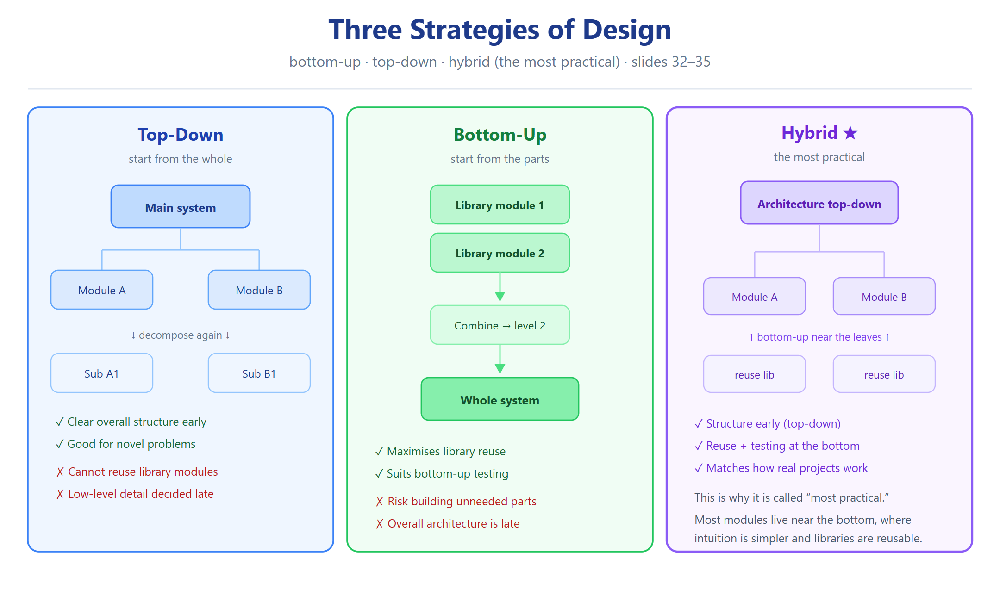

# النوع 4 — أسئلة التحليل (Analyze)

### ASE · Chapter 5 · Software Design — Aggarwal & Singh, 3rd ed. (Bloom Level 4)

> **المصدر:** سلايدات `Ch05_Software_Design.pdf` (1–99) + كتاب ص.202–251.
> **الهدف:** تُعطى سيناريو / تصميم / شيفرة، فتطلب منك: تصنيف، تفكيك، إيجاد الخلل، تتبّع أثر التغيير، أو مقارنة بُنى.
> **قاعدتان ثابتتان (لا تُخالفان):** الاقتران الأفضل←الأسوأ = Data > Stamp > Control > External > Common > Content (Fig 7، سلايد 19). التلاحم الأفضل←الأسوأ = Functional > Sequential > Communicational > Procedural > Temporal > Logical > Coincidental (Fig 11، سلايد 27).
> **ملاحظة استعمال:** سؤال إنكليزي، جواب إنكليزي كامل بخطوات الاستدلال، تبرير عربي قصير في النهاية.

---

## الرسوم المرجعية (راجعها قبل الحل)

---

## القسم أ — سيناريوهات تصنيف (Classification Scenarios)

---

**Q4.1 (Classification — the global buffer trap)**
> A module `validate_and_save()` reads a record from a global buffer, validates it, then writes the updated record back to the same global buffer. Other modules read and write that same buffer.

**Classify** its coupling to the rest of the system and its internal cohesion. Justify both.

**Worked answer:**
1. **Read the coupling definition (slide 21):** "With common coupling, module A and module B have shared data. Global data areas are commonly found in programming languages." → The keyword is *shared* + *global*.
2. **Apply:** `validate_and_save()` and the other modules both read *and write* a global buffer → the shared object is a global data area, not a parameter → **Common coupling** (worst-but-one, per Fig 7, slide 19).
3. **Read the cohesion definition (slide 28):** "Module A outputs some data which forms the input to B" → Sequential. The chain here is read → validate → write, where each step consumes the previous step's output → **Sequential cohesion** (2nd best).
4. **Diagnosis:** internal cohesion is healthy; the true defect is the global buffer, because *making a change to the common data means tracing back to all modules which access that data* (slide 21). Passing the record as a parameter would convert Common → Data coupling (the best).

**التبرير العربي:** التصنيف صحيح لأن الشرط الحاسم للـ common coupling هو *وجود بيانات مشتركة عامة* (global data area) — مو مجرد تمرير. الـ validation chain تعطي sequential cohesion، وهذا جيد؛ الخلل بالـ global buffer اللي يجعل أي تغيير ينتشر لكل الوحدات. الحل: تمرير الـ record كـ parameter.

---

**Q4.2 (Classification — same input / same output)**
> A module `process_payroll()` accepts the employee master file as one block of data, and from that *same* block it computes the salary slip, updates the tax table, and prints the benefit statement. All three operations use the same input data block and produce their own outputs.

**Classify** the cohesion. Which type is it *not*, and why is the distinction critical here?

**Worked answer:**
1. **Identify what ties the elements together:** they all operate on the *same input data* (the employee master block) — but their outputs do **not** feed one another.
2. **Distinguish the two candidate levels:**
   - **Sequential cohesion** (slide 28) requires "module A outputs some data which forms the input to B" — an output→input *chain*.
   - **Communicational cohesion** groups elements that operate on the **same input data** or produce the **same output data** — a *shared source/sink*, no chain.
3. **Apply:** same input block, three *independent* outputs, no chaining → **Communicational cohesion** (3rd best, Fig 11 slide 27).
4. **Why the distinction is critical:** mislabelling it Sequential would wrongly imply the three operations must run in a fixed order; in fact they can be reordered or executed independently. Communicational is *slightly* weaker than Sequential because the elements still share a data source, so a change to the input block structure touches all three.

**التبرير العربي:** الفرق الحاسم: **Sequential** = مخرجات وحدة تغذي مدخلات التالية (سلسلة). **Communicational** = كلها تشتغل على *نفس* المدخل (أو تنتج *نفس* المخرج) بدون سلسلة. هنا المدخل واحد والمخارج مستقلة ⇒ Communicational، وهذا يعني ما أكو ترتيب إلزامي.

---

**Q4.3 (Classification — must run in sequence passing data)**
> A module `prepare_invoice()` is defined as: `read_order()`, then `compute_totals()`, then `format_invoice()`. `compute_totals()` consumes exactly what `read_order()` produced, and `format_invoice()` consumes exactly what `compute_totals()` produced.

**Classify** the cohesion. What single piece of evidence elevates it above Communicational?

**Worked answer:**
1. **Check the Communicational pattern first (slide 27 candidate):** shared input only? No — the elements are *not* independent; each consumes the previous one's output.
2. **Apply the Sequential rule (slide 28):** "Module A outputs some data which forms the input to B. This is the reason for them to be contained in the same procedure." → read_order's output → compute_totals' input; compute_totals' output → format_invoice' input.
3. **Result:** **Sequential cohesion** (2nd best).
4. **The elevating evidence:** the *direct output→input dependency between consecutive elements*. This is stronger than merely sharing a common source because it proves an intrinsic ordering, making the group a genuine processing chain rather than an arbitrary collection around one datum.

**التبرير العربي:** الدليل اللي يرفعه من Communicational إلى **Sequential** هو أن *مخرجات كل خطوة هي مدخلات اللي بعدها*. هذا يثبت ترتيب ذاتي داخلي (readers←compute←format)، فالتجميع له سبب حقيقي — مو مجرد اشتراك بمدخل واحد.

---

**Q4.4 (Classification — startup block)**
> A module `sys_init()` contains: "open log file", "initialise device drivers", "set default time zone from config", and "clear temporary tables". None of these passes data to the next; the only reason they are together is that the system must run them all at boot.

**Classify** the cohesion and the likely coupling.

**Worked answer:**
1. **Test Functional/Sequential/Communicational:** no single task (Functional ✗); no output→input chain (Sequential ✗); no shared input/output datum (Communicational ✗).
2. **Test Procedural (slide 29):** Procedural = instructions that "accomplish different tasks yet have been combined because there is a specific order in which the tasks are to be completed." Here the tasks are indeed different, and there *is* an order (open log before logging, etc.)… **but** the binding force is not the order per se — it is **timing**.
3. **Test Temporal (slide 29):** "contains tasks that are related by the fact that all tasks must be executed in the same time-span." The four tasks are bound solely by *"at boot"* → **Temporal cohesion** (5th, weak).
4. **Coupling:** initialisation routines characteristically write to shared global state (config table, device tables); per slide 21, shared global data → **Common coupling**.
5. **Note the trap:** a student may answer "Procedural" because there is an order. The decisive test is *why* they are grouped: order-driven → Procedural; time-driven → Temporal.

**التبرير العربي:** الفيصل بين Procedural و**Temporal** هو *سبب التجميع*: إذا السبب "الترتيب الإلزامي" ⇒ Procedural؛ وإذا السبب "كلها بنفس النافذة الزمنية (الإقلاع)" ⇒ **Temporal**. هنا السبب الإقلاع ⇒ Temporal. والاقتران المرجّح Common لأن دوال التهيئة تكتب على حالة عامة مشتركة.

---

**Q4.5 (Classification — logic-flag task selector)**
> A single module `compute(x, y, op_flag)` is called everywhere. If `op_flag = 1` it adds, `= 2` it subtracts, `= 3` it multiplies, `= 4` it divides. The caller sets the flag; the module branches on it.

**Classify** the cohesion *and* the coupling, and explain why the two findings are linked.

**Worked answer:**
1. **Cohesion (slide 30):** "Logical cohesion occurs in modules that contain instructions that appear to be related because they fall into the same logical class of functions." Four arithmetic operations = one logical class of functions, selected at runtime → **Logical cohesion** (6th, weak).
2. **Coupling (slide 21):** "Module A and B are said to be control coupled if they communicate by passing of control information. This is usually accomplished by means of flags that are set by one module and reacted upon by the dependent module." `op_flag` is exactly such a flag → **Control coupling**.
3. **Why they are linked:** logical cohesion is *achieved by* asking the caller to say which logical function to run — that "which" is control information. So the module cannot select its task without receiving a flag, and the flag **is** control coupling. This is the textbook pairing (Exercise 5.8, slide 97: "If a module has logical cohesion, what kind of coupling is this module likely to have with others?" → control).
4. **Consequence:** each caller must know the flag encoding; changing the flag convention ripples to all callers; the module can never be understood or unit-tested as one task.

**التبرير العربي:** هذا مثال الكتاب الحرفي (Exercise 5.8). الـ `op_flag` = معلومة تحكم (control information) ⇒ **Control coupling**؛ والوحدة نفسها تختار مهمتها وقت التشغيل من فئة دلالية واحدة ⇒ **Logical cohesion**. الاثنان مترابطان: التلاحم المنطقي *يفرض* تمرير الـ flag، والـ flag *هو* الاقتران التحكمي.

---

**Q4.6 (Classification — reach into another's internals)**
> Module `B` directly modifies a variable that lives *inside* module `C` (`C.internal_counter = 0`), so that `C` continues from a fresh count.

**Classify** the coupling and rank it against the other defects you have seen.

**Worked answer:**
1. **Apply the Content-coupling rule (slide 23):** "Content coupling occurs when module A changes data of module B or when control is passed from one module to the middle of another." B changes C's internal data → **Content coupling** (worst, Fig 7 slide 19).
2. **Why it is worse than Common coupling:** Common coupling at least keeps the shared datum *visible* as a declared global; content coupling reaches into *encapsulated internals*, so the dependency is hidden inside C's implementation. Nothing in C's interface warns the designer.
3. **Ranking:** Content (worst) > Common > External > Control > Stamp > Data (best). Among the six defects in this section, Content is the only one that **breaks encapsulation** (slide 69 defines encapsulation as the separation of external aspects from internal implementation — content coupling is its direct violation).
4. **Fix:** expose a public operation on C (e.g. `C.reset()`) — that converts Content coupling into Data coupling and restores the interface as the only contract.

**التبرير العربي:** **Content coupling** = أخطر نوع (سلايد 23) لأن B يعدّل *بيانات داخلية* لـ C، فيكسر الـ encapsulation (سلايد 69). عكس Common اللي على الأقل البيانات المشتركة معلنة ومرئية. الإصلاح: دالة عامة `C.reset()` تحوّل الاقتران إلى Data.

---

## القسم ب — تحليل الخلل (Defect Analysis)

---

**Q4.7 (Defect analysis — the "utility monster")**
> A design contains one module `utils` with 38 unrelated helper functions (string trim, date format, tax calc, screen clear, DB connect, logging…). Every other module calls `utils`. Separately, a module `report` reads the global array `g_report[]` directly, and calls `utils.trim()` in a loop. Modules `login` and `audit` both write to the same global `g_session`.

**Find every design-quality defect and rank severity.**

**Worked answer:**
1. **Enumerate the defects:**

| # | Location | Defect | Type | Rank |
|---|---|---|---|---|
| D1 | `utils` (38 unrelated fns) | Coincidental cohesion | intra-module (worst) | 2 |
| D2 | everyone → `utils` | high fan-in on a non-cohesive unit ⇒ shared dependency, change ripples everywhere | systemic | 1 (impact) |
| D3 | `utils` internal | any change to one helper can break unrelated callers | maintainability | 1 |
| D4 | `report` reads `g_report[]` | Common coupling | inter-module | 3 |
| D5 | `login` + `audit` share `g_session` | Common coupling | inter-module | 3 |

2. **Rank by severity.** Severity ∝ *hidden + bidirectional* dependencies (the principle from Q1.1 of Tier 2). The utility module is worst because it is **simultaneously** the worst on the cohesion axis (Coincidental) *and* the hub of a fan-in that converts its internal changes into system-wide ripple. The two Common-coupling pairs are next: visible but global.
3. **Cross-check against the four design objectives (slide 8):** *Correct & complete* — cannot be certified (no single purpose per unit); *Understandable* ✗ (nothing unifies 38 functions); *Right level* ✗ (mixing string, DB and UI concerns at one level); *Maintainable* ✗ (every change high-risk).
4. **Fix order:** (a) split `utils` by function into cohesive modules (Functional cohesion) — removes D1/D2/D3; (b) replace the two globals `g_report`/`g_session` with parameters or a controlled repository — removes D4/D5.

**التبرير العربي:** رتّبت الخلل بمبدأ: *الخلل المخفي ثنائي الاتجاه أخطر من المرئي أحادي الاتجاه*. الـ `utils` هو الأخطر لأنه **أسوأ تلاحم (Coincidental) + محور نداءات (fan-in)** فكل تغيير داخلي ينتشر للنظام كله. بعدين الاقترانان المشتركان (Global) لأنهما مرئيان لكن عامّان. الإصلاح: تفكيك `utils` بالوظيفة، واستبدال الـ globals ببارامترات.

---

**Q4.8 (Defect analysis — the 12-parameter call)**
> `create_user()` is called as `create_user(name, age, city, phone, email, is_admin, send_mail, log_it, db_handle, cfg_ptr, err_code, mode)` where `is_admin`, `send_mail`, `log_it`, `mode` are flags the module branches on, and `db_handle`/`cfg_ptr` are handles to global structures the module then mutates directly.

**Find all defects and rank.**

**Worked answer:**
1. **Defect inventory:**
   - **D1 — Control coupling** (slide 21): 4 flags (`is_admin`, `send_mail`, `log_it`, `mode`) are control information the callee reacts on.
   - **D2 — Stamp coupling** (slide 20): "complete data structure is passed from one module to another" — `cfg_ptr` passes a whole structure when only a few fields are used.
   - **D3 — Content coupling** (slide 23): `db_handle` is used to *mutate* shared structures directly — reaching into another entity's data.
   - **D4 — Module size/parameter overload:** vs slide 17 guidance — "Controlling the number of parameters passed amongst modules" and "Pass data, not the control information."
   - **D5 — Violation of info hiding** (slide 69): handles expose internals.
2. **Ranking:** Content (D3) > Common-class (D3 shares the global) > Control (D1) > Stamp (D2). The flag group D1 is *multiple* defects of the same type — each flag is a separate reason the caller must know callee internals.
3. **Repair mapping:** split the four flag-driven behaviours into separate functionally-cohesive modules (`create_admin_user` vs `create_normal_user`; logging/mailing as *data*-driven or event-driven, not flags); pass only the needed fields (kills Stamp); expose proper DB operations instead of a raw handle (kills Content).

**التبرير العربي:** الخلل الأشد: `db_handle`/`cfg_ptr` تعديل مباشر للبيانات ⇒ Content + Stamp. الأربعة flags ⇒ Control coupling (والسلايد 17 صريح: "Pass data, not the control information"). وأخيراً عدد البارامترات نفسه مخالف لتوجيه السلايد 17 (Control the number of parameters). الحل: تفكيك السلوك المتغيّر إلى وحدات functional وتمرير أقل بيانات ممكنة.

---

**Q4.9 (Defect analysis — the "one big module")**
> A student submits a design where the *entire* Library system is one module `library_system()` covering membership, issue, return, search, fine-calculation and reporting. Inside, the fine code reads `global_fine_rate`, and the search code calls back into `library_system()` recursively to reuse its validation. Fan-out from `library_system()` to itself exceeds 7.

**Find the defects, cite the slackest rule broken, and rank.**

**Worked answer:**
1. **Defects:**
   - **D1 — Coincidental/Logical cohesion:** six unrelated functional areas in one unit → at best Logical, at worst Coincidental (slide 30). Worst-tier.
   - **D2 — Fan-out warning:** the brief states fan-out > 7. (Slides do not state a fan-out threshold; the widely used design guideline — and the "warning" convention the study system records — flags fan-out beyond ~7 as a maintainability risk. **Uncertainty flag:** the Aggarwal & Singh Ch.5 slides/Chapter do **not** define a numeric fan-out limit; treat ">7" as an external rule of thumb, not a chapter fact.)
   - **D3 — Recursive self-call for reuse:** re-entering the whole module to reuse validation binds the caller to interals → effectively **Content coupling** (control passes into the middle of the module's own logic, slide 23).
   - **D4 — Common coupling:** `global_fine_rate` shared (slide 21).
   - **D5 — Kills every design objective** (slide 8): not understandable, not at the right level, not maintainable.
2. **Slackest rule broken:** D2 is the *least* grounded in the chapter (numeric threshold not defined there) — the strongest, chapter-grounded findings are D1, D3, D4.
3. **Ranking:** D1 (cohesion) ≈ D3 (content) > D4 (common). Fix: decompose along the six functional areas (Functional cohesion each); extract `validate()` as a proper module and *call* it (Data coupling) instead of recursing.

**التبرير العربي:** الأقوى دليلًا من الفصل: D1 التلاحم (Coincidental/Logical) و D3 إعادة الدخول للوحدة نفسها لإعادة الاستخدام (= Content، سلايد 23) و D4 الـ global. أما D2 (fan-out>7) فهو قاعدة إرشادية شائعة **مو منصوص عليها رقميًا في سلايدات الفصل** — فلازم أوسمها كعدم يقين.

---

**Q4.10 (Defect analysis — the fan-out hub)**
> Module `MAIN` calls twelve sub-modules. Six of them in turn call `MAIN` back for status updates, creating cycles. All twelve share `g_state`.

**Analyse the structural defects in terms of coupling, fan-in/fan-out and stability, then rank the *two* most urgent repairs.**

**Worked answer:**
1. **Fan-out:** MAIN = 12 calls. Even setting aside the exact threshold (see Q4.9), a single module directing 12 subordinates is a low-cohesion "controller" and a maintenance bottleneck.
2. **Cycles:** MAIN → sub → MAIN is a *cyclic* dependency. Cyclic dependencies destroy the layering that allows a module to be understood alone and make the ripple effect potentially infinite (a change in any cyclically-connected module can reach all).
3. **Common coupling:** all 12 + MAIN share `g_state` → any change to that area ripples to 13 units (slide 21).
4. **Stability:** stability is inversely related to coupling; cycles + a global shared by 13 units ⇒ minimum stability, maximum ripple.
5. **Two most urgent repairs, ranked:**
   - **(R1) Break the cycles** — highest urgency: cycles are the only defect that makes the ripple *unbounded*. Extract the "status" service into a separate module the subs call (a *cycble* one-way dependency), turning the MAIN-re-entry into Data coupling.
   - **(R2) Remove `g_state`** — pass only the required fields (Data coupling) or encapsulate it behind an accessor; this kills the 13-way Common coupling.
6. **Lower priority:** splitting MAIN's fan-out (real but incremental compared to R1/R2).

**التبرير العربي:** الأخطورة هي **الحلقات (cycles)**: لأنها تجعل أثر التغيير *غير محدود* — وهذا أسوأ من fan-out عالٍ أو حتى common coupling. فـ R1 = كسر الحلقات، R2 = إزالة `g_state`. تقسيم الـ fan-out مهم لكنه أقل إلحاحاً.

---

## القسم ج — تتبّع أثر التغيير (Ripple Effect Tracing)

---

**Q4.11 (Ripple — A→B→C→D under two coupling levels)**
> Modules are chained A calls B, B calls C, C calls D. The specification of D changes: it now needs one *extra* input field. Trace the impact **under two scenarios**: (i) all links are Data coupling; (ii) all links are Content coupling.

**Worked answer:**
1. **Model the dependency graph:** A → B → C → D (calls point downward; dependency propagates upward: D depends on nothing, C depends on D, B on C, A on B).
2. **Scenario (i) — Data coupling:**
   - D's interface changes (new parameter). Because the *interface is the only contract* (info hiding, slide 69), the change surfaces at the C→D call site.
   - C must update its call to D and decide where the new field comes from. That is a *visible* change at one boundary.
   - Does the ripple reach B? Only if C's own interface must change (i.e., C cannot supply the extra field from data it already has). If C can source the field, the ripple **stops at C**.
   - Deterministic and bounded: the compiler flags every mismatched call.
3. **Scenario (ii) — Content coupling:**
   - D's internal layout has changed, and C reaches into D's internals (slide 23). C's code that references those internals may now silently read wrong data — **no compiler error**.
   - The breakage can propagate to B and A with no interface change to warn anyone; the defect may appear only at runtime.
   - The ripple is **unbounded and invisible**: "Making a change to the common data means tracing back to all the modules which access that data" (slide 21) — content coupling is worse: there is no declared list to trace.
4. **Conclusion:** the *magnitude* of the change is identical (one extra field), but Data coupling **contains** the ripple at one interface while Content coupling lets it **cascade silently** to the whole chain. Coupling form, not change size, determines ripple severity.

**التبرير العربي:** حجم التغيير واحد (حقل إضافي)، لكن **شكل الاقتران يحدد انتشار الأثر**: مع **Data** يتوقف الأثر عند حدّ C (المترجم يكشف أي عدم تطابق)، ومع **Content** ينتشر صامتاً إلى B و A بلا تحذير لأن C يلمس داخل D مباشرة (سلايد 23). الخلاصة: الـ ripple يعتمد على *نوع* الاقتران مو على *حجم* التغيير.

---

**Q4.12 (Ripple — the shared global, fan-in)**
> `g_config` is read by modules M1, M2, M3 and written by M4. M1→M2→M3 form a processing chain. M4 is called only at startup. A new requirement changes the *format* of one field inside `g_config`. Trace the ripple and identify who is affected *even though they never call each other*.

**Worked answer:**
1. **Identify the coupling:** `g_config` is a global data area accessed by M1–M4 → **Common coupling** (slide 21). The modules need not call one another to be coupled — they are coupled *through the data*.
2. **Who is affected:** every module that touches the changed field or that assumed the old format — M1, M2 (chain readers), M3, and M4 (writer, which may now write a format the readers can't parse). Note M4 is *temporal* (startup) yet still in the ripple: **common coupling crosses both call-direction and timing**.
3. **The key insight the question targets:** M1 and M4 have *no call relationship at all* (M4 runs only at startup; M1 is in the runtime chain), yet a change to `g_config` couples them. This is why common coupling is worse than control or stamp coupling — the dependency is not visible in the call graph.
4. **Trace mechanics:** change the field format → fix M4's writer → verify M1/M2/M3's readers → any *other* module touching the field (the design must be searched, not derived from the call chart).
5. **Containment fix:** replace `g_config` with an accessor module (`config_get(field)`) → converts Common coupling to Data coupling, and the ripple is reduced to the accessor's callers only.

**التبرير العربي:** الاقتران هنا **Common** (بيانات عامة مشتركة، سلايد 21). اللافت: M1 و M4 **ما ينادون بعض أبداً** (M4 بالإقلاع فقط) لكنهم مقترنان عبر `g_config` — فالاقتران المشترك *يتجاوز* اتجاه النداء والتوقيت. حالياً الأثر يشمل M1–M4 كلهم. الحل: accessor module يحوّل الاقتران إلى Data.

---

**Q4.13 (Ripple — classifying the boundary, then tracing)**
> In the chain A→B→C→D you are told the links are: A–B is Data, B–C is Control, C–D is Content. D changes. Trace the ripple link-by-link and say at which link it is *contained* vs *cascades*.

**Worked answer:**
1. **Link C–D = Content (worst):** D's internal change can break C silently. The ripple **enters** at this link with no compiler help → *cascades*.
2. **Link B–C = Control:** B passes a flag C reacts on. If C's repair changes the meaning of the flag (e.g. C now needs a new branch selector), B's call must change → the ripple **cascades** to B *and* every module that sets that flag for B.
3. **Link A–B = Data:** if B's own interface must change to accommodate the above, A updates one parameter at one call site. The ripple **stops here** if B can source the new value internally; only the A–B interface is re-verified.
4. **Verdict:** the ripple is contained exactly at the *one* Data-coupled link (A–B) and cascades through the Control and Content links (C–D, B–C). The rule: **a Data-coupled boundary is the natural containment wall.**
5. **Cheapest global fix:** change C–D from Content to Data (expose D's interface). This alone cuts off the silent cascade at its source, regardless of the B–C flag.

**التبرير العربي:** الأثر يدخل من C–D لأنه **Content** (صامت، سلايد 23) ← ينتشر. ثم B–C (**Control**) يزيد الانتشار لأن لو تغيّر معنى الـ flag لازم B يتغير. أما A–B (**Data**) فهو **جدار الإيقاف** — الأثر يتوقف عنده. قاعدة عامة: حدّ الاقتران بالـ Data هو حدود احتواء الـ ripple، وأصلح تعديل من الجذر = تحويل C–D إلى Data.

---

## القسم د — تحليل المخططات (Diagram Analysis)

---

**Q4.14 (Diagram — structure chart vs transaction-centred structure)**
> You are shown two structures. **Structure 1:** one root calling three levels of specialised modules, each child used by exactly one parent. **Structure 2:** `MAIN` invokes `INPUT` to read a transaction, determines the transaction *kind*, and dispatches to one of several transaction-handling modules, then calls `OUTPUT`.

**Analyse** each structure: name it, state its coupling/cohesion tendency, and when each is preferred.

**Worked answer:**
1. **Structure 1 = top-down / hierarchical structure chart** (slides 38–39, 41, figs 14–16). The slide notes: "If a program is created top-down, the modules become very specialized… each module is used by at most one other module, its parent" (slide 39). Tendency: high cohesion (each module a specialised single task → Functional), but **low reuse** — nothing is shared, and a change to a shared concern ripples through each specialised copy.
2. **Structure 2 = transaction-centred structure** (slides 44–45, fig 19). Slide 45 defines MAIN's three functions: "invoke the INPUT module to read a transaction; determine the kind of transaction and select one of a number of transaction modules; output the results by calling OUTPUT." Tendency: the transaction modules are **functionally cohesive** (one handler per transaction type), and MAIN carries a **control/dispatch role** — MAIN is *not* functionally cohesive (it decides, it doesn't compute), so MAIN itself sits at **logical-cohesion** risk if the dispatch logic grows.
3. **Coupling profile:** Structure 1 = Data coupling with a deep, narrow call tree (fan-out ~1–3); Structure 2 = MAIN fan-out grows with the number of transaction types (fan-out = 3 fixed + N handlers), and the dispatch is control-flavoured (MAIN passes a "kind").
4. **Preference:** Structure 1 suits a *single, algorithmically-decomposable* process (e.g. compiler passes). Structure 2 suits a system that "processes a number of different types of transactions" (slide 44 — literally the on-screen example "update file"), i.e. menu/event-driven systems, because adding a transaction type adds one handler without touching the others.

| Feature | Structure 1 (top-down chart) | Structure 2 (transaction-centred) |
|---|---|---|
| Root role | directs a decomposition | dispatches by transaction kind |
| Child binding | each child has one parent | each handler is one transaction type |
| Reuse | low (specialised) | higher (handlers independent) |
| Cohesion risk | shared concern duplicated | MAIN becomes logical-cohesive if it grows |
| Coupling | Data, narrow tree | Data + control-flavoured dispatch |
| Best for | algorithmic pipeline | transaction/event systems |

**التبرير العربي:** Structure 1 = **structure chart هرمي/top-down** (سلايد 39): كل وحدة متخصصة ولكل ابن أبو واحد ⇒ تلاحم عالٍ لكن إعادة استخدام منخفضة. Structure 2 = **transaction-centred** (سلايد 44–45): MAIN يقرأ المعاملة ويحدد نوعها ويرسلها لوحدة معالجة مخصصة ⇒ كل معالج functionally cohesive، والخطر أن MAIN نفسه ينزلق للـ logical cohesion إذا كبرت شروط الإرسال. الاختيار: هرمي للعمليات الخوارزمية، transaction-centred للأنظمة المُدارة بالأحداث/المعاملات.

---

**Q4.15 (Diagram — Library use-case & sequence)**
> The Library case study (slide 81) shows: a student can issue books (max 4 book-bank + 3 general, 15 days); any person can return issued books; a bar-code detector saves student and book info; query processing reports availability; login/security and backup are required. Use cases drawn include **Issue Book** and **Return Book** as *separate* use cases; a sequence diagram for Issue Book sends messages: `Operator → GUI : enterStudentId()`, `GUI → BookMgr : checkLimit()`, `BookMgr → Loan : createLoan()`.

**Analyse** (a) why Issue and Return are modelled as separate use cases rather than one "Circulation" use case, and (b) classify the coupling implied by the message chain in the sequence diagram.

**Worked answer:**
1. **(a) Separation of use cases — cohesion argument:**
   - Issue has actor *Student* (via operator), pre-condition "student under limit", post-condition "loan created, due date stamped".
   - Return has actor *any person* (slide 82: "Any person can return the issued books"), post-condition "loan closed, database updated".
   - Merging them into one "Circulation" use case would create a **logically-cohesive** artefact: one description whose behaviour branches on a control condition (issue vs return) — the model-level twin of **control coupling** (Q2.8 of Tier 2). Two single-purpose use cases each carry **functional cohesion**.
2. **(b) Coupling in the message chain:**
   - `GUI → BookMgr : checkLimit()` — GUI passes the student identity and asks a question; BookMgr returns a result. This is **Data coupling** (slide 20) — only data crosses.
   - `BookMgr → Loan : createLoan()` — BookMgr asks the Loan entity to create itself; the message (slide 61: target identity + operation name + parameters) carries data → **Data coupling**.
   - `Operator → GUI : enterStudentId()` — data in, data out → **Data coupling**.
   - **Verdict:** the message chain is *entirely data-coupled* — which is exactly what an interaction diagram is for: it lets the intended coupling be **reviewed before coding** (the point of OOD step iii, slide 75).
3. **Anti-pattern to flag:** if `GUI` directly set `Loan.dueDate` or read `Loan.overdueFlag`, that message would be **Content coupling** (reach into Loan's internals). The design must route all Loan state changes through Loan's own operations (encapsulation, slide 69).

**التبرير العربي:** (أ) Issue و Return use cases منفصلين لأن دمجهما يصنع **logical cohesion** على مستوى النموذج (سلوك يتفرع على flag: issue/return) — نفس منطق control coupling. كل واحد لوحده = functional cohesion. (ب) سلسلة الرسائل كلها **Data coupling**: `enterStudentId` / `checkLimit` / `createLoan` كلها تمرّر بيانات فقط (سلايد 20)، وهذا بالضبط هدف interaction diagram — مراجعة الاقتران قبل الكود (سلايد 75). لو GUI قرأ/عدّل حقول Loan مباشرة ⇒ يصير **Content** — لازم كل تغيير على حالة Loan يمر من عمليات Loan نفسها (سلايد 69).

---

## خريطة التغطية والتحقق (Coverage & Verification Map)

| # | الفئة | المحور المُختبَر | السلايد/الشكل المرجعي |
|---|---|---|---|
| Q4.1 | تصنيف | Common coupling + Sequential | s21, s28, Fig 7/11 |
| Q4.2 | تصنيف | Communicational vs Sequential | s27, s28, Fig 11 |
| Q4.3 | تصنيف | Sequential (تسلسل تمرير بيانات) | s28, Fig 11 |
| Q4.4 | تصنيف | Temporal + Common (فخ Procedural) | s21, s29, Fig 11 |
| Q4.5 | تصنيف | Logical + Control (Exercise 5.8) | s21, s30, s97 |
| Q4.6 | تصنيف | Content + ترتيب الشدّة | s23, s69, Fig 7 |
| Q4.7 | خلل | Coincidental + fan-in + Common | s8, s21, s30 |
| Q4.8 | خلل | Control + Stamp + Content (البارامترات) | s17, s20, s21, s23 |
| Q4.9 | خلل | تعدد الأنماط + fan-out (وسم عدم يقين) | s17, s23, s30 |
| Q4.10 | خلل | دورات + fan-out + Common + الاستقرار | s21, s31 |
| Q4.11 | ripple | Data vs Content على سلسلة A←B←C←D | s20, s21, s23, s69 |
| Q4.12 | ripple | Common يقفز اتجاه النداء والتوقيت | s21, s29 |
| Q4.13 | ripple | Data = جدار الاحتواء | s20, s21, s23 |
| Q4.14 | مخطط |structure chart vs transaction-centred | s38–39, s41, s44–45 |
| Q4.15 | مخطط | Library use cases + sequence couplings | s75, s81–83, s61, s69 |

**فهرس الاقتران المُستعمل (تحقق):** Data > Stamp > Control > External > Common > Content — مطابق لـ Fig 7 (سلايد 19).
**فهرس التلاحم المُستعمل (تحقق):** Functional > Sequential > Communicational > Procedural > Temporal > Logical > Coincidental — مطابق لـ Fig 11 (سلايد 27).

---

## ملاحظات عدم يقين (Uncertainties — declared)

1. **fan-out > 7:** سلايدات وكتاب الفصل 5 لا ينصّان رقميًا على حدّ للـ fan-out؛ الـ ">7" قاعدة إرشادية متعارف عليها في هندسة البرمجيات، **مو منصوص عليها في هذا الفصل** (سلايد 17 يذكر فقط "التحكم بعدد البارامترات"). وُسمت في Q4.9 و Q4.10.
2. **عدد مستويات التلاحم:** سلايد 26 يسرد **6** أنواع (بدون Communicational)، بينما سلايد 27 (Fig 11) و التعريفات تعرض **7** مع Communicational. الملف يعتمد الـ **7** لأن Fig 11 هو الجدول المُثبَّت (وسلايد 27)، وهذا متوافق مع "VERIFIED FACTS".
3. **"Circulation" كبديل لـ Issue/Return:** تقسيم الـ use cases مشتق من تحليل الأهداف والأحداث في سلايد 81–83؛ الكتاب لا يسمّي الـ use cases صراحة بالقائمة، لكن التبرير قائم على تعريفات التلاحم (سلايد 30) والاقتران التحكمي (سلايد 21).
4. **Vocabulary "poking internals":** استُعمل لوصف Content coupling (سلايد 23) — مطابق حرفيًا لتعريف "module A changes data of module B".

---

*المصدر: Aggarwal & Singh, Software Engineering 3rd ed., Ch.5 — سلايدات 1–99 (تم استخراج النص والتحقق) + كتاب ص.202–251. كل حكم تصنيف قوبل مع تعريفات سلايدات 19–30 قبل التثبيت.*

---

## Retrieval set (active recall)

| السؤال | الجواب |
|---|---|
| أقسام التحليل؟ | تصنيف · تحليل الخلل · تتبّع الأثر · تحليل المخططات |
| الفرق بين fan-in و fan-out؟ | fan-in = عدد من ينادي الوحدة · fan-out = عدد الوحدات اللي تناديها |
| شنو ripple effect؟ | أثر تغيير وحدة على البقية — يقلّ مع low coupling |
| ترتيب الاقتران (أفضل←أسوأ)؟ | Data · Stamp · Control · External · Common · Content |
