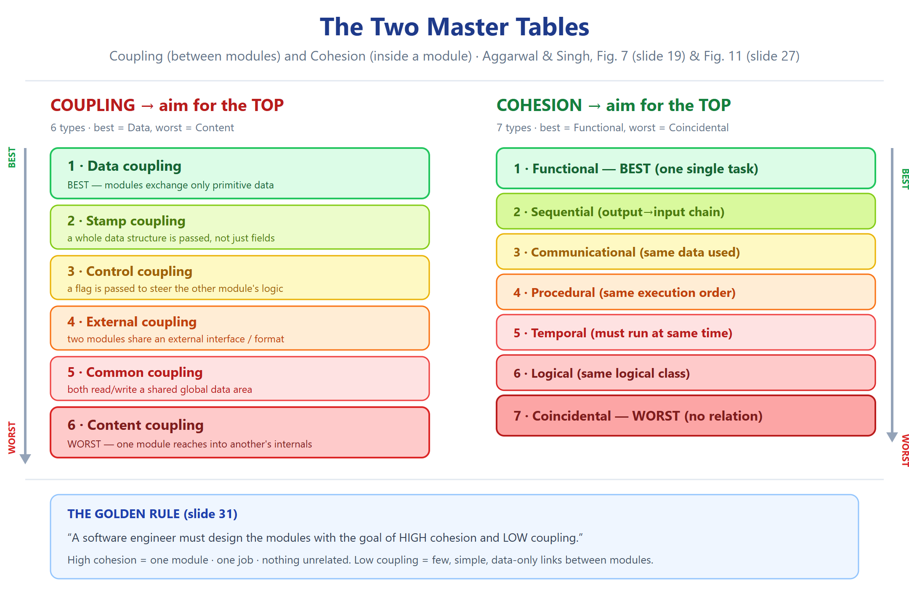

# النوع 5 — أسئلة التقييم (Evaluate)

### ASE · Chapter 5 · Software Design — Aggarwal & Singh, 3rd ed. (Bloom Level 5)

> **المصدر:** سلايدات `Ch05_Software_Design.pdf` (1–99) + كتاب ص.202–251.
> **الهدف:** تُعطى *ادّعاء / قرار تصميم / خيارين متنافسين*، فتُطلب منك: إصدار حكم (verdict)، تبريره بمعايير (coupling, cohesion, design objectives)، ونقد الطرف المقابل.
> **قاعدتان ثابتتان (لا تُخالفان):** الاقتران الأفضل←الأسوأ = Data > Stamp > Control > External > Common > Content (Fig 7، سلايد 19). التلاحم الأفضل←الأسوأ = Functional > Sequential > Communicational > Procedural > Temporal > Logical > Coincidental (Fig 11، سلايد 27).
> **قاعدة الإجابة:** كل جواب = **(1) حكم (Verdict) ← (2) تبرير بمعايير ← (3) الطرف المقابل (Counter-position) ← (4) تبرير عربي قصير.**
> **وسم الاستعمال:** أي ادّعاء مو موجود بالنص يُوسَم `[Foundational Knowledge / Standard Concept]`.

---

## الرسوم المرجعية (راجعها قبل الحل)

---

## القسم أ — تقييم ادّعاءات مفردة (Evaluating Single Claims)

---

**Q5.1 (Evaluate — "content coupling is always unacceptable")**
> A teammate claims: *"Content coupling is the worst of the six types, therefore it must never be tolerated under any circumstances."* Evaluate this claim.

**Verdict:** **Partially correct; the conclusion is too absolute.** Content coupling is *the worst form* — this is fixed by Fig 7 (slide 19) — but "always unacceptable" is an over-generalisation, because the ranking describes *relative desirability*, not an absolute prohibition.

**Criteria-based justification:**
1. **What content coupling is (slide 23):** "module A changes data of module B or control is passed from one module to the middle of another." Its defect is that encapsulation is broken — a change inside B can silently break A with no interface to catch it.
2. **Where it may be tolerated:** in very tight, performance-critical layers where the boundary is *fixed and owned by one team* — e.g. a low-level device driver writing directly into a hardware register block, or a hand-optimised kernel routine. Here the "other module's internals" are a stable, documented register map, so the ripple risk is bounded by a hardware contract, not by arbitrary code.
3. **The cost must be declared:** tolerating it is only defensible when the gain (measured speed / size) is real *and* the coupling is documented as a deliberate exception, reviewed at the boundary.

**Counter-position:** The opposing view holds that even in drivers, one can wrap the register access behind a data-coupled function, and that any tolerance invites the defect to spread by imitation. This is a fair risk-management argument — but it does not make content coupling *absolutely* impossible to justify; it makes it *expensive*, which is exactly what a "worst" rank means.

**التبرير العربي:** الحكم "مرفوض دائماً" مبالغ. الاقتران Content هو الأسوأ *بترتيب Fig 7*، أي الأقل رغبةً — مو محرّم مطلقاً. يُتحمّل فقط إذا كان الـ internals ثابتة وموثّقة (register map لتعريف عتاد) والتكلفة مُعلنة كاستثناء مقصود. أما ادّعاء أنه ممنوع كلياً فهو قوي أخلاقياً وضعيف هندسياً.

---

**Q5.2 (Evaluate — FO vs OO under heavy requirement change)**
> Your team must build a system whose requirements are expected to change heavily over its lifetime. Evaluate whether to choose **function-oriented** or **object-oriented** design.

**Verdict:** **Choose object-oriented design.**

**Criteria-based justification:**
1. **The book's stated reason for OOD's improvement:** OOD "begins with an examination of the real world 'things' that are part of the problem" (slide 58) — the *entities* — whereas FO decomposes by *function*.
2. **Why entity-first survives change:** requirements change far more often by adding or altering *operations on stable entities* than by replacing the entities themselves. Encapsulation (slide 69) localises a change to the affected class; inheritance (slide 68) and polymorphism (slide 69) let new behaviour be added by subclassing rather than by rewriting scattered functions. All three directly attack the *ripple effect*.
3. **Contrast with FO:** a single new requirement typically forces edits across several function hierarchies (e.g. every routine that touched the record format), because the functional axis cuts through the entities.

**Counter-position:** FO is not wrong in general — for a purely computational pipeline dominated by transformation steps, FO's functional axis is more natural, and OO's overhead (classes, message dispatch) buys nothing. The verdict is conditional on *change-dominance*, which this project has.

**التبرير العربي:** الاختيار OOD لأن الفصل يبدأ من *كيانات المشكلة* وهي أكثر استقراراً من الدوال. أي تغيير بالمتطلبات غالباً يضيف/يعدّل *عمليات* على كيان قائم، فيُحصر الأثر داخل الكلاس بفضل الـ encapsulation، وتُضاف السلوكيات الجديدة بالوراثة والـ polymorphism. أما FO فيوزّع الطلب الواحد على عدة تدرجات دوال ← ripple أوسع.

---

**Q5.3 (Evaluate — "hybrid is always best")**
> A student writes: *"Since hybrid design takes the strengths of both top-down and bottom-up, it is always the best strategy."* Critique this.

**Verdict:** **Hybrid is the most *practical* strategy, but "always best" is unproven and often false.**

**Criteria-based justification:**
1. **What the chapter actually says (slide 35):** "For top-down approach to be effective, some bottom-up approach is essential" — to permit common sub-modules, to reuse pre-written library modules, and because near the bottom of the hierarchy intuition is simpler and bottom-up testing is more needed. That justifies hybrid as *usually pragmatic*, not as *universally optimal*.
2. **When pure top-down wins:** when the architecture is novel and reusable components do not exist — going bottom-up early would mean building library pieces whose interfaces nobody has yet defined, wasting effort on modules that the architecture later rejects.
3. **When pure bottom-up wins:** when the project is essentially *assembling existing, verified components* (slide 33: "modules are collected together in the form of a library"), so the composition is genuinely a library-integration task.

**Counter-position:** The pro-hybrid side argues that in practice almost every real project mixes the two, so the label "always" describes reality. This conflates *frequent* with *necessary*; the ranking "most practical" (slide 35) is a pragmatic frequency claim, not a proof of optimality.

**التبرير العربي:** الـ hybrid هو الأكثر *عملية* لأن الفصل يقول إن top-down يحتاج bottom-up لتفعيل إعادة الاستخدام وتشغيل الأجزاء السفلية — لكن "الأفضل دائماً" ادّعاء غير مُثبت. يوجد حالات يربح فيها top-down الصافي (معمارية جديدة بلا مكتبات) وحالات يربح فيها bottom-up الصافي (تجميع مكوّنات موجودة). الأصح: hybrid هو الافتراضي العملي، مو الحتمي.

---

**Q5.4 (Evaluate — a student's "primitives only" rule)**
> A student argues: *"Since data coupling is the best and stamp coupling is a step down, I should never pass a data structure — I should pass every field as a separate primitive parameter."* Evaluate.

**Verdict:** **The premise is right; the conclusion is wrong and can backfire.**

**Criteria-based justification:**
1. **Accept the premise:** passing a whole data structure *is* stamp coupling (slide 20: "complete data structure is passed from one module to another"), which ranks *below* data coupling (Fig 7). The student is correct that it is not the best form.
2. **But stamp is still mid-scale, not near the bottom:** Data > **Stamp** > Control > External > Common > Content. Refusing structures to reach "pure data" pushes you toward control coupling the moment you add a flag to disambiguate the unpacked fields (slide 21: control coupling is "usually accomplished by means of flags") — a *worse* move.
3. **Parameter explosion:** unpacking a structure into N primitives raises the parameter count, and slide 17 explicitly warns to "control the number of parameters passed amongst modules." More parameters means more interface to get wrong.
4. **Correct rule:** pass the **minimum data the callee actually needs** — prefer primitives when natural, and accept a structure when it genuinely *is* one datum (e.g. a complex number, a coordinate).

**Counter-position:** A purist might say a structure always leaks unnecessary fields, so unpacking is worth the extra parameters. That only holds when the callee uses *few* of the fields; if it uses most of them, unpacking buys nothing and costs clarity.

**التبرير العربي:** المقدّمة صحيحة (تمرير structure = stamp coupling وهو أدنى من data coupling)، لكن النتيجة خاطئة: تجريد كل حقل إلى parameter يرفع عدد المعاملات (سلايد 17 يحذّر من ذلك)، وقد يجرّك لـ control coupling إذا أضفت flag. القاعدة الصحيحة: **مرّر الحد الأدنى من البيانات المطلوبة**، واقبل الـ structure إذا كان فعلاً يمثّل معلومة واحدة.

---

**Q5.5 (Evaluate — "modularity is the single attribute")**
> Evaluate the slide claim: *"Modularity is the single attribute of software that allows a program to be intellectually manageable"* (slide 13). Give the strongest argument **for** and the strongest criticism **against**.

**Verdict:** **Defensible as a rhetorical emphasis; overstated as a literal claim.**

**Criteria-based justification — FOR:**
1. Slide 13 itself: modularity "enhances design clarity, which in turn eases implementation, debugging, testing, documenting, and maintenance." Without module boundaries, the human mind cannot hold the whole system in working memory, so *nothing else* (understandability, reuse, maintainability) can be achieved.
2. Modularity's properties (slide 12) — well-defined subsystem, well-defined purpose, separately compilable, easier to use than to build — are the *preconditions* for every other quality attribute. In that sense it is "first among equals."

**Criteria-based justification — AGAINST:**
1. **Modularity alone is insufficient:** the chapter's own coupling/cohesion material shows that a *badly* modularised system (coincidental cohesion + common/content coupling — worst ends of both scales, slides 27 & 19) is *harder* to manage than a small unmodularised one. The quality of the partition, not its mere existence, delivers manageability.
2. **"Single" is the flaw:** modularity is *necessary*; *functional independence* (high cohesion + low coupling, slide 31) is what actually produces manageability. Calling modularity "the single attribute" hides the dependency on coupling/cohesion.

**Counter-position:** One may reply that coupling/cohesion are *properties of* a modular design, so they presuppose modularity and thus modularity remains the root attribute. That is a fair geneaology — but it makes modularity *foundational*, not *sufficient*, which is the correct reading.

**التبرير العربي:** الادّعاء صحيح كتأكيد بلاغي — الـ modularity شرط *ضروري* لكل الصفات الأخرى (سلايد 12–13). لكنه غير *كافٍ*: الفصل نفسه يُثبت أن modularisation سيئة (coincidental cohesion + common coupling) أصعب إدارةً من نظام صغير غير مُقسّم. لذلك "الصفة الواحدة" مبالغة؛ الصفة الحقيقية هي **الاستقلال الوظيفي (high cohesion + low coupling)**، سلايد 31.

---

**Q5.6 (Evaluate — "we can never decouple completely")**
> Exercise 5.24 (slide 99) asks: *"Can a system ever be completely decoupled?"* A student answers: *"Yes — if every module is functionally cohesive and data-coupled, coupling becomes zero."* Evaluate this answer.

**Verdict:** **Beware — the answer is a level confusion. Complete decoupling is achievable only in the degenerate case, not by improving quality.**

**Criteria-based justification:**
1. **What coupling means (slide 15):** "Coupling is the measure of the degree of interdependence between modules." A system where the modules *cooperate at all* — i.e. one calls another and passes data — has **non-zero** coupling by definition; data coupling is the *lowest useful* degree, not zero.
2. **Zero coupling exists (slide 15):** "Uncoupled: no dependencies." That is a system of modules that never interact. For a real single system, that is degenerate — the modules cannot cooperate to deliver any behaviour.
3. **Correct distinction:** what we can reduce to its *minimum* is the *degree* of coupling (down to data coupling), and we can push toward the uncoupled end for genuinely independent subsystems. But "fully functionally cohesive + data-coupled" describes the *best coupled real system*, not a decoupled one.

**Counter-position:** A defender could say "effectively decoupled" for practical purposes. That is a legitimate engineering shorthand, but it must not be stated as *zero* coupling, because the examiner's distinction (slide 15: uncoupled vs loosely coupled) turns precisely on zero vs non-zero.

**التبرير العربي:** خلط بالمستويات. الاقتران مفهوم *ثنائي* — لا قيمة له بلا وحدتين. بيانات تقول: data coupling هو **أدنى درجة مفيدة**، مو صفر. الصفر (uncoupled, سلايد 15) يعني وحدات لا تتعاون أبداً — وهذا عبثي لنظام واحد. الصحيح: نقلّل *الدرجة* إلى data coupling؛ ولا نجعلها صفر.

---

## القسم ب — تقييم بين تصميمين (Evaluating Design A vs Design B)

---

**Q5.7 (Evaluate — A: many small clean modules vs B: few large fast modules)**
> **Design A:** 12 small modules, data-coupled, each functionally cohesive, with 40 inter-module calls.
> **Design B:** 5 large modules, common-coupled, logically cohesive, with only 12 inter-module calls.
> Judge which is better, and state the one condition under which B is defensible.

**Verdict:** **Design A is better.**

**Criteria-based justification:**
1. **Apply the goal (slide 31):** "a software engineer must design the modules with goal of high cohesion and low coupling." A hits *both* (functional cohesion = best; data coupling = best). B hits the *worst-but-one* on coupledness (common, slide 21) and a weak cohesion (logical, slide 30, where instructions "appear to be related because they fall in the same logical class").
2. **Call count is not a defect:** 40 clean data-coupled calls is not the cost — the *form* of coupling is. B's low call-count is bought with a shared global data area, so "making a change to the common data means tracing back to all the modules which access that data" (slide 21).
3. **Against the design objectives (slide 8):** A is more *understandable* (each module has one purpose) and more *maintainable* (change is localised). B is *correct & complete* in isolation but hard to *understand* as a whole.

**Counter-position — when B is defensible:** only in a hard real-time system where the 40 calls' overhead is genuinely unacceptable *and* the shared state is a single well-controlled resource. Even then it must be recorded as a **deliberate documented trade-off**, never presented as good design.

**التبرير العربي:** A أفضل لأنه يحقق الهدف المعلن (سلايد 31): تلاحم عالي + اقتران منخفض. كثرة الاستدعاءات ليست عيباً إذا كان كل استدعاء data-coupled نظيفاً. B يشتري قلّة الاستدعاءات بـ common coupling وlogical cohesion — أي تغيير بالبيانات العامة ينتشر لكل الوحدات (سلايد 21). B يُقبل فقط بأنظمة الزمن الحقيقي الحادّة ومع توثيق المقايضة.

---

**Q5.8 (Evaluate — two designs judged on all three criteria)**
> **Design P:** one `library_ops()` module that reads and writes a shared `GLOBAL_BOOKS` array, branching on a passed `op_flag` (0=issue, 1=return, 2=reserve), plus one `report_module()` with a fixed run-order.
> **Design Q:** separate `issue_book()`, `return_book()`, `reserve_book()` each functionally cohesive; a `database_layer` reached only through data-coupled parameterised calls; no global array.
> Judge P vs Q using **cohesion, coupling, and the four design objectives**.

**Verdict:** **Q is better on every axis.**

**Criteria-based justification:**
1. **Cohesion — P:** `library_ops()` is **logical cohesion** (slide 30, "same logical class of functions" chosen at runtime by a flag); `report_module()` with fixed order is **procedural** (slide 29). **Q:** each op is **functional** (a single task, slide 28) — the best.
2. **Coupling — P:** the shared `GLOBAL_BOOKS` array is **common coupling** (slide 21); the `op_flag` is **control coupling** (slide 21). **Q:** data-coupled calls only — the best.
3. **Design objectives (slide 8):** Q is *understandable* (one module, one purpose), *maintainable* (change localised), *at the right level* (ops as ops, storage as storage), and *correct & complete* in testable units. P is not testable in isolation (the flag branches), and a change to the array touches every caller.

**Counter-position:** One could argue P is "simpler" (fewer modules) and thus easier to *build* first. But the chapter's goal is "easier to use than to build" (slide 12) — P is harder to use and to change, which is the property that matters over the lifetime.

**التبرير العربي:** Q أفضل بكل المحاور: تلاحمه functional (الأفضل) مقابل logical/procedural عند P؛ واقترانه data (الأفضل) مقابل common + control عند P. وبمقارنة أهداف التصميم (سلايد 8) Q أفهم وأقبل للتعديل. حجّة أن P "أبسط للبناء" ترتد لأن القاعدة: الوحدة يجب أن تكون **أسهل استعمالاً من البناء** (سلايد 12).

---

## القسم ج — تقييم مقايضات الاستراتيجيات (Evaluating Strategy Trade-offs)

---

**Q5.9 (Evaluate — reuse vs architectural correctness)**
> Evaluate the trade-off: **bottom-up** maximises **reuse**, but **top-down** maximises **correctness of the overall architecture**. Which should a designer favour, and how is the tension resolved?

**Verdict:** **Favour a hybrid that is top-down in architecture and bottom-up at the base — neither extreme alone is adequate.**

**Criteria-based justification:**
1. **Top-down's strength (slide 34):** it starts by identifying the major modules and refines to increasing detail — this fixes the *architecture* early, so the system's shape is validated against requirements before code exists (guards the "correct & complete" objective, slide 8). Its weakness (slide 39): modules become "very specialized... used by at most one other module, its parent" — poor reuse.
2. **Bottom-up's strength (slide 33):** modules are collected as a library — maximal reuse. Its weakness: building library pieces before the architecture is known risks constructing modules the architecture later rejects.
3. **Resolution (slide 35):** "for top-down approach to be effective, some bottom-up approach is essential" — to permit common sub-modules, to reuse pre-written library modules, and because at the bottom of the hierarchy "intuition is simpler, and the need for bottom-up testing is greater."

**Counter-position:** A strict top-down proponent says reuse can be retrofitted by refactoring. The counter-counter is that refactoring specialised modules into reusable ones is exactly the ripple effect we are trying to avoid — it is cheaper to reuse from the start at the base.

**التبرير العربي:** المقايضة حقيقية: top-down يحمي *صحة المعمارية* ويجعل الوحدات متخصّصة (سلايد 39)، وbottom-up يعظّم *إعادة الاستخدام* لكن قد يبني وحدات ترفضها المعمارية. الحل بنص الفصل (سلايد 35): **hybrid** — قرارات معمارية top-down، وreuse واختبار bottom-up عند قاعدة التدرّج حيث الحدس أبسط والحاجة للاختبار أكبر.

---

**Q5.10 (Evaluate — "reuse justifies a bottom-up start on a novel system")**
> A manager says: *"We should build bottom-up because reusing existing modules is always cheaper than designing new ones."* Evaluate this argument for a system whose architecture is genuinely novel.

**Verdict:** **Reject the "always" — the argument is valid only when the reused modules fit the architecture, which a novel system cannot guarantee up front.**

**Criteria-based justification:**
1. **Reuse is real (slide 35):** "in the use of pre-written library modules, in particular, reuse of modules" is an explicit reason hybrid needs bottom-up. So the premise has grounding.
2. **But bottom-up reuse presupposes known interfaces:** if the architecture is novel, the required interfaces are not yet defined, so a module "reused" bottom-up may expose the wrong interface — forcing wrapping or rejection, which costs *more* than designing fresh (the ripple of a wrong interface is exactly the defect coupling/cohesion warns against).
3. **Correct sequencing:** put the architectural decisions top-down first (slide 34), *then* exploit bottom-up reuse at the base where the interfaces are now known (slide 35).

**Counter-position:** The manager could reply that reuse still gives a head start even if interfaces differ. That is true for *leaf* utilities (math, strings, IO) but not for domain modules whose interface *is* the architectural decision.

**التبرير العربي:** "إعادة الاستخدام أرخص دائماً" غير صحيح كلما كانت المعمارية جديدة: الوحدة المُعاد استخدامها قد تكشف interface خاطئاً، وتغليفه/رفضه يكلّف أكثر من بناء جديد. الفصل يُثبّت reuse كسبب لاستخدام bottom-up (سلايد 35) لكنه لا يقول إنه يسبق المعمارية. الترتيب الصحيح: قرارات معمارية top-down أولاً، ثم reuse عند القاعدة حيث الـ interfaces معروفة.

---

## القسم د — تقييم وثائق وحجج (Evaluating Documents & Arguments)

---

**Q5.11 (Evaluate — is this SDD complete per IEEE 1016?)**
> A team submits an SDD containing: a hierarchical decomposition diagram, a module list with names and purposes, and a structure chart showing calls. It contains **no** parameter tables and **no** internal-detail section. Judge whether the SDD is complete per IEEE STD 1016-1998.

**Verdict:** **No — the SDD is incomplete.** It covers at most two of the four design views (Table 2, slide 57).

**Criteria-based justification:**
1. **The four views (Table 2, slide 57):** Decomposition description, Dependency description, Interface description, Detail description. The submitted SDD supplies:
   - **Decomposition description** ✔ (hierarchical decomposition diagram + natural-language module list).
   - **Dependency description** ✔ (structure chart — "description of relationships among entities").
   - **Interface description** ✘ — this view requires "interface files, parameter tables" listing everything a designer/developer/tester needs to use the entities. Missing.
   - **Detail description** ✘ — this view requires "flow charts, PDL etc." describing the *internal* design details of an entity. Missing.
2. **Ten entity attributes (slide 53):** Identification, Type, Purpose, Function, Subordinates, Dependencies, Interface, Resources, Processing, Data. A SDD organised only by decomposition + dependency typically records identification/type/purpose/function/subordinates/dependencies but omits **Interface, Processing, and Data** in usable form — so it is incomplete even at the attribute level.
3. **Purpose of the SDD (slide 52):** "the blueprint for the implementation activity." Without the interface and detail views, implementers lack the two things they need most, so the document fails its own stated purpose.

**Counter-position:** A defender might say the missing views are "obvious from the structure chart." That confuses *implied* with *specified* — IEEE 1016 asks for the information to be *recorded*, because "each design description writer may have a different view of what are essential aspects" (slide 54), which is precisely why the standard fixes the views.

**التبرير العربي:** غير كامل. الـ SDD يغطي **view-ين فقط** من أربعة (Table 2، سلايد 57): الـ decomposition والـ dependency ✔، لكن ناقص **Interface description** (parameter tables) و**Detail description** (PDL/flow charts). وهذا يخرق هدف الـ SDD نفسه: "blueprint for implementation" (سلايد 52) — بدون الـ interface والـ details لا يستطيع المُنفّذ العمل. كما أن بعض سمات الكيان العشر (Interface, Processing, Data — سلايد 53) مفقودة.

---

**Q5.12 (Evaluate — "a class diagram is enough for design")**
> A student claims: *"Since object-oriented design reduces complexity via abstraction and hierarchy, drawing a complete class diagram is sufficient to document an OO design."* Evaluate against the chapter's OO design process.

**Verdict:** **Reject — the class diagram is one of six steps, not the whole design.**

**Criteria-based justification:**
1. **The six steps (slides 71–80):** (i) Create use case model, (ii) activity diagram (if required), (iii) interaction diagram, (iv) class diagram, (v) state chart diagrams, (vi) component & deployment diagrams. The class diagram is step (iv) only.
2. **Why the others are indispensable:** the **use case model** fixes actors and boundary; the **interaction diagram** "addresses the dynamic view" (slide 75) — the messages between objects, i.e. the *coupling* — which a static class diagram does not show; the **state chart** shows the state space and transitions (slide 79); the **component/deployment** diagrams address "the static implementation view" and "the relationship between physical components and the hardware" (slide 80).
3. **Abstraction and hierarchy (slides 61, 69)** are *mechanisms*, not *documentation views*: they help you *think* about the model, they do not replace the interaction/state/physical views.

**Counter-position:** For a very small system, a class diagram plus code may suffice in practice. That is an effort-scaling decision, not a claim that the class diagram is *sufficient in principle* — the standard OO process (Fig 25, slide 72) defines six steps for a reason.

**التبرير العربي:** مرفوض. الـ class diagram هو **الخطوة الرابعة من ست** (سلايدات 71–80). الناقص أهمّه الـ **interaction diagram** الذي يبيّن الرسائل بين الأجسام (أي الاقتران الفعلي — dynamic view، سلايد 75)، والـ use case، وstate chart، وcomponent/deployment. الـ abstraction والـ hierarchy آليات تفكير (سلايد 61, 69) مو بديل عن الـ views. "كفاية الـ class diagram" صحيح فقط لنظام صغير جداً كقرار جهد، مو كمبدأ.

---

## القسم هـ — تقييم مقايضات نوعية إضافية (Further Qualitative Evaluations)

---

**Q5.13 (Evaluate — "encapsulation makes cohesion irrelevant")**
> A claim: *"If every class fully encapsulates its data, cohesion becomes an irrelevant metric."* Evaluate.

**Verdict:** **False — encapsulation addresses *coupling*, not *cohesion*; they are different axes.**

**Criteria-based justification:**
1. **Different definitions (slides 15, 25):** coupling is the "degree of interdependence **between** modules"; cohesion is "the degree to which the **elements of a module** are functionally related." Encapsulation (slide 69) "separates the external aspects of an object from the internal implementation," which controls what *other* modules can depend on → it constrains **coupling** only.
2. **Cohesion is untouched:** a class can perfectly encapsulate its data and still be **coincidental** internally — e.g. a `Helpers` class hiding a dozen unrelated methods behind private fields. Encapsulation hides that mess; it does not remove it. The class becomes easy to *use* but hard to *understand*, *test*, and *maintain* — failing three of the four design objectives (slide 8).
3. **They must be considered together (slide 31 goal):** high cohesion AND low coupling. Encapsulation serves the second; only *good decomposition* serves the first.

**Counter-position:** A defender might say hidden internal mess is harmless because nobody sees it. The reply: the *implementer and maintainer* see it, and change cost is what cohesion predicts — so the cost is paid at maintenance, not at the interface.

**التبرير العربي:** خطأ. الـ encapsulation (سلايد 69) يضبط **الاقتران** فقط — أي ما تعتمد عليه الوحدات الأخرى. أما **التلاحم** فداخل الوحدة (سلايد 25)، وكلاس يمكن أن يُغلق بياناته تماماً ويبقى **coincidental cohesion** في الداخل (مثل class فيها دوال غير مترابطة). تصير الوحدة سهلة الاستعمال لكن صعبة الفهم والاختبار والصيانة — أي تفشل بثلاثة من أهداف التصميم الأربعة (سلايد 8).

---

**Q5.14 (Evaluate — "more modules always means a better design")**
> A claim: *"Since modularity allows a program to be intellectually manageable, splitting the system into as many modules as possible yields the best design."* Evaluate using the modularity–cost relationship.

**Verdict:** **False — the relationship is a U-curve, so over-modularising raises cost again.**

**Criteria-based justification:**
1. **Modularity–cost = U-curve (Fig 4, slide 14):** the chapter shows that software cost first *decreases* as the number of modules rises (because each is simpler), then *increases* again beyond an optimum (because the cost of inter-module interfaces and integration grows). There is a minimum, not a monotone direction.
2. **Why the right limb rises:** every extra module adds at least one interface, and interfaces are where coupling lives. Splitting past the optimum raises per-module simplicity but multiplies the *number* of coupled pairs — and slide 17 warns to "control the number of parameters passed amongst modules" and "maintain parent/child relationships."
3. **Correct statement:** the goal (slide 31) is *high cohesion and low coupling*, which the U-curve optimum approximates. "As many as possible" ignores the right limb entirely.

**Counter-position:** A modularity enthusiast may say small modules are always more reusable. Reusability is real, but it must be weighed against interface count; the U-curve is the formal statement of that trade-off, and the chapter presents it precisely so that "more" is not assumed to be "better."

**التبرير العربي:** خطأ. علاقة modularity–cost هي **منحنى U (Fig 4، سلايد 14)**: التكلفة تنزل بزيادة الوحدات حتى نقطة دنيا ثم ترتفع. سبب الصعود: كل وحدة إضافية تضيف interface، والـ interfaces هي موطن الاقتران — فيتضاعف عدد الأزواج المقترنة. الصحيح: الهدف هو **high cohesion + low coupling**، وهو ما يوافق نقطة المنحنى الدنيا، مو "أكثر ما يمكن".

---

**Q5.15 (Evaluate — defending procedural cohesion as "good enough")**
> A developer argues: *"My module's steps always run in a fixed order, so procedural cohesion is essentially as good as functional cohesion — the difference is academic."* Evaluate.

**Verdict:** **Reject — procedural cohesion is three ranks below functional and the difference is operational, not academic.**

**Criteria-based justification:**
1. **The definitions:** **functional** = "A and B are part of a single functional task" (slide 28). **Procedural** = instructions that "although accomplish different tasks yet have been combined because there is a specific order" (slide 29). The key phrase is **"different tasks"** — the elements do not serve one purpose; they are only *sequenced*.
2. **The ranking (Fig 11, slide 27):** Functional > Sequential > Communicational > **Procedural** > Temporal. Procedural is 4th, three ranks below Functional — not adjacent.
3. **Operational consequences:** (a) **Testability** — a functional module has one testable purpose; a procedural module mixes purposes, so it cannot be verified against a single specification. (b) **Reusability** — the fixed order means a caller who needs only step 3 must still trigger steps 1–2, or the module must be split anyway. (c) **Naming/abstraction** — a functional module has a name describing *what* it does; procedural modules often need names like "phase-1-processing," a symptom of missing purpose.
4. **Why the "fixed order" intuition misleads:** order alone is a *weak* bond — it binds the elements externally, not through a shared purpose. Sequential cohesion (rank 2) also has order, but there each step's *output feeds the next step's input*, which is a genuine data bond, stronger than a mere ordering.

**Counter-position:** The developer might say that in practice the ordered steps are never separated, so the reuse loss never materialises. That is an assumption about *current* use; cohesion predicts the cost of *future* change and reuse, which is precisely why the ranking exists.

**التبرير العربي:** مرفوض. الـ procedural cohesion يعني "خطوات **مهامّ مختلفة** جُمعت لترتيب معيّن" (سلايد 29) — أي الرباط ترتيبي خارجي فقط، وليس غرضاً واحداً. ترتيبه **الرابع**، أي ثلاث درجات تحت functional (Fig 11). الفروق عملية: قابلية اختبار (غرض واحد)، وقابلية إعادة استخدام (الترتيب يُجبِر على تشغيل كل الخطوات)، والاسم. لاحظ الفرق عن Sequential: هناك مخرجات كل خطوة تغذي التالية — رباط بيانات حقيقي أقوى.

---

## خريطة التغطية (Evaluate)

| المحور | السؤال |
|---|---|
| Coupling limits / when worst is tolerable | Q5.1, Q5.4, Q5.6 |
| Cohesion vs coupling (axes) | Q5.13, Q5.15 |
| Design objectives (4) | Q5.5, Q5.7, Q5.8, Q5.11 |
| Modularity / U-curve | Q5.5, Q5.14 |
| Strategy of design (BU/TD/Hybrid) | Q5.3, Q5.9, Q5.10 |
| FO vs OO design | Q5.2 |
| SDD / IEEE 1016 / 4 views | Q5.11 |
| OOD process (6 steps) | Q5.12 |
| Design A vs Design B judgement | Q5.7, Q5.8 |

---

*المصدر: Aggarwal & Singh, Software Engineering 3rd ed., Ch.5 — سلايدات 1–99 + كتاب ص.202–251. كل ادّعاء داخل الأجوبة مُتحقق منه بالنص، وما خارجه موسوم `[Foundational Knowledge / Standard Concept]`.*
