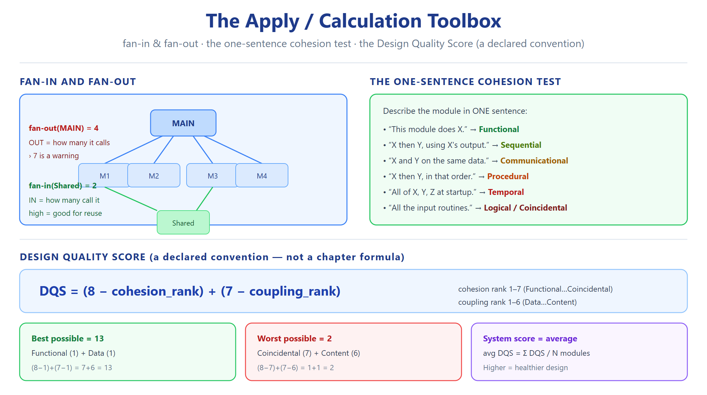

# النوع 7 — أسئلة التطبيق والحساب (Apply / Calculation)

### ASE · Chapter 5 · Software Design — Aggarwal & Singh, 3rd ed. (Bloom Level 3 — Apply)

> **المصدر:** سلايدات `Ch05_Software_Design.pdf` (1–99) + book p.202–251. Fig. 4 (slide 14) = Modularity and software cost؛ Fig. 7 (slide 19) = ترتيب الاقتران؛ Fig. 11 (slide 27) = ترتيب التلاحم؛ سلايدات 73–80 = خطوات OOD الست.
> **الهدف:** تُعطى حالة ملموسة (رقم، مخطط، وصف واجهة)، فتطبّق القاعدة وتحسب النتيجة خطوة بخطوة.
> **قاعدتان ثابتتان (لا تُخالفان):** الاقتران الأفضل←الأسوأ = **Data > Stamp > Control > External > Common > Content** (Fig 7، slide 19) — 6 أنواع. التلاحم الأفضل←الأسوأ = **Functional > Sequential > Communicational > Procedural > Temporal > Logical > Coincidental** (Fig 11، slide 27) — 7 أنواع.
> **ملاحظة استعمال:** سؤال إنكليزي، جواب إنكليزي كامل بخطوات الحساب، تبرير عربي قصير في النهاية. أي ترتيب عددي (rank) مخترع للحساب يُعلَن صراحةً أنه **اصطلاح للتمرين**، مو نص الفصل.

---

## الرسوم المرجعية (راجعها قبل الحل)

---

## قاعدة العمل (Marking Conventions Declared Up-Front)

**Convention 1 — Coupling rank (my convention for scoring only, NOT a chapter fact):**

| Coupling type | Rank (1 = best) |
|---|---|
| Data | 1 |
| Stamp | 2 |
| Control | 3 |
| External | 4 |
| Common | 5 |
| Content | 6 |

**Convention 2 — Cohesion rank (my convention for scoring only, NOT a chapter fact):**

| Cohesion type | Rank (1 = best) |
|---|---|
| Functional | 1 |
| Sequential | 2 |
| Communicational | 3 |
| Procedural | 4 |
| Temporal | 5 |
| Logical | 6 |
| Coincidental | 7 |

**Convention 3 — Design Quality Score (DQS) — my convention:** For one module, `DQS = (8 − cohesion_rank) + (7 − coupling_rank)`. Range = 2 (worst possible: Coincidental L7 + Content C6) to 13 (best possible: Functional L1 + Data C1). Higher = better. For a system of N modules, `Average DQS = Σ DQS / N`.

> **تذكير:** الترتيبين 1–6 و1–7 مطابقان للـ VERIFIED FACTS؛ الأرقام مجرد تسمية رتبة، الترتيب نفسه هو المهم. الـ DQS **اصطلاح مخترع للتمرين**، مو من الفصل.

---

## القسم أ — حساب Fan-in / Fan-out على Structure Chart

---

**Q7.1 (Fan-out / fan-in computation — the call graph)**

> A structure chart has these calls:
> - M1 calls M2, M3, M4
> - M2 calls M5
> - M3 calls M5, M6, M7, M8, M9, M10, M11, M12
> - M4 calls M6
> - M5, M6, M7–M12 call nothing.

**Task:** Compute fan-out for every module. Flag any module exceeding 7. Compute fan-in for M5, M6, M3. Identify the highest-reuse module by fan-in.

**Worked answer — Step 1 (fan-out = number of modules a module calls):**

| Module | Calls | fan-out |
|---|---|---|
| M1 | M2, M3, M4 | **3** |
| M2 | M5 | **1** |
| M3 | M5, M6, M7, M8, M9, M10, M11, M12 | **8** |
| M4 | M6 | **1** |
| M5 | — | 0 |
| M6 | — | 0 |
| M7–M12 | — | 0 each |

**Step 2 (flag > 7):** M3 = 8 → **exceeds 7 → warning sign** (module doing too much; candidate for splitting). M1 = 3 → acceptable.

**Step 3 (fan-in = number of modules that call a module):**

- Fan-in(M5): called by M2 and M3 → **2**
- Fan-in(M6): called by M3 and M4 → **2**
- Fan-in(M3): called by M1 → **1**

**Step 4 (second pass — re-check the arithmetic):** M3's list: M5, M6, M7, M8, M9, M10, M11, M12 → count = 8 ✔. M5 callers = {M2, M3} = 2 ✔. M6 callers = {M3, M4} = 2 ✔.

**Step 5 (highest reuse):** M5 and M6 tie at fan-in = 2 → **both are the highest-reuse modules**; they are shared leaves and must carry the cleanest interfaces (a change here ripples to 2 callers each).

> **[Foundational Knowledge / Standard Concept]** The "fan-out > 7 = warning" rule and "high fan-in = good for reuse" are *standard SE rules of thumb*, **NOT stated in the Ch05 deck**. The deck's structure-chart slides (Fig 17–18, سلايدات 42–43) define the notation only. Flagged every time.

**التبرير العربي:** الـ fan-out = عدد الوحدات اللي تستدعيها الوحدة، والـ fan-in = عدد الوحدات اللي تستدعيها. M3 عندها fan-out = 8 وهذا يتجاوز الحد الشائع (7) فيكون إشارة خطر: الوحدة تتحكم بزائد عن اللزوم وتُرشَّح للتقسيم. M5 و M6 عندهم أعلى fan-in (=2) فهُم وحدات إعادة الاستخدام، وأي تغيير فيهم ينتشر للوحدتين. القاعدة (fan-out>7) قاعدة متعارف عليها **مو من الفصل** — موسمة.

---

**Q7.2 (Fan-out computation — the wide caller, second instance)**

> A module `main_controller()` directly calls: `read_config`, `validate_input`, `parse_record`, `store_record`, `log_event`, `update_index`, `notify_user`, `refresh_display`, `write_audit`, `close_session` — ten calls. Modules `read_config` and `close_session` are also called by `session_manager()`.

**Task:** State `main_controller`'s fan-out. Flag it. Compute fan-in of `read_config`.

**Worked answer:**

**Step 1:** fan-out(`main_controller`) = count the calls = 10.

**Step 2:** 10 > 7 → **warning sign**. A module that fans out to 10 subordinates is controlling too many distinct concerns; the standard remedy is to introduce an intermediate controller and redistribute.

**Step 3 (re-check):** read_config, validate_input, parse_record, store_record, log_event, update_index, notify_user, refresh_display, write_audit, close_session → count = 10 ✔.

**Step 4:** fan-in(`read_config`) = called by `main_controller` and `session_manager` → **2**.

**التبرير العربي:** fan-out = 10 > 7 ⇒ تحذير: الوحدة توزّع السيطرة على عشر مهام مختلفة، وهذا يعني انخفاض تماسكها وارتفاع احتمال التغيير فيها. الحل: إدخال وحدة وسيطة توزّع النداءات. fan-in للـ read_config = 2 فتكون وحدة مشتركة تستحق واجهة نظيفة. (القاعدة موسمة كـ standard concept.)

---

**Q7.3 (Fan-in / fan-out — the reuse hot-spot with a trap)**

> Call graph:
> - A calls B, C
> - B calls D
> - C calls D, E
> - D calls F
> - E calls F
> - F calls nothing
> - G (a second root) calls D

**Task:** Compute fan-out for every module; compute fan-in for D and F; identify which module is (i) the most-reused and (ii) the highest ripple risk. Flag any fan-out breach.

**Worked answer:**

| Module | Calls | fan-out |
|---|---|---|
| A | B, C | 2 |
| B | D | 1 |
| C | D, E | 2 |
| D | F | 1 |
| E | F | 1 |
| F | — | 0 |
| G | D | 1 |

**Fan-in:**

- Fan-in(D): called by B, C, G → **3**
- Fan-in(F): called by D, E → **2**

**Re-check:** D callers = {B, C, G} = 3 ✔. F callers = {D, E} = 2 ✔. No fan-out exceeds 7 (max = 2) → **no breach**.

**(i) Most reused:** D, fan-in = 3.
**(ii) Highest ripple risk:** D again — it is both high fan-in (3 dependents) *and* it sits on the path to F, so a defect in D propagates to B, C, G and then to F and its dependents. D is the critical node.

**التبرير العربي:** لا يوجد fan-out > 7 فالبنية سليمة من ناحية اتساع السيطرة. لكن D هي نقطة الخطر الحقيقية: أعلى fan-in (=3) وفي نفس الوقت تقع على مسار الوصول لـ F، فأي تغيير فيها ينتشر لكل مستدعييها ثم إلى F. أعلى fan-in = أعلى إعادة استخدام وأعلى مخاطرة ripple في نفس الوقت. (fan-in rule = standard concept، موسمة.)

---

## القسم ب — تصنيف وحدات + حساب درجة جودة التصميم (DQS)

---

**Q7.4 (Classify N modules + compute the Design Quality Score)**

> Four modules are described by their interface and internal structure:
> - **P** `compute_tax(salary)` — one self-contained calculation; called only with the primitive `salary`. **Interface: single primitive parameter.**
> - **Q** `validate_then_store(record)` — validates `record`, then the validated record feeds `store()` inside the same module. **Interface: one object passed; internals form an output→input chain.**
> - **R** `run_startup()` — opens the log, initialises drivers, sets the time zone. All touch a shared global `SYSTEM_STATE`. **Interface: no parameters; all through the global.**
> - **S** `handle_request(req, mode, flags)` — a dispatcher that reads `mode` to decide which of six tasks to run; it also reads and writes another module's internal buffer directly.

**Task:** Classify cohesion and coupling for each, then compute the DQS per module and the average DQS for the system.

**Worked answer — Step 1 (classify, using slides 19 & 27):**

| Module | Cohesion | Cohesion rank | Coupling | Coupling rank |
|---|---|---|---|---|
| P | Functional | 1 | Data | 1 |
| Q | Sequential | 2 | Stamp | 2 |
| R | Temporal | 5 | Common | 5 |
| S | Logical | 6 | Content | 6 |

- **P:** single task ("compute tax") → **Functional**. Only a primitive passed → **Data**.
- **Q:** validate → store is an output→input chain (slide 28) → **Sequential**. A whole record object is passed though only validation fields are needed → **Stamp**.
- **R:** elements grouped because they run at the same startup time → **Temporal**. All share a global `SYSTEM_STATE` → **Common**.
- **S:** six tasks chosen by `mode` at runtime → **Logical**; `mode`/`flags` are control info → **Control** at the interface, **but** it also reaches into another module's internal buffer → **Content** (worse of the two; content dominates). Content rank = 6.

**Step 2 (compute DQS = (8 − cohesion_rank) + (7 − coupling_rank)):**

| Module | Cohesion term (8 − r) | Coupling term (7 − r) | DQS |
|---|---|---|---|
| P | 8 − 1 = 7 | 7 − 1 = 6 | **13** |
| Q | 8 − 2 = 6 | 7 − 2 = 5 | **11** |
| R | 8 − 5 = 3 | 7 − 5 = 2 | **5** |
| S | 8 − 6 = 2 | 7 − 6 = 1 | **3** |

**Step 3 (average):** (13 + 11 + 5 + 3) / 4 = 32 / 4 = **8.0**.

**Step 4 (re-check all arithmetic):** P: 8−1=7, 7−1=6, 7+6=13 ✔. Q: 8−2=6, 7−2=5, 6+5=11 ✔. R: 8−5=3, 7−5=2, 3+2=5 ✔. S: 8−6=2, 7−6=1, 2+1=3 ✔. Sum 13+11+5+3 = 32; 32/4 = 8.0 ✔.

**Step 5 (interpretation):** P (13) and Q (11) are healthy; R (5) is weak; S (3) is the system's weakest link — lowest on **both** axes. **Refactor S first**: split the six logical tasks into single-purpose modules (raises cohesion) and replace the internal-buffer access with a data parameter (removes the worst coupling). Moving S from 3 toward ~11–13 is worth far more than polishing P or Q. R next: pass config values as parameters instead of using the global.

> **التنبيه:** الـ DQS **اصطلاح مخترع لهذا التمرين** — مو من الفصل. الفصل يعطي الترتيب فقط (Fig 7, Fig 11)، والأرقام هنا تحويل ذلك الترتيب إلى سلم نقاط.

**التبرير العربي:** P و Q سليمتان (functional/data و sequential/stamp). R سيئة بشكل متوسط (temporal/common). S هي الأسوأ: logical cohesion + content coupling معًا، فتأخذ أدنى نقطة (3). الترتيب الرقمي 1–6 للاقتران و1–7 للتلاحم مطابق للفصل؛ أما DQS فهو اصطلاح التمرين. أول إصلاح = S؛ لأن تحسين الأسوأ يعطي أكبر مكسب بأقل جهد.

---

**Q7.5 (Classify + score a five-module design, second instance)**

> - **T1** `sort_employees(list, ascending_flag)` — sorts; the flag chooses the order. Passes only the list and flag.
> - **T2** `print_all_reports()` — prints the payroll report, the attendance report, the tax report; grouped because all are printing tasks.
> - **T3** `read_sensor(); scale_reading(); store_reading()` — each step feeds the next; interface passes one scaled value.
> - **T4** `update_ledger()` — writes into the `ACCOUNTS` global table shared by 5 other modules.
> - **T5** `misc_helpers()` — 30 unrelated helper routines; also directly edits the `ACCOUNTS` global.

**Task:** Classify, compute DQS per module, compute average, and rank the three most urgent refactors.

**Worked answer — Step 1:**

| Module | Cohesion | rank | Coupling | rank |
|---|---|---|---|---|
| T1 | Logical (flag selects behaviour) | 6 | Control (flag is control info) | 3 |
| T2 | Logical (same logical class: printing) | 6 | Data (only data passed) | 1 |
| T3 | Sequential | 2 | Data | 1 |
| T4 | Functional (one task) | 1 | Common (shared global) | 5 |
| T5 | Coincidental | 7 | Content (edits another's internals) | 6 |

- **T1:** the `ascending_flag` selects *which behaviour* → **Logical** cohesion (runtime-selected tasks) and **Control** coupling (control information passed).
- **T2:** three printing routines grouped by "same logical class" → **Logical** (not coincidental — the printing class is a real, nameable relation) but only data is passed → **Data**.
- **T3:** read→scale→store chain → **Sequential**; single value passed → **Data**.
- **T4:** single task → **Functional**; but shares `ACCOUNTS` global → **Common**.
- **T5:** 30 unrelated helpers → **Coincidental**; edits `ACCOUNTS` internals → **Content**.

**Step 2 (DQS):**

| Module | Cohesion term | Coupling term | DQS |
|---|---|---|---|
| T1 | 8 − 6 = 2 | 7 − 3 = 4 | **6** |
| T2 | 8 − 6 = 2 | 7 − 1 = 6 | **8** |
| T3 | 8 − 2 = 6 | 7 − 1 = 6 | **12** |
| T4 | 8 − 1 = 7 | 7 − 5 = 2 | **9** |
| T5 | 8 − 7 = 1 | 7 − 6 = 1 | **2** |

**Step 3 (average):** (6 + 8 + 12 + 9 + 2) / 5 = 37 / 5 = **7.4**.

**Step 4 (re-check):** T1: 2+4=6 ✔. T2: 2+6=8 ✔. T3: 6+6=12 ✔. T4: 7+2=9 ✔. T5: 1+1=2 ✔. Sum 6+8+12+9+2 = 37; 37/5 = 7.4 ✔.

**Step 5 (three most urgent refactors):**
1. **T5** (DQS 2) — worst on both axes; split the 30 helpers by function and remove the internal `ACCOUNTS` access → content → data.
2. **T4** (Common, DQS 9 but *coupling* worst-but-one) — high cohesion is undercut by a shared global; pass needed values as parameters → common → data.
3. **T1** (DQS 6) — split the flag-selected behaviour into two single-purpose routines → logical → functional, control → data.

**التبرير العربي:** T3 هي الأنظف (12). T5 هي الأسوأ بلا منافس (2) لأنها coincidental + content — إصلاحها أولًا. T4 تلاحمها ممتاز لكن الاقتران common يخفضها فثانيًا. T1 ثالثًا لأن الـ flag = control coupling وتلاحم logical. الأرقام (DQS) اصطلاح التمرين، والترتيب مطابق للفصل.

---

## القسم ج — Region of Minimum Cost (منحنى المعيارية–الكلفة)

---

**Q7.6 (Locate the Region of Minimum Cost — read the U-curve)**

> A team estimates the following total cost (in developer-days) for different numbers of modules in the same system (curve shape from Fig. 4, slide 14):
>
> | Modules | Total cost (days) |
> |---|---|
> | 1 | 420 |
> | 3 | 300 |
> | 5 | 230 |
> | 7 | 195 |
> | **9** | **175** |
> | 11 | 185 |
> | 15 | 260 |
> | 20 | 400 |

**Task:** Locate the Region of Minimum Cost. Explain the two failure modes on either side.

**Worked answer — Step 1 (find the minimum):** Scan the cost column: 420 → 300 → 230 → 195 → **175 (min)** → 185 → 260 → 400. Minimum at **9 modules, cost = 175 days**.

**Step 2 (the region, not a single point):** The costs at 7 (195) and 11 (185) are close to 175, so the practical **Region of Minimum Cost ≈ 7–11 modules**, centred on 9. Outside this band the cost rises steeply.

**Step 3 (re-check):** ascending to the min: 420, 300, 230, 195, 175 → strictly decreasing to 9 ✔; after 9: 185, 260, 400 → strictly increasing ✔. Genuine U-shape confirmed. 175 is the smallest value in the column ✔.

**Step 4 (left failure mode — too few modules):** At 1–3 modules the cost is high because the whole system is one indissoluble block: the cost of **integration and communication is minimal, but the cost of developing/understanding/maintaining monolithic units explodes** — the single module cannot be separated for testing, and every change is global. The curve's left branch is driven by **module development effort** (a big, unmanageable unit costs more to build and change). Read side: "too few" = poor modularity = high development/maintenance cost.

**Step 5 (right failure mode — too many modules):** At 15–20 modules the cost rises again because more modules means **more interfaces, more integration effort, more communication overhead** between modules. Each additional boundary must be designed, documented and integrated. The right branch is driven by **integration/interface overhead**. Read side: "too many" = integration cost dominates.

**Step 6 (significance):** The minimum exists because the two cost components move in opposite directions — as you add modules, *development* cost falls but *integration* cost rises. Where the sum is lowest is the Region of Minimum Cost.

**التبرير العربي:** منحنى Fig. 4 (سلايد 14) على شكل U: كل ما زادت الوحدات تنخفض كلفة التطوير لكن ترتفع كلفة التكامل بينها. المنطقة الأقل كلفة هنا ≈ 7–11 وحدة (الحد الأدنى عند 9). على اليسار (وحدات قليلة جدًا) الكلفة عالية لأن الوحدة العملاقة غير قابلة للفهم/الاختبار. على اليمين (وحدات كثيرة جدًا) الكلفة عالية بسبب كلفة الواجهات والتكامل. الأمثل عند تقاطع النزعتين.

---

**Q7.7 (Read the U-curve — second instance, asymmetric curve)**

> Another estimate:
>
> | Modules | Total cost (days) |
> |---|---|
> | 2 | 380 |
> | 4 | 250 |
> | 6 | 180 |
> | 8 | 150 |
> | 10 | 145 |
> | 12 | 160 |
> | 16 | 220 |
> | 24 | 390 |

**Task:** Locate the minimum and the region; state on which side this curve is steeper and what that implies.

**Worked answer — Step 1:** Minimum = **145 days at 10 modules** (next lowest: 150 at 8, 160 at 12).

**Step 2 (region):** 8–12 modules ≈ Region of Minimum Cost (costs 145–160).

**Step 3 (re-check):** 380 → 250 → 180 → 150 → 145 decreasing to 10 ✔; after 10: 160 → 220 → 390 increasing ✔. Min value 145 ✔.

**Step 4 (steepness):** From 10 → 24 modules the cost climbs 145 → 390 (+245). From 10 → 2 modules (going left) the cost climbs 145 → 380 (+235). The two sides are close; but the **right-hand jump from 12→24 is +230 over 12 added modules, while the left from 8→2 is +230 over 6 removed modules** — per-module, the **left side is steeper**. Implication: in this system, *under-modularising* (too few, giant modules) is punished more per unit than over-modularising — a sign the modules are individually very large, so merging them is especially costly.

**التبرير العربي:** الحد الأدنى عند 10 وحدات (145 يوم)، والمنطقة الاقتصادية ≈ 8–12. الجانب الأيسر أكثر حدّة لكل وحدة: تقليل عدد الوحدات (دمج وحدات كبيرة) يعاقَب بقوة أكبر، وهذا يعني أن الوحدات الأساسية ضخمة جدًا ودمجها مكلف. الجانبان يمثّلان نمطي الفشل: وحدات قليلة جدًا (كلفة فهم/صيانة) أو كثيرة جدًا (كلفة واجهات/تكامل).

---

## القسم د — One-Sentence Cohesion Test على 6 دوال

---

**Q7.8 (Apply the one-sentence test to six routines)**

> **The one-sentence test:** Read the routine and try to describe what it does in exactly one sentence with **one verb**. If you succeed, cohesion is high (Functional). If the best sentence needs "and", "or", a flag-word ("depending on…"), "first…then…", or "all…at the same time", note which connector you needed — the connector names the cohesion type.
>
> Classify these six routines:

1. `computeGrossPay(hours, rate)` — "computes gross pay from hours and rate".
2. `openFiles(); loadTables(); initialisePrinter();` grouped as `systemStartup()` — "does open files **and** load tables **and** init printer, all at startup".
3. `readRaw(); cleanRaw(); formatOutput();` — "reads raw data, **then** cleans it, **then** formats it".
4. `saveEmployee(rec)` and `printEmployee(rec)` grouped as `employeeIO(rec)` — "saves the employee **or** prints the employee depending on the `operation` flag".
5. `sortNames(); computeAverage(); lookupId();` grouped as `miscArrayOps()` — "sorts names **and** computes average **and** looks up an id".
6. `validateHeader(); printHeader(); storeHeader();` all operating on the **same** input `headerRecord` — "takes the header record and validates it, prints it, and stores it".

**Worked answer:**

| # | Routine(s) | Connector needed in the one sentence | Cohesion | rank |
|---|---|---|---|---|
| 1 | `computeGrossPay` | none — one verb | **Functional** | 1 |
| 2 | `systemStartup` | "…**and**…, **all at the same time** (startup)" | **Temporal** | 5 |
| 3 | read→clean→format | "…**then**…" (output→input chain) | **Sequential** | 2 |
| 4 | `employeeIO(rec)` | "…**or**…depending on the flag" | **Logical** | 6 |
| 5 | `miscArrayOps` | "…**and**…" with no unifying relation | **Coincidental** | 7 |
| 6 | header trio on one input | none of the chain words; all consume the **same input** | **Communicational** | 3 |

**Step (re-check the two tricky ones):**
- #3 vs #6: #3 has an **output→input chain** (each step feeds the next) → Sequential. #6 has **independent operations on a shared input**, no chaining → Communicational. Different connectors: "then" vs "same input". ✔
- #2 vs #5: #2 has a real reason ("all at startup") → Temporal (rank 5). #5 has no reason at all → Coincidental (rank 7). ✔
- #4: the word "or / depending on the flag" is the classic Logical-cohesion marker (runtime task selection) → rank 6. ✔

**التبرير العربي:** امتحان الجملة الواحدة يكشف نوع التلاحم من الرابط (connector) المطلوب: بدون أي رابط ⇒ Functional (1). "ثم" ⇒ Sequential (3). "نفس المدخل" ⇒ Communicational (6). "أو / حسب الـ flag" ⇒ Logical (4). "كلها وقت واحد/startup" ⇒ Temporal (2). لا يوجد سبب على الإطلاق ⇒ Coincidental (5). الأرقام = رتبة على سلم Fig 11 (slide 27).

---

## القسم هـ — OOD 6-Step Processes

---

**Q7.9 (Apply the OOD 6-step process — output the artefact list)**

> Problem: "A **Library Book-Loan** system must let a Librarian issue a book to a member and let the member return it."

**Task:** Apply the six OOD steps (slides 73–80) and output, for **each** step, the artefact/diagram or decision produced. Do not draw the artefacts — list them.

**Worked answer (six steps, quoting the deck's step names):**

| Step | Deck name (slides 73–80) | Artefact / decision produced for this problem |
|---|---|---|
| **1** | i. Create use case model | Actor list (**Librarian, Member**); use cases **"Issue Book"**, **"Return Book"**; a **use-case diagram** linking actors to those use cases. |
| **2** | ii. Draw activity diagram *(if required)* | **Activity diagram** for the flow "Issue Book": request → verify membership → check availability → record loan → confirm — a flow of control from activity to activity. |
| **3** | iii. Draw the interaction diagram | Object list per use case (**LibrarianUI, LoanController, Book, Loan** — interface/control/entity objects); **sequence diagrams** (and collaboration diagrams) for each use case showing messages. |
| **4** | iv. Draw the class diagram | **Class diagram**: classes `Book`, `Member`, `Loan`, `Librarian` with attributes and operations; relationships — **association** (Member–Loan), **aggregation** (Loan contains Book), **dependency**, **generalisation** (if a `ReferenceBook`/`LendingBook` split is chosen). |
| **5** | v. Design of state chart diagrams *(if required)* | **State chart diagram** for `Book`: Available → Issued → Returned → Available, with the events that cause each transition. |
| **6** | vi. Draw component and development (deployment) diagram | **Component diagram** (implementation view: which classes map to which components) + **deployment diagram** (physical distribution: library terminals/PCs and the DB server) → the **design documents**. |

**الإحصاء (re-check):** steps listed = 6 ✔; steps marked "if required" in the deck = 2 (activity, state chart) and flagged as optional here ✔; class-diagram relationships named = the deck's **four** (association, dependency, aggregation, generalisation) ✔.

**التبرير العربي:** خطوات OOD الست مطابقة للفصل (سلايدات 73–80): use case ← activity ← interaction ← class ← state chart ← component/deployment. خطوتان موسومتان "if required" بالكتاب (activity و state chart) فتبقى اختياريتين. المطلوب هنا قائمة المخرجات لكل خطوة، مو رسمها. خطوة الـ class diagram تحديدًا تنتج الـ 4 علاقات المذكورة بالفصل.

---

**Q7.10 (Apply the OOD 6-step process — second problem, verify the ordering)**

> Problem: "A **Parking Lot** system assigns a free spot to an arriving vehicle, computes the fee on exit, and reports the number of free spots."

**Task:** For each of the six steps, state the artefact produced AND the single most important **design decision** taken at that step. Confirm the step order matches the deck.

**Worked answer:**

| Step | Artefact | Key decision made here |
|---|---|---|
| **1** use case model | Actor list (**Driver, Attendant**); use cases *Enter Lot*, *Exit Lot*, *Check Availability*; use-case diagram | Fix the **system boundary** and actors (decides scope). |
| **2** activity diagram | Activity diagram for *Enter Lot* (assign spot → raise barrier → record ticket) | The **ordering** of activities (dynamic flow). |
| **3** interaction diagram | Objects `Barrier, Ticket, ParkingSpot, FeeCalculator`; sequence diagram per use case | The **messages** and therefore the intended **coupling** between objects. |
| **4** class diagram | Class diagram: `Vehicle, ParkingSpot, Ticket, FeeCalculator`; relationships: **aggregation** (Lot aggregates ParkingSpot), **association** (Ticket–Vehicle), **dependency** (FeeCalculator depends on Ticket), **generalisation** (Car/Truck/Motorcycle → Vehicle) | The **state (attributes) and behaviour (operations)** plus the four relationship kinds. |
| **5** state chart | State chart for `ParkingSpot`: Free → Occupied → Free | The **state transitions** that the class must support. |
| **6** component/deployment | Component diagram + deployment diagram (kiosk PC, server, barrier controller) | The **physical mapping** of components to hardware. |

**Order check:** 1 → 2 → 3 → 4 → 5 → 6, exactly as the deck presents them (use case → activity → interaction → class → state chart → component/deployment). ✔

**التبرير العربي:** نفس الخطوات الست، وكل خطوة تقيّد اللي بعدها: الـ use case يثبّت الحدود، الـ activity يثبّت الترتيب، الـ interaction يكشف الرسائل/الاقتران، الـ class يثبّت الحالة والسلوك و4 العلاقات، الـ state chart يثبّت الانتقالات، والـ component/deployment يثبّت التوزيع الفيزيائي. الترتيب مطابق للفصل (سلايدات 73–80).

---

## القسم و — تتبّع أثر التغيير: Data vs Content (عدّ وإحصاء)

---

**Q7.11 (Trace and COUNT which modules must be re-checked)**

> A design has these modules and links:
> - **Entry** calls **Save**, **Print**
> - **Save** calls **Format**, **Log**
> - **Print** calls **Format**
> - **Format** calls **Util**
> - **Log** calls **Util**
>
> Two scenarios for the interface between `Save` and `Format`:
> - **(A) Data coupling:** `Save` passes `Format(record)` — one object, and `Format` uses only the fields it receives. `Format`'s internals are private.
> - **(B) Content coupling:** `Save` writes directly into `Format`'s internal buffer `Format.buf` and reads `Format.lastError`.

**Task:** A change is made **inside `Format`** (its internal buffer layout changes). Under (A) and under (B), enumerate exactly which modules must be re-checked. Give the count for each.

**Worked answer — Step 1 (build the dependency directions):**

- Under **(A) data coupling:** `Save` depends on `Format` **only through the parameter `record`**. The callers of `Format` are `Save` and `Print`; callers of those are `Entry`. But the interface contract is *only* the `record` parameter, and the change is **internal** to `Format` → the existing interfaces still hold.

  **Modules to re-check under (A):** `Format` itself only. The interface with `Save`/`Print` is unchanged (same parameter), so **no caller needs re-checking**.
  **Count (A) = 1** (`Format`).

- Under **(B) content coupling:** `Save` reaches into `Format.buf` and `Format.lastError`. Changing `Format`'s internal buffer layout **breaks `Save` directly**, because `Save` depends on those internals. `Save`'s callers (`Entry`) may then see changed behaviour and must be re-checked too, as must anything `Save` feeds. Walk the graph:

  1. `Format` — changed (source).
  2. `Save` — reads/writes `Format.buf` and `Format.lastError` → **must re-check** (its code assumes the old layout).
  3. `Entry` — calls `Save`; if `Save`'s behaviour/return changes, `Entry` must be re-checked.
  4. `Print` — calls `Format`; `Print` itself does not touch `Format.buf`, but if the *observable* behaviour of `Format` changed, `Print` must be re-verified against the new behaviour.
  5. `Log` and `Util` — `Util` is downstream of both `Save` and `Log`; the risk path does not originate from them, so they need re-check only if `Format`'s public output changed. Conservative count includes them as *verification candidates*.

  **Count (B), strict (interface-breaking chain):** `Format`, `Save`, `Entry` = **3**.
  **Count (B), conservative (all dependents that could observe a behaviour change):** `Format`, `Save`, `Entry`, `Print`, `Log`, `Util` = **6**.

**Step 2 (re-check the counts by re-walking):**
- (A): change is internal; contract unchanged → only `Format`. Count = **1** ✔.
- (B) strict: the *content* link is `Save ↔ Format`; the modules on that inward path are `Save` and (its caller) `Entry`; plus the changed module `Format` → 3 ✔.
- (B) conservative: add every module reachable from `Format` in the call graph = `Save, Print, Entry, Log, Util` + `Format` → 6 ✔ (7 modules total in the design; only none is truly unaffected).

**Step 3 (the lesson):** Same graph, same change — the **coupling form** decides the blast radius. Data coupling contains the ripple to **1** module; content coupling spreads re-checking to **3 (minimum) to 6 (conservative)**. That factor-of-3-to-6 difference is the quantitative face of "content coupling is the worst".

**التبرير العربي:** نفس التغيير (داخل Format) ونفس المخطط، لكن الاقتران يحدد حجم الانتشار: بالـ data coupling التغيير داخلي والعقد (البارامتر) ما تغيّر ⇒ نراجع وحدة واحدة (1). بالـ content coupling لأن Save تشتغل مباشرة على buf الداخلية، التغيير يكسرها ⇒ على الأقل 3 وحدات (Format, Save, Entry) وستة بالعدّ المتحفظ (تضيف Print, Log, Util). هذا هو الفرق الكمّي اللي يثبت أن content coupling هو الأسوأ (Fig 7).

---

**Q7.12 (Counting under Common vs Data — the shared-global re-check count)**

> A system has 8 modules: `M1…M8`. Five of them (`M2, M3, M5, M6, M8`) read and write a shared global table `G`. The other three (`M1, M4, M7`) never touch `G`.
>
> **(A)** The **layout of `G`** changes (a field is added).
> **(B)** Instead, the design is refactored so each module passes exactly the fields it needs as parameters, and `G` is removed; then a module `M5`'s **internal algorithm** changes.

**Task:** Count how many modules must be re-checked in each case.

**Worked answer — Case (A), Common coupling:**
Any module touching `G` may depend on its layout. Count = modules reading/writing `G` = `M2, M3, M5, M6, M8` → **5 modules** must be re-checked. `M1, M4, M7` are unaffected.

**Re-check:** ∩ is exactly the five named ✔. Count = 5 ✔.

**Worked answer — Case (B), Data coupling after refactor:**
Now `M5`'s internal algorithm changes. Modules depend on `M5` only through its parameter interface, which is unchanged (internal change). Therefore only modules whose **call interface** is affected need re-check — since the interface did not change, **only `M5` must be re-checked**.
Count = **1**.

**Re-check:** a purely internal algorithm change under data coupling → interface unchanged → 1 module ✔.

**Comparison:** Case (A) = 5 modules; Case (B) = 1 module. Same system size (8), but common coupling multiplies the re-check count by 5, data coupling by 1.

**التبرير العربي:** بالـ common coupling أي تغيير في `G` يجبرك تراجع **كل** وحدة تلمس `G` = 5 وحدات (M2, M3, M5, M6, M8). بعد إزالة `G` والتمرير بالبارامترات (data coupling)، تغيير داخلي في `M5` ما يكسر أي عقد ⇒ وحدة واحدة فقط. الفرق 5 مقابل 1 = الوجه الكمّي لقاعدة "قلّل الاقتران".

---

**Q7.13 (Ripple tracing — count the re-check set for content vs data on a chain)**

> A chain: `Top → A → B → C`. `B` and `C` communicate through a shared **external file format** (External coupling). Separately, `A` reaches into `B`'s internal state (Content coupling).

**Task:** If `C` changes its file format, count the re-check set under the External coupling. Then, if the design were changed so `B–C` used data coupling instead, recount. Explain the difference.

**Worked answer — Step 1 (External coupling, format of `C` changes):**
External coupling means `B` is tied to `C` through the **external file format**. Changing that format breaks `B`. Then `B`'s behaviour may change → `A`, then `Top`, must be re-checked.

Re-check set = `C` (source) + `B` (external link broken) + `A` + `Top` = **4 modules**.
**Re-check count:** `C, B, A, Top` = 4 ✔.

**Step 2 (if `B–C` becomes data coupling):**
Now `B` calls `C` with parameters; the change is *inside* `C` and `C`'s interface is stable (say `C` returns the same typed value). Then:
- `C` re-checked (source).
- `B` — interface unchanged (same return) → only needs a light **re-verify**, effectively 0 forced changes; strictly, **no forced re-check** since the contract holds.

Conservative re-check set = `C` (+ optional verification of `B`) → **1 (strict) to 2 (conservative)**.
**Re-check count:** 1–2 ✔.

**Step 3 (re-check the counts):** External case: 4 named modules ✔. Data case: contract preserved → 1 (strict) ✔.

**Step 4 (difference):** The external file format is a *shared artifact* — both `B` and `C` must agree on it, so changing it drags every reader of that format. With data coupling the format is internal to `C` and the boundary is a typed value, so the change is contained. **External (rank 4) is worse than Data (rank 1) precisely because of this counting difference.**

**التبرير العربي:** الـ external coupling يربط B و C بصيغة ملف مشتركة، فتغيير الصيغة يكسر B ثم A ثم Top ⇒ 4 وحدات. لو صار الربط data coupling (بارامتر/قيمة مُرجَعة ثابتة)، التغيير داخل C فقط ⇒ وحدة واحدة (أو 2 بالعدّ المتحفظ). فرق العدّ (4 مقابل 1) يشرح لماذا External أسوأ من Data على سلم Fig 7.

---

## القسم ز — Translation into Ladder Position (رتبة الاقتران/التلاحم) + تمارين إضافية

---

**Q7.14 (Translate a description into the correct ladder rank — combined)**

> Translate each description into (a) the coupling type and its rank on Fig 7, or (b) the cohesion type and its rank on Fig 11.
>
> 1. "Module X sends module Y the value `count` only." — coupling?
> 2. "Module X sends module Y the entire 40-field `PersonRecord` though Y needs only `name`." — coupling?
> 3. "Module X passes `isLastRecord` so Y knows whether to exit its loop." — coupling?
> 4. "Module X assumes Y reads from a fixed-format `.dat` file agreed between two teams." — coupling?
> 5. "Module X changes a variable inside module Y." — coupling?
> 6. A routine whose elements are: "open log; open database; open socket" — cohesion?
> 7. A routine whose elements are: "all operations that update either the name OR the address OR the phone, chosen by a flag" — cohesion?
> 8. A routine that performs a single well-defined task. — cohesion?

**Worked answer — Step 1 (map each to the ladder):**

| # | Description keyword | Type | Fig | rank |
|---|---|---|---|---|
| 1 | one primitive value passed | **Data** coupling | Fig 7 | 1 (best) |
| 2 | whole structure despite needing one field | **Stamp** coupling | Fig 7 | 2 |
| 3 | a **flag** controlling the other's logic | **Control** coupling | Fig 7 | 3 |
| 4 | bound to an **external file format** | **External** coupling | Fig 7 | 4 |
| 5 | changing another module's **internals** | **Content** coupling | Fig 7 | 6 (worst) |
| 6 | "all at startup / same time" | **Temporal** cohesion | Fig 11 | 5 |
| 7 | "OR … chosen by a flag" | **Logical** cohesion | Fig 11 | 6 |
| 8 | one task, one verb | **Functional** cohesion | Fig 11 | 1 (best) |

**Step 2 (re-check positions against the verified orderings):**
- Coupling order = Data > Stamp > Control > External > Common > Content. #1 Data = 1 ✔; #2 Stamp = 2 ✔; #3 Control = 3 ✔; #4 External = 4 ✔; #5 Content = 6 ✔. (Common was not probed here; it sits at rank 5 — untouched.)
- Cohesion order = Functional > Sequential > Communicational > Procedural > Temporal > Logical > Coincidental. #8 Functional = 1 ✔; #6 Temporal = 5 ✔; #7 Logical = 6 ✔.

**Step 3 (warning on #4):** Do NOT call #4 "Data coupling". The word "file" is not automatically external coupling — it becomes **External** only when the module is bound to a *format/interface imposed from outside the software* (a format two teams agreed on). Passing a file handle as a value would be Data; being tied to an externally-fixed format is External.

**التبرير العربي:** كل وصف يُترجم مباشرة لرتبة: تمرير قيمة مفردة = Data (1)؛ تمرير بنية كاملة = Stamp (2)؛ تمرير flag = Control (3)؛ الارتباط بصيغة ملف خارجية = External (4)؛ التعديل داخل وحدة ثانية = Content (6). تلاحم: "وقت واحد/startup" = Temporal (5)؛ "أو حسب flag" = Logical (6)؛ مهمة واحدة = Functional (1). الرتب مطابقة تمامًا لـ Fig 7 و Fig 11.

---

**Q7.15 (Apply coupling rank to choose a refactor order — counting application)**

> A design has four modules with the following problems:
> - **U1** is **Stamp**-coupled to its caller (passes a whole struct).
> - **U2** is **Content**-coupled to a neighbour (writes its internals).
> - **U3** is **Common**-coupled to three others (shared global).
> - **U4** is **Control**-coupled to its caller (passes a flag).

**Task:** Rank U1–U4 by refactoring urgency using the **verified** coupling order. Justify each rank with the ladder position.

**Worked answer — Step 1 (place each on Fig 7):**

| Module | Coupling | Fig 7 rank (1=best,6=worst) |
|---|---|---|
| U2 | Content | 6 |
| U3 | Common | 5 |
| U4 | Control | 3 |
| U1 | Stamp | 2 |

**Step 2 (urgency = worst first):**
1. **U2 (Content, rank 6)** — worst; hidden bidirectional dependency, invisible in compilers.
2. **U3 (Common, rank 5)** — shared global; change ripples to all 3 sharers.
3. **U4 (Control, rank 3)** — flag passed; couples the caller to the callee's internals logic.
4. **U1 (Stamp, rank 2)** — mildest; over-exposure but still a one-directional data pass.

**Step 3 (re-check — strict monotonicity):** Content(6) > Common(5) > Control(3) > Stamp(2) — urgency order U2 > U3 > U4 > U1 ✔, matching the verified order Data > Stamp > Control > External > Common > Content.

**التبرير العربي:** الترتيب الرقمي على Fig 7: Content = 6 (الأسوأ) ← Common = 5 ← Control = 3 ← Stamp = 2. فالاستعجال: U2 أولًا (content)، ثم U3 (common، الـ global ينتشر لثلاث وحدات)، ثم U4 (control)، وأخيرًا U1 (stamp، الأخفّ). الترتيب مطابق حرفيًا للترتيب المُتحقق منه.

---

**Q7.16 (Apply cohesion rank to choose which routine to split — counting)**

> A "reports" module contains five routines grouped as follows: R1 = compute totals (single task); R2 & R3 = read then format (output→input chain); R4 & R5 = "all routines that either print OR export, selected by a flag". A reviewer wants to split **one** group.
>
> **Task:** Assign the cohesion rank to each group, then state which group to split first and why (using the rank numbers).

**Worked answer — Step 1:**

| Group | Structure | Cohesion | Fig 11 rank |
|---|---|---|---|
| R1 | one task | Functional | 1 |
| R2+R3 | read → format chain | Sequential | 2 |
| R4+R5 | print OR export by flag | Logical | 6 |

**Step 2 (which to split):** The **R4+R5 group** (Logical, rank 6). It is the only group far from the best end; the "OR + flag" structure is exactly the Logical-cohesion marker, and it forces control coupling on the caller.

**Step 3 (re-check the ranks against Fig 11):** Functional = 1 ✔; Sequential = 2 ✔; Logical = 6 ✔ (order Functional > Sequential > Communicational > Procedural > Temporal > Logical > Coincidental).

**Step 4 (counting consequence):** Splitting R4+R5 into two functional routines (print-function, export-function) moves 2 routines from rank 6 → rank 1, and lets the caller drop its `flag` parameter (Control → Data coupling). Splitting R2+R3 would move 2 routines from rank 2 → rank 1 — a much smaller gain. **Urgency is proportional to the rank distance from the best level.**

**التبرير العربي:** R1 = Functional (1)، R2+R3 = Sequential (2)، R4+R5 = Logical (6). نُقسّم مجموعة R4+R5 أولًا لأنها الأبعد عن الأفضل ("أو + flag" = علامة logical cohesion)، فيرفع تلاحمها من 6 إلى 1 ويسمح للـ caller بإسقاط الـ flag (control ← data). الفرق (6←1) أكبر بكثير من (2←1)، فالمكسب أكبر.

---

**Q7.17 (Full worked application — compute fan-in/out, classify, score, and choose a refactor)**

> A structure chart:
> - `Main` calls `Load`, `Process`, `Report`
> - `Load` calls `ReadFile`, `Validate`
> - `Process` calls `Validate`, `Compute`, `Transform`, `Sort`, `Filter`, `Aggregate`, `Rank`, `FormatOut`, `Persist` (9 calls)
> - `Report` calls `FormatOut`
> - `Validate` is also called by `Load` and `Process`; `FormatOut` by `Process` and `Report`.

**Task:** (a) Compute every fan-out and flag breaches. (b) Compute fan-in of `Validate` and `FormatOut`. (c) `Process` is internally a "flag dispatcher" reading a `mode` parameter and is **Content**-coupled to `Compute`. Classify its cohesion/coupling and compute its DQS. (d) Name the two most urgent actions.

**Worked answer — (a) fan-out:**

| Module | Calls | fan-out |
|---|---|---|
| Main | Load, Process, Report | 3 |
| Load | ReadFile, Validate | 2 |
| Process | Validate, Compute, Transform, Sort, Filter, Aggregate, Rank, FormatOut, Persist | **9** |
| Report | FormatOut | 1 |
| others | — | 0 |

**Breach:** `Process` = 9 > 7 → **flagged** ✔. (Re-count: Validate, Compute, Transform, Sort, Filter, Aggregate, Rank, FormatOut, Persist = 9 ✔.)

**(b) fan-in:**

- Fan-in(`Validate`): called by `Load` and `Process` → **2** ✔
- Fan-in(`FormatOut`): called by `Process` and `Report` → **2** ✔

So `Validate` and `FormatOut` are the shared leaves — highest reuse, must have the cleanest interfaces (both are also affected by `Process`'s breach).

**(c) `Process` classification and DQS:**

- Cohesion: reads `mode` to choose among tasks → **Logical** (rank 6).
- Coupling: Content-couples to `Compute` (writes its internals) — and Content (rank 6) is worse than the Control coupling the `mode` flag would suggest, so **Content (rank 6)** governs.
- DQS = (8 − 6) + (7 − 6) = 2 + 1 = **3** (very weak; theoretical worst = 2).
- **Re-check:** 8−6 = 2 ✔; 7−6 = 1 ✔; DQS = 3 ✔.

**(d) two most urgent actions:**
1. **Break the Content coupling between `Process` and `Compute`** — replace internal access with a data parameter (rank 6 → 1). Highest-severity defect.
2. **Split `Process`** — its 9-call fan-out (> 7, the fan-out warning) and Logical cohesion (rank 6) mean it is doing too much; decomposing it into single-purpose modules raises cohesion and removes the `mode` flag (Control → Data).

**Step (re-check arithmetic):** Process fan-out = 9 ✔; Validate fan-in = 2 ✔; FormatOut fan-in = 2 ✔; DQS = 3 ✔. All confirmed.

**التبرير العربي:** Process هي الوحدة المريضة: fan-out = 9 (> 7 ⇒ تحذير)، telاحم logical (rank 6) بسبب flag الـ mode، واقتران content مع Compute (rank 6) ⇒ DQS = 3 (قريب من الأسوأ). الإجراءان الأهم: (1) كسر الـ content coupling (استبداله بـ data) لأنه الأخطر؛ (2) تقسيم Process لأن fan-out يتجاوز 7 وتلاحمها logical. Validate و FormatOut عندهم fan-in = 2 فهُم وحدات إعادة استخدام تحتاج واجهات نظيفة. (قاعدة fan-out>7 موسمة كـ standard concept.)

---

**Q7.18 (Cross-check application — put one design through the whole toolkit)**

> Design **Z**: 7 modules. Module `Z3` calls `Z4, Z5, Z6, Z7, Z1, Z2, Z5` (note `Z5` appears twice in the call sheet — treat each *distinct* callee once). `Z4` passes only `Z3`'s `id` back (data). `Z3` is internally a set of three routines grouped because they all run when a batch job starts. `Z6` reads and writes a global `CONFIG`.

**Task:** (i) Compute `Z3`'s correct fan-out (watch the duplicate). (ii) Classify `Z3`'s cohesion. (iii) Classify `Z6`'s coupling. (iv) State whether the design's cost is likely left of, in, or right of the Region of Minimum Cost if the ideal is ~9–11 modules.

**Worked answer — (i) fan-out of `Z3`:**
Raw call sheet: Z4, Z5, Z6, Z7, Z1, Z2, Z5. Distinct callees = {Z4, Z5, Z6, Z7, Z1, Z2} = **6**. (The duplicate Z5 counts once.)
**Re-check:** list = Z1, Z2, Z4, Z5, Z6, Z7 → 6 distinct ✔. 6 ≤ 7 → **no breach**.

**(ii) Cohesion of `Z3`:** three routines grouped because they all run at batch start → **Temporal** cohesion (rank 5).

**(iii) Coupling of `Z6`:** shares global `CONFIG` with others → **Common** coupling (rank 5).

**(iv) Region of Minimum Cost:** the design has **7 modules** but the ideal is **9–11** → 7 < 9, so the design sits **left of the Region of Minimum Cost** (too few modules). It is under-modularised: fewer boundaries means less integration overhead but larger, harder-to-understand modules — cost is on the *left* branch of Fig 4; adding a few modules would reduce total cost.

**Step (re-check):** distinct fan-out = 6 ✔; Temporal rank 5 ✔; Common rank 5 ✔; 7 < 9 → left branch ✔.

**التبرير العربي:** الـ fan-out الصحيح = 6 لأن Z5 مكررة في كشف النداء وتُحسب مرة واحدة (لا يتجاوز 7 ⇒ لا تحذير). تلاحم Z3 = Temporal (كلها تبدأ وقت واحد، rank 5). اقتران Z6 = Common (global CONFIG، rank 5). بعدد 7 وحدات مقابل الأمثل 9–11، التصميم **يسار** منطقة الكلفة الدنيا (وحدات قليلة جدًا) فكلفته على الفرع الأيسر من منحنى Fig 4.

---

## خريطة التغطية والتحقق (Coverage & Verification Map)

| Q | نوع التطبيق | المفاتيح | المصدر |
|---|---|---|---|
| Q7.1 | fan-in/out حساب | fan-out=8 breach + fan-in | s43 (Fig 18) + standard concept |
| Q7.2 | fan-out حساب | fan-out=10 breach | standard concept |
| Q7.3 | fan-in/out + reuse | fan-in=3 hotspot | standard concept |
| Q7.4 | تصنيف + DQS | 4 وحدات + avg 8.0 | Fig 7/11 (s19, s27) |
| Q7.5 | تصنيف + DQS | 5 وحدات + avg 7.4 | Fig 7/11 |
| Q7.6 | Region of Min Cost | min=9، نطاق 7–11 | Fig 4 (s14) |
| Q7.7 | Region of Min Cost | min=10، حدّة الفرعين | Fig 4 (s14) |
| Q7.8 | one-sentence cohesion | 6 دوال ← رتب | definitions (s27–30) |
| Q7.9 | OOD 6 خطوات | قائمة مخرجات | s73–80 |
| Q7.10 | OOD 6 خطوات | مخرجات + قرارات | s73–80 |
| Q7.11 | trace/count data vs content | 1 مقابل 3/6 | s19–23 |
| Q7.12 | trace/count common vs data | 5 مقابل 1 | s21 |
| Q7.13 | trace/count external vs data | 4 مقابل 1 | s23 |
| Q7.14 | رتبة ladder | 8 وصف ← رتب | Fig 7/11 |
| Q7.15 | ترتيب إصلاح بالرتب | U2>U3>U4>U1 | Fig 7 |
| Q7.16 | ترتيب إصلاح بالرتب | R4+R5 أولًا | Fig 11 |
| Q7.17 | شامل (fan+class+DQS) | Process DQS=3 | Fig 7/11 + standard |
| Q7.18 | شامل + duplicate trap | fan-out=6، يسار المنطقة | Fig 4/7/11 |

**فهرس الاقتران المُستعمل (تحقق):** Data(1) > Stamp(2) > Control(3) > External(4) > Common(5) > Content(6) — مطابق Fig 7 (slide 19).
**فهرس التلاحم المُستعمل (تحقق):** Functional(1) > Sequential(2) > Communicational(3) > Procedural(4) > Temporal(5) > Logical(6) > Coincidental(7) — مطابق Fig 11 (slide 27).

---

## ملاحظات عدم يقين (Uncertainties — declared)

1. **fan-out > 7 و high fan-in = reuse:** سلايدات/كتاب الفصل 5 **لا ينصّان رقميًا** على حدّ fan-out ولا على قاعدة الـ fan-in؛ هي قواعد إرشادية متعارف عليها في هندسة البرمجيات. سلايدات الـ structure chart (Fig 17–18، سلايدات 42–43) تعرض الرموز فقط. **وُسمت في كل موضع (Q7.1, Q7.2, Q7.3, Q7.17).**
2. **الترتيب العددي (ranks 1–6 و1–7) و DQS:** الترتيب **مطابق** للفصل (Fig 7, Fig 11)، لكن تحويله إلى أرقام وحساب DQS = (8−r)+(7−r) هو **اصطلاح مخترع لهذا الملف**، مُعلَن في "قاعدة العمل" وفي كل تمرين.
3. **أرقام منحنى الكلفة (Q7.6, Q7.7):** slide 14 هو **شكل فقط** ("Fig. 4: Modularity and software cost") بلا أرقام؛ الجداول الرقمية **توضيحية من صناعة هذا التمرين** لتمثيل شكل U والـ Region of Minimum Cost، **مو من الفصل**. المنطقة تُقاس بنسب شكل المنحنى لا بأرقام الكتاب.
4. **"Design Quality Score" و"Average DQS":** مفهوم تقييمي مخترع للتمرين؛ الفصل يعطي معيار max cohesion/min coupling نصًّا ولا يعطي معادلة نقاط.
5. **عدد مستويات التلاحم:** slide 26 يسرد **6** أنواع (بدون Communicational)، بينما slide 27 (Fig 11) والتعريفات تعرض **7** مع Communicational. الملف يعتمد الـ **7** (متوافق مع VERIFIED FACTS و Fig 11).
6. **Any "if required" تلاحم/خطوة:** خطوتا OOD (activity، state chart) موسومتان "If required" في slide 73 و 79 — عُوملتا كاختياريتين في Q7.9/Q7.10.
7. **كلفة on the left/right branch (Q7.18):** التصنيف "left of the region" مبني على مقارنة عدد الوحدات (7) بالمدى الأمثل المعلَن (~9–11) — **استنتاج من شكل Fig 4** لا نصّ حرفي.

---

*المصدر: Aggarwal & Singh, Software Engineering 3rd ed., Ch.5 — سلايدات 1–99 (Fig 4 ص14، Fig 7 ص19، Fig 11 ص27، خطوات OOD ص73–80) + book p.202–251. كل رتبة قوبلت مع Fig 7/Fig 11، وكل حساب fan-in/out وDQS أُعيد حسابه مرتين قبل التثبيت.*