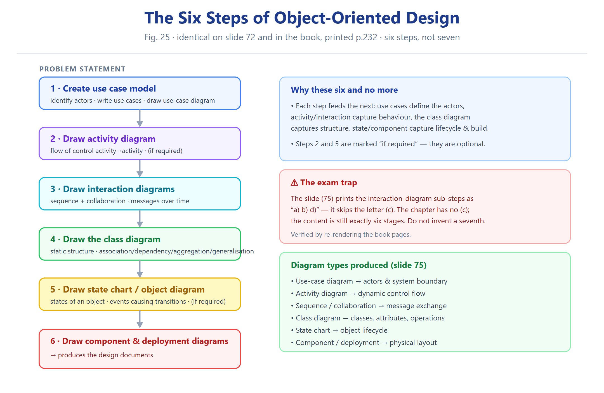
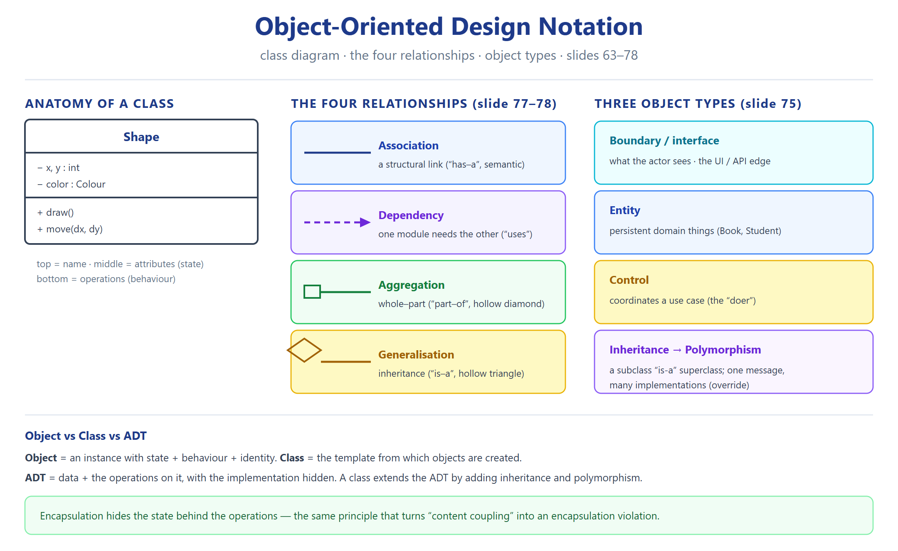
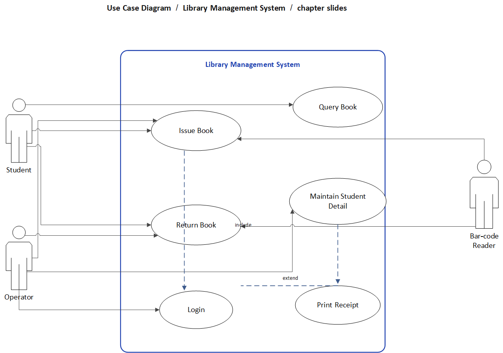
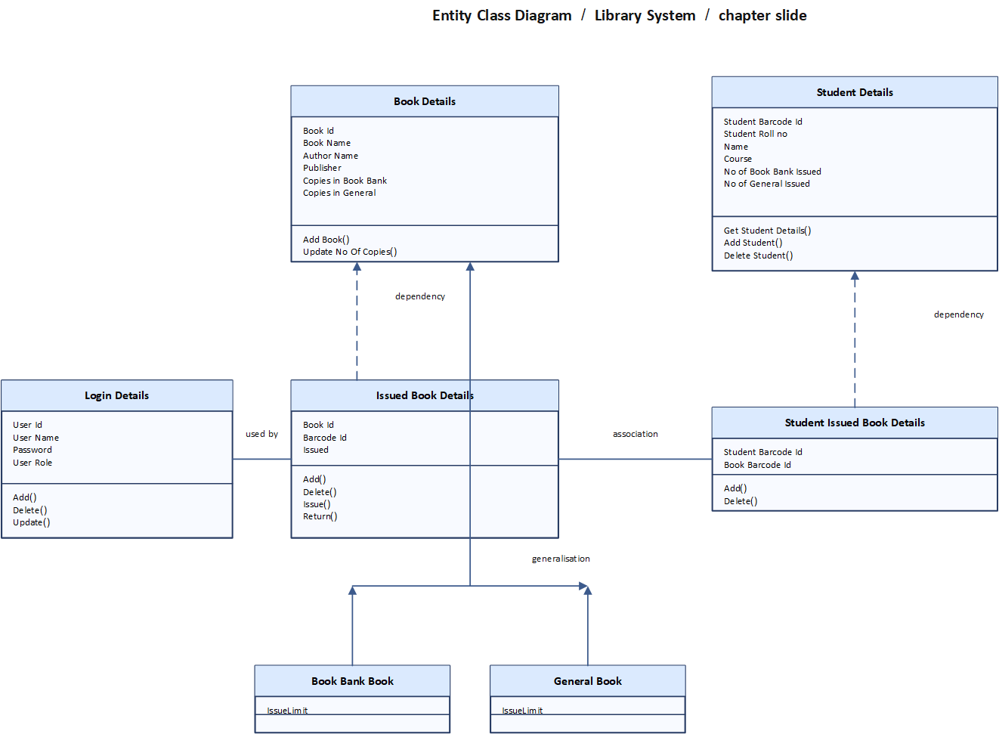
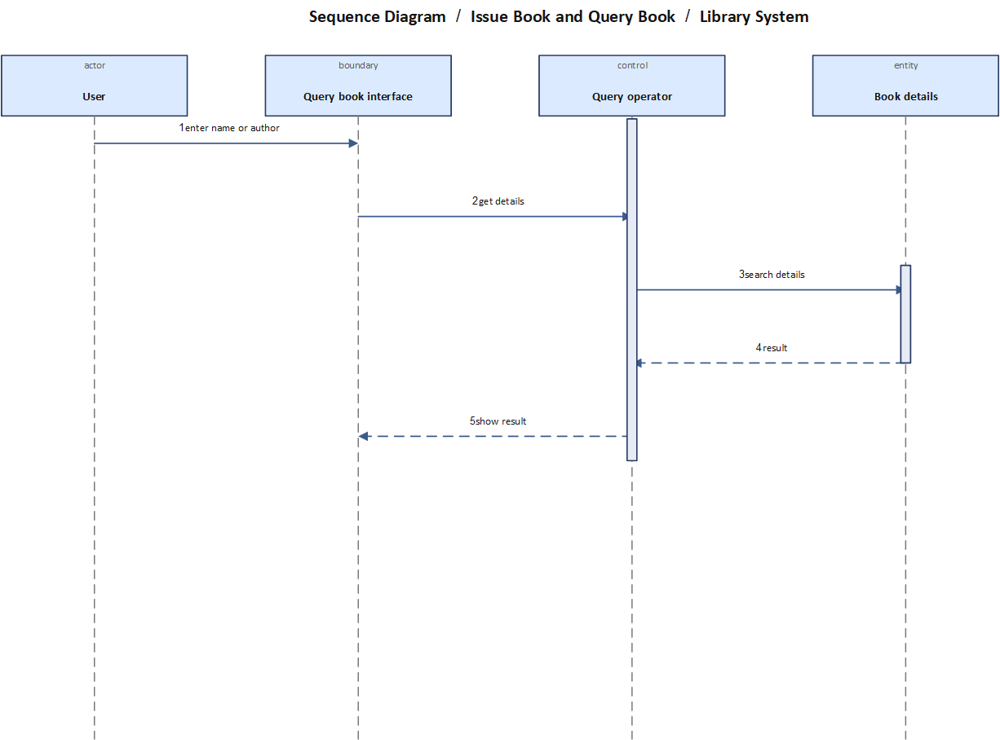

# النوع 6 — أسئلة الإنشاء والتصميم (Create / Design)

**UML variant.** This is a **copy** of `T6_Create_Design.md` with three real Microsoft-Visio UML diagrams added (use case, class, sequence). The original file is untouched. Only the new "UML diagrams" section below differs.

### ASE · Chapter 5 · Software Design — Aggarwal & Singh, 3rd ed. (Bloom Level 6)

**Source:** slide deck `Ch05_Software_Design.pdf` (99 slides) + printed book pp. 202–251. Case study = **Library Management System** (slides 81–93; book pp. 236–247). Chapter data tables: slide 19 (coupling), slide 27 (cohesion), slide 57 (SDD Table 2), slide 72/75 (OOD steps, 6 boxes), slide 75 (object types), slides 77–78 (class relationships), slides 84–93 (case-study artefacts).

**Format:** English question + full worked artefact in English; one short Arabic justification per item. Every sub-question states its assumptions, produces the artefact (tables / indented trees / ASCII-structured lists), then justifies. Blank lines separate every block (RTL-safe). No frontmatter.

**Two frozen facts (must not be contradicted anywhere in this file):**

- Coupling best→worst = **Data > Stamp > Control > External > Common > Content** (Fig. 7, slide 19 / book p. 208–209).

- Cohesion best→worst = **Functional > Sequential > Communicational > Procedural > Temporal > Logical > Coincidental** (Fig. 11, slide 27 / book p. 211).

- OOD = exactly **SIX** steps in this order (slide 72 Fig. 25 / book p. 232): (1) Create use case model → (2) Draw activity diagram (if required) → (3) Draw the interaction diagrams → (4) Draw the class diagram → (5) Draw the state chart / object diagram (if required) → (6) Draw component & deployment diagram → design documents.

---

## Reference diagrams (review before solving)





---

## UML diagrams — real Microsoft Visio notation

The three diagrams below were produced with Microsoft Visio using its shipped UML stencils (actor stick-figures, use-case ellipses, system boundary, class compartments, lifelines and messages). Each is also available as an editable `.vsdx` source.

| # | Diagram | File | Editable source |
|---|---|---|---|
| 1 | Use case diagram — Library Management System | `uml/uml_1_usecase.png` | `uml/uml_1_usecase.vsdx` |
| 2 | Entity class diagram — Library System | `uml/uml_2_class.png` | `uml/uml_2_class.vsdx` |
| 3 | Sequence diagram — Issue Book / Query Book | `uml/uml_3_sequence.png` | `uml/uml_3_sequence.vsdx` |

#### UML 1 — Use case diagram



Actors (Student, Operator, Bar-code Reader) sit outside the system boundary; the use cases sit inside; `include` and `extend` dependencies are labelled. This matches the case-study use-case structure on slides 84–92.

#### UML 2 — Entity class diagram



Each class has three compartments (name, attributes, operations). Relationships: **dependency** (dashed, unidirectional) from the issued-record classes to the detail classes; **association** between the issue record and the student-issue record; **generalisation** from the two book kinds to `Book Details`. This matches slide 93's entity classes and slides 77–78's relationship kinds.

#### UML 3 — Sequence diagram



Four typed lifelines — actor, boundary, control, entity (slide 75's object types). Solid arrows are requests, dashed arrows are returns, and the activation bars mark the period the control object is executing. This matches the sequence diagrams on slides 85–92.

---

## القسم أ — بناء نماذج الكائنات (Object / Class Artefacts)

---

**Q6.1 (Create — class model with one relationship of each kind)**

> Design the class model for an **Online Shop** system. It must contain **at least three classes** and **one relationship of each Chapter-5 kind**: association, dependency, aggregation, generalisation. Mark clearly the **polymorphic operation**.

**Assumptions:** single-language-agnostic model (slide 59 says OOD does not depend on an implementation language); a `Customer` places `Order`s; each `Order` contains `OrderLine`s; payment is handled by an external `PaymentGateway`.

**Artefact — class model (text form):**

```
CLASS Customer
  Attributes : custId, name, email, address
  Operations : register(), login(), placeOrder()

CLASS Order
  Attributes : orderId, orderDate, status, total
  Operations : addLine(), removeLine(), checkout(), computeTotal()   <-- POLYMORPHIC
      subclass DiscountedOrder overrides computeTotal() (applies a coupon)
      subclass InternationalOrder overrides computeTotal() (adds duty)

CLASS OrderLine
  Attributes : productId, qty, unitPrice
  Operations : lineTotal()

CLASS Product
  Attributes : productId, name, price, stockQty
  Operations : isAvailable(), reserve(), release()

CLASS PaymentGateway   (external boundary)
  Operations : authorise(amount, token), refund(txnId)
```

**Artefact — relationships used (one of each, per slides 77–78):**

| Relationship | Chapter-5 definition (slide 77–78) | How it is used here | Notation |
|---|---|---|---|
| **Association** | "semantic connection between classes… each class can send messages to the other" | `Customer` ↔ `Order` (a customer places orders) | plain line |
| **Dependency** | "always unidirectional… one class depends on definitions in another" | `Order` ➜ `PaymentGateway` (checkout uses the gateway; gateway does not know Order) | dashed arrow |
| **Aggregation** | "a relationship between a whole and its parts" | `Order` ◆— `OrderLine` (whole = Order, parts = its lines) | diamond |
| **Generalisation** | "inheritance relationship between two classes" | `DiscountedOrder` ▷ `Order` (subclass inherits state/behaviour) | hollow triangle |

**Polymorphic operation mark:** `Order.computeTotal()` — per slide 69, "we abstract just the interface of an operation and leave the implementation to subclasses" → each subclass supplies its own body, so the same message `order.computeTotal()` yields different behaviour by actual type.

**التبرير العربي:** المطلوب أربع علاقات — والفرق الحاسم بينها: الـ**association** رابط دلالي عادي، والـ**dependency** أحادي الاتجاه (يعتمد على تعريف الطرف الثاني)، والـ**aggregation** علاقة *كل/جزء* (الطلب يحتوي بنودًا)، والـ**generalisation** وراثة (subclass ترث من superclass). الـpolymorphic operation هي `computeTotal()` لأن واجهتها في الأب والتنفيذ في الأبناء (سلايد 69).

---

**Q6.2 (Create — class model for an ATM, cohesion-aware)**

> Design a class model for a **Bank ATM** with **at least four classes**. Explicitly separate **entity / boundary (interface) / control** objects (slide 75), and give exactly one **generalisation** and one **aggregation**.

**Assumptions:** a single bank; two account kinds; the ATM talks to a `BankHost` for debits.

**Artefact:**

```
== ENTITY classes (data that outlives the transaction) ==
CLASS Account         : acctNo, holderName, balance, type
                        Operations: debit(), credit(), getBalance()
CLASS SavingsAccount  : minBalance, interestRate     (GENERALISATION ▷ Account)
CLASS CurrentAccount  : overdraftLimit               (GENERALISATION ▷ Account)
CLASS Card            : cardNo, pin, expiry, status
                        Operations: validatePin(), isActive()
CLASS CashBin         : binId, denomMap               (AGGREGATION owner)

== BOUNDARY (interface) classes ==
CLASS KeypadScreen    : Operations: readInput(), showMessage()
CLASS CardReader      : Operations: readCard()
CLASS CashDispenser   : Operations: dispense(amount)

== CONTROL classes (coordinate the use case) ==
CLASS TransactionController : Operations: withdraw(), deposit(), transfer()
```

**Relationship map (each must match slide 77–78 wording):**

| Pair | Kind | Slide-definition check |
|---|---|---|
| `SavingsAccount` → `Account` | Generalisation | "inheritance relationship" (slide 78) |
| `CashBin` ◆— `CashNote` | Aggregation | "whole and its parts" (slide 78) |
| `TransactionController` ➜ `Account` | Dependency | "always unidirectional" (slide 78) |
| `Card` ↔ `Account` | Association | "semantic connection… each class can send messages" (slide 77) |

**Polymorphic operation:** `Account.debit()` is overridden in `SavingsAccount` (enforces min balance) and `CurrentAccount` (allows overdraft).

**التبرير العربي:** تصنيف الكائنات الثلاثة إلزامي (سلايد 75): **entity** = بيانات دائمة (Account/Card)، **boundary** = واجهة مع المستخدم (Keypad/CardReader)، **control** = منسّق الـuse case (TransactionController). الفصل هذا هو تطبيق الـinformation hiding عمليًا: الـcontrol ما يوصل داخليات الـentity إلا عبر عملياتها.

---

## القسم ب — عملية التصميم الكائني (The SIX OOD Steps)

---

**Q6.3 (Create — realise the 6 OOD steps concretely)**

> For the small problem "**an online cinema ticket booking system**", produce the chapter's **OOD steps as a concrete sequence**, naming the exact diagram produced at each step and the concrete content of that diagram.

**Assumptions:** one venue, one film per screen, seats selectable.

**Artefact — the SIX steps (order and number are fixed by slide 72 Fig. 25):**

| # | Step (slide 72) | Diagram produced | Concrete content for this problem |
|---|---|---|---|
| 1 | Create use case model | **Use case diagram** | Actors: `Customer`, `Payment Gateway`. Use cases: `Browse Films`, `Select Show`, `Select Seats`, `Pay`, `Print Ticket` |
| 2 | Draw activity diagram (if required) | **Activity diagram** | Flow: browse → choose show → choose seats → [seats available?] → pay → issue ticket; the fork/branch models the availability check (slide 73: "an activity represents an operation on some class… that results in a change in the state") |
| 3 | Draw the interaction diagrams | **Sequence diagrams** (one per use case) + collaboration diagrams | e.g. `Select Seats`: Customer → SeatSelection : select(showId, seats); SeatSelection → SeatDB : checkAvailable(); SeatDB → Seat : markHeld() |
| 4 | Draw the class diagram | **Class diagram** | Classes: `Film`, `Show`, `Seat`, `Booking`, `Customer`; relationships per slides 77–78; `Seat.price()` polymorphic over `StandardSeat`/`PremiumSeat` |
| 5 | Draw the state chart / object diagram (if required) | **State chart diagram** + object diagram | State chart for `Seat`: Available → Held → Booked → (cancelled) Available (slide 79: "state space of a given class, the event that cause a transition") |
| 6 | Draw component & deployment diagram | **Component + deployment diagrams** → design documents | Components: `BookingService`, `PaymentAdapter`, `SeatDB`; deployment: DB server + app server + client browsers (slide 80) |

**التبرير العربي:** الخطوات **ست بالضبط** بهذا الترتيب (سلايد 72) — كل خطوة تقيّد اللي بعدها: الـuse case يحدد الحدود، والنشاط يحدد التدفق، والتفاعل يحدد الرسائل (= الاقتران المقصود قبل البرمجة)، والصنف يثبّت الحالة والسلوك، ثم الحالة والنشر. خلط الترتيب يعني تصميم بنية قبل معرفة نطاقها.

---

**Q6.4 (Create — contrast the 6 steps with a 5-step wrong answer)**

> A student submits a 5-step OOD process: "(1) class diagram (2) use case model (3) sequence diagram (4) component diagram (5) write code." Grade it against the chapter and produce the corrected SIX-step version.

**Assumptions:** the question tests recall of slide 72 / book p. 232.

**Artefact — grading table:**

| Student step | In chapter's 6-step list? | Defect |
|---|---|---|
| 1. class diagram | Yes — but **position 4**, not 1 | Classes are fixed *after* use cases and interactions; a class diagram drawn first models the wrong scope |
| 2. use case model | Yes — **position 1** | Out of order; must be first (slide 73: "First step is to identify the actors") |
| 3. sequence diagram | Yes — **step 3** (interaction diagrams) | Naming too narrow: slide 75 says interactions = sequence **and** collaboration diagrams |
| 4. component diagram | Yes — **step 6**, and must be paired with **deployment** | Missing the deployment diagram |
| 5. write code | **Not an OOD step** | Chapter step 6 ends at "→ design documents"; coding is outside design |

**Corrected SIX-step sequence:** (1) Use case model → (2) Activity diagram (if required) → (3) Interaction diagrams → (4) Class diagram → (5) State chart / object diagram (if required) → (6) Component & deployment diagram → design documents.

**التبرير العربي:** الطالب خلط الترتيب وحذف خطوة. القاعدة: الـ**use case أولاً** (يرسم الحدود)، والـ**class diagram رابعًا** (لأنه يحتاج نتائج التفاعل)، والخطوة السادسة **مزدوجة** (component **و** deployment). عدد الخطوات **ست** — مو خمس ولا سبع (سلايد 72).

---

## القسم ج — وصف حالة الاستعمال (Use-Case Description)

---

**Q6.5 (Create — full use-case description, mirroring "Issue Book")**

> Write a **use-case description** for **"Issue Book"** in the Library Management System, mirroring the book's format: Introduction / Actors / Pre-condition / Post-condition / Basic flow / Alternate flow / Special requirements / Related use cases. Ground it in the requirements on slides 81–82 and the sequence diagram on slide 86.

**Assumptions:** standalone system (slide 81); bar-code detector available (slide 82); issue limits = max 4 Book-bank + 3 General for 15 days (slide 81).

**Artefact — use-case description:**

```
USE CASE : Issue Book                          (Library Management System)
--------------------------------------------------------------------------
1. INTRODUCTION
   Allows an Operator to issue a book to a student using the bar-code
   detector. The system computes the return date (issue date + 15 days)
   and stamps the due date.

2. ACTORS
   Primary   : Operator
   Secondary : Bar code reader   (machine actor, slide 84 use case diagram)

3. PRE-CONDITION
   - Operator is logged in (Login use case completed).
   - Student detail and Book detail exist (Maintain student detail /
     Maintain catalogue completed).
   - Bar-code detector is online.

4. POST-CONDITION (success)
   - An Issued Book Details record is created (Book Id, Barcode Id, Issued).
   - A Student Issued Book Details record links the student to the book.
   - Book's "Copies in General / Book Bank" count is decremented.

5. BASIC FLOW
   1. Operator reads the student barcode.               (seq. 1)
   2. System submits student details to Student Info controller. (seq. 2)
   3. System fetches and validates student details.     (seq. 3-4)
   4. System checks the book can be issued to that student's course.
   5. Operator reads the book barcode.                  (seq. 8)
   6. System submits book code and re-checks issue rules. (seq. 9-10)
   7. System updates details, adds Issued Book record, adds Student Issued
      Book record, stamps the due date.                (seq. 12-14)
   8. System reports "Issue successfully".              (seq. 15)

6. ALTERNATE FLOWS
   6a. Invalid student detail  -> show "Invalid student" (seq. 5); abort.
   6b. Book cannot be issued   -> show "Can't issue" (seq. 7); abort.
   6c. Book-bank book requested for a different course -> route to 6b.
   6d. Issue limit reached (4 Book-bank / 3 General)    -> show limit error.

7. SPECIAL REQUIREMENTS
   - Issue period is fixed at 15 days; due date = system date + 15.
   - Due date is physically stamped on the book (slide 82).
   - Bar-code input is mandatory for both student and book.

8. RELATED USE CASES
   <<include>> Login ;  <<extend>> Print receipt ;
   <<uses>> Maintain student detail, Maintain catalogue.
```

**التبرير العربي:** الوصف يطابق بنية الكتاب المطلوبة، وكل سطر مُشتق من سلايد 81–82 + تسلسل سلايد 86. الفائدة الهندسية: هذا المستند هو الحدّ الفاصل بين النطاق والداخل — الـalternate flows تمنع تكديس الشروط داخل الـbasic flow (نفس فكرة تجنّب logical cohesion على مستوى النموذج).

---

**Q6.6 (Create — write the Return-Book use case, then justify its separation)**

> Write the use-case description for **"Return Book"** (slide 82 requirements, slide 87 sequence) and then justify — using cohesion principles — why the book keeps it **separate** from Issue Book.

**Assumptions:** any person may return the book (slide 82); a fine may apply.

**Artefact — concise use-case description:**

| Section | Content |
|---|---|
| Introduction | Accepts a returned book and updates the database. |
| Actors | Primary: `Operator`; Secondary: `Bar code reader` |
| Pre-condition | Book was issued; operator logged in; detector online |
| Post-condition | Issued Book record deleted; copies incremented; fine charged if late |
| Basic flow | 1 read code → 2 submit → 3 validate if fine → 4 calculate fine → 5 update Student details → 6 delete Student-Issued-Book record → 7 update Issued-Book-Details → 8 "Book returned successfully" |
| Alternate flow | 8a. No fine due → skip step 4, proceed to 5. 8b. Unknown book code → show error, abort. |
| Special requirements | Fine computed from issue date vs return date (15-day rule) |
| Related use cases | `<<include>>` Login ; `<<uses>>` Query book |

**Why separate from "Issue Book" (cohesion argument):** the two flows have **different pre/post-conditions and different actors** — one creates an issue record, the other deletes it and may charge a fine. Merging them into one "Circulation" artefact would create a **single description whose behaviour branches on a control condition (issue vs return)** — the *model-level equivalent of logical cohesion / control coupling*. Keeping them separate gives each description **a single, well-defined purpose** (the model equivalent of functional cohesion), which is easier to read, verify and implement.

**التبرير العربي:** الفصل لأن الوصفين مختلفون في الشروط والأحداث والأخطاء. دمجهما يعطينا وصف واحد يتفرّع على راية (issue/return) — نظير الـ**logical cohesion** الوارد في سلايد 30. الإبقاء منفصلين يعطي كل use case **غرضًا واحدًا واضحًا** = نظير الـfunctional cohesion.

---

## القسم د — الوحدات والاقتران والتلاحم (Modular Decomposition)

---

**Q6.7 (Create — decompose a system, classify every cohesion and coupling)**

> Take the requirement set: "**The system must register a student, record a course, enrol a student in a course, and produce a transcript**". Decompose it into modules and, for **each module**, state and justify its **cohesion type** and its **coupling type** to its callers (target: high cohesion, low coupling, slide 31).

**Assumptions:** persistent store accessed only through parameterised calls; no global record buffer.

**Artefact — module decomposition with classification:**

```
MAIN (transaction dispatcher)
 ├── register_student(studentRecord) : void
 ├── record_course(courseRecord)     : void
 ├── enrol_student(studentId, courseId) : Result
 ├── generate_transcript(studentId)  : Transcript
 └── storage_layer  (accessed only via parameters)
```

| Module | Cohesion | Justification | Coupling (to callers) | Justification |
|---|---|---|---|---|
| `register_student` | **Functional** | single task: create + store one student record | **Data** | receives one primitive-structure parameter, returns status |
| `record_course` | **Functional** | single task: create + store one course record | **Data** | one parameter |
| `enrol_student` | **Functional** | single task: create the enrolment link after validating both keys | **Data** | two ids in, result out — no flag (`flag` would make it **Control**) |
| `MAIN` dispatcher | **Logical** (weak) | it selects *which* task to run on the same logical class "handle request" | **Data** | passes only the request id; branching stays inside MAIN, not signalled by a flag from above |
| `generate_transcript` | **Sequential** | fetch enrolments → fetch grades → format; each step feeds the next (slide 28) | **Data** | studentId in; transcript out |
| storage_layer | **Communicational** | all operations work on the same persistent store (same input/output resource) | **Data** | every access is a parameterised call — explicitly **no global buffer**, so **no Common coupling** (slide 21) |

**Design verdict:** cohesion ranges **Functional → Sequential → Communicational** (good end of Fig. 11); coupling is **Data** throughout (best end of Fig. 7); there is no shared global area. Only `MAIN` sits at Logical and should be split further if it grows.

**التبرير العربي:** الهدف على سلايد 31: **high cohesion + low coupling**. هنا كل وحدة وظيفية (Functional) ما عدا الـdispatcher (Logical) والـtranscript (Sequential لأنها سلسلة). الاقتران كله **Data** (الأفضل) لأن المدخلات parameters — وتجنّبنا الـ**Common coupling** بعدم استخدام أي global buffer (سلايد 21).

---

**Q6.8 (Create — design to a stated coupling budget)**

> Design a **Payroll** module set with **no coupling worse than Control** and **no cohesion worse than Procedural**. List your modules, their cohesion, their coupling, and state the one decision that binds you to the budget.

**Assumptions:** monthly run; tax rules in a separate table; employee master file available.

**Artefact:**

| Module | Cohesion | Coupling | Contract |
|---|---|---|---|
| `compute_gross(empRecord)` | Functional | Data | one employee record in; gross out |
| `apply_tax(gross, taxTable) | Functional | Data | passes the tax table **by parameter** (never reads a global) |
| `run_payroll(masterFile)` | Sequential | Data | drives compute→tax→slip in order |
| `print_payslip(empRecord, gross, tax)` | Procedural | Data | three data parameters, no flags |
| `select_employees(filterMode)` | **Logical** | **Control** | `filterMode` is a **control flag** → this is the one permitted Control coupling (slide 20) |

**Budget-binding decisions:**

1. **No globals** — the tax table is passed as a parameter, keeping everything at Data (slide 21: "making a change to the common data means tracing back to all modules which access that data").

2. **The only Control link is quarantined** in `select_employees`, where the flag genuinely selects behaviour; the budget forbids it anywhere else.

3. **Cohesion floor honoured:** the weakest module is `select_employees` at Logical — if the budget is enforced strictly, split it into `select_by_department` / `select_by_grade`, which raises it to Functional.

**التبرير العربي:** الميزانية تسمح بأقصى **Control** coupling وأدنى **Procedural** cohesion. حاصرنا الـcontrol في وحدة واحدة (`select_employees`) لأن الراية هناك اختيار سلوك فعلي (سلايد 20). تجنّب الـglobals هو القرار الحاسم — أول ما تدخل global area يصير الاقتران **Common** ويُخرق السقف (سلايد 21).

---

**Q6.9 (Create — refactor a bad decomposition to target levels)**

> Given: "one `utility_module` contains 12 unrelated helpers, and every other module reads a global `config_string`." Produce the **refactored** decomposition and state the **before/after** level on both scales.

**Assumptions:** the 12 helpers cluster into 3 real functions; the config values are 5 primitives.

**Artefact — refactor plan:**

```
BEFORE                                   AFTER
--------                                 -----
utility_module (12 helpers)      -->     file_io_utils        (Functional)
global config_string  <-- read           validation_utils     (Functional)
  by every module                        math_utils           (Functional)
                                         config = 5 params passed explicitly
```

| Aspect | Before | After | Scale movement |
|---|---|---|---|
| `utility_module` cohesion | Coincidental (worst) | Functional (best) | Fig. 11: 7/7 → 1/7 |
| Modules reading `config_string` | Common coupling (worst-but-one) | Data coupling (best) | Fig. 7: 5/6 → 1/6 |
| Rule applied | — | split by function; pass 5 primitives | slide 31 objective |

**التبرير العربي:** الخلل المزدوج: وحدة بلا صلة (Coincidental) + حالة عامة مشتركة (Common coupling). الحل المزدوج: تفكيك الوحدة حسب الوظيفة (Functional) + تمرير قيم الإعداد كـparameters (Data). هذا هو بالضبط معنى **high cohesion / low coupling** في سلايد 31، ويقلّل الـripple (سلايد 21).

---

## القسم هـ — مخطط البنية (Structure Chart)

---

**Q6.10 (Create — structure chart and its distinction from a flowchart)**

> Draw/describe a **structure chart** for "**Update File**" (slide 43, Fig. 18) and state the **three differences** between a structure chart and a flowchart.

**Assumptions:** record-oriented update; validation before write.

**Artefact — structure chart as an indented tree (slide 41: "partition a system into block boxes… black box = functionality known without internal design"):**

```
UPDATE FILE  (root / level 0)
├── INPUT
│     reads record key
│     (data pass: recordKey  downward)
├── VALIDATE
│     checks key against file
│     (data pass: recordKey → validFlag)
├── UPDATE-RECORD
│     ├── READ-RECORD      (data: recordKey → record)
│     ├── MODIFY-FIELDS    (data: newValues → record)
│     └── WRITE-RECORD     (data: record → status)
└── OUTPUT
      prints status message        (data: status)
```

**Artefact — structure chart vs flowchart:**

| Aspect | Structure chart (slide 41–42) | Flowchart |
|---|---|---|
| Shows | **Hierarchy of modules / who calls whom** (static) | **Sequence of processing steps** (dynamic order) |
| Unit (box) | A **module** — a black box with a known interface | A **process step / decision** |
| Annotation | Data and control **couples on the call arrows** (Fig. 17, slide 42) | Flow lines between steps |

**الفرق الجوهري:** الـstructure chart يُظهر **التسلسل الهرمي للوحدات وماذا يُمرَّر بينها** (بيانات/تحكم) — فهو ثابت (static) ويخدم تحليل الاقتران. الـflowchart يُظهر **ترتيب خطوات المعالجة** داخل الوحدة (dynamic). الأول يجيب "من ينادي من"، الثاني يجيب "ما هو ترتيب التنفيذ".

---

**Q6.11 (Create — transaction-centred structure chart)**

> Design a **transaction-centred structure chart** (slide 44, Fig. 19) for a **library front desk** that processes several transaction types, and state the three responsibilities of the MAIN module (slide 45).

**Assumptions:** transaction types = Issue, Return, Query, Report.

**Artefact — transaction-centred structure:**

```
LIBRARY-FRONT-DESK (MAIN)
│   (1) invoke INPUT to read a transaction
│   (2) determine the kind of transaction, select one transaction module
│   (3) output results by calling OUTPUT
├── INPUT                (reads the transaction record)
├── TRANSACTION-DISPATCH (selects one of the below on transaction type)
│     ├── ISSUE-BOOK
│     ├── RETURN-BOOK
│     ├── QUERY-BOOK
│     └── GENERATE-REPORT
└── OUTPUT               (prints the transaction result)
```

**MAIN's three functions (verbatim from slide 45):** (i) invoke the `INPUT` module to read a transaction; (ii) determine the kind of transaction and select one of a number of transaction modules to process it; (iii) output the results by calling the `OUTPUT` module.

**Coupling note:** the dispatcher passes the **transaction record by data**; if instead it passed a `typeFlag` that the leaf modules branched on, coupling would rise to **Control** (slide 20). The chart above keeps the branch inside the dispatcher, so every leaf stays **Data**-coupled.

**التبرير العربي:** البنية **transaction-centred** (سلايد 44) = بنية تدور على محول يختار الوحدة حسب نوع المعاملة. مسؤوليات MAIN الثلاث من سلايد 45 (input، تحديد النوع والتوزيع، output). إبقاء التفرّع داخل المُوزِّع يحافظ على اقتران **Data** للأوراق ويمنع ارتفاعه إلى **Control**.

---

## القسم و — مستند تصميم البرمجية (SDD)

---

**Q6.12 (Create — SDD outline with concrete artefacts per view)**

> Write the **SDD outline** for the Library Management System using IEEE STD 1016-1998: the **four design views** of Table 2 (slide 57) with the entity attributes each view uses, and choose a **concrete artefact** for each view. Then show how the ten entity attributes (a–j, slide 53) map onto one entity.

**Assumptions:** SDD organisation follows slide 52 (Introduction / Design entities / Design entity attributes).

**Artefact — four design views (Table 2, slide 57):**

| Design view | Scope (slide 57) | Entity attributes used | Concrete artefact for Library System |
|---|---|---|---|
| **Decomposition description** | Partition of the system into design entities | Identification, type, purpose, function, subordinate | Hierarchical decomposition diagram + module list: `Circulation` → `Issue Book`, `Return Book`, `Query Book` |
| **Dependency description** | Relationships among entities of system resources | Identification, type, purpose, dependencies, resources | Structure chart showing how `Issue Book` calls `Validate Student`, `Check Issue Rules`, `Update DB` |
| **Interface description** | Everything needed to *use* each entity | Identification, function, interfaces | Parameter table for `issueBook(studentBarCode, bookBarCode) : Status` |
| **Detail description** | Internal design details of an entity | Identification, processing, data | PDL/pseudocode of the fine calculation in `Return Book` |

**Artefact — the ten entity attributes (a–j, slide 53) applied to the entity `Issued Book Details`:**

| Letter | Attribute (slide 53) | Value for `Issued Book Details` |
|---|---|---|
| a | Identification | `E-04 Issued Book Details` |
| b | Type | Entity (persistent data) |
| c | Purpose | Record which book is issued to a student |
| d | Function | Issue / Return / Add / Delete |
| e | Subordinates | none (leaf entity) |
| f | Dependencies | `Book Details`, `Student Issued Book Details` |
| g | Interface | `Add(), Delete(), Issue(), Return()` (slide 93) |
| h | Resources | Library database, bar-code reader |
| i | Processing | stamp due date = issue date + 15 days |
| j | Data | Book Id, Barcode Id, Issued |

**التبرير العربي:** الـSDD = **blueprint للتنفيذ** (سلايد 52). أربع views (سلايد 57) وكل view يستخدم مجموعة صفات مختلفة؛ وعشر صفات للـentity من a إلى j (سلايد 53). القاعدة العملية: الـdecomposition يقول "ما هي الأجزاء"، والـdependency "كيف تتصل"، والـinterface "كيف تُستعمل"، والـdetail "كيف تعمل من الداخل".

---

## القسم ز — مهام إنشاء إضافية (Additional Create Tasks)

---

**Q6.13 (Create — interaction diagram description for a named use case)**

> Produce a **sequence diagram description** for the Library "**Query Book**" use case, naming the object types (slide 75) and the messages (slide 88).

**Assumptions:** user may be student, librarian or operator (slide 88 note).

**Artefact — sequence (text form), objects typed per slide 75:**

```
:User                 (actor)
:Query book interface (BOUNDARY / interface object)  — lifeline 1
:Query operator       (CONTROL object)               — lifeline 2
:Book details         (ENTITY object)                — lifeline 3

1. User           -> :Query book interface : enter name/author
2. :Query book interface -> :Query operator : get details
3. :Query operator       -> :Book details   : search details
4. :Book details         -> :Query operator : result
5. :Query operator       -> :Query book interface : show result  (to User)
```

**Object-type check (slide 75):** `Query book interface` = interface/boundary; `Query operator` = control; `Book details` = entity. This is the same pattern used across the case study (slides 85–92 all show one boundary, one control and one entity per use case).

**التبرير العربي:** كل use case في حالة الدراسة له ثلاثة أنواع كائنات: **boundary** (النموذج/الواجهة)، **control** (المتحكّم)، **entity** (البيانات). نمط الرسائل موحّد: المستخدم → الحدّ → المتحكّم → الكيان ثم الرجوع. هذا يعطي اقترانًا أحاديّ الاتجاه واضحًا قبل كتابة الشيفرة (سلايد 75).

---

**Q6.14 (Create — build an entity class diagram from the case study)**

> From the requirements (slides 81–83), construct the **class diagram of entity classes** for the Library System and identify each relationship's kind per slides 77–78.

**Assumptions:** entity classes only (slide 93 shows the book's own answer).

**Artefact — entity classes (matches slide 93):**

```
CLASS Book Details
  Book Id, Book Name, Author Name, Publisher,
  Copies in Book Bank, Copies in General
  Add Book(), Update No. of Copies()

CLASS Student Details
  Student Barcode Id, Student Roll no., Name, Course,
  No. of Book Bank Issued, No. of General Issued
  Get Student Details(), Add Student(), Delete Student(), Update Student()

CLASS Issued Book Details
  Book Id, Barcode Id, Issued
  Add(), Delete(), Issue(), Return()

CLASS Student Issued Book Details
  Student Bar Code Id, Book Bar Code Id
  Add(), Delete()

CLASS Login Details
  User Id, User Name, Password, User Role
  Add(), Delete(), Update()
```

**Artefact — relationships:**

| From | To | Kind | Slide-78/77 wording check |
|---|---|---|---|
| `Issued Book Details` | `Book Details` | Dependency (unidirectional) | "always unidirectional… depends on definitions in another" |
| `Student Issued Book Details` | `Student Details` | Dependency (unidirectional) | same |
| `Issued Book Details` ↔ `Student Issued Book Details` | Association | "semantic connection between classes" (slide 77) |

**التبرير العربي:** المخطط طابق ما في سلايد 93 حرفيًا. العلاقة بين تفاصيل الكتاب الصادر وتفاصيل الكتاب = **dependency** (أحادية الاتجاه، سلايد 78)، والربط بين الكتاب الصادر والطالب = **association** (سلايد 77). هذا يفصل "بيانات الكيان" عن "سجل الحركة" بفصل نظيف.

---

**Q6.15 (Create — justify an OOD choice with a trade-off)**

> Produce a **design-decision memo** (max one page) justifying **object-oriented design over function-oriented design** for the Library System, using at least four chapter concepts, and state the single risk of your choice.

**Assumptions:** requirements (issue limits, fine rules) are expected to change after deployment.

**Artefact — memo:**

```
DESIGN DECISION MEMO — Library Management System
DECISION: Adopt object-oriented design (6-step process, slide 72).

1. ORTHOGONALITY (slide 58): OOD focuses on the data ("things"), not the
   function; the library's things (Book, Student, Loan) are stable while
   the functions change -- so the decomposition is more durable.

2. ENCAPSULATION / INFORMATION HIDING (slide 69): each entity keeps its own
   state; the fine rule lives inside the Loan class, so changing it does
   not ripple to unrelated modules.

3. INHERITANCE + POLYMORPHISM (slides 68-69): Book Bank Book and General
   Book are subclasses of Book; the issue-limit rule becomes a polymorphic
   operation, so a new book category is added by subclassing -- no edit to
   existing code.

4. USE-CASE-DRIVEN TRACEABILITY (slides 73-75): the 6 steps start from the
   use case model, so every class traces to a requirement -- protecting the
   design from scope creep (the model-level source of coincidental cohesion).

RISK: OOD adds modelling overhead and requires discipline; if the team
documents classes but not their interfaces, class coupling can silently
become Content coupling -- the exact defect the chapter ranks worst.
```

**التبرير العربي:** اخترنا OOD لأن **الأشياء ثابتة والوظائف متغيّرة** (سلايد 58)، والـ**encapsulation** تحصر أثر التغيير (سلايد 69)، والـ**inheritance/polymorphism** تضيف سلوكًا بدون تعديل الكود القائم. الخطر الوحيد: إهمال توثيق الواجهات يخلق **Content coupling** — أسوأ نوع (سلايد 24).

---

**Q6.16 (Create — assemble a complete mini-design for a new system)**

> For "**a university hostel mess billing system**", produce a **complete mini-design**: the 6 OOD steps, one class model with ≥3 classes, one use-case description, and the cohesion/coupling of the modules you propose.

**Assumptions:** monthly billing; students have meal plans; cashier records payments.

**Artefact — (A) the SIX OOD steps:**

| # | Step | Diagram | Content |
|---|---|---|---|
| 1 | Use case model | Use case diagram | Actors: `Cashier`, `Student`. Use cases: `Enrol Student`, `Record Meal`, `Generate Bill`, `Record Payment`, `Query Dues` |
| 2 | Activity diagram (if req.) | Activity diagram | Flow: select student → check plan → count meals → compute bill → [paid?] → close / carry forward |
| 3 | Interaction diagrams | Sequence diagrams | `Generate Bill`: Cashier → BillForm → BillController → MessRecordDB |
| 4 | Class diagram | Class diagram | `Student`, `MealPlan`, `Bill`, `Payment` |
| 5 | State chart / object diagram (if req.) | State chart | `Bill`: Open → Generated → PartlyPaid → Settled |
| 6 | Component & deployment | Component + deployment | Components: `BillingService`, `PaymentAdapter`, `MessDB`; deployment: campus server + cashier terminals |

**Artefact — (B) class model:**

```
CLASS Student       : rollNo, name, hostelBlock ; enrol(), getPlan()
CLASS MealPlan      : planId, mealsPerDay, rate   ; monthlyAmount()   <-- POLYMORPHIC
       subclass VegPlan     overrides monthlyAmount()
       subclass NonVegPlan  overrides monthlyAmount()
CLASS Bill          : billId, month, amount, status ; generate(), settle()
CLASS Payment       : payId, amount, mode, date    ; record()
```

Relationships: `Student` ◆— `MealPlan` (**aggregation** — whole/parts of a student's plan); `Bill` ➜ `MealPlan` (**dependency** — needs the plan to compute the amount); `Student` ↔ `Bill` (**association**); `VegPlan`/`NonVegPlan` ▷ `MealPlan` (**generalisation**).

**Artefact — (C) use-case description (abridged, "Record Payment"):**

```
Introduction   : Records a student's mess payment against an open bill.
Actors         : Primary Cashier ; Secondary none
Pre-condition  : Bill exists with status Generated or PartlyPaid
Post-condition : Payment recorded; bill status advanced or Settled
Basic flow     : 1 enter rollNo -> 2 system shows open bill -> 3 enter amount
                 and mode -> 4 system validates -> 5 system records payment
                 -> 6 shows receipt
Alternate flow : 4a amount exceeds dues -> error, return to 3
                 4b no open bill -> show message, abort
Special req.   : partial payments allowed; receipt is printed
Related        : <<include>> Login ; <<uses>> Query Dues
```

**Artefact — (D) module classification:**

| Module | Cohesion | Coupling |
|---|---|---|
| `count_meals(studentId, month)` | Functional | Data |
| `compute_bill(studentId, month)` | Sequential | Data |
| `record_payment(billId, amount, mode)` | Functional | Data |
| `generate_bill_report(month)` | Communicational | Data |

**التبرير العربي:** التصميم يمر بالخطوات **الست** بالترتيب، والـclass model فيه علاقة من كل نوع (aggregation = student/plan، dependency = bill/plan، association = student/bill، generalisation = veg/nonveg plan)، والوحدات كلها **Functional/Sequential** بتلاحم عالٍ واقتران **Data** منخفض — أي التزام بهدف سلايد 31.

---

## ملخّص التحقق (Verification Summary)

| Check | Requirement | Status in this file |
|---|---|---|
| 1 | OOD steps = exactly **6**, correct order | Q6.3, Q6.4, Q6.16 all list **six** in the slide-72 order (use case → activity → interaction → class → state → component/deployment) |
| 2 | Relationship names match slide definitions | Q6.1, Q6.2, Q6.14 quote slide 77–78 wording: aggregation = whole/parts; generalisation = inheritance; dependency = unidirectional; association = semantic connection |
| 3 | Cohesion/coupling classifications match verified definitions | All classifications in Q6.7–Q6.9, Q6.16 use the Fig. 7 and Fig. 11 orders and the slide-28/29/30 / slide-20/21 definitions |
| 4 | Source citations | Every item cites slide (and book page where relevant) |

**State uncertainties (explicit):**

- Slides 84–93 are **image-only** (no extractable text); their content above was read by rendering the pages at 140 dpi and reading the figures directly. The use-case names and sequence messages are therefore transcribed from images and could contain a minor OCR-style variant in wording (e.g. "Get Student Details()").

- Slide 75 lists interaction-diagram steps as "a) b) d)" — the letter **c) is skipped in the slide text** but the content is complete (the source map confirms the book uses a→f). This file uses the six *boxes* from Fig. 25 (slide 72), which are unambiguous.

- The book's printed pp. 236–247 for the case study were **not opened directly** (only the slide deck was read); all case-study facts here are grounded in slides 81–93.

---

*المصدر: Aggarwal & Singh, Software Engineering 3rd ed., Ch.5 — سلايدات 1–99 (التركيز 72–93) + كتاب ص.202–251. كل صنف/علاقة/خطوة مُتحقَّق منه بنص الفصل.*
