# Soft Computing — العمليات على المجموعات الضبابية

---

## 1. تذكير — المجموعة الضبابية كأزواج مُدرَّجة (ص 2)

$$A = \{\, (x,\ \mu_A(x)) \mid x \in X \,\}, \qquad \mu_A : X \to [0,1]$$

المجموعة الضبابية **زوج**: العنصر + درجة انتمائه. الدرجة **مو احتمال** — هي «كم ينتمي» العنصر للمفهوم.

| | **Crisp set** | **Fuzzy set** |
|:---|:---|:---|
| مدى العضوية | $\mu(x) \in \{0,1\}$ | $\mu(x) \in [0,1]$ |
| الحدّ الفاصل | حادّ: إما داخل أو خارج | متدرّج، بلا حدّ حادّ |
| مثال | شخص 180 سم «طويل»، و179 سم **ليس** طويلاً | 179 و180 يختلفان **قليلاً** فقط |
| الأثر العملي | قرار «نعم/لا» | قرار بدرجة ثقة |

**🧠 مرساة هذا القسم:** العنصر ما ينتمي أو ما ينتمي — هو **ينتمي بمقدار**.

---

## 2. Union — fuzzy OR يأخذ الأعلى (ص 2)

$$\mu_{A \cup B}(x) = \max\big(\mu_A(x),\ \mu_B(x)\big) \;=\; \mu_A(x) \lor \mu_B(x)$$

عملية **ثنائية**: تحتاج مجموعتين، وتُطبَّق **عنصراً عنصراً** على نفس العنصر $x$.

**مثال:**

$$A = \{(x_1,0.5),\ (x_2,0.1),\ (x_3,0.4)\}$$
$$B = \{(x_1,0.2),\ (x_2,0.3),\ (x_3,0.5)\}$$

**خطوة بخطوة:**

$$\begin{aligned}
\mu_{A \cup B}(x_1) &= \max(0.5,\ 0.2) = 0.5 \\
\mu_{A \cup B}(x_2) &= \max(0.1,\ 0.3) = 0.3 \\
\mu_{A \cup B}(x_3) &= \max(0.4,\ 0.5) = 0.5
\end{aligned}$$

$$A \cup B = \{(x_1,0.5),\ (x_2,0.3),\ (x_3,0.5)\}$$

| العنصر | $\mu_A$ | $\mu_B$ | $\max$ | لماذا |
|:--:|:--:|:--:|:--:|:---|
| $x_1$ | 0.5 | 0.2 | **0.5** | $A$ أعلى |
| $x_2$ | 0.1 | 0.3 | **0.3** | $B$ أعلى |
| $x_3$ | 0.4 | 0.5 | **0.5** | $B$ أعلى |

**⚠️ مصيدة:** Union **ما تجمع** ولا تأخذ المتوسط. لو جمعت لصار $0.5+0.2=0.7$ وهذا غلط. Union = **الأعلى فقط**.

---

## 3. Intersection — fuzzy AND يأخذ الأدنى (ص 3)

$$\mu_{A \cap B}(x) = \min\big(\mu_A(x),\ \mu_B(x)\big) \;=\; \mu_A(x) \land \mu_B(x)$$

**بنفس بيانات القسم 2:**

$$\begin{aligned}
\mu_{A \cap B}(x_1) &= \min(0.5,\ 0.2) = 0.2 \\
\mu_{A \cap B}(x_2) &= \min(0.1,\ 0.3) = 0.1 \\
\mu_{A \cap B}(x_3) &= \min(0.4,\ 0.5) = 0.4
\end{aligned}$$

| العنصر | $\mu_A$ | $\mu_B$ | $\min$ | لماذا |
|:--:|:--:|:--:|:--:|:---|
| $x_1$ | 0.5 | 0.2 | **0.2** | $B$ أدنى |
| $x_2$ | 0.1 | 0.3 | **0.1** | $A$ أدنى |
| $x_3$ | 0.4 | 0.5 | **0.4** | $A$ أدنى |

$$A \cap B = \{(x_1,0.2),\ (x_2,0.1),\ (x_3,0.4)\}$$

**⚠️ مصيدة:** Intersection **ما تضرب**. لو ضربت لصار $0.5\times0.2=0.1$ وهذا **Algebraic product** — عملية ثانية بالقسم 6. الفرق إن `min` يختار **أحد الطرفين**، و`product` يطلع **رقم ثالث أصغر منهما**.

---

## 4. Complement — fuzzy NOT يعكس الدرجة (ص 3)

$$\mu_{\overline{A}}(x) = 1 - \mu_A(x)$$

عملية **أحادية (unary)**: تحتاج مجموعة **واحدة** فقط. وهذا هو جواب سؤال المراجعة الأول.

$$A = \{(x_1,0.5),\ (x_2,0.1),\ (x_3,0.4)\}$$

$$\begin{aligned}
\mu_{\overline{A}}(x_1) &= 1 - 0.5 = 0.5 \\
\mu_{\overline{A}}(x_2) &= 1 - 0.1 = 0.9 \\
\mu_{\overline{A}}(x_3) &= 1 - 0.4 = 0.6
\end{aligned}$$

$$\overline{A} = \{(x_1,0.5),\ (x_2,0.9),\ (x_3,0.6)\}$$

| العنصر | $\mu_A$ | $1-\mu_A$ |
|:--:|:--:|:--:|
| $x_1$ | 0.5 | **0.5** |
| $x_2$ | 0.1 | **0.9** |
| $x_3$ | 0.4 | **0.6** |

**🧠 مرساة:** العنصر اللي عضويته 0.5 **يبقى 0.5** بعد النفي. ولهذا الوصف «مش حار» ما يعني «بارد».

---

## 5. الرؤية البيانية: الأغلفة والمرآة (ص 4)

ارسم مجموعتين مثلثيتين $A = \text{triangle}(x;1,4,7)$ و $B = \text{triangle}(x;3,6,9)$، وستجد للعمليات الثلاث معنى **هندسي** واضح:

| العملية | المعنى الهندسي | القاعدة البصرية |
|:---|:---|:---|
| $A \cup B$ | **upper envelope** — الغلاف الأعلى | اتبع **المنحنى العالي** عند كل $x$ |
| $A \cap B$ | **lower envelope** — الغلاف الأدنى | اتبع **المنحنى الواطي** عند كل $x$ |
| $\overline{A}$ | **mirror about $\mu = 0.5$** — انعكاس حول الخطّ الأوسط | المسافة من 1 بدل المسافة من 0 |

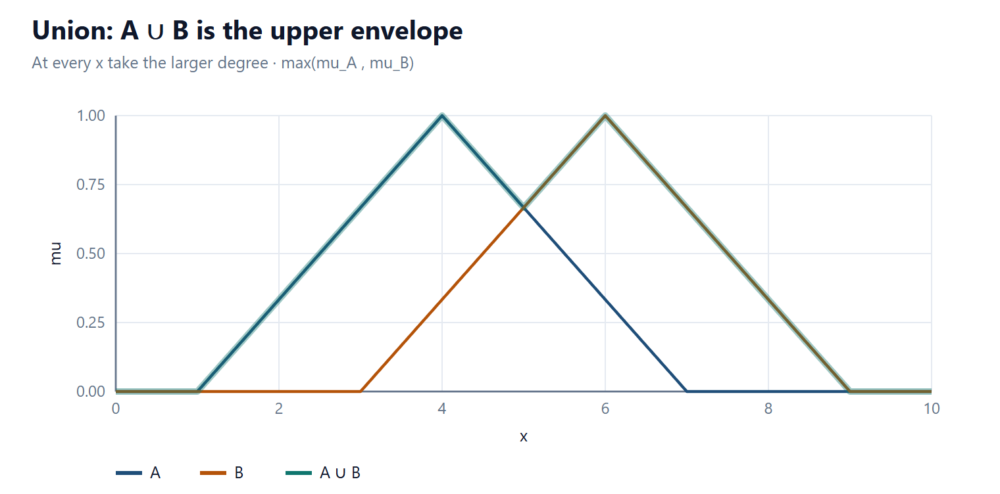

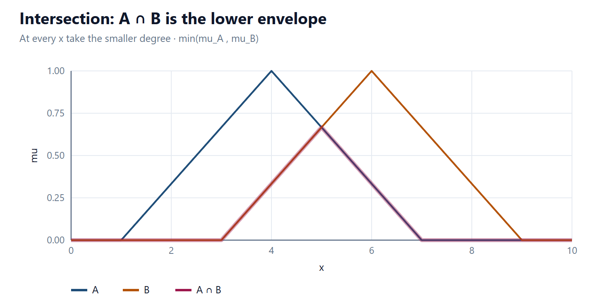

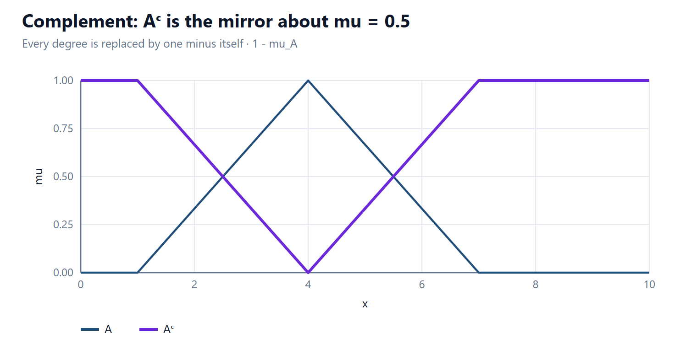

**لماذا يهمّك هذا الرسم؟** لأن **الرسم قبل الحساب** هو أسرع طريق: لو رسمت الغلافين صحيحاً، الأرقام تجي وحدها.

**ملاحظة دقيقة:** $A \cup B$ و $A \cap B$ **ما يحتاجان** نفس شكل الدالة. يكفي أن تكون المجموعتان معرّفتين على **نفس الكون** $X$. أما لو كان الكون مختلفاً، فأنت بحاجة **Cartesian product** (القسم 11).

---

## ✎ أسئلة — العمليات الأساسية (Union · Intersection · Complement)

1 **س1.** سمِّ المجموعة الضبابية بصيغتها، واذكر ما الذي يميّز درجتها عن الدرجة في المجموعة الحادة.

**الحل:**

$$A = \{(x,\ \mu_A(x)) \mid x \in X\}, \qquad \mu_A : X \to [0,1]$$

الدرجة $\mu_A(x)$ **ليست احتمالاً**، بل «كم ينتمي $x$ للمفهوم $A$». وفي المجموعة الحادة الدرجة $0$ أو $1$ فقط — إما داخل أو خارج بلا حدّ فاصل. فالضبابية تضيف **تدريجاً** بين الصفر والواحد.

---

2 **س2.** ليش الـcomplement عملية **أحادية** بينما الـunion والـintersection **ثنائية**؟

**الحل:**

العدد يتبع عدد **درجات العضوية** التي تدخلها العملية:

| العملية | عدد الدرجات | النتيجة |
|:---|:--:|:---|
| $\overline{A} = 1-\mu_A$ | **واحدة** | أحادية (unary) |
| $A \cup B = \max(\mu_A,\mu_B)$ | **اثنتان** | ثنائية (binary) |
| $A \cap B = \min(\mu_A,\mu_B)$ | **اثنتان** | ثنائية (binary) |

فالـcomplement تحوّل درجة واحدة، والـunion والـintersection تدمجان درجتين لنفس العنصر $x$.

---

3 **س3.** احسب $A \cup B$ و $A \cap B$ و $\overline{A}$ للمجموعتين
$A = \{(x_1,0.6),(x_2,0.3),(x_3,0.9)\}$ و $B = \{(x_1,0.4),(x_2,0.8),(x_3,0.5)\}$.

**الحل:**

$$\begin{aligned}
\mu_{A \cup B}(x_1) &= \max(0.6,\ 0.4) = 0.6 \\
\mu_{A \cup B}(x_2) &= \max(0.3,\ 0.8) = 0.8 \\
\mu_{A \cup B}(x_3) &= \max(0.9,\ 0.5) = 0.9
\end{aligned}$$

$$\begin{aligned}
\mu_{A \cap B}(x_1) &= \min(0.6,\ 0.4) = 0.4 \\
\mu_{A \cap B}(x_2) &= \min(0.3,\ 0.8) = 0.3 \\
\mu_{A \cap B}(x_3) &= \min(0.9,\ 0.5) = 0.5
\end{aligned}$$

$$\begin{aligned}
\mu_{\overline{A}}(x_1) &= 1 - 0.6 = 0.4 \\
\mu_{\overline{A}}(x_2) &= 1 - 0.3 = 0.7 \\
\mu_{\overline{A}}(x_3) &= 1 - 0.9 = 0.1
\end{aligned}$$

---

4 **س4.** ليه ما ينفع نحسب $A \cup B$ بالجمع المباشر؟ احسب الناتج الخاطئ purposely ومقابله بالصحيح.

**الحل:**

الجمع المباشر يحسب **حالة التداخل** مرتين، لأن $x$ قد يكون موجوداً في $A$ وفي $B$ معاً. مثال عند $x_1$:

$$\text{جمع مباشر:}\quad 0.5 + 0.2 = 0.7 \quad\text{(خاطئ)}$$
$$\text{الصحيح:}\quad \max(0.5,\ 0.2) = 0.5$$

---

## 6. Algebraic product و Scalar product (ص 4)

هاتان العمليتان تختلفان عن `min` و`max` بأنهما **حسابيتان** لا اختياريتان.

## 6.1 Algebraic (vector) product

$$\mu_{A \cdot B}(x) = \mu_A(x) \cdot \mu_B(x)$$

**مثال:**

$$A = \{(x_1,0.5),\ (x_2,0.3)\}, \quad B = \{(x_1,0.1),\ (x_2,0.2)\}$$

$$\begin{aligned}
\mu_{A \cdot B}(x_1) &= 0.5 \times 0.1 = 0.05 \\
\mu_{A \cdot B}(x_2) &= 0.3 \times 0.2 = 0.06
\end{aligned}$$

$$A \cdot B = \{(x_1,0.05),\ (x_2,0.06)\}$$

| العنصر | $\mu_A$ | $\mu_B$ | $\mu_A\mu_B$ |
|:--:|:--:|:--:|:--:|
| $x_1$ | 0.5 | 0.1 | $0.5 \times 0.1 = $ **0.05** |
| $x_2$ | 0.3 | 0.2 | $0.3 \times 0.2 = $ **0.06** |

**الفرق الجوهري:** `min` كان سيعطي 0.1 و 0.2، أما `product` فيعطي 0.05 و 0.06 — **أصغر**، لأن الضرب يعاقب الطرفين.

## 6.2 Scalar product

$$\mu_{\alpha A}(x) = \alpha \cdot \mu_A(x), \qquad 0 \le \alpha \le 1$$

**مثال:** $\alpha = 0.5$ و $A = \{(x_1,0.5),(x_2,0.3)\}$

$$\begin{aligned}
\mu_{\alpha A}(x_1) &= 0.5 \times 0.5 = 0.25 \\
\mu_{\alpha A}(x_2) &= 0.5 \times 0.3 = 0.15
\end{aligned}$$

$$\alpha A = \{(x_1,0.25),\ (x_2,0.15)\}$$

هذه العملية **تخفض** كل الدرجات بنفس النسبة — كأنك تقول «هذا الاحتمال نصف المؤكَّد».

---

## 7. Sum · Difference · Disjunctive sum (ص 5)

## 7.1 Sum — «probabilistic OR»

$$\mu_{A+B}(x) = \mu_A(x) + \mu_B(x) - \mu_A(x)\,\mu_B(x)$$

**خطوة بخطوة:**

$$\begin{aligned}
\mu_{A+B}(x_1) &= 0.5 + 0.2 - (0.5)(0.2) = 0.7 - 0.10 = 0.60 \\
\mu_{A+B}(x_2) &= 0.1 + 0.3 - (0.1)(0.3) = 0.4 - 0.03 = 0.37 \\
\mu_{A+B}(x_3) &= 0.4 + 0.5 - (0.4)(0.5) = 0.9 - 0.20 = 0.70
\end{aligned}$$

**ليش نطرح الحاصل؟** لأن $A$ و $B$ قد يتحققان **سوية**، والجمع المباشر يحسب هذا الجزء **مرتين**. فالطرح يصحّح العدّ المزدوج. ولهذا تسمى «OR الاحتمالي».

**⚠️ مصيدة:** صيغتها **مو** $\mu_A + \mu_B$ فقط. لو جمعت مباشرة لصار 0.7، والصحيح 0.60.

## 7.2 Difference

$$A - B \;=\; A \cap \overline{B} \qquad\Longrightarrow\qquad \mu_{A-B}(x) = \min\big(\mu_A(x),\ 1-\mu_B(x)\big)$$

$$\begin{aligned}
\mu_{A-B}(x_1) &= \min(0.5,\ 1-0.2) = \min(0.5,\ 0.8) = 0.5 \\
\mu_{A-B}(x_2) &= \min(0.1,\ 1-0.3) = \min(0.1,\ 0.7) = 0.1 \\
\mu_{A-B}(x_3) &= \min(0.4,\ 1-0.5) = \min(0.4,\ 0.5) = 0.4
\end{aligned}$$

**المعنى:** «$A$ بشرط **عدم** $B$». درجة $x$ في $A$ محدودة بدرجة **غيابه** عن $B$.

**⚠️ مصيدة:** $A - B$ **مو** $\mu_A - \mu_B$. والنتيجة **ما تصير سالبة أبداً** لأن كلا طرفي الـ`min` في $[0,1]$.

## 7.3 Disjunctive sum — fuzzy XOR

$$A \veebar B = (\overline{A} \cap B) \cup (A \cap \overline{B})$$

$$\mu_{A \veebar B}(x) = \max\big(\min(\mu_A, 1-\mu_B),\ \min(1-\mu_A, \mu_B)\big)$$

$$\begin{aligned}
\mu_{A \veebar B}(x_1) &= \max\big(\min(0.5,\ 0.8),\ \min(0.5,\ 0.2)\big) = \max(0.5,\ 0.2) = 0.5 \\
\mu_{A \veebar B}(x_2) &= \max\big(\min(0.1,\ 0.7),\ \min(0.9,\ 0.3)\big) = \max(0.1,\ 0.3) = 0.3 \\
\mu_{A \veebar B}(x_3) &= \max\big(\min(0.4,\ 0.5),\ \min(0.6,\ 0.5)\big) = \max(0.4,\ 0.5) = 0.5
\end{aligned}$$

**المعنى:** «واحد منهم فقط». وهذا هو XOR الضبابي.

> 💡 **تنبيه الرمز:** العملية تُكتب بـ `⊕` — **ونفس الرمز** مستعمل للـBounded sum في القسم 8. والمسألتان في هذا القسم تستعملانه بمعنيين مختلفين؛ التفريق كامل في القسم 18.

---

## 8. Bounded sum و Bounded difference (ص 5)

## 8.1 Bounded sum — «الأعلى عند السقف»

$$\mu_{A \oplus B}(x) = \min\big(1,\ \mu_A(x) + \mu_B(x)\big)$$

$$\begin{aligned}
\mu_{A \oplus B}(x_1) &= \min(1,\ 0.5+0.2) = \min(1,\ 0.7) = 0.7 \\
\mu_{A \oplus B}(x_2) &= \min(1,\ 0.1+0.3) = \min(1,\ 0.4) = 0.4 \\
\mu_{A \oplus B}(x_3) &= \min(1,\ 0.4+0.5) = \min(1,\ 0.9) = 0.9
\end{aligned}$$

**تجمع الدرجات لكن تقصّها عند 1.** الفرق عن Sum: هنا لا نطرح الحاصل ولا نعاقب التزامن — نجمع ثم نحدّ.

## 8.2 Bounded difference

$$\mu_{A \ominus B}(x) = \max\big(0,\ \mu_A(x) + \mu_B(x) - 1\big)$$

$$\begin{aligned}
\mu_{A \ominus B}(x_1) &= \max(0,\ 0.5+0.2-1) = \max(0,\ -0.3) = 0 \\
\mu_{A \ominus B}(x_2) &= \max(0,\ 0.1+0.3-1) = \max(0,\ -0.6) = 0 \\
\mu_{A \ominus B}(x_3) &= \max(0,\ 0.4+0.5-1) = \max(0,\ -0.1) = 0
\end{aligned}$$

**لا تعطي قيمة موجبة إلا إذا كان الطرفان معاً مرتفعين.** هذا «AND المتشدّد»: يحتاج دعمين قويين.

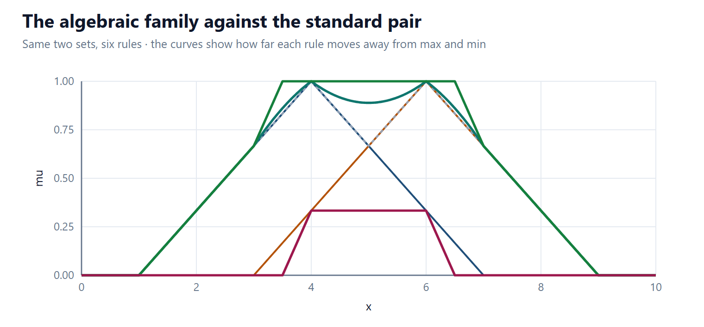

**الحدس:** لو $\mu_A = \mu_B = 0.4$، فمجموعهما 0.8 — أقل من 1، فـBounded difference = **0**. لكن لو $\mu_A = \mu_B = 0.8$، فالمجموع 1.6، ناقص 1 = **0.6**.

---

## 9. جدول واحد: كل العمليات على نفس الأرقام (ص 6)

هذا هو الجدول اللي يحلّ لك أكثر من سؤال امتحان، لأنه يضع **كل** العمليات جنب بعض بنفس المدخلات.

**المدخلات:** $\mu_A = (0.5,\ 0.1,\ 0.4)$ و $\mu_B = (0.2,\ 0.3,\ 0.5)$ على $x_1, x_2, x_3$.

| العملية | $x_1$ | $x_2$ | $x_3$ | القاعدة |
|:---|:--:|:--:|:--:|:---|
| $A$ | 0.5 | 0.1 | 0.4 | معطى |
| $B$ | 0.2 | 0.3 | 0.5 | معطى |
| $A \cup B$ | 0.5 | 0.3 | 0.5 | $\max$ |
| $A \cap B$ | 0.2 | 0.1 | 0.4 | $\min$ |
| $\overline{A}$ | 0.5 | 0.9 | 0.6 | $1-\mu_A$ |
| $A \cdot B$ | 0.10 | 0.03 | 0.20 | $\mu_A\mu_B$ |
| $A + B$ | 0.60 | 0.37 | 0.70 | $\mu_A+\mu_B-\mu_A\mu_B$ |
| $A \oplus B$ | 0.70 | 0.40 | 0.90 | $\min(1,\ \mu_A+\mu_B)$ |
| $A \ominus B$ | 0.00 | 0.00 | 0.00 | $\max(0,\ \mu_A+\mu_B-1)$ |
| $A - B$ | 0.50 | 0.10 | 0.40 | $\min(\mu_A,\ 1-\mu_B)$ |

**ثلاث قراءات على هذا الجدول — احفظها كقواعد:**

1. $A \cdot B \ \le\ A \cap B$ و $A + B \ \ge\ A \cup B$: فالضرب **AND أشدّ**، والجمع **OR أسخى**.
2. $A \ominus B = 0$ **بكل الخانات هنا**، لأنه ماكو عنصر عنده $\mu_A+\mu_B > 1$.
3. $A - B = A$ **بكل الخانات هنا**، لأن كل $\mu_A \le 1-\mu_B$.

> ⚠️ **القراءتان 2 و3 خاصتان بهذه الأرقام فقط** — مو قوانين عامة. لو غيّرت المدخلات تتغيّر. وهذه **مصيدة امتحان** نموذجية: الطالب يحفظ «bounded difference صفر» ويطبّقها على مسألة ثانية.

**فحص سريع:** عند $x_2$:

$$0.1+0.3-(0.1)(0.3) = 0.4-0.03 = 0.37 \quad\checkmark$$

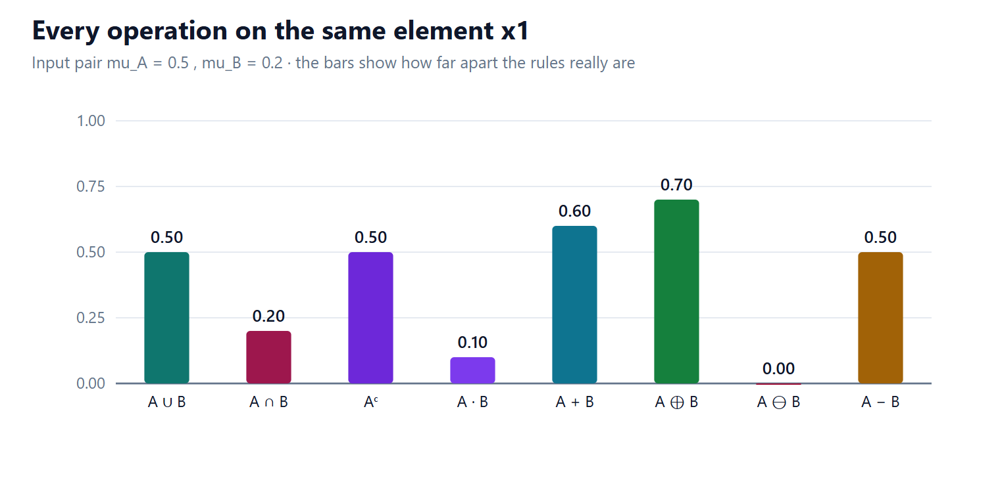

---

## 10. Equality و Power: concentration و dilation (ص 6)

## 10.1 متى مجموعتان متساويتان؟

$$A = B \iff \mu_A(x) = \mu_B(x) \quad \forall x \in X$$

المساواة **لكل** عنصر، مو لعنصر واحد. لو اختلفتا بعنصر واحد فقط، فالمجموعتان مختلفتان.

## 10.2 Power operation

$$\mu_{A^{\alpha}}(x) = \big[\mu_A(x)\big]^{\alpha}$$

| الحالة | الأثر على الدرجات | الأثر على الشكل | الـhedge اللغوي |
|:---|:---|:---|:---|
| $\alpha > 1$ | **تصغر** | المجموعة تصير **أحدّ (sharper)** | «**very** A» — وأشهرها $\alpha = 2$ |
| $\alpha = 1$ | ثابتة | ثابتة | $A$ نفسها |
| $0 < \alpha < 1$ | **تكبر** | المجموعة تصير **أوسع (wider)** | «**more or less** A» — وأشهرها $\alpha = 0.5$ |

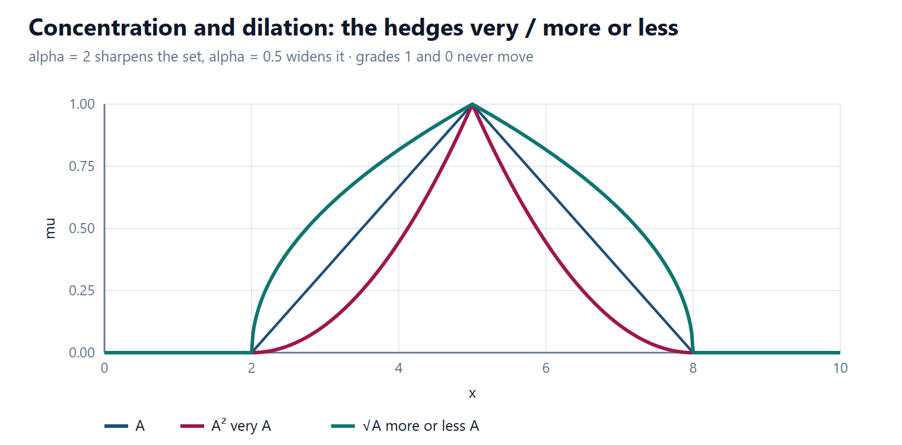

**مثال عددي** على $A = \{(x_1,0.2),(x_2,0.7),(x_3,1.0),(x_4,0.4)\}$:

$$\begin{aligned}
\mu_{A^2}(x_1) &= (0.2)^2 = 0.04 & \mu_{\sqrt{A}}(x_1) &= \sqrt{0.2} = 0.447 \\
\mu_{A^2}(x_2) &= (0.7)^2 = 0.49 & \mu_{\sqrt{A}}(x_2) &= \sqrt{0.7} = 0.837 \\
\mu_{A^2}(x_3) &= (1.0)^2 = 1.00 & \mu_{\sqrt{A}}(x_3) &= \sqrt{1.0} = 1.000 \\
\mu_{A^2}(x_4) &= (0.4)^2 = 0.16 & \mu_{\sqrt{A}}(x_4) &= \sqrt{0.4} = 0.632
\end{aligned}$$

**🧠 الحدس اللي لازم تحمله:** التربيع **يسحب** الدرجات المتوسطة إلى الأسفل ولا يمسّ 1. فـ«very A» تصير مجموعة **أضيق**: عدد أقل من العناصر يستحق وصف «جداً». والجذر يعمل العكس.

**⚠️ مصيدة:** $\alpha$ مو أُسّ على العنصر $x$ — هو أُسّ على **درجة العضوية**. $x_2^2$ غلط؛ $\mu_A(x_2)^2$ صح.

---

## 11. Cartesian product — بناء علاقة ضبابية (ص 7)

$$\mu_{A \times B}(x, y) = \min\big(\mu_A(x),\ \mu_B(y)\big)$$

## ليش هذه العملية مختلفة عن الباقي؟

| | Union / Intersection | Cartesian product |
|:---|:---|:---|
| الكون | **نفس** الكون $X$ | **كونان** $X$ و $Y$ مختلفان |
| المدخل | عنصر واحد $x$ | زوج $(x, y)$ |
| الخرج | درجة واحدة | **مصفوفة علاقة** $R \subseteq X \times Y$ |
| التطبيق | دمج مفهومين | بناء قاعدة ضبابية |

## المثال

$$A = \{(x_1,0.2),\ (x_2,0.3),\ (x_3,0.5),\ (x_4,0.6)\}$$
$$B = \{(y_1,0.8),\ (y_2,0.6),\ (y_3,0.3)\}$$

| $A \times B$ | $y_1 = 0.8$ | $y_2 = 0.6$ | $y_3 = 0.3$ |
|:---|:--:|:--:|:--:|
| $x_1 = 0.2$ | 0.2 | 0.2 | 0.2 |
| $x_2 = 0.3$ | 0.3 | 0.3 | 0.3 |
| $x_3 = 0.5$ | 0.5 | 0.5 | **0.3** |
| $x_4 = 0.6$ | 0.6 | 0.6 | **0.3** |

**طريقة الحساب — كل خانة:** عند $x_3, y_3$: $\min(0.5,\ 0.3) = 0.3$ ✓

**لاحظ:** كل صف يساوي **الأصغر** بين $\mu_A(x_i)$ و**كل** $\mu_B(y_j)$ بالتتابع. فالصف كله يتساوى عند الحدّ الأدنى للصف، وينخفض فقط عند الأعمدة اللي $\mu_B$ فيها أصغر.

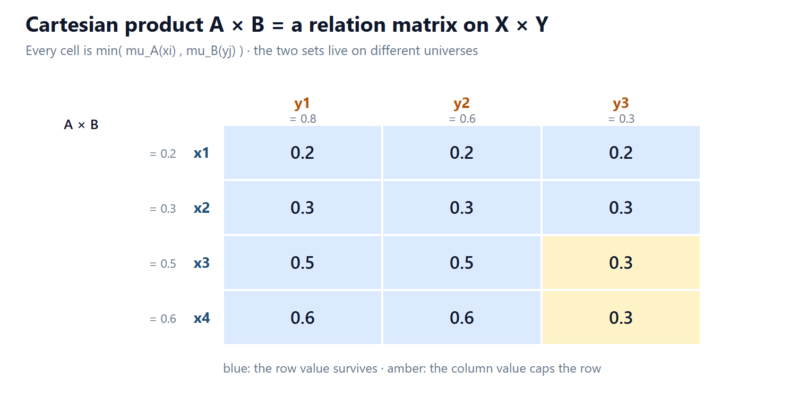

> 🔗 **ربط بالفصل القادم:** هذه المصفوفة **ليست تمريناً منفصلاً**. هي بالضبط الشكل اللي تُكتب بيه قاعدة `IF x is A THEN y is B` — والفصل 5 يبدأ من هنا بمصفوفة القاعدة وتركيب `max–min`. احفظ هذه الخطوة؛ هي جسرك.

---

## ✎ أسئلة — العائلة الجبرية (Product · Sum · Difference · Bounded)

5 **س5.** اكتب صيغة Sum، وفسّر لماذا نطرح $\mu_A\mu_B$ منها.

**الحل:**

$$\mu_{A+B}(x) = \mu_A(x) + \mu_B(x) - \mu_A(x)\mu_B(x)$$

الطرح يصحّح **العدّ المزدوج**: لو $A$ و $B$ متحقّقان معاً عند نفس $x$، فالجمع المباشر يحسب هذه الدرجة **مرتين**، والطرح يزيل النسخة الزائدة. ولهذا اسمها «OR الاحتمالي».

**تحقّق عددي:**

$$0.5 + 0.2 - (0.5)(0.2) = 0.7 - 0.10 = 0.60$$

---

6 **س6.** اكتب صيغة Difference، وبيّن لماذا لا تكون ناتجها سالباً أبداً.

**الحل:**

$$\mu_{A-B}(x) = \min\big(\mu_A(x),\ 1-\mu_B(x)\big)$$

لأن $\mu_A \in [0,1]$ و $1-\mu_B \in [0,1]$، فكلاهما غير سالب، والأصغر بينهما غير سالب كذلك.

---

7 **س7.** ما الفرق بين Bounded sum وDisjunctive sum؟ وما المشكلة في رمزيهما؟

**الحل:**

| | Bounded sum | Disjunctive sum (XOR) |
|:---|:---|:---|
| الصيغة | $\min(1,\ \mu_A+\mu_B)$ | $\max\big(\min(\mu_A,1-\mu_B),\ \min(1-\mu_A,\mu_B)\big)$ |
| المعنى | «واحد **أو** اثنان» | «**واحد فقط**» |
| عند $\mu_A=0.8,\ \mu_B=0.6$ | $\min(1,\ 0.8+0.6) = \mathbf{1.0}$ | $\max(0.4,\ 0.2) = \mathbf{0.4}$ |
| عند $\mu_A=0.9,\ \mu_B=0.2$ | $\min(1,\ 0.9+0.2) = \mathbf{1.0}$ | $\max(0.8,\ 0.1) = \mathbf{0.8}$ |

**الفرق بالأرقام:** الـBounded sum **تشبع عند 1** مع كل زوجين عاليين. أما XOR فيبقى **منخفضاً** لأن الطرفين معاً يلغيان بعضهما — ويرتفع فقط حين يكون أحدهما عالياً والآخر منخفضاً.

**المشكلة:** كلتاهما تُكتب بالرمز `⊕`، فيلتبس الأمر. **حدّد من السياق**: لو مقرونة بـ`⊖` (bounded difference) فهي Bounded sum؛ لو ظهرت مع نفي $A$ أو $B$ فهي XOR.

---

8 **س8.** احسب $A \cdot B$ و $A + B$ و $A \oplus B$ و $A \ominus B$ عند $x_1$، حيث $\mu_A(x_1)=0.6$ و $\mu_B(x_1)=0.4$.

**الحل:**

$$\begin{aligned}
\mu_{A \cdot B}(x_1) &= 0.6 \times 0.4 = 0.24 \\
\mu_{A+B}(x_1) &= 0.6 + 0.4 - (0.6)(0.4) = 1.0 - 0.24 = 0.76 \\
\mu_{A \oplus B}(x_1) &= \min(1,\ 0.6+0.4) = \min(1,\ 1.0) = 1.0 \\
\mu_{A \ominus B}(x_1) &= \max(0,\ 0.6+0.4-1) = \max(0,\ 0.0) = 0
\end{aligned}$$

**لاحظ:** $A \oplus B$ بلغت 1.0 (السقف)، بينما $A \ominus B$ بقيت 0 لأن المجموع ما تجاوز 1.

---

9 **س9.** احسب $A - B$ وDisjunctive sum عند $x_1$، حيث $\mu_A(x_1)=0.6$ و $\mu_B(x_1)=0.4$، ثم قارن.

**الحل:**

$$\begin{aligned}
\mu_{A-B}(x_1) &= \min(0.6,\ 1-0.4) = \min(0.6,\ 0.6) = 0.6 \\
\mu_{A \veebar B}(x_1) &= \max\big(\min(0.6,\ 0.6),\ \min(0.4,\ 0.4)\big) = \max(0.6,\ 0.4) = 0.6
\end{aligned}$$

**الفرق:** $A-B$ يعطي «درجة $A$ مع غياب $B$»، أما XOR فيعطي «درجة **وجود أحدهما فقط**». هنا التقتا القيمتان **عددياً** لأن $\mu_A = 1-\mu_B$ بالضبط.

---

## 12. القوانين التي تصمد (ص 7–8)

| القانون | الصيغة |
|:---|:---|
| **Commutativity** | $A \cup B = B \cup A$ · $A \cap B = B \cap A$ |
| **Associativity** | $A \cup (B \cup C) = (A \cup B) \cup C$ · $A \cap (B \cap C) = (A \cap B) \cap C$ |
| **Distributivity** | $A \cup (B \cap C) = (A \cup B) \cap (A \cup C)$ · $A \cap (B \cup C) = (A \cap B) \cup (A \cap C)$ |
| **Idempotence** | $A \cup A = A$ · $A \cap A = A$ |
| **Identity** | $A \cup \varnothing = A$ · $A \cap X = A$ · $A \cap \varnothing = \varnothing$ · $A \cup X = X$ |
| **Transitivity** | $A \subseteq B,\ B \subseteq C \ \Rightarrow\ A \subseteq C$ |
| **Involution** | $\overline{\overline{A}} = A$ |
| **De Morgan** | $\overline{A \cup B} = \overline{A} \cap \overline{B}$ · $\overline{A \cap B} = \overline{A} \cup \overline{B}$ |

**🧠 مرساة:** كل قوانين المجموعات الكلاسيكية **تصمد** للمجموعات الضبابية — إلا قانونين. والقانونان هما القسم التالي، وهما **أهم سؤال في الامتحان**.

---

## 13. القوانين التي تنكسر (ص 8)

## القانونان اللذان يسقطان

$$\boxed{A \cup \overline{A} \neq X} \qquad\qquad \boxed{A \cap \overline{A} \neq \varnothing}$$

اسماهما: **excluded middle** و**contradiction**.

## الإثبات العددي (بلا حفظ)

خذ عنصراً درجته **0.5**:

$$\mu_{A \cup \overline{A}}(x) = \max(0.5,\ 1-0.5) = \max(0.5,\ 0.5) = \mathbf{0.5} \neq 1$$

$$\mu_{A \cap \overline{A}}(x) = \min(0.5,\ 1-0.5) = \min(0.5,\ 0.5) = \mathbf{0.5} \neq 0$$

## ليش؟ — السبب الفكري

المجموعة الضبابية **تتخلّى عن الحدّ الحادّ** بين $A$ و«ليس $A$». فالعنصر عنده 0.5 هو **نصف داخل ونصف خارج** بآن واحد. والقانونان الكلاسيكيان مبنيان على افتراض إنه **إما داخل أو خارج** — فالافتراض يسقط ويسقطان معه.

> 💬 **صياغة تنفعك بالامتحان:** «Fuzzy sets give up the sharp boundary between A and not-A, so they also give up the excluded middle and the law of contradiction.»

## لكن — فيه حدود تصمد

$$\mu_{A \cup \overline{A}}(x) \ \ge\ 0.5 \qquad\text{و}\qquad \mu_{A \cap \overline{A}}(x) \ \le\ 0.5$$

السبب: لو $\mu_A = t$، فالمجموع $= \max(t, 1-t)$ وهو دائماً $\ge 0.5$، والتقاطع $= \min(t, 1-t)$ وهو دائماً $\le 0.5$. وهاتان **أفضل حدّين ممكنين** — وذكرهما بالامتحان يرفع درجتك.

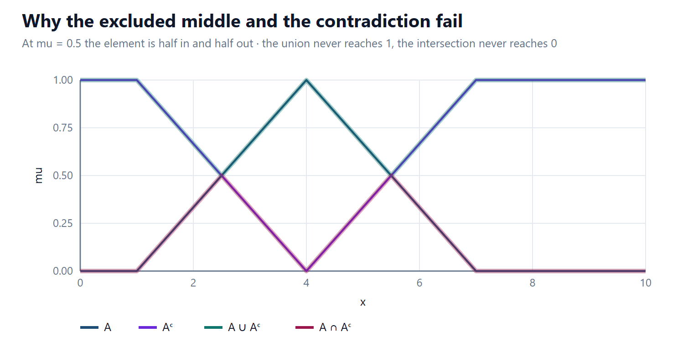

**⚠️ مصيدة:** التقاطع **مو صفر** — لكنه **مو 1** أيضاً. لو كتبت $A \cap \overline{A} = \varnothing$ خسرت السؤال كله. الجواب الصحيح: **$\neq \varnothing$**، وأقصى قيمة له 0.5.

---

## 14. T-norms و S-norms — العمليات على مستوى أعلى (ص 9)

## 14.1 الفكرة

`min` و`max` هما **خيار واحد** من عائلة. أي عملية ثنائية تحقق **أربع بديهيات** تصلح أن تكون fuzzy AND وتُسمّى **T-norm**:

| # | البديهية | الصيغة |
|:--:|:---|:---|
| 1 | **Commutativity** | $T(a,b) = T(b,a)$ |
| 2 | **Associativity** | $T(a, T(b,c)) = T(T(a,b), c)$ |
| 3 | **Monotonicity** | $a \le a',\ b \le b' \Rightarrow T(a,b) \le T(a',b')$ |
| 4 | **Boundary** | $T(a,1) = a$ و $T(a,0) = 0$ |

و**S-norm** هي **المزدوجة** لنفس الـT-norm:

$$S(a,b) = 1 - T(1-a,\ 1-b)$$

## 14.2 الجدول (ص 9)

| العائلة | **T-norm (AND)** | **S-norm (OR)** |
|:---|:---|:---|
| **Standard** | $\min(a,b)$ | $\max(a,b)$ |
| **Algebraic** | $a \cdot b$ | $a + b - ab$ |
| **Bounded** | $\max(0,\ a+b-1)$ | $\min(1,\ a+b)$ |
| **Drastic** | $a$ إذا $b=1$ · $b$ إذا $a=1$ · $0$ غير ذلك | $a$ إذا $b=0$ · $b$ إذا $a=0$ · $1$ غير ذلك |

حيث $a = \mu_A(x)$ و $b = \mu_B(x)$.

## 14.3 الترتيب — يُحفظ كسلسلة

$$\min \ \ge\ \text{product} \ \ge\ \text{bounded} \ \ge\ \text{drastic}$$

$$\max \ \le\ \text{algebraic sum} \ \le\ \text{bounded sum} \ \le\ \text{drastic sum}$$

**تحقّق على $a=b=0.5$:**

| العائلة | T-norm | القيمة | S-norm | القيمة |
|:---|:---|:--:|:---|:--:|
| Standard | $\min(0.5,0.5)$ | 0.5 | $\max(0.5,0.5)$ | 0.5 |
| Algebraic | $0.5\times0.5$ | 0.25 | $0.5+0.5-0.25$ | 0.75 |
| Bounded | $\max(0,\ 0.5+0.5-1)$ | 0 | $\min(1,\ 0.5+0.5)$ | 1 |
| Drastic | $a$ | 0 | $a$ | 1 |

السلسلة $0.5 \ge 0.25 \ge 0 \ge 0$ ✓ للسلسلة T، و $0.5 \le 0.75 \le 1 \le 1$ ✓ للسلسلة S.

**🧠 الحدس:** كل ما نزلت بالجدول، صارت العملية **أكثر تشدّداً** (AND) أو **أكثر سخاءً** (OR). الـstandard هو الأخفّ، والـdrastic هو الأقصى.

**⚠️ مصيدة:** $T(a,1)=a$ مو $1$. الـT-norm **محايدها 1**، والـS-norm **محايدها 0**. لو خلطت بينهما تنقلب كل القيم.

---

## ✎ أسئلة — القوانين وT-norms و S-norms

10 **س10.** اكتب قانونَي De Morgan وتحقّق منهما عددياً عند $\mu_A = 0.7$ و $\mu_B = 0.4$.

**الحل:**

$$\overline{A \cup B} = \overline{A} \cap \overline{B} \qquad\qquad \overline{A \cap B} = \overline{A} \cup \overline{B}$$

**التحقّق الأول:**

$$\text{LHS} = 1 - \max(0.7,\ 0.4) = 1 - 0.7 = 0.3$$
$$\text{RHS} = \min(1-0.7,\ 1-0.4) = \min(0.3,\ 0.6) = 0.3 \quad\checkmark$$

**التحقّق الثاني:**

$$\text{LHS} = 1 - \min(0.7,\ 0.4) = 1 - 0.4 = 0.6$$
$$\text{RHS} = \max(0.3,\ 0.6) = 0.6 \quad\checkmark$$

---

11 **س11.** ليش يسقط excluded middle و contradiction؟ أعطِ مثالاً عددياً، واذكر الحدّين اللذين يصمدان بدلاً منهما.

**الحل:**

لأن عند أي درجة متوسطة $0<\mu_A<1$ يكون العنصر **جزءاً داخل وجزءاً خارج** بآن واحد، فيخسر الحدّ الحادّ الذي بُني عليه القانونان.

مثال عند $\mu_A = 0.5$:

$$A \cup \overline{A}:\ \max(0.5,\ 0.5) = 0.5 \neq 1$$
$$A \cap \overline{A}:\ \min(0.5,\ 0.5) = 0.5 \neq 0$$

والحدود التي تصمد: $\mu_{A \cup \overline{A}} \ge 0.5$ و $\mu_{A \cap \overline{A}} \le 0.5$.

---

12 **س12.** عرّف الـT-norm بأربع بديهيات، واذكر ثلاث عائلات مع أزواجها الـS-norms.

**الحل:**

**T-norm** عملية ثنائية $T:[0,1]^2 \to [0,1]$ تحقق: التبديل، التجميع، الرتابة، و$T(a,1)=a$، و$T(a,0)=0$. وتصلح أن تكون **fuzzy AND**.

| T-norm | S-norm المقابلة |
|:---|:---|
| $\min(a,b)$ | $\max(a,b)$ |
| $a \cdot b$ | $a + b - ab$ |
| $\max(0,\ a+b-1)$ | $\min(1,\ a+b)$ |

والربط بينهما دائماً: $S(a,b) = 1 - T(1-a,\ 1-b)$.

---

13 **س13.** ما هي الـS-norm المزدوجة للـbounded T-norm؟ برهن بالalgebra.

**الحل:**

$$S(a,b) = 1 - T(1-a,\ 1-b) = 1 - \max(0,\ (1-a)+(1-b)-1) = 1 - \max(0,\ 1-a-b)$$

ونفصل الحالات:

$$S(a,b) = \begin{cases} 1 - (1-a-b) = a+b, & \text{إذا } a+b \le 1 \\[6pt] 1 - 0 = 1, & \text{إذا } a+b > 1 \end{cases} = \min(1,\ a+b)$$

وهذه بالضبط الـBounded sum من القسم 8.

---

## 15. مثال 1 — مجموعتان متصلتان، محسوب خطوة بخطوة (ص 9–10)

## المعطى

$$\mu_A(x) = \frac{x}{1+x}, \qquad \mu_B(x) = 2^{-x}, \qquad x \in [0,5]$$

**المطلوب:** $\overline{A}$ · $\overline{B}$ · $A \cup B$ · $A \cap B$ · $\overline{A \cup B}$.

## الخطوة 1 — النفيان (مباشر)

$$\mu_{\overline{A}}(x) = 1 - \frac{x}{1+x} = \frac{1+x-x}{1+x} = \frac{1}{1+x}$$

$$\mu_{\overline{B}}(x) = 1 - 2^{-x}$$

## الخطوة 2 — نقطة التقاطع (هنا يخطئ أغلب الطلبة)

نحتاج $x$ حيث $\mu_A = \mu_B$:

$$\frac{x}{1+x} = 2^{-x}$$

**الاختبار عند $x = 1$:**

$$\text{LHS} = \frac{1}{1+1} = \frac{1}{2} = 0.5 \qquad \text{RHS} = 2^{-1} = \frac{1}{2} = 0.5 \quad \checkmark$$

**وهي النقطة الوحيدة**، لأن:
- $f(x) = \dfrac{x}{1+x}$ **متزايدة** على $[0,5]$ (المشتقة $\dfrac{1}{(1+x)^2} > 0$)
- $g(x) = 2^{-x}$ **متناقصة** على $[0,5]$

فمنحنى صاعد ومنحنى نازل يتقاطعان **مرة واحدة** فقط. لا تحفظ الرقم — احفظ **الحجّة**.

## الخطوة 3 — تحديد الأكبر والأصغر على كل مجال

| المجال | المقارنة | $A \cup B$ | $A \cap B$ |
|:---|:---|:---|:---|
| $0 \le x \le 1$ | $B \ge A$ | $2^{-x}$ | $\dfrac{x}{1+x}$ |
| $1 \le x \le 5$ | $A \ge B$ | $\dfrac{x}{1+x}$ | $2^{-x}$ |

## الخطوة 4 — التركيب

$$\mu_{A \cup B}(x) = \begin{cases} 2^{-x}, & 0 \le x \le 1 \\[6pt] \dfrac{x}{1+x}, & 1 \le x \le 5 \end{cases}$$

$$\mu_{A \cap B}(x) = \begin{cases} \dfrac{x}{1+x}, & 0 \le x \le 1 \\[6pt] 2^{-x}, & 1 \le x \le 5 \end{cases}$$

## الخطوة 5 — نفي الاتحاد (بـDe Morgan)

$$\mu_{\overline{A \cup B}}(x) = \mu_{\overline{A} \cap \overline{B}}(x) = \begin{cases} 1 - 2^{-x}, & 0 \le x \le 1 \\[6pt] \dfrac{1}{1+x}, & 1 \le x \le 5 \end{cases}$$

**فحص الاتساق عند الحدّ $x=1$:** الطرفان يعطيان 0.5 من كل جهة، فالدالة **متّصلة** بلا قفزة. وهذا فحصاً سريعاً يكشف أي خطأ بالمجالات.

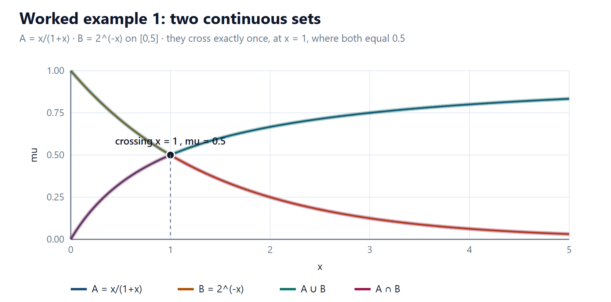

**⚠️ مصيدة:** الخطأ الشائع إن الطالب يكتب $\mu_A = \mu_B$ ويحلّ جبرياً فيصل لمعادلة ما تنحلّ بسهولة، فيتركها. الحلّ الصحيح: **اختبار $x=1$** ثم **تبرير الوحدانية** بالرتابة. وهذا كل المطلوب.

---

## 16. مثال 2 — العمليات تحمل معنى (ص 10)

هذا المثال هو الأهم **فكرياً**، لأنه يربط الرياضيات بالكلام.

لنفرض:
- $A$ = **cold climate**
- $B$ = **hot climate**
- المتغيّر: درجة الحرارة $t$ بالـ°C

| التعبير | الصيغة | المعنى اللغوي |
|:---|:---|:---|
| **Not cold** | $\overline{A}:\ 1-\mu_A(t)$ | «مو بارد» |
| **Not hot** | $\overline{B}:\ 1-\mu_B(t)$ | «مو حار» |
| **Extreme** | $A \cup B:\ \max(\mu_A,\mu_B)$ | «متطرّف» — بارد جداً أو حار جداً |
| **Pleasant** | $\overline{A} \cap \overline{B} = \overline{A \cup B}$ | «لطيف» — لا بارد ولا حار |

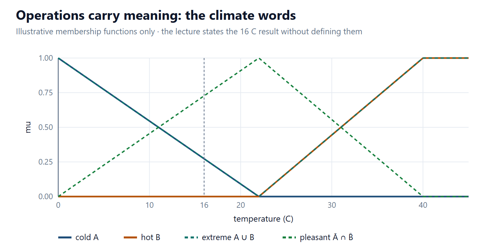

## الدرس المحوري

> «Not cold» is not the same as «hot»: at 16 °C, not cold = 0.5 but hot = 0.

**المعنى:** $\overline{A} \neq B$ بصورة عامة. نفي مفهوم **لا يساوي** المفهوم المقابل. وهذه نتيجة مباشرة لانكسار excluded middle بالقسم 13 — نفس الفكرة بلغة الحياة اليومية.

**🧠 مرساة:** «مو بارد» تشمل **الحار** و**اللطيف** و**الدافئ**. فمعناها **أوسع** من «حار». ورياضياً: $\overline{A} \supset B$ وليس $\overline{A} = B$.

## ⚠️ تنبيه على الرقم

الرقم 16 °C صحيح **إذا وفقط إذا** كان:

$$\mu_{\text{cold}}(16) = 0.5 \qquad\text{و}\qquad \mu_{\text{hot}}(16) = 0$$

**لو جاءك بالامتحان:** اكتب هذين الشرطين، وقل إن الرقم يعتمد على تعريف الدالتين — وهذا أدقّ من تكرار الرقم بلا سند.

---

## ✎ أسئلة — Power و Cartesian product والمسائل التطبيقية

14 **س14.** أيّهما «very A»: $A^2$ أم $\sqrt{A}$؟ ولماذا؟

**الحل:**

| | الأُسّ | الأثر | الـhedge |
|:---|:---|:---|:---|
| **Concentration** | $\alpha > 1$ (أشهرها 2) | الدرجات تصغر، المجموعة تصير أحدّ | **very** |
| **Dilation** | $0 < \alpha < 1$ (أشهرها 0.5) | الدرجات تكبر، المجموعة تصير أوسع | **more or less** |

**الجواب:** $A^2$ هي **«very A»** لأن $\alpha = 2 > 1$ (concentration). و$\sqrt{A}$ هي **«more or less A»** لأن $\alpha = 0.5 < 1$ (dilation).

**دليل الأثر:** عند $\mu_A = 0.7$ صارت $0.49$ بالتربيع — انخفضت، فصارت المجموعة **أصعب** أن تنطبق. و$\sqrt{0.7} = 0.837$ رفعتها، فصارت **أسهل**. والاثنان لا يغيّران 1 ولا 0، بل ما بينهما فقط.

---

15 **س15.** كيف تبني مصفوفة $A \times B$؟ وشنو أبعادها؟

**الحل:**

$$\mu_{A \times B}(x_i, y_j) = \min\big(\mu_A(x_i),\ \mu_B(y_j)\big)$$

الأبعاد = $|A| \times |B|$ — عدد صفوف $A$ بعدد أعمدة $B$. والنتيجة **علاقة** $R \subseteq X \times Y$.

**تحقّق:** لو $|A| = 4$ و $|B| = 3$، تكون المصفوفة $4 \times 3$ أي 12 خانة.

---

## 17. ورقة الصيغ المركزة

| العملية | الصيغة | النوع | الشرط |
|:---|:---|:---:|:---|
| Union | $\mu_{A \cup B}(x) = \max(\mu_A, \mu_B)$ | ثنائية | نفس الكون |
| Intersection | $\mu_{A \cap B}(x) = \min(\mu_A, \mu_B)$ | ثنائية | نفس الكون |
| Complement | $\mu_{\overline{A}}(x) = 1 - \mu_A(x)$ | **أحادية** | — |
| Algebraic product | $\mu_{A \cdot B}(x) = \mu_A \cdot \mu_B$ | ثنائية | نفس الكون |
| Scalar product | $\mu_{\alpha A}(x) = \alpha \cdot \mu_A$ | ثنائية | $0 \le \alpha \le 1$ |
| Sum (probabilistic OR) | $\mu_{A+B}(x) = \mu_A + \mu_B - \mu_A\mu_B$ | ثنائية | نفس الكون |
| Difference | $\mu_{A-B}(x) = \min(\mu_A,\ 1-\mu_B)$ | ثنائية | — |
| Disjunctive sum (XOR) | $\mu_{A \veebar B}(x) = \max\big(\min(\mu_A,1-\mu_B),\ \min(1-\mu_A,\mu_B)\big)$ | ثنائية | — |
| Bounded sum | $\mu_{A \oplus B}(x) = \min(1,\ \mu_A+\mu_B)$ | ثنائية | — |
| Bounded difference | $\mu_{A \ominus B}(x) = \max(0,\ \mu_A+\mu_B-1)$ | ثنائية | — |
| Power | $\mu_{A^{\alpha}}(x) = [\mu_A(x)]^{\alpha}$ | أحادية | $\alpha>0$ |
| Equality | $A = B \iff \mu_A(x)=\mu_B(x)\ \forall x$ | علاقة | — |
| Cartesian product | $\mu_{A \times B}(x,y) = \min(\mu_A(x),\ \mu_B(y))$ | ثنائية | **كونان** |
| S-norm (المزدوجة) | $S(a,b) = 1 - T(1-a,\ 1-b)$ | تحويل | — |

**بديهيات T-norm:** commutativity · associativity · monotonicity · $T(a,1)=a$ · $T(a,0)=0$.
**بديهيات S-norm:** نفسها مع $S(a,0)=a$ و $S(a,1)=1$.

---

## 18. مصائد الامتحان

| # | المصيدة | الجواب الآمن |
|:--:|:---|:---|
| 1 | Union = جمع الدرجات؟ | ❌ **`max`** فقط — ما تجمع ولا تأخذ متوسط |
| 2 | Intersection = ضرب الدرجات؟ | ❌ **`min`**. الضرب هو **Algebraic product** — عملية أخرى |
| 3 | $\overline{A}$ عند 0.5؟ | **0.5** — لا تصير 0 ولا 1 |
| 4 | $A \cap \overline{A} = \varnothing$؟ | ❌ **$\neq \varnothing$** — وأقصى قيمة 0.5 |
| 5 | $A \cup \overline{A} = X$؟ | ❌ **$\neq X$** — وأدنى قيمة 0.5 |
| 6 | رمز `⊕`؟ | **غامض**: bounded sum أو XOR. حدّده من السياق؛ لو مقرون بـ`⊖` فهو bounded sum |
| 7 | Sum = $\mu_A + \mu_B$؟ | ❌ ناقص **$\mu_A\mu_B$** (تصحيح العدّ المزدوج) |
| 8 | $A - B = \mu_A - \mu_B$؟ | ❌ **$\min(\mu_A,\ 1-\mu_B)$** — والنتيجة **ما تصير سالبة أبداً** |
| 9 | $A^\alpha$: الأُسّ على $x$؟ | ❌ على **$\mu_A(x)$**. و$x_2^2$ مو المقصود |
| 10 | محايد T-norm؟ | **1** ($T(a,1)=a$). ومحايد S-norm **0** |
| 11 | Cartesian product = union؟ | ❌ يحتاج **كونين** وينتج **مصفوفة**؛ والـunion يحتاج كوناً واحداً |
| 12 | «bounded difference دائماً 0»؟ | ❌ صحّ **لهذه الأرقام فقط** — مو قانون |
| 13 | الترتيب: أيّهما أشدّ؟ | $\min \ge \text{product} \ge \text{bounded} \ge \text{drastic}$ (T) · والعكس للـS |
| 14 | $2^{-x}$ = $x^{-2}$؟ | ❌ عند $x=2$ يتفقان بالصدفة (0.25)؛ عند $x=0.5$: الأول 0.707 والثاني 4 |

---

## ✎ أسئلة — مسائل التطبيق الشاملة

> **المعطيات المشتركة:**
> $A = \{(x_1,0.2),(x_2,0.7),(x_3,1.0),(x_4,0.4)\}$ · $B = \{(x_1,0.6),(x_2,0.3),(x_3,0.5),(x_4,0.9)\}$ · $C = \{(y_1,0.8),(y_2,0.4)\}$

16 **س16.** احسب $A \cup B$ · $A \cap B$ · $\overline{A}$ · $\overline{B}$.

**الحل:**

| العنصر | $\mu_A$ | $\mu_B$ | $A \cup B$ | $A \cap B$ | $\overline{A}$ | $\overline{B}$ |
|:--:|:--:|:--:|:--:|:--:|:--:|:--:|
| $x_1$ | 0.2 | 0.6 | **0.6** | **0.2** | **0.8** | **0.4** |
| $x_2$ | 0.7 | 0.3 | **0.7** | **0.3** | **0.3** | **0.7** |
| $x_3$ | 1.0 | 0.5 | **1.0** | **0.5** | **0.0** | **0.5** |
| $x_4$ | 0.4 | 0.9 | **0.9** | **0.4** | **0.6** | **0.1** |

**طريقة الحساب:** غطِّ العمودين واشتغل عنصراً عنصراً. مثال $x_2$:

$$\max(0.7,\ 0.3) = 0.7 \quad\cdot\quad \min(0.7,\ 0.3) = 0.3 \quad\cdot\quad 1-0.7 = 0.3 \quad\cdot\quad 1-0.3 = 0.7$$

---

17 **س17.** احسب $A \cdot B$ · $A + B$ · $A \oplus B$ · $A \ominus B$.

> ⚠️ **هنا تُحلّ مصيدة الرمز:** `⊕` بالمسألة تعني **bounded sum**، لأنها مقرونة بـ`⊖` (bounded difference) بالطلب نفسه.

**الحل — الخطوات كاملة:**

| العنصر | $A \cdot B$ | $A+B-AB$ | $\min(1,A+B)$ | $\max(0,A+B-1)$ |
|:--:|:---|:---|:---|:---|
| $x_1$ | $0.2\times0.6 = $ **0.12** | $0.8 - 0.12 = $ **0.68** | $\min(1,\ 0.8) = $ **0.80** | $\max(0,\ -0.2) = $ **0.00** |
| $x_2$ | $0.7\times0.3 = $ **0.21** | $1.0 - 0.21 = $ **0.79** | $\min(1,\ 1.0) = $ **1.00** | $\max(0,\ 0.0) = $ **0.00** |
| $x_3$ | $1.0\times0.5 = $ **0.50** | $1.5 - 0.50 = $ **1.00** | $\min(1,\ 1.5) = $ **1.00** | $\max(0,\ 0.5) = $ **0.50** |
| $x_4$ | $0.4\times0.9 = $ **0.36** | $1.3 - 0.36 = $ **0.94** | $\min(1,\ 1.3) = $ **1.00** | $\max(0,\ 0.3) = $ **0.30** |

**قراءة النتيجة:** $A \ominus B$ سالبة عند $x_1$ و$x_2$ فصارت **0**؛ وموجبة فقط عند $x_3$ و$x_4$ لأن مجموعهما تجاوز 1. وهذا يطابق منطق العملية: تحتاج دعمين قويين.

---

18 **س18.** احسب $A - B$ والـDisjunctive sum، وقارن بين النتيجتين.

**الحل:**

| العنصر | $A - B = \min(\mu_A, 1-\mu_B)$ | Disjunctive sum |
|:--:|:--:|:--:|
| $x_1$ | $\min(0.2,\ 0.4) = $ **0.2** | $\max(0.2,\ \min(0.8,\ 0.6)) = \max(0.2,\ 0.6) = $ **0.6** |
| $x_2$ | $\min(0.7,\ 0.7) = $ **0.7** | $\max(0.7,\ \min(0.3,\ 0.3)) = \max(0.7,\ 0.3) = $ **0.7** |
| $x_3$ | $\min(1.0,\ 0.5) = $ **0.5** | $\max(0.5,\ \min(0.0,\ 0.5)) = \max(0.5,\ 0) = $ **0.5** |
| $x_4$ | $\min(0.4,\ 0.1) = $ **0.1** | $\max(0.1,\ \min(0.6,\ 0.9)) = \max(0.1,\ 0.6) = $ **0.6** |

**لاحظ الفرق:** $A-B$ يعطي «درجة $A$ مع غياب $B$»، أما XOR فيعطي «درجة **وجود أحدهما فقط**». ولهذا $x_1$ يعطي 0.6 بـXOR و0.2 بالفرق.

---

19 **س19.** تحقّق من $\overline{A \cup B} = \overline{A} \cap \overline{B}$ على البيانات المشتركة.

**الحل:**

| العنصر | $A \cup B$ | $\overline{A \cup B}$ | $\overline{A}$ | $\overline{B}$ | $\overline{A} \cap \overline{B}$ |
|:--:|:--:|:--:|:--:|:--:|:--:|
| $x_1$ | 0.6 | **0.4** | 0.8 | 0.4 | **0.4** |
| $x_2$ | 0.7 | **0.3** | 0.3 | 0.7 | **0.3** |
| $x_3$ | 1.0 | **0.0** | 0.0 | 0.5 | **0.0** |
| $x_4$ | 0.9 | **0.1** | 0.6 | 0.1 | **0.1** |

العمودان الأخيران **متطابقان بكل خانة** ← القانون يتحقّق. ولهذا نقدر نستنتج **الحالة العامة**: الفرضية صحيحة لأي مجموعة ضبابية، لأن $1-\max(a,b) = \min(1-a,\ 1-b)$ متطابقة جبرياً.

---

20 **س20.** احسب $A^2$ و $\sqrt{A}$، وحدّد أيّهما «very A».

**الحل:**

| العنصر | $\mu_A$ | $\mu_A^2$ | $\sqrt{\mu_A}$ |
|:--:|:--:|:--:|:--:|
| $x_1$ | 0.2 | **0.04** | **0.447** |
| $x_2$ | 0.7 | **0.49** | **0.837** |
| $x_3$ | 1.0 | **1.00** | **1.000** |
| $x_4$ | 0.4 | **0.16** | **0.632** |

**الجواب:** $A^2$ هي **«very A»** لأن $\alpha = 2 > 1$ (concentration). و$\sqrt{A}$ هي **«more or less A»** لأن $\alpha = 0.5 < 1$ (dilation).

---

21 **س21.** احسب مصفوفة العلاقة $A \times C$، وحدّد أبعادها.

**الحل:**

$$\mu_{A \times C}(x_i, y_j) = \min(\mu_A(x_i),\ \mu_C(y_j))$$

| $A \times C$ | $y_1 = 0.8$ | $y_2 = 0.4$ |
|:---|:--:|:--:|
| $x_1 = 0.2$ | $\min(0.2,\ 0.8) = $ **0.2** | $\min(0.2,\ 0.4) = $ **0.2** |
| $x_2 = 0.7$ | $\min(0.7,\ 0.8) = $ **0.7** | $\min(0.7,\ 0.4) = $ **0.4** |
| $x_3 = 1.0$ | $\min(1.0,\ 0.8) = $ **0.8** | $\min(1.0,\ 0.4) = $ **0.4** |
| $x_4 = 0.4$ | $\min(0.4,\ 0.8) = $ **0.4** | $\min(0.4,\ 0.4) = $ **0.4** |

**الشكل:** **4 صفوف** بعدد عناصر $A$، و**2 عمود** بعدد عناصر $C$. والنتيجة علاقة $R \subseteq X \times Y$.

---

22 **س22.** دوال متصلة: $\mu_A = \dfrac{x}{1+x}$ · $\mu_B = 2^{-x}$. احسب $\mu_{A \cup B}(2)$ و $\mu_{A \cap B}(0.5)$.

**الحل — الأول:**

$$\mu_A(2) = \frac{2}{1+2} = \frac{2}{3} \approx 0.6667, \qquad \mu_B(2) = 2^{-2} = 0.25$$

$$\mu_{A \cup B}(2) = \max(0.6667,\ 0.25) = \mathbf{0.6667} = \frac{2}{3}$$

**الحل — الثاني:**

$$\mu_A(0.5) = \frac{0.5}{1.5} = \frac{1}{3} \approx 0.3333, \qquad \mu_B(0.5) = 2^{-0.5} = \frac{1}{\sqrt{2}} \approx 0.7071$$

$$\mu_{A \cap B}(0.5) = \min(0.3333,\ 0.7071) = \mathbf{0.3333} = \frac{1}{3}$$

**⚠️ مصيدة:** لا تخلط بين $2^{-x}$ و$x^{-2}$. عند $x=2$ يتفقان بالصدفة (0.25)؛ لكن عند $x=0.5$: الأول 0.707 والثاني 4.

---

23 **س23.** الرسم: $A = \text{triangle}(x;0,3,6)$ و $B = \text{triangle}(x;2,5,8)$. ارسم الاتحاد والتقاطع، وحدّد نقطة التقاطع.

**تعريف المثلث:**

$$\text{triangle}(x;a,b,c) = \max\left(\min\left(\dfrac{x-a}{b-a},\ \dfrac{c-x}{c-b}\right),\ 0\right)$$

| $x$ | $A$ | $B$ | $A \cup B$ | $A \cap B$ |
|:--:|:--:|:--:|:--:|:--:|
| 0 | 0.000 | 0.000 | 0.000 | 0.000 |
| 2 | 0.667 | 0.000 | 0.667 | 0.000 |
| 3 | 1.000 | 0.333 | 1.000 | 0.333 |
| **4** | **0.667** | **0.667** | **0.667** | **0.667** |
| 5 | 0.333 | 1.000 | 1.000 | 0.333 |
| 6 | 0.000 | 0.667 | 0.667 | 0.000 |
| 8 | 0.000 | 0.000 | 0.000 | 0.000 |

**نقطة التقاطع:** نحُلّ $\dfrac{x-0}{3} = \dfrac{x-2}{3}$ على المجال المشترك:

$$\frac{6-x}{3} = \frac{x-2}{3} \ \Rightarrow\ 6-x = x-2 \ \Rightarrow\ x = 4$$

**عندها:** $\mu_A = \mu_B = \dfrac{2}{3} \approx 0.667$. وهذه **قمة التقاطع**.

**الصيغة القطعية:**

$$\mu_{A \cup B}(x) = \begin{cases} \dfrac{x}{3} & 0 \le x \le 3 \\[6pt] \dfrac{6-x}{3} & 3 \le x \le 4 \\[6pt] \dfrac{x-2}{3} & 4 \le x \le 5 \\[6pt] \dfrac{8-x}{3} & 5 \le x \le 8 \end{cases}$$

$$\mu_{A \cap B}(x) = \begin{cases} \dfrac{x-2}{3} & 2 \le x \le 4 \\[6pt] \dfrac{6-x}{3} & 4 \le x \le 6 \\[6pt] 0 & \text{otherwise} \end{cases}$$

**فكرتان بصريتان:**
1. **الاتحاد** فيه **قمتان** (عند 3 وعند 5) و**هبوط** إلى 0.667 بينهما عند 4. لأنه غلاف أعلى لمثلثين متباعدين.
2. **التقاطع** له **قمة واحدة** عند 4 — وهو عند نقطة التقاطع بالضبط. وهذه قاعدة عامة: قمة التقاطع لمثلثين تقع عند تقاطعهما.

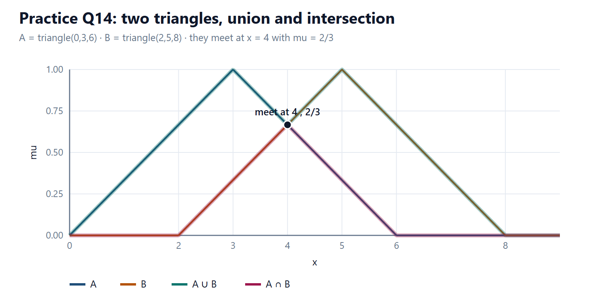

---

## 19. ماذا يجب أن تكون قادراً عليه بعد هذا الفصل

| # | القدرة | المحكّ |
|:--:|:---|:---|
| 1 | تكتب صيغ العمليات الخمس الأساسية | $\max$ · $\min$ · $1-\mu_A$ · $\mu_A\mu_B$ · $\alpha\mu_A$ |
| 2 | تحسب أي عملية على ثلاث عناصر | خطوة بخطوة: **العملية أولاً، ثم إدخال الرقمين، ثم النتيجة** |
| 3 | تفرّق بين `⊕` و`⊖` | حدّد من السياق: مقرون بـ`⊖` فهو **bounded sum** |
| 4 | تبني مصفوفة $A \times B$ | $\min$ في كل خانة، والأبعاد $\lvert A \rvert \times \lvert B \rvert$ |
| 5 | تذكر أي القانونين يسقطان ولماذا | `excluded middle` و`contradiction` — بسبب فقدان الحدّ الحادّ |
| 6 | تذكر الحدّين الصامدين | $\mu_{A \cup \overline{A}} \ge 0.5$ و $\mu_{A \cap \overline{A}} \le 0.5$ |
| 7 | تسمّي أربع بديهيات للـT-norm | تبديل · تجميع · رتابة · $T(a,1)=a$ و $T(a,0)=0$ |
| 8 | تربط كل T-norm بـS-norm | $S(a,b) = 1 - T(1-a,\ 1-b)$ |
| 9 | تفرق بين concentration و dilation | $\alpha>1$ تصغّر (**very**) · $\alpha<1$ تكبّر (**more or less**) |
| 10 | ترسم مثلثين وتحدد قمة التقاطع | $\dfrac{x-a}{b-a} = \dfrac{c-x}{c-b}$ ثم اجعل الطرفين متساويين |

**قاعدة أخيرة واحدة:** لو ترددت بين صيغتين، ارسم. الأرقام تجي من الرسم.

---
