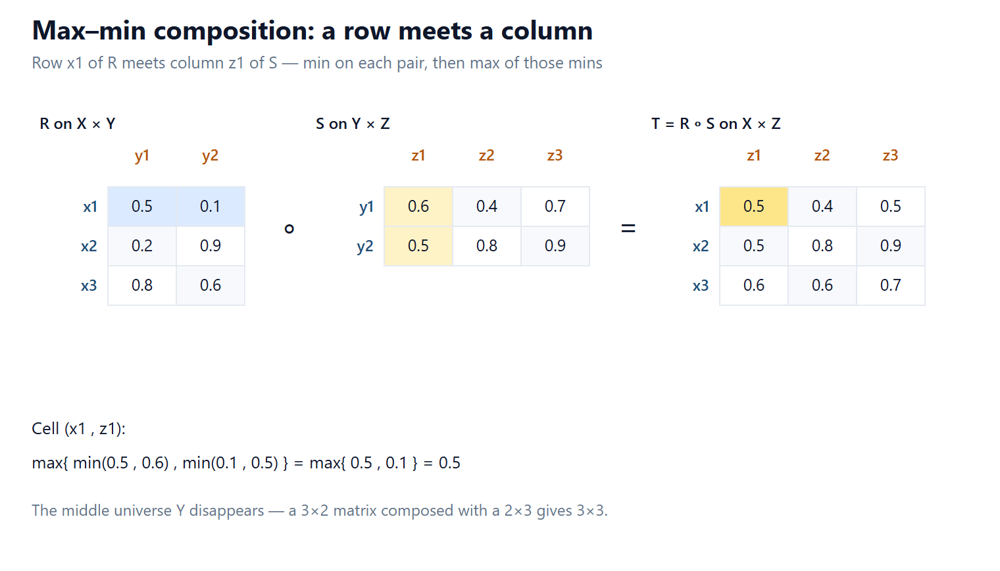
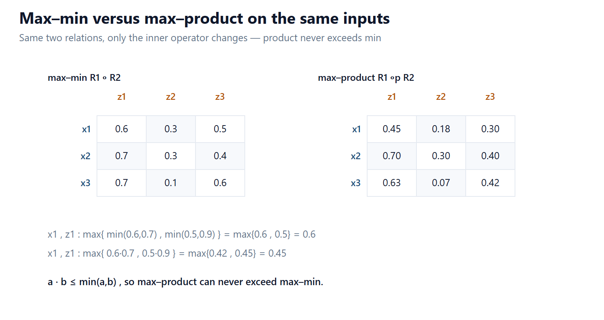
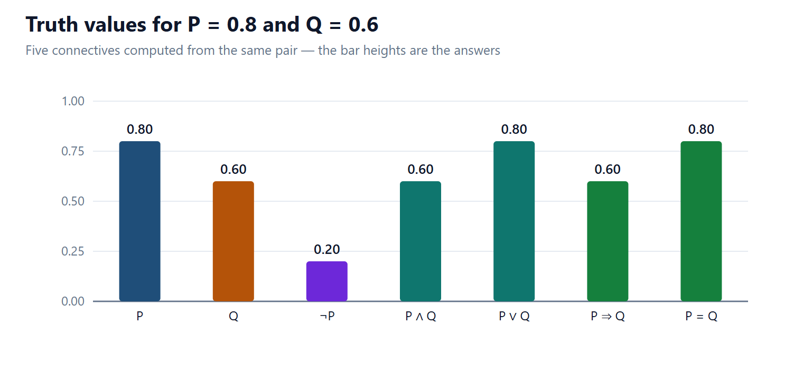
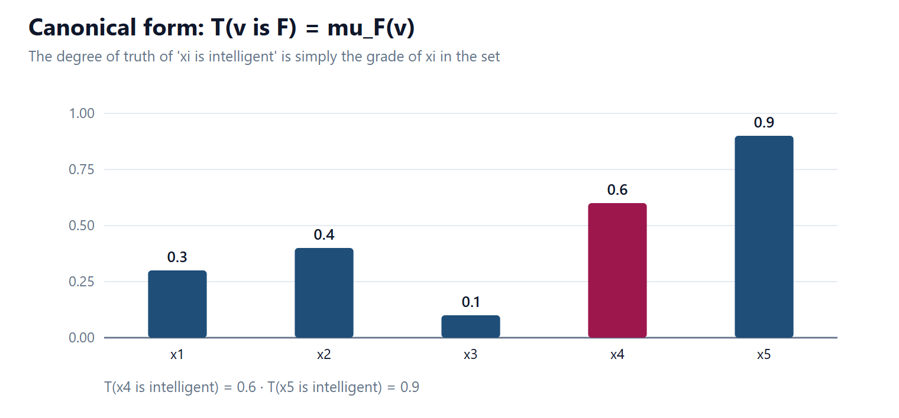

# الجزء 1 — العلاقات الضبابية والقضايا

> **من وين جاي:** بملزمة Ch4 سوّينا $A \times B$ وطلعنا **مصفوفة**. هذه المصفوفة هي **علاقة**. هالجزء يبني عليها كل شي بعده — لحد محرّك التحكّم الضبابي.

---

## 1. العلاقة الصلبة — subset من $A \times B$ (ص 5)

$$A \times B = \{(a,b) \mid a \in A,\ b \in B\}, \qquad |A \times B| = |A| \cdot |B|$$

$$A \times B \neq B \times A$$

الضرب الديكارتي **مو تبديلي** — الترتيب جزء من المعنى. $(2,3)$ مو $(3,2)$.

**العلاقة** هي مجموعة الأزواج المرتّبة التي تحقق قاعدة:

$$R = \{(a,b) \in A \times B \mid \text{condition}\}$$

### مثال

$$A = \{1,2,3,4\}, \quad B = \{3,5,7\}, \quad R = \{(a,b) \mid b = a+1\}$$

نبني كل زوج ممكن ونفحصه:

| $a$ | $a+1$ | موجود في $B$؟ | الزوج |
|:--:|:--:|:--:|:---|
| 1 | 2 | ❌ | — |
| 2 | 3 | ✅ | $(2,3)$ |
| 3 | 4 | ❌ | — |
| 4 | 5 | ✅ | $(4,5)$ |

$$R = \{(2,3),\ (4,5)\}$$

### مصفوفة العلاقة

| $a \backslash b$ | 3 | 5 | 7 |
|:--:|:--:|:--:|:--:|
| 1 | 0 | 0 | 0 |
| 2 | **1** | 0 | 0 |
| 3 | 0 | 0 | 0 |
| 4 | 0 | **1** | 0 |

**1** = الزوج موجود · **0** = غير موجود. مصفوفة العلاقة الصلبة **ثنائية**: ما فيها إلا 0 و1.

**⚠️ مصيدة:** حجم المجال هو

$$|A \times B| = |A| \cdot |B|$$

وهذا **حجم المجال**، مو عدد أزواج العلاقة. هنا $4 \times 3 = 12$ زوجاً ممكناً، والعلاقة اختارت **2** منهم.

---

## 2. العلاقة الضبابية — كل زوج له درجة (ص 6)

$$R = \{\, ((x,y),\ \mu_R(x,y)) \mid (x,y) \in X \times Y \,\}, \qquad \mu_R : X \times Y \to [0,1]$$

| | **علاقة صلبة** | **علاقة ضبابية** |
|:---|:---|:---|
| قيمة الخانة | $0$ أو $1$ | أي قيمة في $[0,1]$ |
| المعنى | الزوج موجود أو لا | **قوة** الرابط |
| العمليات | كل عمليات المجموعات | **نفسها** — خانة خانة |

> *«Only the entries change. Every crisp operation carries over to fuzzy relations.»*

### مثال — الأمراض والأعراض

$R \subseteq \text{diseases} \times \text{symptoms}$: شكد يبيّن كل مرض كل عَرَض؟

| المرض | running nose | high temp. | shivering |
|:---|:--:|:--:|:--:|
| **typhoid** | 0.1 | 0.9 | 0.8 |
| **viral** | 0.2 | 0.9 | 0.7 |
| **cold** | 0.9 | 0.4 | 0.6 |

**اقرأ صفاً:** التايفوئيد يبيّن حرارة عالية بدرجة **0.9**، بس رشح الأنف بدرجة **0.1** فقط. فالعلاقة **مو نعم/لا** — هي شدة.

**اقرأ عموداً:** عمود `running nose` يقول: الزكام هو اللي يفسّر الرشح أكثر من غيره (0.9).

---

## 3. طريقتان لبناء علاقة ضبابية (ص 7)

### الطريقة الأولى — من مجموعتين ضبابيتين

$$\mu_{A \times B}(x,y) = \min\big(\mu_A(x),\ \mu_B(y)\big)$$

$$A = \{(a_1,0.2),\ (a_2,0.7),\ (a_3,0.4)\}, \qquad B = \{(b_1,0.5),\ (b_2,0.6)\}$$

| $A \times B$ | $b_1 = 0.5$ | $b_2 = 0.6$ |
|:---|:--:|:--:|
| $a_1 = 0.2$ | $\min(0.2,\ 0.5) = $ **0.2** | $\min(0.2,\ 0.6) = $ **0.2** |
| $a_2 = 0.7$ | $\min(0.7,\ 0.5) = $ **0.5** | $\min(0.7,\ 0.6) = $ **0.6** |
| $a_3 = 0.4$ | $\min(0.4,\ 0.5) = $ **0.4** | $\min(0.4,\ 0.6) = $ **0.4** |

**فكرتها:** الدرجة الناتجة = **الأضعف** من الطرفين. لأن الزوج لا يكون أقوى من أضعف عنصر فيه.

### الطريقة الثانية — من صيغة على $X \times Y$

$$\mu_R(x,y) = \begin{cases} \dfrac{y-x}{4} & y > x \\[6pt] 0 & y \le x \end{cases}$$

المتغيّر: «$y$ أكبر بكثير من $x$». والكونان:

$$X = \{3,4,5\}, \qquad Y = \{3,4,5,6,7\}$$

| $x \backslash y$ | 3 | 4 | 5 | 6 | 7 |
|:--:|:--:|:--:|:--:|:--:|:--:|
| **3** | 0 | 0.25 | 0.50 | 0.75 | 1.00 |
| **4** | 0 | 0 | 0.25 | 0.50 | 0.75 |
| **5** | 0 | 0 | 0 | 0.25 | 0.50 |

**افحص ثلاث خانات:**

| الخانة | التعويض | الناتج |
|:--:|:---|:--:|
| $(3,7)$ | $\dfrac{7-3}{4} = \dfrac{4}{4}$ | **1** |
| $(3,5)$ | $\dfrac{5-3}{4} = \dfrac{2}{4}$ | **0.5** |
| $(5,4)$ | $4 \le 5$ ← صفر | **0** |

**⚠️ مصيدة:** الطريقة الأولى تعطي **0.6 كسقف** لأن $B$ سقفها 0.6. الطريقة الثانية تقدر توصل 1. السقف مو من العملية — من **المدخلات**.

---

## 4. الاتحاد والتقاطع والنفي على العلاقات (ص 8)

$$\mu_{R \cup P} = \max(\mu_R,\ \mu_P) \qquad \mu_{R \cap P} = \min(\mu_R,\ \mu_P) \qquad \mu_{\overline{R}} = 1 - \mu_R$$

**كلها خانة خانة** — العلاقة ما تتصرف كوحدة، تتصرف كمصفوفة.

### مثال

$$R = \begin{bmatrix} 0.5 & 0.1 \\ 0.2 & 0.9 \\ 0.8 & 0.6 \end{bmatrix}, \qquad P = \begin{bmatrix} 0.1 & 0.2 \\ 0.2 & 0.5 \\ 0.3 & 0.4 \end{bmatrix}$$

$$R \cup P = \begin{bmatrix} 0.5 & 0.2 \\ 0.2 & 0.9 \\ 0.8 & 0.6 \end{bmatrix}, \qquad R \cap P = \begin{bmatrix} 0.1 & 0.1 \\ 0.2 & 0.5 \\ 0.3 & 0.4 \end{bmatrix}, \qquad \overline{R} = \begin{bmatrix} 0.5 & 0.9 \\ 0.8 & 0.1 \\ 0.2 & 0.4 \end{bmatrix}$$

**فحص الخانة $(1,1)$:**

| العملية | الحساب | الناتج |
|:---|:---|:--:|
| اتحاد | $\max(0.5,\ 0.1)$ | **0.5** |
| تقاطع | $\min(0.5,\ 0.1)$ | **0.1** |
| نفي | $1-0.5$ | **0.5** |

**شرط:** الاتحاد والتقاطع يحتاجان العلاقتين على **نفس** $X \times Y$ (نفس الأبعاد). والنفي **أحادي** — يحتاج علاقة واحدة.

**⚠️ مصيدة:** لو الأبعاد مختلفة ($R$ عندها عمودان و$P$ ثلاثة)، **ما يصير** اتحاد — مو خطأ حسابي، هو **غير معرّف**.

---

## ✎ أسئلة — العلاقات وبناؤها

1 **س1.** عرّف العلاقة الصلبة والضبابية بفرق واحد.

**الحل:**

| | علاقة صلبة | علاقة ضبابية |
|:---|:---|:---|
| قيمة الخانة | $0$ أو $1$ فقط | أي قيمة في $[0,1]$ |
| الدلالة | الزوج **موجود** أو **غير موجود** | **قوة** الرابط |
| المصفوفة | ثنائية | متدرّجة |

**بصيغة واحدة:** العلاقة الصلبة مجموعتها $\{0,1\}$، والعلاقة الضبابية مجموعتها $\{((x,y),\mu_R(x,y))\}$ — أي كل زوج **ينتسب** له بدل ما يكون أو لا يكون.

---

2 **س2.** $A = \{1,2,3,4\}$ و $B = \{3,5,7\}$ و $R = \{(a,b) \mid b = a+1\}$. ابنِ $R$ ومصفوفتها.

**الحل — الخطوة 1:** افحص كل $a$ في $A$:

$$a=1 \Rightarrow a+1=2 \notin B \qquad a=2 \Rightarrow a+1=3 \in B$$
$$a=3 \Rightarrow a+1=4 \notin B \qquad a=4 \Rightarrow a+1=5 \in B$$

**الخطوة 2:** اجمع الأزواج survivors:

$$R = \{(2,3),\ (4,5)\}$$

**الخطوة 3:** المصفوفة (1 = موجود):

| $a \backslash b$ | 3 | 5 | 7 |
|:--:|:--:|:--:|:--:|
| 1 | 0 | 0 | 0 |
| 2 | **1** | 0 | 0 |
| 3 | 0 | 0 | 0 |
| 4 | 0 | **1** | 0 |

**الخطوة 4 — انتبه للفرق:** حجم المجال $4 \times 3 = 12$، لكن العلاقة فيها **زوجان فقط**.

---

3 **س3.** احسب $R \cup P$ و $R \cap P$ و $\overline{R}$ للمصفوفتين:

$$R = \begin{bmatrix} 0.5 & 0.1 \\ 0.2 & 0.9 \\ 0.8 & 0.6 \end{bmatrix}, \qquad P = \begin{bmatrix} 0.1 & 0.2 \\ 0.2 & 0.5 \\ 0.3 & 0.4 \end{bmatrix}$$

**الحل — خانة خانة:**

| الخانة | $\max$ (اتحاد) | $\min$ (تقاطع) | $1-\mu_R$ (نفي) |
|:--:|:--:|:--:|:--:|
| $(1,1)$ | $\max(0.5,\ 0.1) = $ **0.5** | $\min(0.5,\ 0.1) = $ **0.1** | $1-0.5 = $ **0.5** |
| $(1,2)$ | $\max(0.1,\ 0.2) = $ **0.2** | $\min(0.1,\ 0.2) = $ **0.1** | $1-0.1 = $ **0.9** |
| $(2,1)$ | $\max(0.2,\ 0.2) = $ **0.2** | $\min(0.2,\ 0.2) = $ **0.2** | $1-0.2 = $ **0.8** |
| $(2,2)$ | $\max(0.9,\ 0.5) = $ **0.9** | $\min(0.9,\ 0.5) = $ **0.5** | $1-0.9 = $ **0.1** |
| $(3,1)$ | $\max(0.8,\ 0.3) = $ **0.8** | $\min(0.8,\ 0.3) = $ **0.3** | $1-0.8 = $ **0.2** |
| $(3,2)$ | $\max(0.6,\ 0.4) = $ **0.6** | $\min(0.6,\ 0.4) = $ **0.4** | $1-0.6 = $ **0.4** |

$$R \cup P = \begin{bmatrix} 0.5 & 0.2 \\ 0.2 & 0.9 \\ 0.8 & 0.6 \end{bmatrix}, \qquad R \cap P = \begin{bmatrix} 0.1 & 0.1 \\ 0.2 & 0.5 \\ 0.3 & 0.4 \end{bmatrix}, \qquad \overline{R} = \begin{bmatrix} 0.5 & 0.9 \\ 0.8 & 0.1 \\ 0.2 & 0.4 \end{bmatrix}$$

---

4 **س4.** $A = \{(a_1,0.2),(a_2,0.7),(a_3,0.4)\}$ و $B = \{(b_1,0.5),(b_2,0.6)\}$. ابنِ $A \times B$، ثم قارن سقفها بسقف علاقة $\mu_R(x,y) = \dfrac{y-x}{4}$.

**الحل — الخطوة 1:** $A \times B$ بـ`min`:

$$A \times B = \begin{bmatrix} \min(0.2,\ 0.5) & \min(0.2,\ 0.6) \\ \min(0.7,\ 0.5) & \min(0.7,\ 0.6) \\ \min(0.4,\ 0.5) & \min(0.4,\ 0.6) \end{bmatrix} = \begin{bmatrix} 0.2 & 0.2 \\ 0.5 & 0.6 \\ 0.4 & 0.4 \end{bmatrix}$$

**الخطوة 2 — السقف:** أقصى قيمة في $A \times B$ هي **0.6** — وهي سقف $B$ نفسه.

**الخطوة 3 — بالمقارنة:** في $\dfrac{y-x}{4}$ القيمة الكبرى تكون عندما $y-x = 4$، فيصير 1. أي أن سقف العلاقة الثانية **1** والسقف الأول **0.6**.

**الدرس:** السقف **مو من العملية** — العملية `min` ما تنتج إلا أضعف الطرفين. السقف من **المدخلات**.

---

## 5. تركيب max–min — محرّك الاستدلال (ص 9)

$$\mu_{R \circ S}(x,z) = \max_{y \in Y}\ \min\big(\mu_R(x,y),\ \mu_S(y,z)\big)$$

$$R \subseteq X \times Y, \quad S \subseteq Y \times Z \quad\Longrightarrow\quad R \circ S \subseteq X \times Z$$

### الفكرة بثلاث كلمات

**ضرب مصفوفات، بس بدّل العمليتين:** الضرب $\cdot$ صار **$\min$**، والجمع $+$ صار **$\max$**.

$$\text{matrix product: } \sum (r_{ik} \cdot s_{kj}) \quad\Longrightarrow\quad \text{composition: } \max_k \min(r_{ik}, s_{kj})$$

### القاعدة العملية

**1)** خذ **صف** $x$ من $R$ و**عمود** $z$ من $S$.

**2)** **قابِل** الأرقام واحد بواحد وخذ `min` لكل زوج.

**3)** خذ `max` من النواتج.

**4)** النتيجة رقم واحد للخانة $(x,z)$.

> **`Y` لازم يكون مشترك** — مثل الأبعاد الداخلية بضرب المصفوفات.

---

## 6. التركيب محسوباً خانة خانة (ص 10)

$$R = \begin{bmatrix} 0.5 & 0.1 \\ 0.2 & 0.9 \\ 0.8 & 0.6 \end{bmatrix}_{X \times Y}, \qquad S = \begin{bmatrix} 0.6 & 0.4 & 0.7 \\ 0.5 & 0.8 & 0.9 \end{bmatrix}_{Y \times Z}$$

$$T = R \circ S = \begin{bmatrix} 0.5 & 0.4 & 0.5 \\ 0.5 & 0.8 & 0.9 \\ 0.6 & 0.6 & 0.7 \end{bmatrix}_{X \times Z}$$

### الحساب كامل — كل خانة

$$\begin{aligned}
\mu_T(x_1,z_1) &= \max\{\min(0.5,\ 0.6),\ \min(0.1,\ 0.5)\} = \max\{0.5,\ 0.1\} = 0.5 \\
\mu_T(x_1,z_2) &= \max\{\min(0.5,\ 0.4),\ \min(0.1,\ 0.8)\} = \max\{0.4,\ 0.1\} = 0.4 \\
\mu_T(x_1,z_3) &= \max\{\min(0.5,\ 0.7),\ \min(0.1,\ 0.9)\} = \max\{0.5,\ 0.1\} = 0.5 \\
\mu_T(x_2,z_1) &= \max\{\min(0.2,\ 0.6),\ \min(0.9,\ 0.5)\} = \max\{0.2,\ 0.5\} = 0.5 \\
\mu_T(x_2,z_2) &= \max\{\min(0.2,\ 0.4),\ \min(0.9,\ 0.8)\} = \max\{0.2,\ 0.8\} = 0.8 \\
\mu_T(x_2,z_3) &= \max\{\min(0.2,\ 0.7),\ \min(0.9,\ 0.9)\} = \max\{0.2,\ 0.9\} = 0.9 \\
\mu_T(x_3,z_1) &= \max\{\min(0.8,\ 0.6),\ \min(0.6,\ 0.5)\} = \max\{0.6,\ 0.5\} = 0.6 \\
\mu_T(x_3,z_2) &= \max\{\min(0.8,\ 0.4),\ \min(0.6,\ 0.8)\} = \max\{0.4,\ 0.6\} = 0.6 \\
\mu_T(x_3,z_3) &= \max\{\min(0.8,\ 0.7),\ \min(0.6,\ 0.9)\} = \max\{0.7,\ 0.6\} = 0.7
\end{aligned}$$

**الأبعاد:** $R$ هي $3 \times 2$ و$S$ هي $2 \times 3$، فالناتج **$3 \times 3$**. الـ**2** الأوسط اختفى — وهذا شكل الضرب المصفوفي.

> 📋 **قالب العمل بالامتحان:** ارسم جدولاً بالخانات، واكتب **داخل كل خانة** `max{min(a,b), min(c,d)}` **قبل** ما تحسب. علامات الصيغة وعلامات الخطوات منفصلتان، فكتابة القالب تجيب لك الدرجة حتى لو غلطت بالرقم الأخير.

---

## 7. تركيب max–product — نسخة ألطف (ص 11)

$$\mu_{R \circ_p S}(x,z) = \max_{y \in Y}\ \big(\mu_R(x,y) \cdot \mu_S(y,z)\big)$$

الفرق الوحيد: بدل `min` نضرب.

### المثال — نفس المدخلات، عمليتان

$$R_1 = \begin{bmatrix} 0.6 & 0.5 \\ 1 & 0.1 \\ 0 & 0.7 \end{bmatrix}, \qquad R_2 = \begin{bmatrix} 0.7 & 0.3 & 0.4 \\ 0.9 & 0.1 & 0.6 \end{bmatrix}$$

| | **max–min** | **max–product** |
|:---|:--|:--|
| $x_1$ | 0.6 · 0.3 · 0.5 | **0.45** · **0.18** · **0.30** |
| $x_2$ | 0.7 · 0.3 · 0.4 | 0.70 · 0.30 · 0.40 |
| $x_3$ | 0.7 · 0.1 · 0.6 | **0.63** · **0.07** · **0.42** |

**افحص $(x_1,z_1)$:**

$$\text{max–min:}\quad \max\{\min(0.6,\ 0.7),\ \min(0.5,\ 0.9)\} = \max\{0.6,\ 0.5\} = 0.6$$

$$\text{max–product:}\quad \max\{0.6 \times 0.7,\ 0.5 \times 0.9\} = \max\{0.42,\ 0.45\} = 0.45$$

### القاعدتان اللتان تحفظهما

**1)** **max–product $\le$ max–min دائماً** — لأن $a \cdot b \le \min(a,b)$.

**2)** **بالعلاقات الصلبة (0/1) الاثنان يتفقان** — لأن $0 \times 0 = \min(0,0)$ و$1 \times 1 = \min(1,1)$.

**⚠️ مصيدة:** لا تفترض إن الاثنين يعطون نفس الجواب. بـ$x_1$ الفرق واضح (0.6 مقابل 0.45). والسؤال قد يطلب **الاثنين** صراحةً.

---

## ✎ أسئلة — التركيب

5 **س5.** اكتب صيغة تركيب max–min وفسّر كل رمز فيها.

**الحل:**

$$\mu_{R \circ S}(x,z) = \max_{y \in Y}\ \min\big(\mu_R(x,y),\ \mu_S(y,z)\big)$$

| الرمز | معناه |
|:---|:---|
| $\mu_{R \circ S}(x,z)$ | درجة العلاقة الناتجة عند الزوج $(x,z)$ |
| $\max_{y \in Y}$ | نمرّ على **كل** عناصر $Y$ |
| $\min(\cdot,\cdot)$ | لكل $y$ نأخذ الأصغر بين درجة $R$ عند $x$ ودرجة $S$ عند $z$ |

**بالترتيب:** نمرّ على كل $y$ ← نأخذ `min` لكل زوج ← نأخذ `max` من النواتج. ملاحظة: `min` **قبل** `max`.

---

6 **س6.** ليش لازم $R$ و$S$ تتقاسمان $Y$ قبل ما $R \circ S$ تتحوّل؟

> **نص المسألة:** *"Why must R and S share the middle universe Y before R ∘ S can be formed?"*

**شنو المطلوب؟** سؤال **مفاهيمي** مو حسابي. ما يريد أرقام — يريد تفسير **الشرط** الذي بدونه التركيب غير معرّف. والجواب الصح يمرّ بثلاث نقاط: شنو يعني التركيب، من وين يجي الربط، وشو يصير لو ما تحقّق الشرط.

**خطة الحل:**

**1)** عرّف التركيب: العلاقة الناتجة على $X \times Z$، وكل خانة فيها تحتاج **مسارات** عبر $Y$.

**2)** بيّن إن الربط يصير على $y$ — نفس $y$ من صف $R$ ومن عمود $S$.

**3)** اربطها بضرب المصفوفات (الأبعاد الداخلية).

**4)** اذكر النتيجة لو اختلف الكونان.

**الحل:**

**الخطوة 1 — شنو ينتج التركيب.** العلاقة الناتجة $T = R \circ S$ تعيش على $X \times Z$، وكل خانة فيها تُحسب من **كل** العناصر $y$ المشتركة.

**الخطوة 2 — من وين يجي الربط.** نأخذ صفاً من $R$ عند $x$، وعموداً من $S$ عند $z$. والقيم اللي تُقابَل هي قيم $y$: كل $y$ في الصف لازم يقابله **نفس** $y$ في العمود. فلو ماكو نفس $y$، ماكو زوج يُقابَل، والقالب $\min$ ما يشتغل.

**الخطوة 3 — التشبيه المصفوفي.** $(3 \times 2)(2 \times 3)$ تشتغل، و$(3 \times 2)(4 \times 3)$ **ما تشتغل** — لأن البعد الداخلي (2) لازم يتطابق. و$Y$ هو البعد الداخلي هنا.

**الخطوة 4 — لو اختلف الكونان.** لو $R \subseteq X \times Y_1$ و$S \subseteq Y_2 \times Z$ مع $Y_1 \neq Y_2$ ← ماكو تطابق بين أي $y$، فالتركيب **غير معرّف** أصلاً (مو خطأ حسابي).

---

7 **س7.** علاقتان $3 \times 2$ و $2 \times 3$ — شنو أبعاد الناتج؟ وشنو صار للبعد الأوسط؟

**الحل:**

$$(3 \times 2)(2 \times 3) = 3 \times 3$$

الناتج **$3 \times 3$**. البعد الأوسط **2** يختفي تماماً — تماماً مثل ضرب المصفوفات: الأبعاد الداخلية تضرب بعضها وتُحذف من الناتج.

---

8 **س8.** $R = \begin{bmatrix} 0.3 & 0.8 \\ 0.6 & 0.1 \end{bmatrix}$ و $S = \begin{bmatrix} 0.5 & 0.9 \\ 0.4 & 0.7 \end{bmatrix}$. احسب $R \circ S$ بـmax–min و $R \circ_p S$ بـmax–product.

> **نص المسألة:** *"R = [0.3 0.8; 0.6 0.1], S = [0.5 0.9; 0.4 0.7]. Find R ∘ S by max–min and by max–product."*

**شنو المطلوب؟** عندك علاقتان، كل واحدة **$2 \times 2$**. المطلوب **ناتجان**، مو واحد: الأول بقاعدة **max–min** والثاني بقاعدة **max–product**. والناتج في الحالتين مصفوفة **$2 \times 2$** (لأن $2\times2$ مع $2\times2$ تعطي $2\times2$). المقصود من السؤال إنك تشوف الفرق بين القاعدتين على نفس الأرقام.

**خطة الحل:**

**1)** تحقّق من التوافق: البعد الداخلي متساوٍ (2 = 2) ← التركيب ممكن.

**2)** اكتب القالب مرّة واحدة قبل أي حساب.

**3)** احسب max–min: أربع خانات.

**4)** احسب max–product: أربع خانات بنفس الترتيب.

**5)** قارن الناتجين.

**الحل:**

**الخطوة 1 — التوافق.** $R$ هي $2 \times 2$ و$S$ هي $2 \times 2$، فالبعد الداخلي 2 = 2 ✓ والناتج $2 \times 2$.

**الخطوة 2 — القالب.**

$$\mu_T(x_i,z_j) = \max\{\min(r_{i1}, s_{1j}),\ \min(r_{i2}, s_{2j})\}$$

**الخطوة 3 — max–min أربع خانات:**

| الخانة | التعويض | `min` | `max` |
|:---|:---|:---|:--:|
| $(x_1,z_1)$ | $\min(0.3,\ 0.5),\ \min(0.8,\ 0.4)$ | $0.3,\ 0.4$ | **0.4** |
| $(x_1,z_2)$ | $\min(0.3,\ 0.9),\ \min(0.8,\ 0.7)$ | $0.3,\ 0.7$ | **0.7** |
| $(x_2,z_1)$ | $\min(0.6,\ 0.5),\ \min(0.1,\ 0.4)$ | $0.5,\ 0.1$ | **0.5** |
| $(x_2,z_2)$ | $\min(0.6,\ 0.9),\ \min(0.1,\ 0.7)$ | $0.6,\ 0.1$ | **0.6** |

$$R \circ S = \begin{bmatrix} 0.4 & 0.7 \\ 0.5 & 0.6 \end{bmatrix}$$

**الخطوة 4 — max–product أربع خانات:**

| الخانة | التعويض | الضرب | `max` |
|:---|:---|:---|:--:|
| $(x_1,z_1)$ | $0.3 \times 0.5,\ 0.8 \times 0.4$ | $0.15,\ 0.32$ | **0.32** |
| $(x_1,z_2)$ | $0.3 \times 0.9,\ 0.8 \times 0.7$ | $0.27,\ 0.56$ | **0.56** |
| $(x_2,z_1)$ | $0.6 \times 0.5,\ 0.1 \times 0.4$ | $0.30,\ 0.04$ | **0.30** |
| $(x_2,z_2)$ | $0.6 \times 0.9,\ 0.1 \times 0.7$ | $0.54,\ 0.07$ | **0.54** |

$$R \circ_p S = \begin{bmatrix} 0.32 & 0.56 \\ 0.30 & 0.54 \end{bmatrix}$$

**الخطوة 5 — المقارنة:** كل قيمة بالـproduct **أصغر** من نظيرتها بالـmin — كما تتوقع من القاعدة $a\cdot b \le \min(a,b)$.

---

9 **س9.** شنو الفرق بين max–min و max–product؟

**الحل:**

| | max–min | max–product |
|:---|:---|:---|
| العملية على كل زوج | $\min(a,b)$ | $a \cdot b$ |
| الناتج | selects **أحد الطرفين** | يعطي **رقم ثالث** أصغر منهما |
| العلاقة | $\mu_{R\circ_p S} \le \mu_{R\circ S}$ دائماً | |

**السبب:** $a \cdot b \le \min(a,b)$ دائماً — لأن $ab \le a$ و$ab \le b$ داخل $[0,1]$. فالـproduct **أشدّ** من الـmin، و`max` فوق القمة الأشدّ يعطي نتيجة أصغر أو مساوية.

---

10 **س10.** متى يعطي max–min و max–product نفس الجواب؟

**الحل:**

**فقط إذا كانت العلاقات صلبة** (قيمها 0 و1 فقط).

**السبب:** عند $0/1$ تنعدم حالة «رقم ثالث»:

$$0 \times 0 = 0 = \min(0,0) \qquad 1 \times 1 = 1 = \min(1,1)$$

وأي زوج فيه 0 و1: $0 \times 1 = 0 = \min(0,1)$. فالعمليتان متطابقتان على كل خانة.

**⚠️ مصيدة:** بمجرد ما تدخل قيمة **بين الصفر والواحد** — مثل 0.6 — ينفصلان. على $x_1$ في المثال: 0.6 مقابل 0.45.

---

## 8. تسلسل ثلاثي: نبات ← مرض ← عَرَض (ص 12)

هذا المثال يبيّن **ليش** التركيب مفيد: يوصّل مساراً كامل عبر كونين.

$$R: \text{plant} \to \text{disease}, \qquad S: \text{disease} \to \text{symptom}, \qquad R \circ S: \text{plant} \to \text{symptom}$$

$$R = \begin{bmatrix} 0.1 & 0.3 & 0.5 & 0.7 \\ 0.4 & 0.2 & 0.8 & 0.9 \\ 0.6 & 0.8 & 0.3 & 0.2 \end{bmatrix}, \qquad S = \begin{bmatrix} 0.9 & 0.1 \\ 0.2 & 0.3 \\ 0.5 & 0.6 \\ 0.7 & 0.2 \end{bmatrix}$$

$$T = R \circ S = \begin{bmatrix} 0.7 & 0.5 \\ 0.7 & 0.6 \\ 0.6 & 0.3 \end{bmatrix}$$

### الحساب كامل

$$\mu_T(P_2,S_1) = \max\{0.4 \wedge 0.9,\ 0.2 \wedge 0.2,\ 0.8 \wedge 0.5,\ 0.9 \wedge 0.7\}$$
$$= \max\{0.4,\ 0.2,\ 0.5,\ 0.7\} = 0.7$$

**اقرأها بلغة:** النبات $P_2$ يبيّن العَرَض $S_1$ بدرجة **0.7**، وأقوى مسار يمرّ عبر المرض $D_4$.

### ليش هذا مهم؟

- هذا **مخطط تشخيص**: نبات ← مرض ← عَرَض.
- وهو **نفس منطق القاعدة الضبابية**: $x$ ← $y$ ← $z$. يعني الجزء التالي (الاستلزام) يبني على نفس الآلة.
- لاحظ إن الدرجة النهائية **مو** مجموع — هي **أقوى مسار**. `max` تختار المسار الأقوى، و`min` تضمن إن المسار لا يتجاوز أضعف حلقة فيه.

---

## ✎ أسئلة — التسلسل الثلاثي

11 **س11.** نبات ← مرض ← عَرَض. احسب $\mu_T(P_1,S_2)$ من المصفوفتين:

$$R = \begin{bmatrix} 0.1 & 0.3 & 0.5 & 0.7 \\ 0.4 & 0.2 & 0.8 & 0.9 \\ 0.6 & 0.8 & 0.3 & 0.2 \end{bmatrix}, \qquad S = \begin{bmatrix} 0.9 & 0.1 \\ 0.2 & 0.3 \\ 0.5 & 0.6 \\ 0.7 & 0.2 \end{bmatrix}$$

**الحل — خطوة بخطوة:**

**1)** صف $P_1$ من $R$ هو $(0.1,\ 0.3,\ 0.5,\ 0.7)$.

**2)** عمود $S_2$ من $S$ هو $(0.1,\ 0.3,\ 0.6,\ 0.2)$.

**3)** قابِل واحداً واحداً وخذ `min`:

$$\min(0.1,\ 0.1) = 0.1 \quad \min(0.3,\ 0.3) = 0.3 \quad \min(0.5,\ 0.6) = 0.5 \quad \min(0.7,\ 0.2) = 0.2$$

**4)** خذ `max`:

$$\mu_T(P_1,S_2) = \max\{0.1,\ 0.3,\ 0.5,\ 0.2\} = \mathbf{0.5}$$

**5)** اقرأها: النبات $P_1$ يبيّن العَرَض $S_2$ بدرجة **0.5**، وأقوى مسار يمرّ عبر المرض $D_3$ (لأن $0.5 \wedge 0.6 = 0.5$ هو الأكبر).

---

## 9. من منطق ثنائي إلى منطق متعدد القيم (ص 14)

| | القضية الصلبة | القضية الضبابية |
|:---|:---|:---|
| قيمة الصدق | $T(P) \in \{0,1\}$ | $T(P) \in [0,1]$ |
| مثال | «الشمس تطلع من الشرق» ← $T=1$ | «المانجو حلوة» ← $T=0.7$ |

**المنطق الثلاثي** يضيف القيمة **½** بين الصدق والكذب.

### جدول الحقيقة الثلاثي كامل

$$\text{AND}: \quad a \wedge b = \min(a,b) \qquad\qquad \text{OR}: \quad a \vee b = \max(a,b)$$

$$\text{NOT}: \quad \neg a = 1-a \qquad\qquad \text{EQUIV}: \quad (a = b) = 1-\lvert a-b \rvert$$

$$\text{IMPLICATION}: \quad a \Rightarrow b = \max(1-a,\ b)$$

| $a$ | $b$ | $a \wedge b$ | $a \vee b$ | $\neg a$ | $a \Rightarrow b$ | $a = b$ |
|:--:|:--:|:--:|:--:|:--:|:--:|:--:|
| 0 | 0 | 0 | 0 | 1 | 1 | 1 |
| 0 | ½ | 0 | ½ | 1 | 1 | ½ |
| 0 | 1 | 0 | 1 | 1 | 1 | 0 |
| ½ | 0 | 0 | ½ | ½ | ½ | ½ |
| ½ | ½ | ½ | ½ | ½ | ½ | 1 |
| ½ | 1 | ½ | 1 | ½ | 1 | ½ |
| 1 | 0 | 0 | 1 | 0 | 0 | 0 |
| 1 | ½ | ½ | 1 | 0 | ½ | ½ |
| 1 | 1 | 1 | 1 | 0 | 1 | 1 |

**لا تحفظ الجدول — احفظ الصيغ الخمس.** الجدول كله يطلع منها بثوانٍ.

**فحص سطرين:**
- $(a,b)=(0,\tfrac12)$: $\wedge=0$ · $\vee=\tfrac12$ · $\neg a=1$ · $\Rightarrow=\max(1,\tfrac12)=1$ · $==1-\tfrac12=\tfrac12$ ✓
- $(a,b)=(\tfrac12,1)$: $\wedge=\tfrac12$ · $\vee=1$ · $\neg a=\tfrac12$ · $\Rightarrow=\max(\tfrac12,1)=1$ · $==1-\tfrac12=\tfrac12$ ✓

**🧠 ملاحظة مهمة:** لاحظ الخانة $(a,b)=(0,\tfrac12)$ ← $a \Rightarrow b = 1$. **المقدمة الكاذبة تجعل الاستلزام صحيحاً** بلا شرط. هذي فكرة راح تتكرر بالجزء الثاني (عائلتا المشغّلات) وهي مفتاح فهم الفرق بينهما.

---

## 10. الروابط الخمسة — الجدول الرسمي (ص 15)

| الرمز | الرابط | الاستعمال | قيمة الصدق |
|:--:|:---|:---|:---|
| $\neg$ | NOT | $\neg P$ | $1 - T(P)$ |
| $\vee$ | OR | $P \vee Q$ | $\max\{T(P),\ T(Q)\}$ |
| $\wedge$ | AND | $P \wedge Q$ | $\min\{T(P),\ T(Q)\}$ |
| $\Rightarrow$ | IMPLICATION | $P \Rightarrow Q$ أي $\neg P \vee Q$ | $\max\{1-T(P),\ T(Q)\}$ |
| $=$ | EQUALITY | $(P \Rightarrow Q) \wedge (Q \Rightarrow P)$ | $1 - \lvert T(P)-T(Q) \rvert$ |

### مثال

$$P: \text{Mary is efficient},\ T(P)=0.8 \qquad Q: \text{Ram is efficient},\ T(Q)=0.6$$

«إذا ماري كفوءة فرام كفوء»:

$$T(P \Rightarrow Q) = \max\{1-0.8,\ 0.6\} = \max\{0.2,\ 0.6\} = \mathbf{0.6}$$

| التعبير | الحساب | القيمة |
|:---|:---|:--:|
| $\neg P$ | $1-0.8$ | **0.2** |
| $P \wedge Q$ | $\min(0.8,\ 0.6)$ | **0.6** |
| $P \vee Q$ | $\max(0.8,\ 0.6)$ | **0.8** |
| $P \Rightarrow Q$ | $\max(0.2,\ 0.6)$ | **0.6** |
| $P = Q$ | $1-\lvert0.8-0.6\rvert = 1-0.2$ | **0.8** |

**⚠️ مصيدة:** $P \Rightarrow Q$ **مو** $T(P)\cdot T(Q)$ ولا $T(P)-T(Q)$. إذا حفظت الصيغة الوحيدة $\max(1-a,\ b)$ تسلم بكل الحالات.

---

## ✎ أسئلة — الروابط الخمسة

12 **س12.** اكتب الروابط الخمسة بصيغها.

**الحل:**

$$\neg P:\ 1 - T(P) \qquad\qquad P \vee Q:\ \max\{T(P),\ T(Q)\}$$
$$P \wedge Q:\ \min\{T(P),\ T(Q)\} \qquad\qquad P \Rightarrow Q:\ \max\{1-T(P),\ T(Q)\}$$
$$P = Q:\ 1 - \lvert T(P)-T(Q) \rvert$$

**Mnemonic:** نفي = 1 ناقص · OR = أعلى · AND = أدنى · استلزام = أعلى ما بين «نفي المقدّمة» و«النتيجة» · مساوة = واحد ناقص الفرق.

---

13 **س13.** $T(P) = 0.7$ و $T(Q) = 0.4$. احسب $T(\neg P)$ و $T(P\wedge Q)$ و $T(P\vee Q)$ و $T(P\Rightarrow Q)$ و $T(P=Q)$.

> **نص المسألة:** *"T(P) = 0.7 and T(Q) = 0.4. Find T(¬P), T(P∧Q), T(P∨Q), T(P⇒Q) and T(P=Q)."*

**شنو المطلوب؟** عندك **قضيتان** وقيمة صدق كل واحدة. المطلوب **خمس** قيم جديدة، كل واحدة من رابط مختلف. ما في "معادلة عامة" — كل رابط له صيغته، فالسؤال في الحقيقة خمس أسئلة صغيرة.

**خطة الحل:**

**1)** اكتب جدول الروابط الخمسة قبل الأرقام.

**2)** طبّق كل صيغة على $a = 0.7$ و$b = 0.4$.

**3)** افحص النتائج: هل تقع في $[0,1]$؟ وهل العلاقات المنطقية بينها معقولة؟

**الحل:**

**الخطوة 1 — القيم المعطاة:** $a = T(P) = 0.7$ و$b = T(Q) = 0.4$.

**الخطوة 2 — التطبيق، رابطاً رابطاً:**

| التعبير | الصيغة | الحساب | الناتج |
|:---|:---|:---|:--:|
| $T(\neg P)$ | $1-T(P)$ | $1-0.7$ | **0.3** |
| $T(P \wedge Q)$ | $\min$ | $\min(0.7,\ 0.4)$ | **0.4** |
| $T(P \vee Q)$ | $\max$ | $\max(0.7,\ 0.4)$ | **0.7** |
| $T(P \Rightarrow Q)$ | $\max(1-a,\ b)$ | $\max(0.3,\ 0.4)$ | **0.4** |
| $T(P = Q)$ | $1-\lvert a-b\rvert$ | $1-\lvert0.3\rvert$ | **0.7** |

**الخطوة 3 — فحص النتائج.** كل القيم في $[0,1]$ ✓. ولاحظ الترتيب المنطقي: $\neg P$ أصغر قيمة (0.3) لأن $P$ قوية، و$P \vee Q$ أكبر (0.7) لأن `max` تختار الأقوى — وهو $P$ نفسها.

**ملاحظة على $T(P \Rightarrow Q) = 0.4$ و$T(P \wedge Q) = 0.4$:** **تساويا هنا صدفةً** لأن $1-T(P) = 0.3 < T(Q) = 0.4 < T(P) = 0.7$. لا تعمّمها — لو تغيّرت القيمتان يفترقان.

---

14 **س14.** ليش $T(P\Rightarrow Q)$ ما تساوي $T(Q\Rightarrow P)$؟

**الحل:**

لأن الصيغة **مو متناظرة**:

$$T(P\Rightarrow Q) = \max\{1-T(P),\ T(Q)\} \qquad T(Q\Rightarrow P) = \max\{1-T(Q),\ T(P)\}$$

**مثال عددي** بـ$T(P)=0.8$ و$T(Q)=0.6$:

$$T(P\Rightarrow Q) = \max\{1-0.8,\ 0.6\} = \max\{0.2,\ 0.6\} = 0.6$$
$$T(Q\Rightarrow P) = \max\{1-0.6,\ 0.8\} = \max\{0.4,\ 0.8\} = 0.8$$

**فرق 0.2** — والسبب أن $P$ أقوى من $Q$: فـ$P \Rightarrow Q$ تنزل (المقدّمة ضعيفة)، و$Q \Rightarrow P$ ترتفع (المقدّمة $Q$ متوسطة والنتيجة $P$ قوية).

**⚠️ مصيدة:** الاستلزام في المنطق الكلاسيكي **غير متناظر** أيضاً — `False` $\Rightarrow$ True صحيح، وTrue $\Rightarrow$ False خطأ.

---

15 **س15.** عند $a = 0$ و $b = \tfrac12$: شنو $a \Rightarrow b$؟ وليش؟

**الحل:**

$$a \Rightarrow b = \max(1-a,\ b) = \max(1-0,\ \tfrac12) = \max(1,\ \tfrac12) = \mathbf{1}$$

**السبب:** المقدمة $a$ **كاذبة تماماً**. في المنطق الكلاسيكي، الاستلزام بمقدمة كاذبة **صحيح دائماً** (vacuously true) — لأن الاستلزام يقول «إذا تحققت $a$ entonces $b$»، و$a$ ما تحققت، فـالشرط كلّه ما له موضوع.

**🔗 الجسر للجزء الثاني:** هذا بالضبط **نقطة الانفصال** بين عائلتي المشغّلات — العائلة المربوطة تعطي 0 هنا، والعائلة المستلزمة تعطي 1.

---

## 11. الصيغة القانونية: $P : v \text{ is } F$ (ص 16)

$$P:\ v \text{ is } F \qquad\Longrightarrow\qquad T(P) = \mu_F(v)$$

| الرمز | المعنى |
|:---:|:---|
| $v$ | متغيّر يأخذ قيماً من كون $V$ |
| $F$ | مجموعة ضبابية على $V$ — عادةً **مصطلح لغوي** (hot · tall · intelligent) |
| $T(P)$ | درجة انتماء $v$ للمجموعة $F$ |

**أمثلة:**
- «20 °C is hot» ← $T = \mu_{\text{hot}}(20)$
- $T(x_4 \text{ is intelligent}) = \mu_{\text{intelligent}}(x_4) = 0.6$

**🧠 مرساة:** قيمة صدق القضية **هي** درجة العضوية. ما في حساب إضافي. هذا اللي يخلّي المنطق الضبابي طبيعياً — الجملة اللغوية صارت رقماً مباشرة.

---

## 12. من القضية إلى القاعدة إلى العلاقة (ص 17)

| # | العنصر | الصيغة | الشرح |
|:--:|:---|:---|:---|
| 1 | **Proposition** | $x \text{ is } A$ | قضية صدقها $\mu_A(x)$ |
| 2 | **Rule** | $\text{IF } x \text{ is } A \ \text{THEN } z \text{ is } C$ | تربط قضيتين |
| 3 | **Relation** | $R_i = A \times C \subseteq X \times Z$ | تُخزَّن **مصفوفة** على $X \times Z$ |

### المقدّمة المركّبة — القاعدتان

$$\text{IF } x \text{ is } A \ \text{OR } y \text{ is } B \ \text{THEN } z \text{ is } C: \qquad R = R_1 \cup R_2$$

$$\text{IF } x \text{ is } A \ \text{AND } y \text{ is } B \ \text{THEN } z \text{ is } C: \qquad R = R_1 \cap R_2$$

حيث $R_1 = A \times C$ و$R_2 = B \times C$.

**⚠️ مصيدة (مهمة):** منطقياً قد تتوقع العكس — «OR» توسّع الشرط فيصير الاتحاد أوسع، وهذا صحيح: **OR ← اتحاد**. أما «AND» يضيّق الشرط فيصير التقاطع أضيق: **AND ← تقاطع**. احفظها كجملة: *«أو تفتح، وو تظيّق»*.

**🧠 مرساة هذا القسم:** القاعدة الضبابية **مو كلام** — هي **مصفوفة** $A \times C$. وهذا اللي يخلّي محرّك الاستدلال يشتغل: يضرب القاعدة بالمقدمة.

---

## ✎ أسئلة — الصيغة القانونية والقواعد

16 **س16.** شنو الصيغة القانونية للقضية الضبابية؟ وماذا تعني أجزاؤها؟

**الحل:**

$$P : v \text{ is } F \qquad\Longrightarrow\qquad T(P) = \mu_F(v)$$

- $v$ — المتغيّر، يأخذ قيماً من كون $V$.
- $F$ — المجموعة الضبابية، عادةً **مصطلح لغوي** (hot · tall · intelligent).
- $T(P)$ — **درجة انتماء $v$ للمجموعة $F$**، أي $\mu_F(v)$.

**النقطة:** ما في حساب إضافي. قيمة صدق القضية **هي** درجة العضوية.

---

17 **س17.** قاعدة بمقدمة **OR** — شنو علاقتها؟ ومثال عددي.

**الحل:**

$$\text{IF } x \text{ is } A \ \text{OR } y \text{ is } B \ \text{THEN } z \text{ is } C \qquad\Longrightarrow\qquad R = R_1 \cup R_2$$

حيث $R_1 = A \times C$ و$R_2 = B \times C$.

**مثال عددي:** $A = \{(x,0.5)\}$ و $B = \{(y,0.3)\}$ و $C = \{(z,0.8)\}$

$$R_1 = A \times C = \{((x,z),\ \min(0.5,\ 0.8))\} = \{((x,z),\ 0.5)\}$$
$$R_2 = B \times C = \{((y,z),\ \min(0.3,\ 0.8))\} = \{((y,z),\ 0.3)\}$$
$$R = R_1 \cup R_2 = \{((x,z),\ 0.5),\ ((y,z),\ 0.3)\}$$

**الفهم:** «OR» يوسّع الشرط — فيُقبل $x$ **أو** $y$. والعلاقة الناتجة **اتحاد** (max) للعلاقتين.

---

18 **س18.** قاعدة بمقدمة **AND** — شنو علاقتها؟ ومثال عددي.

**الحل:**

$$\text{IF } x \text{ is } A \ \text{AND } y \text{ is } B \ \text{THEN } z \text{ is } C \qquad\Longrightarrow\qquad R = R_1 \cap R_2$$

**نفس البيانات:** $A = \{(x,0.5)\}$ و $B = \{(y,0.3)\}$ و $C = \{(z,0.8)\}$

$$R_1 = \{((x,z),\ 0.5)\}, \qquad R_2 = \{((y,z),\ 0.3)\}$$

$$R = R_1 \cap R_2 = \varnothing$$

**الفهم:** «AND» يضيّق الشرط — لازم $x$ **و** $y$ معاً. لأن $x \neq y$ فلا يوجد زوج مشترك، فالعلاقة **فارغة**.

**⚠️ المصيدة الكبرى:** «أو تفتح، وو تظيّق». الـOR = **اتحاد** (يوسّع) · الـAND = **تقاطع** (يضيّق). لا تعكسهم.

---

## 13. ورقة صيغ الجزء 1

| العملية | الصيغة | شرط |
|:---|:---|:---|
| الضرب الديكارتي | $\mu_{A \times B}(x,y) = \min(\mu_A(x),\ \mu_B(y))$ | كونان |
| اتحاد علاقات | $\mu_{R \cup P} = \max(\mu_R,\ \mu_P)$ | نفس الأبعاد |
| تقاطع علاقات | $\mu_{R \cap P} = \min(\mu_R,\ \mu_P)$ | نفس الأبعاد |
| نفي علاقة | $\mu_{\overline{R}} = 1-\mu_R$ | أحادية |
| **تركيب max–min** | $\mu_{R \circ S}(x,z) = \max_{y}\min(\mu_R(x,y),\ \mu_S(y,z))$ | $Y$ مشترك |
| **تركيب max–product** | $\mu_{R \circ_p S}(x,z) = \max_{y}(\mu_R \cdot \mu_S)$ | $Y$ مشترك |
| NOT | $1-T(P)$ | — |
| OR | $\max\{T(P),T(Q)\}$ | — |
| AND | $\min\{T(P),T(Q)\}$ | — |
| IMPLICATION | $\max\{1-T(P),\ T(Q)\}$ | — |
| EQUALITY | $1-\lvert T(P)-T(Q)\rvert$ | — |
| الصيغة القانونية | $T(v \text{ is } F) = \mu_F(v)$ | — |
| قاعدة OR | $R = R_1 \cup R_2$ | $R_i = A_i \times C$ |
| قاعدة AND | $R = R_1 \cap R_2$ | $R_i = A_i \times C$ |

---

## 14. مصائد الامتحان

| # | المصيدة | الجواب الآمن |
|:--:|:---|:---|
| 1 | التركيب = ضرب مصفوفات عادي | ❌ بدّل العمليتين: $\cdot \leftarrow \min$ و$+ \leftarrow \max$ |
| 2 | $R \circ S$ بلا شرط | يحتاج **$Y$ مشترك** وأبعاد متوافقة |
| 3 | max–product $\ge$ max–min | ❌ **أصغر أو يساوي** دائماً |
| 4 | $\overline{R}$ تحتاج علاقتين | ❌ **أحادية** |
| 5 | $A \times B = B \times A$ | ❌ الترتيب جزء من المعنى |
| 6 | $\lvert A \times B\rvert$ = عدد أزواج العلاقة | ❌ هي **حجم المجال** $=\lvert A\rvert\cdot\lvert B\rvert$ |
| 7 | OR ← تقاطع | ❌ **OR ← اتحاد** |
| 8 | AND ← اتحاد | ❌ **AND ← تقاطع** |
| 9 | $T(P\Rightarrow Q) = T(P)\cdot T(Q)$ | ❌ $\max(1-a,\ b)$ |
| 10 | $(a\Rightarrow b)$ عند $a=0$ | **1** — مقدمة كاذبة ← استلزام صحيح |
| 11 | $a=b$ تعني تطابق القيمتين | لا — $1-\lvert a-b\rvert$، فـ$0.8=0.6$ تعطي **0.8** مو 0 |
| 12 | $\wedge$ هنا مثل Ch4 | نفس الحساب، **لكن** هنا قضية ضد قضية مو درجة ضد درجة |
| 13 | $T(P\Rightarrow Q) = T(Q\Rightarrow P)$ | ❌ الصيغة غير متناظرة |
| 14 | $\max$ بعد $\min$ | ❌ الترتيب **$\min$ أولاً ثم $\max$** |
| 15 | $R \cup P$ بأبعاد مختلفة | ❌ **غير معرّف** — مو خطأ حسابي |

---

## 15. ماذا يجب أن تكون قادراً عليه بعد هذا الجزء

| # | القدرة | المحكّ |
|:--:|:---|:---|
| 1 | تبني علاقة صلبة من قاعدة | افحص كل $a$، ثم ضع 1 في المصفوفة |
| 2 | تفرّق بين العلاقة الصلبة والضبابية | 0/1 **بدون** قيمة وسطى ↔ قوة الرابط |
| 3 | تبني علاقة ضبابية بالطريقتين | `min` على المجموعةين ↔ صيغة على $X \times Y$ |
| 4 | تحسب اتحاداً وتقاطعاً ونفياً | خانة خانة: `max` · `min` · $1-\mu$ |
| 5 | تكتشف شرط التركيب | $Y$ مشترك — مثل البعد الداخلي في ضرب المصفوفات |
| 6 | تحسب خانة في التركيب | صف من $R$ × عمود من $S$ ← `min` لكل زوج ← `max` |
| 7 | تفرّق max–min من max–product | `min` مقابل الضرب، والـproduct **لا يزيد** |
| 8 | تعرف متى يتّفقان | فقط مع العلاقات **الصلبة** (0/1) |
| 9 | تحسب قيمة أي رابط من الخمسة | $1-T$ · `max` · `min` · $\max(1-T,T)$ · $1-\lvert T-T\rvert$ |
| 10 | تكتب الصيغة القانونية | $P : v \text{ is } F$ و $T(P) = \mu_F(v)$ |
| 11 | تحوّل قاعدة إلى علاقة | OR ← **اتحاد** · AND ← **تقاطع** |

---