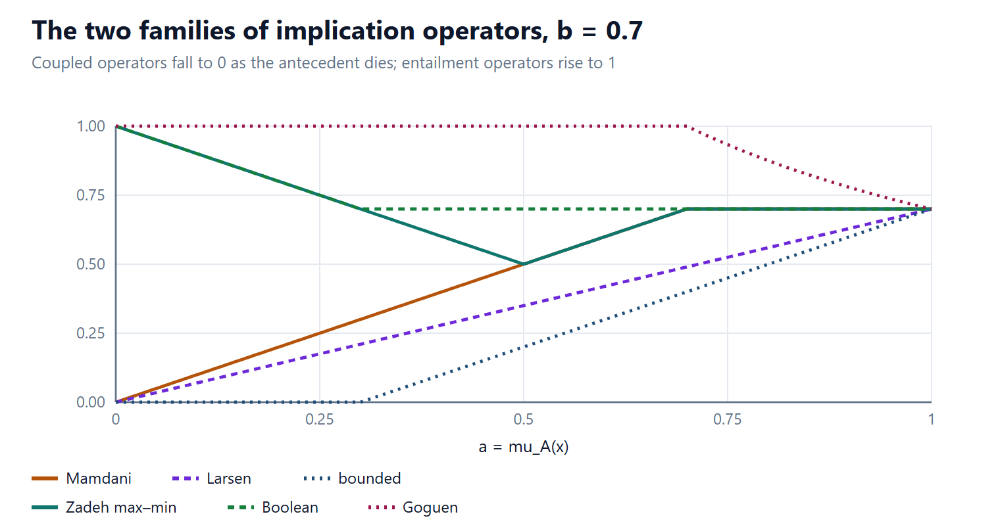
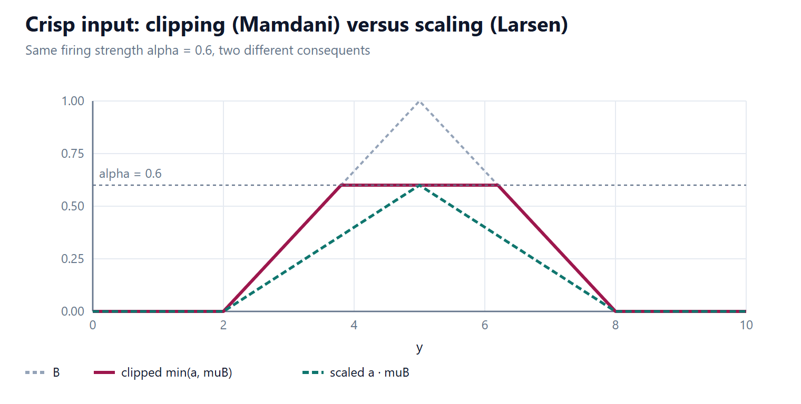

# الجزء 2 — الاستلزامات والاستدلال

> **من وين جاي:** الجزء 1 خلّى القاعدة **مصفوفة** $R = A \times C$. هذا الجزء يجاوب: **شنو نوع** هذا الضرب؟ وهل كل القواعد تُبنى بنفس الطريقة؟ وبعدين: شلون نستنتج من مصفوفة؟

---

## 1. القاعدة الضبابية = علاقة استلزام (ص 19)

$$\text{IF } x \text{ is } A \ \text{THEN } y \text{ is } B \qquad\Longleftrightarrow\qquad R: A \to B, \quad R \subseteq X \times Y$$

| الجزء | الاسم | المعنى |
|:---|:---|:---|
| $x \text{ is } A$ | **antecedent** — المقدّمة | الشرط |
| $y \text{ is } B$ | **consequent** — النتيجة | الحكم |

القاعدة تُسمّى بأربعة أسماء: **fuzzy rule** · **IF–THEN rule** · **fuzzy conditional statement** · **fuzzy implication**. كلها نفس الشي.

### أمثلة

**1)** If **pressure is high** then **temperature is low**

**2)** If **mango is yellow** then **mango is sweet**, else **mango is sour**

**3)** If **road is good** then **driving is smooth**, else **traffic is high**

**لاحظ:** المثالان 2 و3 فيهما **else** — وهذا يحتاج علاقة مختلفة (القسم 6).

---

## 2. القاعدة كمصفوفة — مثال كامل (ص 20)

$$\text{High temperature } T_{HIGH} \qquad\qquad \text{Low pressure } P_{LOW}$$

| $T$ | 20 | 25 | 30 | 35 | 40 | 45 | 50 |
|:---|:--:|:--:|:--:|:--:|:--:|:--:|:--:|
| $\mu$ | 0.2 | 0.4 | 0.6 | 0.6 | 0.7 | 0.8 | 0.8 |

| $P$ | 1 | 2 | 3 | 4 |
|:---|:--:|:--:|:--:|:--:|
| $\mu$ | 0.8 | 0.8 | 0.6 | 0.4 |

$$R = T_{HIGH} \times P_{LOW}$$

الضرب بـ`min` — صيغة **Mamdani**.

| $T \backslash P$ | 1 | 2 | 3 | 4 |
|:--:|:--:|:--:|:--:|:--:|
| **20** | 0.2 | 0.2 | 0.2 | 0.2 |
| **25** | 0.4 | 0.4 | 0.4 | 0.4 |
| **30** | 0.6 | 0.6 | 0.6 | 0.4 |
| **35** | 0.6 | 0.6 | 0.6 | 0.4 |
| **40** | 0.7 | 0.7 | 0.6 | 0.4 |
| **45** | 0.8 | 0.8 | 0.6 | 0.4 |
| **50** | 0.8 | 0.8 | 0.6 | 0.4 |

**طريقة البناء:** كل خانة تأخذ الأصغر من درجتي الصف والعمود:

$$\mu_R(t,p) = \min\big(\mu_T(t),\ \mu_P(p)\big)$$

**افحص خانتين:**

$$\mu_R(40,\ 3) = \min(0.7,\ 0.6) = 0.6 \qquad \mu_R(50,\ 2) = \min(0.8,\ 0.8) = 0.8$$

### قراءة القاعدة عند دخل صريح

عند $T = 40$، **صف 40** هو جواب القاعدة عن الضغط:

$$P_{LOW} \mid_{T=40} = \{(1,0.7),\ (2,0.7),\ (3,0.6),\ (4,0.4)\}$$

**هذا مفهوم محوري:** الصف = النتيجة الضبابية للقاعدة عند قيمة دخل محددة. الجزء الرابع (P4) يبدأ من هنا حرفياً.

**⚠️ مصيدة:** كل صف **لا يساوي** $P_{LOW}$ نفسها إلا إذا كان $\mu_T(t) \ge$ كل قيم $P_{LOW}$. عند $T=20$ الصف كله 0.2 — لأن درجة «الحرارة عالية» ضعيفة جداً، فالقاعدة ما تقدر تؤكد أي ضغط.

---

## 3. عائلتا المشغّلات — قلب هذا الجزء (ص 21)

$$\mu_R(x,y) = f\big(\mu_A(x),\ \mu_B(y)\big) = f(a,b)$$

السؤال: **شنو الدالة $f$؟** والجواب إنها **مو وحدة** — فيه عائلتان مختلفتان **فلسفياً**:

### العائلة الأولى: «A coupled with B» — ربط (conjunction)

$$R = A \times B$$

الضرب بـ**T-norm**.

| المشغّل | الصيغة |
|:---|:---|
| **Mamdani** (min) | $a \wedge b$ |
| **Larsen** (product) | $a \cdot b$ |
| **Bounded product** | $0 \vee (a+b-1)$ أي $\max(0,\ a+b-1)$ |
| **Drastic product** | $a$ إن $b{=}1$ $b$ إن $a{=}1$ $0$ غير ذلك |

### العائلة الثانية: «A entails B» — استلزام (implication)

$$R \ \text{يُبنى بمكمّل} \ A$$

| المشغّل | الصيغة |
|:---|:---|
| **Zadeh arithmetic** | $1 \wedge (1-a+b)$ أي $\min(1,\ 1-a+b)$ |
| **Zadeh max–min** | $(1-a) \vee (a \wedge b)$ |
| **Boolean** | $(1-a) \vee b$ |
| **Goguen** | $1$ إذا $a \le b$ · $b/a$ إذا $a > b$ |

> 📌 **ملاحظة تسمية:** «Zadeh arithmetic» هو الاسم المتّبع هنا، والاسم الأكثر شيوعاً في الأدبيات **Łukasiewicz**. اكتب الاسمين إن أمكن.

### 🎯 الفرق العملي — احسبها بأرقام

خذ $a = 0.4$ و$b = 0.7$:

| العائلة | المشغّل | الحساب | الناتج |
|:---|:---|:---|:--:|
| coupled | Mamdani | $\min(0.4,\ 0.7)$ | 0.4 |
| coupled | Larsen | $0.4 \times 0.7$ | 0.28 |
| coupled | Bounded product | $\max(0,\ 0.4+0.7-1) = \max(0,\ 0.1)$ | 0.1 |
| coupled | Drastic | لا $a{=}1$ ولا $b{=}1$ | 0 |
| entails | Zadeh arithmetic | $\min(1,\ 1-0.4+0.7) = \min(1,\ 1.3)$ | **1** |
| entails | Zadeh max–min | $\max(1-0.4,\ \min(0.4,\ 0.7)) = \max(0.6,\ 0.4)$ | 0.6 |
| entails | Boolean | $\max(1-0.4,\ 0.7) = \max(0.6,\ 0.7)$ | 0.7 |
| entails | Goguen | $0.4 \le 0.7$ ← | **1** |

**🧠 مرساة:** العائلة الأولى **تربط** (تريد الاثنين معاً، فتعاقب الضعف). والثانية **تستلزم** (تسمح للمقدّمة الكاذبة بأن تمرّ). ولهذا تختلفان جذرياً عند $a=0$.

---

## ✎ أسئلة — القاعدة والعائلتان

1 **س1.** اكتب صيغة القاعدة الضبابية كعلاقة، وسمِّ جزأيها.

**الحل:**

$$\text{IF } x \text{ is } A \ \text{THEN } y \text{ is } B \qquad\Longleftrightarrow\qquad R: A \to B, \quad R \subseteq X \times Y$$

| الجزء | الاسم | المعنى |
|:---|:---|:---|
| $x \text{ is } A$ | **antecedent** — المقدّمة | الشرط |
| $y \text{ is } B$ | **consequent** — النتيجة | الحكم |

**النقطة:** القاعدة **مو كلام** — هي **مصفوفة** على $X \times Y$. وهذا اللي يخلّي محرّك الاستدلال يشتغل.

---

2 **س2.** اذكر عائلتي المشغّلات وثلاثة من كل عائلة.

**الحل:**

**العائلة الأولى — coupled (ربط):** القاعدة = $A \times B$، والضرب بـT-norm.

| المشغّل | الصيغة |
|:---|:---|
| Mamdani | $a \wedge b = \min(a,b)$ |
| Larsen | $a \cdot b$ |
| Bounded product | $\max(0,\ a+b-1)$ |

**العائلة الثانية — entails (استلزام):** القاعدة تُبنى بمكمّل $A$.

| المشغّل | الصيغة |
|:---|:---|
| Zadeh arithmetic | $\min(1,\ 1-a+b)$ |
| Zadeh max–min | $\max(1-a,\ \min(a,b))$ |
| Boolean | $\max(1-a,\ b)$ |

*(والرابع في كل عائلة: Drastic product و Goguen.)*

---

3 **س3.** قارن بين «A coupled with B» و«A entails B». شنو يعطي كل واحد عند $\mu_A(x) = 0$؟

> **نص المسألة:** *"Contrast 'A coupled with B' and 'A entails B'. What does each give when μA(x) = 0?"*

**شنو المطلوب؟** شيئان: (1) **مقارنة** بين عائلتي المشغّلات — شنو الفرق بينهما فلسفياً، و(2) **قيمة** كل عائلة عند حالة حدّية واحدة: لما المقدّمة تكون كاذبة تماماً ($\mu_A=0$). الحالة الحدّية هي مفتاح السؤال، لأنها المكان الوحيد اللي تنفصل فيه العائلتان انفصالاً كاملاً.

**خطة الحل:**

**1)** عرّف كل عائلة بجملة واحدة (ربط مقابل استلزام).

**2)** احسب الحالة $a=0$ لكل مشغّل من المشغّلات.

**3)** فسّر النتيجتين منطقياً.

**4)** اذكر أثرها على التصميم.

**الحل:**

**الخطوة 1 — التعريف.**

**الفرق الجوهري:** الأولى **ربط** (تريد تحقّق الطرفين معاً)، والثانية **استلزام** (تقول: إذا تحققت المقدّمة فستتحقق النتيجة).

| عند $\mu_A(x)=0$ | الناتج | التفسير |
|:---|:--:|:---|
| **coupled** | **0** | لا ربط بين شيء غير موجود وشيء آخر. العلاقة تنهار |
| **entails** | **1** | المقدّمة كاذبة ← الاستلزام صحيح **بلا إلزام** (vacuously true) |

**الخطوة 2 — الحساب لكل مشغّل عند $a = 0$ و $b = 0.7$:**

| المشغّل | الحساب | الناتج |
|:---|:---|:--:|
| Mamdani | $\min(0,\ 0.7)$ | **0** |
| Larsen | $0 \times 0.7$ | **0** |
| Bounded product | $\max(0,\ 0+0.7-1) = \max(0,\ -0.3)$ | **0** |
| Drastic | $a \neq 1$ و $b \neq 1$ | **0** |
| Zadeh arithmetic | $\min(1,\ 1-0+0.7) = \min(1,\ 1.7)$ | **1** |
| Zadeh max–min | $\max(1-0,\ \min(0,\ 0.7)) = \max(1,\ 0)$ | **1** |
| Boolean | $\max(1-0,\ 0.7) = \max(1,\ 0.7)$ | **1** |
| Goguen | $0 \le 0.7$ ← | **1** |

**الخطوة 3 — التفسير المنطقي.** لو الشرط غلط، القاعدة **ما تنكسر** — هي فقط «صحيحة بلا إلزام». مثل ما تقول: «إذا كان القمر جبنة، فأنا ملك». الجملة صحيحة منطقياً لأن المقدمة باطلة.

**الخطوة 4 — الأثر على التصميم.** لهذا تُستعمل العائلة الأولى في **قواعد التحكّم** (تريد ربطاً فعلياً)، والثانية في **الاستدلال المنطقي** (تريد استلزاماً). والخلط بينهما يفسد النظام.

**⚠️ مصيدة:** هذا **مو** خطأ بالصيغ. الفرق بين العائلتين **مقصود**، وهو أشهر سؤال امتحاني بهذا الجزء.

---

## 4. نفس المدخلات، علاقات مختلفة (ص 22)

هذه السلايد هي **الخلاصة الفلسفية** للجزء كله:

> عند $a = 0$ (المقدّمة كاذبة): المشغّلات المربوطة تعطي **0**، ومشغّلات الاستلزام تعطي **1**. المقدّمة الكاذبة تجعل الاستلزام **صحيحاً بلا شرط** (vacuously true).

---

## 5. قاعدة Zadeh max–min — محسوبة كاملة (ص 23)

$$R = (A \times B) \cup (\overline{A} \times Y), \qquad \mu_Y(y) = 1 \ \forall y \in Y$$

$$A = \{(a,0),\ (b,0.8),\ (c,0.6),\ (d,1)\}, \qquad B = \{(1,0.2),\ (2,1),\ (3,0.8),\ (4,0)\}$$

### الخطوة 1 — $A \times B$ بـ`min`

| $A \times B$ | 1 | 2 | 3 | 4 |
|:--:|:--:|:--:|:--:|:--:|
| **a** (0) | 0 | 0 | 0 | 0 |
| **b** (0.8) | 0.2 | 0.8 | 0.8 | 0 |
| **c** (0.6) | 0.2 | 0.6 | 0.6 | 0 |
| **d** (1) | 0.2 | 1 | 0.8 | 0 |

### الخطوة 2 — $\overline{A} \times Y$ (و$Y$ كلها 1)

$\overline{A} = \{(a,1),\ (b,0.2),\ (c,0.4),\ (d,0)\}$

| $\overline{A} \times Y$ | 1 | 2 | 3 | 4 |
|:--:|:--:|:--:|:--:|:--:|
| **a** | 1 | 1 | 1 | 1 |
| **b** | 0.2 | 0.2 | 0.2 | 0.2 |
| **c** | 0.4 | 0.4 | 0.4 | 0.4 |
| **d** | 0 | 0 | 0 | 0 |

### الخطوة 3 — الاتحاد (max)

$$R = \begin{bmatrix} 1 & 1 & 1 & 1 \\ 0.2 & 0.8 & 0.8 & 0.2 \\ 0.4 & 0.6 & 0.6 & 0.4 \\ 0.2 & 1 & 0.8 & 0 \end{bmatrix}$$

### اقرأ النتيجة — هذه أهم ثلاث ملاحظات

**1)** **صف `a`:** $\mu_A(a)=0$ ← القاعدة **ما عندها رأي**، فالصف كله **1**. وهذا مخطط: «لا أعرف» تُرمَز بـ1 مش بـ0.

**2)** **صف `d`:** $\mu_A(d)=1$ ← الصف **ينسخ $B$** حرفياً.

**3)** **الصفوف `b` و`c`:** مزيج — بين $B$ وبين 1، بأوزان $\mu_A$.

**⚠️ مصيدة:** لو بنيت القاعدة بـ`min` فقط (Mamdani) صار صف `a` **كله أصفار**. الفرق بين الصيغتين هو بالضبط هذا الصف.

---

## 6. IF … THEN … ELSE كعلاقة واحدة (ص 24)

$$R = (A \times B) \cup (\overline{A} \times C)$$

$$\mu_R(x,y) = \max\big(\min(\mu_A,\ \mu_B),\ \min(1-\mu_A,\ \mu_C)\big)$$

$$C = \{(1,0),\ (2,0.4),\ (3,1),\ (4,0.8)\}$$

### $\overline{A} \times C$ بـ`min`

| $\overline{A} \times C$ | 1 | 2 | 3 | 4 |
|:--:|:--:|:--:|:--:|:--:|
| **a** (1) | 0 | 0.4 | 1 | 0.8 |
| **b** (0.2) | 0 | 0.2 | 0.2 | 0.2 |
| **c** (0.4) | 0 | 0.4 | 0.4 | 0.4 |
| **d** (0) | 0 | 0 | 0 | 0 |

### النتيجة النهائية

$$R = \begin{bmatrix} 0 & 0.4 & 1 & 0.8 \\ 0.2 & 0.8 & 0.8 & 0.2 \\ 0.2 & 0.6 & 0.6 & 0.4 \\ 0.2 & 1 & 0.8 & 0 \end{bmatrix}$$

| الصف | يتبع | لماذا |
|:---|:---|:---|
| `d` ($\mu_A=1$) | **$B$** | الشرط تحقّق ← النتيجة |
| `a` ($\mu_A=0$) | **$C$** | الشرط فشل ← البديل |
| `b` و`c` | **مزيج** | الشرط جزئي |

**🧠 مرساة:** `else` **مو** استثناء برمجي — هو **علاقة ثانية** $\overline{A} \times C$ تُضاف بالاتحاد. والاتحاد (max) هو الذي يخلط بينهما بحسب درجة تحقّق الشرط.

**⚠️ مصيدة:** في `IF–THEN–ELSE` ما نستعمل $\overline{A} \times Y$ — نستعمل $\overline{A} \times C$ حيث $C$ هي نتيجة `else` الفعلية. لو استعملت $Y$ صار عندك Zadeh max–min مو IF–THEN–ELSE.

---

## ✎ أسئلة — بناء القاعدة

4 **س4.** اكتب قاعدة Zadeh max–min، واشرح لماذا الصف اللي درجته فيه $\mu_A = 0$ يطلع كله **1**.

**الحل:**

$$R = (A \times B) \cup (\overline{A} \times Y), \qquad \mu_Y(y) = 1 \ \forall y \in Y$$

**اشتقاق الصف:**

$$\mu_A(x) = 0 \;\Rightarrow\; \mu_{\overline{A}}(x) = 1 - 0 = 1$$
$$\Rightarrow\; \mu_{\overline{A} \times Y}(x,y) = \min(1,\ 1) = 1 \quad \forall y$$

$$\Rightarrow\; \mu_R(x,y) = \max\big(\underbrace{0}_{A \times B},\ \underbrace{1}_{\overline{A} \times Y}\big) = 1$$

**المعنى:** «لا أعرف» تُرمَز بـ**1** مو بـ0 — لأن القاعدة ما عندها رأي، وأي درجة أعلى من صفر تعني «احتمال».

**⚠️ مصيدة:** لو بنيت القاعدة بـ`min` فقط (Mamdani) صار هذا الصف **كله أصفار**. الفرق بين الصيغتين هو بالضبط هذا الصف.

---

5 **س5.** اكتب صيغة IF–THEN–ELSE، وبيّن الفرق بينها وبين Zadeh max–min.

**الحل:**

$$\text{IF–THEN–ELSE}: \qquad R = (A \times B) \cup (\overline{A} \times C)$$

$$\text{Zadeh max–min}: \qquad R = (A \times B) \cup (\overline{A} \times Y)$$

**الفرق في المصطلح الثاني:**

| | المصطلح الثاني | معناه |
|:---|:---|:---|
| Zadeh max–min | $\overline{A} \times Y$ | «ما أعرف» — كل $Y$ بدرجة 1 |
| IF–THEN–ELSE | $\overline{A} \times C$ | نتيجة `else` **الفعلية** |

**مثال عددي:** $A = \{(a,0)\}$ و $B = \{(1,0.2)\}$ و $C = \{(1,0.9)\}$

$$\text{Zadeh:}\quad \max\big(\min(0,\ 0.2),\ \min(1,\ 1)\big) = \max(0,\ 1) = 1$$
$$\text{IF–THEN–ELSE:}\quad \max\big(\min(0,\ 0.2),\ \min(1,\ 0.9)\big) = \max(0,\ 0.9) = 0.9$$

**الفرق:** 1 مقابل 0.9 — لأن Zadeh يعطيك «ما أعرف» (1) وIF–THEN–ELSE يعطيك نتيجة `else` (0.9).

**🧠 مرساة:** `else` **مو** استثناء برمجي — هو **علاقة ثانية** تُضاف بالاتحاد.

---

6 **س6.** $A = \{(x_1, 0.3), (x_2, 1), (x_3, 0.6)\}$ و $B = \{(y_1, 0.7), (y_2, 0.2)\}$. ابنِ $A \times B$ وقاعدة Zadeh max–min.

> **نص المسألة:** *"A = {(x₁, 0.3), (x₂, 1), (x₃, 0.6)}, B = {(y₁, 0.7), (y₂, 0.2)}. Build A × B and Zadeh's max–min rule matrix."*

**شنو المطلوب؟** **مرحلتان**، والثانية تعتمد على الأولى: (1) ابني الضرب الديكارتي $A \times B$، و(2) ابني **قاعدة Zadeh max–min** — وهي ليست $A \times B$ وحدها، بل $A \times B$ **مع** $\overline{A} \times Y$. وهذا نصف السؤال اللي ينساه الطلبة.

**خطة الحل:**

**1)** احسب $A \times B$ بـ`min` (مصفوفة $3 \times 2$).

**2)** احسب $\overline{A} = 1-\mu_A$.

**3)** احسب $\overline{A} \times Y$ (مع $Y$ كلها 1).

**4)** اتحاد المصفوفتين بـ`max`.

**5)** تحقّق: الصف اللي $\mu_A=1$ لازم ينسخ $B$.

**الحل:**

**الخطوة 1 — البيانات.**

$$A = \{(x_1,0.3),\ (x_2,1),\ (x_3,0.6)\}, \qquad B = \{(y_1,0.7),\ (y_2,0.2)\}$$

**الخطوة 2 — $A \times B$ بـ`min`:**

| $A \times B$ | $y_1 = 0.7$ | $y_2 = 0.2$ |
|:--:|:--:|:--:|
| $x_1 = 0.3$ | $\min(0.3,\ 0.7) = $ **0.3** | $\min(0.3,\ 0.2) = $ **0.2** |
| $x_2 = 1$ | $\min(1,\ 0.7) = $ **0.7** | $\min(1,\ 0.2) = $ **0.2** |
| $x_3 = 0.6$ | $\min(0.6,\ 0.7) = $ **0.6** | $\min(0.6,\ 0.2) = $ **0.2** |

**الخطوة 3 — $\overline{A}$ و$\overline{A} \times Y$:**

$$\overline{A} = \{(x_1,0.7),\ (x_2,0),\ (x_3,0.4)\}$$

| $\overline{A} \times Y$ | $y_1$ | $y_2$ |
|:--:|:--:|:--:|
| $x_1$ | **0.7** | **0.7** |
| $x_2$ | **0** | **0** |
| $x_3$ | **0.4** | **0.4** |

**الخطوة 4 — الاتحاد:**

$$R = \begin{bmatrix} \max(0.3,\ 0.7) & \max(0.2,\ 0.7) \\ \max(0.7,\ 0) & \max(0.2,\ 0) \\ \max(0.6,\ 0.4) & \max(0.2,\ 0.4) \end{bmatrix} = \begin{bmatrix} 0.7 & 0.7 \\ 0.7 & 0.2 \\ 0.6 & 0.4 \end{bmatrix}$$

**الخطوة 5 — فحص ذاتي:** الصف $x_2$ ($\mu_A=1$) صار **نسخة من $B$**: $(0.7,\ 0.2)$ ✓ — وهذا يثبت صحة البناء.

---

## 7. الاستدلال الكلاسيكي — الأساس (ص 26)

### القواعد الثلاث

$$\textbf{Modus Ponens: } \frac{P, \quad P \Rightarrow Q}{Q} \qquad \textbf{Modus Tollens: } \frac{P \Rightarrow Q, \quad \neg Q}{\neg P} \qquad \textbf{Chain: } \frac{P \Rightarrow Q, \quad Q \Rightarrow R}{P \Rightarrow R}$$

### ليش Modus Ponens يشتغل — البرهان

$$P \wedge (P \Rightarrow Q) = P \wedge (\neg P \vee Q)$$
$$= (P \wedge \neg P) \vee (P \wedge Q)$$
$$= 0 \vee (P \wedge Q) = P \wedge Q \ \Rightarrow\ Q$$

**اقرأها:** «$P$ صحيحة» **تُلزم** إن $P \wedge Q$ صحيحة، ومنها $Q$. فما في مجال تكون $P$ صحيحة و$Q$ كاذبة.

**النقطة المهمة:** القواعد الثلاث **تبقى** بالمنطق الضبابي — بس المقدّمات والنتائج تصير **بدرجات**. وهذا هو التعميم بالفقرة التالية.

---

## 8. GMP و GMT — التعميم (ص 27)

### Generalized Modus Ponens — من المقدّمة إلى النتيجة

$$\text{Premise 1: } x \text{ is } A' \qquad \text{Premise 2: } \text{IF } x \text{ is } A \text{ THEN } y \text{ is } B \qquad \text{Conclusion: } y \text{ is } B'$$

$$B' = A' \circ R(x,y) \qquad\Longrightarrow\qquad \mu_{B'}(y) = \max_{x}\ \min\big(\mu_{A'}(x),\ \mu_R(x,y)\big)$$

**الاتجاه:** من **واقعة مرصودة** إلى **نتيجة**. (`max` على $x$ — أي على **الصفوف**.)

### Generalized Modus Tollens — من النتيجة إلى السبب

$$\text{Premise 1: } y \text{ is } B' \qquad \text{Premise 2: } \text{IF } x \text{ is } A \text{ THEN } y \text{ is } B \qquad \text{Conclusion: } x \text{ is } A'$$

$$A' = B' \circ R(x,y) \qquad\Longrightarrow\qquad \mu_{A'}(x) = \max_{y}\ \min\big(\mu_{B'}(y),\ \mu_R(x,y)\big)$$

**الاتجاه:** من **أثر** إلى **سببه المحتمل**. (`max` على $y$ — أي على **الأعمدة**.)

> 🔑 **الفرق الوحيد بالحساب:** GMP يأخذ `max` **أفقياً** على الصف، وGMT يأخذ `max` **عمودياً** على العمود. الصيغة نفسها، والمحور مختلف.

---

## 9. GMP محسوب خطوة بخطوة (ص 28)

$$A = \{(x_1,0.5),\ (x_2,1),\ (x_3,0.6)\}, \qquad B = \{(y_1,1),\ (y_2,0.4)\}$$
$$A' = \{(x_1,0.6),\ (x_2,0.9),\ (x_3,0.7)\}$$

### الخطوة 1 — بناء القاعدة $R = (A \times B) \cup (\overline{A} \times Y)$

$\overline{A} = \{(x_1,0.5),\ (x_2,0),\ (x_3,0.4)\}$

**$A \times B$:**

| | $y_1$ | $y_2$ |
|:--:|:--:|:--:|
| $x_1$ (0.5) | 0.5 | 0.4 |
| $x_2$ (1) | 1 | 0.4 |
| $x_3$ (0.6) | 0.6 | 0.4 |

**$\overline{A} \times Y$:**

| | $y_1$ | $y_2$ |
|:--:|:--:|:--:|
| $x_1$ | 0.5 | 0.5 |
| $x_2$ | 0 | 0 |
| $x_3$ | 0.4 | 0.4 |

**$R$ (الاتحاد):**

$$R = \begin{bmatrix} 0.5 & 0.5 \\ 1 & 0.4 \\ 0.6 & 0.4 \end{bmatrix}$$

### الخطوة 2 — التركيب $B' = A' \circ R$

$$\mu_{B'}(y_1) = \max\{\min(0.6,\ 0.5),\ \min(0.9,\ 1),\ \min(0.7,\ 0.6)\}$$
$$= \max\{0.5,\ 0.9,\ 0.6\} = \mathbf{0.9}$$

$$\mu_{B'}(y_2) = \max\{\min(0.6,\ 0.5),\ \min(0.9,\ 0.4),\ \min(0.7,\ 0.4)\}$$
$$= \max\{0.5,\ 0.4,\ 0.4\} = \mathbf{0.5}$$

$$B' = \{(y_1,0.9),\ (y_2,0.5)\}$$

**اقرأ النتيجة:** «$y_1$ صحيحة بدرجة 0.9» — أقوى من $B$ الأصلية (1) لكن أقوى بكثير من $y_2$ (0.5 مقابل 0.4). فالمقدّمة $A'$ **عزّزت** الطرف $y_2$.

**⚠️ مصيدة:** $B'$ **مو** $B$. $B$ كانت $(1,\ 0.4)$ و$B'$ صارت $(0.9,\ 0.5)$. والفرق هو **معلومة** جاءت من $A'$.

---

## 10. GMT محسوب — الاتجاه المعاكس (ص 29)

$$B' = \{(y_1,0.9),\ (y_2,0.7)\}$$

والقاعدة $R$ نفسها من القسم 9.

$$\mu_{A'}(x) = \max_{y}\ \min\big(\mu_{B'}(y),\ \mu_R(x,y)\big)$$

$$\mu_{A'}(x_1) = \max\{\min(0.9,\ 0.5),\ \min(0.7,\ 0.5)\} = \max\{0.5,\ 0.5\} = \mathbf{0.5}$$

$$\mu_{A'}(x_2) = \max\{\min(0.9,\ 1),\ \min(0.7,\ 0.4)\} = \max\{0.9,\ 0.4\} = \mathbf{0.9}$$

$$\mu_{A'}(x_3) = \max\{\min(0.9,\ 0.6),\ \min(0.7,\ 0.4)\} = \max\{0.6,\ 0.4\} = \mathbf{0.6}$$

$$A' = \{(x_1,0.5),\ (x_2,0.9),\ (x_3,0.6)\}$$

**قارن مع $A$ الأصلية:** $A = (0.5,\ 1,\ 0.6)$ و$A' = (0.5,\ 0.9,\ 0.6)$. الفرق الوحيد عند $x_2$: نزل من 1 إلى 0.9 — لأن الأثر $B'(y_1)=0.9$ كان أقل تأكيداً من $B(y_1)=1$.

**🧠 مرساة:** GMP وGMT **نفس العملية الرياضية** — الفرق إن GMP يبدأ من مصفوفة صفّية (متجه صف) وGMT من متجه عمود. ومصفوفة $R$ هي **الجسر** بين الاتجاهين.

---

## ✎ أسئلة — الاستدلال

7 **س7.** اكتب GMP وصيغتها.

**الحل:**

$$\text{Premise 1: } x \text{ is } A' \qquad \text{Premise 2: } \text{IF } x \text{ is } A \text{ THEN } y \text{ is } B \qquad \text{Conclusion: } y \text{ is } B'$$

$$B' = A' \circ R(x,y) \qquad\Longrightarrow\qquad \mu_{B'}(y) = \max_{x}\ \min\big(\mu_{A'}(x),\ \mu_R(x,y)\big)$$

**الاتجاه:** من **واقعة مرصودة** إلى **نتيجة**. و`max` على $x$ — أي على **الصفوف**.

**⚠️ المصيدة:** الترتيب $A' \circ R$ — **مو** $R \circ A'$. لأن $A'$ متجه صف.

---

8 **س8.** اكتب GMT وصيغتها.

**الحل:**

$$\text{Premise 1: } y \text{ is } B' \qquad \text{Premise 2: } \text{IF } x \text{ is } A \text{ THEN } y \text{ is } B \qquad \text{Conclusion: } x \text{ is } A'$$

$$A' = B' \circ R(x,y) \qquad\Longrightarrow\qquad \mu_{A'}(x) = \max_{y}\ \min\big(\mu_{B'}(y),\ \mu_R(x,y)\big)$$

**الاتجاه:** من **أثر** إلى **سببه المحتمل**. و`max` على $y$ — أي على **الأعمدة**.

---

9 **س9.** ما الفرق العملي بين GMP و GMT؟ وما اسم التركيب المستعمل في كل منهما؟

> **نص المسألة:** *"State GMP and GMT and the composition used in each."*

**شنو المطلوب؟** ليس حساباً — **ثلاث معلومات**: تعريف GMP، تعريف GMT، و**اسم التركيب** المستعمل في كل منهما. الكلمة المفتاحية بالسؤال هي *composition* — يعني المطلوب تسمية العملية، مو أرقام.

**خطة الحل:**

**1)** حدّد مدخلات ومخرجات GMP.

**2)** نفس الشي لـGMT.

**3)** سمِّ التركيب المستعمل.

**4)** اذكر الفرق العملي بين الاتجاهين.

**الحل:**

**الخطوة 1 — جدول المقارنة:**

| | GMP | GMT |
|:---|:---|:---|
| المعطى | $x$ is $A'$ + القاعدة | $y$ is $B'$ + القاعدة |
| المطلوب | $y$ is $B'$ | $x$ is $A'$ |
| الصيغة | $\mu_{B'}(y)=\max_x\min(\mu_{A'}(x),\mu_R(x,y))$ | $\mu_{A'}(x)=\max_y\min(\mu_{B'}(y),\mu_R(x,y))$ |
| المحور | `max` على **الصفوف** | `max` على **الأعمدة** |
| الاتجاه | من سبب إلى نتيجة | من أثر إلى سبب |

**الخطوة 2 — تسمية التركيب:** **max–min composition** ($\circ$).

**الخطوة 3 — الفرق العملي:** الناتج في الاثنين مجموعة ضبابية على كون واحد (لا مصفوفة)؛ والفرق الوحيد بالحساب هو محور الـ`max`.

---

10 **س10.** القاعدة $R = \begin{bmatrix} 0.7 & 0.7 \\ 0.7 & 0.2 \\ 0.6 & 0.4 \end{bmatrix}$ و $A' = \{(x_1,0.4),(x_2,0.8),(x_3,0.9)\}$. احسب $B'$ بطريقة GMP.

> **نص المسألة:** *"With R from problem 8 and A′ = {(x₁, 0.4), (x₂, 0.8), (x₃, 0.9)}, find B′ by GMP."*

**شنو المطلوب؟** تطبيق **GMP**: عندك قاعدة $R$ (من س6) وواقعة جديدة $A'$. المطلوب النتيجة $B'$. وهذا **تركيب** بين متجه الصف $A'$ (طوله 3) والمصفوفة $R$ ($3 \times 2$)، فالناتج متجه طوله **2** ($y_1$ و$y_2$).

**خطة الحل:**

**1)** اكتب $A'$ كمتجه صف.

**2)** اكتب القالب: لكل عمود، `max` على الصفوف.

**3)** احسب العمود $y_1$ (ثلاث قيم `min` ثم `max`).

**4)** احسب العمود $y_2$ بنفس الطريقة.

**5)** قارن $B'$ بـ$B$ الأصلية.

**الحل:**

**الخطوة 1 — المعطى.**

$$A' = \{(x_1,0.4),\ (x_2,0.8),\ (x_3,0.9)\}$$

$$R = \begin{bmatrix} 0.7 & 0.7 \\ 0.7 & 0.2 \\ 0.6 & 0.4 \end{bmatrix}$$

**الخطوة 2 — القالب قبل الحساب:**

$$\mu_{B'}(y) = \max\{\min(\mu_{A'}(x_1),\mu_R(x_1,y)),\ \min(\mu_{A'}(x_2),\mu_R(x_2,y)),\ \min(\mu_{A'}(x_3),\mu_R(x_3,y))\}$$

**الخطوة 3 — العمود $y_1$:**

$$\max\{\min(0.4,\ 0.7),\ \min(0.8,\ 0.7),\ \min(0.9,\ 0.6)\}$$
$$= \max\{0.4,\ 0.7,\ 0.6\} = \mathbf{0.7}$$

**الخطوة 4 — العمود $y_2$:**

$$\max\{\min(0.4,\ 0.7),\ \min(0.8,\ 0.2),\ \min(0.9,\ 0.4)\}$$
$$= \max\{0.4,\ 0.2,\ 0.4\} = \mathbf{0.4}$$

$$B' = \{(y_1,0.7),\ (y_2,0.4)\}$$

**الخطوة 5 — قارن مع $B$:** $B$ الأصلية $(0.7,\ 0.2)$ ← $B'$ صارت $(0.7,\ 0.4)$. الطرف $y_2$ **تعزّز** لأن $A'$ كانت ($0.4,\ 0.8,\ 0.9$) — أي «$x$ قريبة جداً من $A$». وهذا منطقي: كل ما اقتربت $A'$ من $A$، اقتربت $B'$ من $B$ بالحد الأعلى.

---

## 11. الدخل الصريح يحوّل الاستدلال إلى قصّ (ص 30)

$$A' = \{(x_0,\ 1)\}, \qquad R = A \times B \ \text{(Mamdani)}$$

$$\mu_{B'}(y) = \min\big(\mu_A(x_0),\ \mu_B(y)\big) = \min(\alpha,\ \mu_B(y))$$

| المصطلح | المعنى |
|:---|:---|
| **fuzzy singleton** | دخل مقيس — قيمته واحدة بدرجة 1 |
| $\alpha = \mu_A(x_0)$ | **قوة الإشعال** — أعلى نقطة تُقصّ عندها $B$ |
| **Mamdani** | **يقصّ** (clip): $\min(\alpha,\ \mu_B)$ — الشكل يتسطّح |
| **Larsen** | **يقيّس** (scale): $\alpha \cdot \mu_B$ — الشكل ينضغط عمودياً |

### مع عدة قواعد

$$\mu_{B'}(y) = \max_i\ \min(\alpha_i,\ \mu_{B_i}(y))$$

**خذ الاتحاد (max) للمجموعات المقصوصة.** وهذا بالضبط ما يحسبه محرّك Mamdani — الجزءان 5 و8 يكملان من هنا.

**⚠️ مصيدة:** الفرق بين القصّ والقياس **مو شكلي**. القصّ يخلّي القمة **مسطّحة** عند $\alpha$، والقياس يخلّيها **مدبّبة** بنسبة $\alpha$. ونتيجة إزالة التضبيب تختلف بينهما.

---

## ✎ أسئلة — القصّ والقياس

11 **س11.** شنو الـfuzzy singleton؟ وماذا يعني $\alpha$؟

**الحل:**

**fuzzy singleton** هو دخل **مقيس**: مجموعة ضبابية من عنصر واحد بدرجة **1** كاملة.

$$A' = \{(x_0,\ 1)\}$$

و$\alpha = \mu_A(x_0)$ هي **قوة الإشعال** — أي أعلى نقطة تُقصّ عندها المجموعة $B$. وهي دائماً في $[0,1]$ لأن $\mu_A$ درجة عضوية.

**لماذا $\{1\}$ بالضبط؟** لأن $1$ هو **العنصر المحايد** لعملية `min`: فـ$\min(1,\ \mu_B(y)) = \mu_B(y)$ — أي أن التركيب لا يشوّه $B$. أي قيمة أقل من 1 كانت ستقصّ $B$ وهذا معنى القصّ.

---

12 **س12.** ما الفرق بين القصّ والقياس؟

**الحل:**

| | Mamdani — **قصّ** | Larsen — **قياس** |
|:---|:---|:---|
| الصيغة | $\min(\alpha,\ \mu_B(y))$ | $\alpha \cdot \mu_B(y)$ |
| مثال عند $\alpha=0.6$ و $\mu_B=0.4$ | $\min(0.6,\ 0.4) = 0.4$ | $0.6 \times 0.4 = 0.24$ |
| مثال عند $\alpha=0.6$ و $\mu_B=0.9$ | $\min(0.6,\ 0.9) = 0.6$ | $0.6 \times 0.9 = 0.54$ |
| شكل القمة | **مسطّحة** عند $\alpha$ | **مدبّبة** بنسبة $\alpha$ |

**القراءة:** القصّ **يحافظ** على القيم الصغيرة كما هي ($0.4$ تبقى $0.4$) ويقطع الكبيرة عند $\alpha$. القياس **يضرب كل القيم** بنسبة $\alpha$ — فالمنحنى كله ينضغط عمودياً.

**⚠️ المصيدة:** الفرق **مو شكلي** — نتيجة إزالة التضريب تختلف بين الاثنين، فاختر واحدة والتزم بها في النظام كله.

---

13 **س13.** كيف تجمع نتائج عدة قواعد؟

**الحل:**

$$\mu_{B'}(y) = \max_i\ \min(\alpha_i,\ \mu_{B_i}(y))$$

**بالترتيب:** لكل قاعدة $i$ ← قصّ مجموعتها عند $\alpha_i$ ← ثم خذ **اتحاد** (max) للمجموعات المقصوصة.

**مثال عددي — قاعدتان:**

$$\text{قاعدة 1:}\quad \min(0.7,\ \mu_{B_1}) \qquad \text{قاعدة 2:}\quad \min(0.4,\ \mu_{B_2})$$

$$\mu_{B'}(y) = \max\big\{\min(0.7,\ \mu_{B_1}(y)),\ \min(0.4,\ \mu_{B_2}(y))\big\}$$

**السبب:** كل قاعدة تعطي **نتيجة جزئية** (وتركيبها معرمى واحد لا يتركّب). فالناتج النهائي هو **union** للمجموعات المقصوصة.

---

14 **س14.** ليش $P \wedge (P \Rightarrow Q) = P \wedge Q$؟

**الحل:**

**الخطوة 1 — استبدل الاستلزام:**

$$P \wedge (P \Rightarrow Q) = P \wedge (\neg P \vee Q)$$

**الخطوة 2 — وزّع التوزيع:**

$$= (P \wedge \neg P) \vee (P \wedge Q)$$

**الخطوة 3 — طرف مستحيل:**

$$P \wedge \neg P = 0 \quad\Rightarrow\quad = 0 \vee (P \wedge Q) = P \wedge Q$$

**الفهم:** «$P$ صحيحة» **تُلزم** إن $P \wedge Q$ صحيحة، ومنها $Q$. فما في مجال تكون $P$ صحيحة و$Q$ كاذبة — وهذا بالضبط Modus Ponens.

**لماذا يهمّنا في المنطق الضبابي؟** لأن نفس algebra تُستعمل بـ`min` و`max` بدل `∧` و`∨`، فتبقى البراهين صالحة داخل $[0,1]$. ولهذا يبقى Modus Ponens صالحاً مع درجات متوسطة.

---

## 12. ورقة صيغ الجزء 2

| العنصر | الصيغة |
|:---|:---|
| القاعدة | $R: A \to B \subseteq X \times Y$ |
| **Mamdani** | $a \wedge b$ |
| **Larsen** | $a \cdot b$ |
| Bounded product | $\max(0,\ a+b-1)$ |
| Drastic product | $a$ إن $b{=}1$ $b$ إن $a{=}1$ $0$ إن لا |
| Zadeh arithmetic | $\min(1,\ 1-a+b)$ |
| **Zadeh max–min** | $\max(1-a,\ \min(a,b))$ |
| Boolean | $\max(1-a,\ b)$ |
| Goguen | $1$ إن $a \le b$ · $b/a$ إن $a>b$ |
| Zadeh rule | $R = (A \times B) \cup (\overline{A} \times Y)$ |
| IF–THEN–ELSE | $R = (A \times B) \cup (\overline{A} \times C)$ |
| **GMP** | $\mu_{B'}(y) = \max_x \min(\mu_{A'}(x),\ \mu_R(x,y))$ |
| **GMT** | $\mu_{A'}(x) = \max_y \min(\mu_{B'}(y),\ \mu_R(x,y))$ |
| إشعال صريح | $\alpha = \mu_A(x_0)$ |
| قصّ Mamdani | $\min(\alpha,\ \mu_B)$ |
| قياس Larsen | $\alpha \cdot \mu_B$ |

---

## 13. مصائد الامتحان

| # | المصيدة | الجواب الآمن |
|:--:|:---|:---|
| 1 | العائلتان تعطيان نفس النتيجة | ❌ تختلفان جذرياً عند $a=0$: **0** مقابل **1** |
| 2 | Zadeh arithmetic = Zadeh max–min | ❌ $\min(1,1-a+b)$ مقابل $\max(1-a,\min(a,b))$ |
| 3 | IF–THEN–ELSE يستعمل $\overline{A}\times Y$ | ❌ يستعمل $\overline{A}\times C$ — نتيجة `else` |
| 4 | GMP يأخذ `max` عمودياً | ❌ **أفقياً على الصفوف** ($x$). وGMT عمودياً ($y$) |
| 5 | $B' = R \circ A'$ | ❌ الترتيب $A' \circ R$ — المتجه صف |
| 6 | Goguen = $a/b$ | ❌ $b/a$ عند $a>b$ |
| 7 | Larsen = قصّ | ❌ Larsen **يقيّس** ($\alpha\mu_B$)؛ Mamdani **يقصّ** ($\min$) |
| 8 | صف الـ1s بقاعدة Zadeh خطأ | ✅ **صح** — القاعدة ما عندها رأي حين $\mu_A=0$ |
| 9 | تقريب الأرقام الوسطية | ❌ لا تقرّب — الخطأ يتراكم عبر ثلاث مراحل |
| 10 | $B'$ تساوي $B$ | ❌ إلا إذا $A' = A$ بالضبط |
| 11 | القاعدة = جملة IF–THEN | ❌ **مصفوفة** على $X \times Y$ |
| 12 | $\overline{A}$ عمود في القاعدة | ❌ $\overline{A}$ **صف** (مكمّل المقدّمة) |

---

## 14. ماذا يجب أن تكون قادراً عليه بعد هذا الجزء

| # | القدرة | المحكّ |
|:--:|:---|:---|
| 1 | تكتب القاعدة كعلاقة | $R: A \to B \subseteq X \times Y$ |
| 2 | تبني مصفوفة قاعدة Mamdani | `min` بين درجة الصف ودرجة العمود |
| 3 | تسمّي عائلتي المشغّلات | coupled (min · product) · entails (Zadeh · Boolean · Goguen) |
| 4 | تعرف الفرق عند $a=0$ | coupled = **0** · entails = **1** |
| 5 | تبني قاعدة Zadeh max–min | $(A \times B) \cup (\overline{A} \times Y)$ |
| 6 | تبني IF–THEN–ELSE | $(A \times B) \cup (\overline{A} \times C)$ |
| 7 | تكتب GMP و GMT | `max` على $x$ مقابل `max` على $y$ |
| 8 | تحسب خانة في GMP | لكل $x$: `min` مع صف $R$ ← ثم `max` على $x$ |
| 9 | تفرّق القصّ عن القياس | $\min(\alpha,\mu_B)$ يسطّح · $\alpha\mu_B$ يضغط |
| 10 | تجمع عدة قواعد | $\max_i \min(\alpha_i,\ \mu_{B_i}(y))$ |

---
