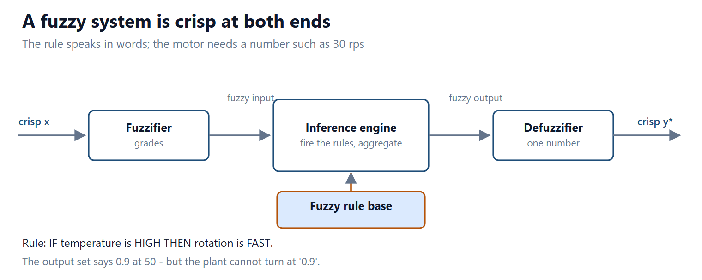
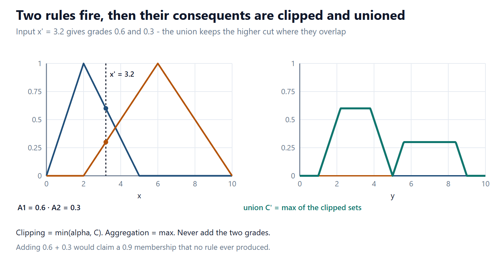
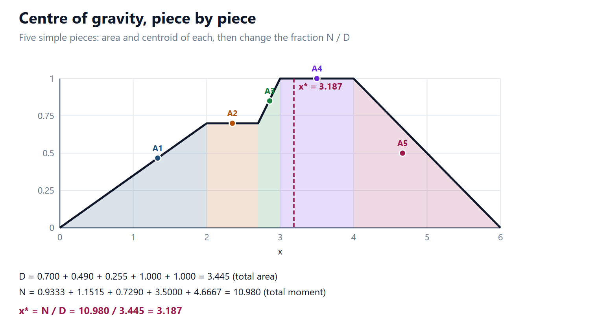
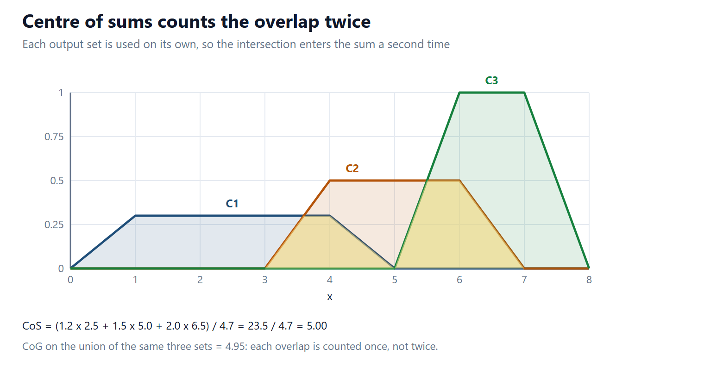

# الجزء 3 — إزالة التضبيب

> **من وين جاي:** الجزء 2 خلّى المخرج **مجموعة ضبابية** $C'$. بس المحرّك لازم يحرّك شي — والمحرّك ما يفهم «قريب» ولا «بعيد»، يفهم رقم. هذا الجزء هو الجسر بين المجموعة والرقم.

---

## 1. النظام يتكلّم صريحاً من الطرفين (ص 32)

القاعدة تقول: «إذا الحرارة عالية فالدوران سريع». بس المحرّك ما يدور «سريعاً» — يدور **30 دورة/ثانية**. وهنا السؤال: أي قيمة من $T_{HIGH}$ نأخذ؟

$$T_{HIGH} = \{(15,0.1),\ (20,0.4),\ \dots,\ (45,0.85),\ (50,0.9)\}$$

ثلاثة أجوبة ممكنة، وكلها «معقولة»:

| الطريقة | الجواب | ليش |
|:---|:--:|:---|
| أعلى درجة عضوية | 50 | $0.9$ هي القمة |
| المنتصف | 32.5 | وسط المدى |
| **مركز الثقل** | **≈ 36** | يأخذ **الشكل كله** بالحساب |

الطريقتان الأولى والثانية **حدس**؛ الثالثة **قاعدة**. هذا هو الفرق بين «أخمّن» و«أحسب».

$$y^* = \text{Defuzzify}(C')$$

**🧠 مرساة:** إزالة التضبيب مو خطوة تجميلية — هي اللي تحوّل **معرفة** إلى **فعل**. بدونها النظام يبقى وصفاً ولا يتحكّم بشي.

---

## 2. خريطة الطرق الأربع (ص 33)

| العائلة | المدخل | الناتج | التكلفة | متى تُستعمل |
|:---|:---|:---|:--:|:---|
| **λ-cut** | مجموعة ضبابية | **مجموعة صريحة** | منخفضة | تحليل، لا تحكّم |
| **Maxima** | القمة فقط | رقم | **الأرخص** | مخرج بقمة واضحة |
| **Centroid** | الشكل كله | رقم | **الأعلى** | الاختيار القياسي |
| **Weighted average** | القمم + الدرجات | رقم | منخفضة | مخرج **متماثل** |

**لاحظ الترتيب:** الأولى لا تعطي رقماً أصلاً — تعطي **مجموعة**. فالطرق الفعلية ثلاث، والـλ-cut أداة تحليل تدخل في الطرق الأخرى.

**⚠️ مصيدة:** λ-cut **مو** طريقة إزالة تضبيب بالمعنى الكامل. السؤال «أعطني رقماً» ما ينحلّ بـλ-cut وحده — تحتاج بعده خطوة اختيار أو متوسط.

---

## 3. λ-cut — التعريف (ص 34)

$$A_\lambda = \{x \in X \mid \mu_A(x) \ge \lambda\}, \qquad 0 \le \lambda \le 1$$

«احتفظ بكل عنصر درجته **تساوي أو تتجاوز** λ، وارمِ الباقي.»

### مثالان على نفس الكون

$$A_1 = \{(x_1,0.9),\ (x_2,0.5),\ (x_3,0.2),\ (x_4,0.3)\}$$

$$\lambda = 0.6: \quad A_{1,0.6} = \{x_1\}$$

$$A_2 = \{(x_1,0.1),\ (x_2,0.5),\ (x_3,0.8),\ (x_4,0.7)\}$$

$$\lambda = 0.2: \quad A_{2,0.2} = \{x_2,\ x_3,\ x_4\}$$

**افحص الحدّ:** في $A_1$ عند $\lambda = 0.5$ يدخل $x_2$ لأن $0.5 \ge 0.5$ — العلامة **$\ge$** مو $>$. وهذا أشهر موضع خطأ.

### ثلاث حقائق

1. **الناتج مجموعة صريحة**: قد تكون فاضية، أو عنصراً واحداً، أو عدة عناصر.
2. **لتحصل على رقم**: إمّا تختار عنصراً (وهذا يصير FoM/LoM) أو تأخذ متوسط الباقين (MoM) أو تحسب مركزهم (CoG).
3. **هي نفس $\alpha$-cut مالت Ch3** بتبديل الرمز فقط — المصدر يقولها صراحةً.

**⚠️ مصيدة الرمز:** $\lambda$ هنا **مستوى القطع**، و$\alpha$ في الجزء 2 **قوة إشعال**. نفس الفكرة (عتبة)، لكن مختلفة المعنى — لا تخلطهما في الجواب.

**⚠️ مصيدة $A_0$:** القاعدة $A_0 = X$ صحيحة، لكن **الدعم** (support) هو $\{x \mid \mu_A(x) > 0\}$ — أصغر من $X$. الفرق: $A_0$ تستعمل $\ge$، والدعم يستعمل $>$.

---

## 4. λ-cuts على العلاقات (ص 35)

نفس التعريف، مطبَّقاً **خانة خانة**:

$$R_\lambda = \{(x,y) \mid \mu_R(x,y) \ge \lambda\}$$

$$R = \begin{bmatrix} 1 & 0.2 & 0.3 \\ 0.5 & 0.9 & 0.6 \\ 0.4 & 0.8 & 0.7 \end{bmatrix}$$

$$R_{0.5} = \begin{bmatrix} 1 & 0 & 0 \\ 1 & 1 & 1 \\ 0 & 1 & 1 \end{bmatrix} \qquad R_{0.9} = \begin{bmatrix} 1 & 0 & 0 \\ 0 & 1 & 0 \\ 0 & 0 & 0 \end{bmatrix}$$

**افحص:** $0.5 \ge 0.5$ ← **1** ✓ · $0.4 < 0.5$ ← **0** ✓ · $0.9 \ge 0.9$ ← **1** ✓

### الخصائص الأربع

$$(A \cup B)_\lambda = A_\lambda \cup B_\lambda \qquad (A \cap B)_\lambda = A_\lambda \cap B_\lambda$$

$$\lambda \le \alpha \quad\Longrightarrow\quad A_\alpha \subseteq A_\lambda$$

$$A_0 = X \qquad\qquad (\overline{A})_\lambda \ne \overline{(A_\lambda)} \text{ عموماً}$$

**ليش الأخيرة؟** لأن النفي يقلب الدرجات، والقطع يحتفظ بها. جرّب:

$$A = \{(x_1,0.8),\ (x_2,0.3)\}, \quad X = \{x_1,x_2\}, \quad \lambda = 0.3$$

| التعبير | الحساب | الناتج |
|:---|:---|:---|
| $\overline{A}$ | $1-0.8 = 0.2$ · $1-0.3 = 0.7$ | $\{(x_1,0.2),\ (x_2,0.7)\}$ |
| $(\overline{A})_{0.3}$ | $0.2 < 0.3$ · $0.7 \ge 0.3$ | $\{x_2\}$ |
| $A_{0.3}$ | $0.8 \ge 0.3$ · $0.3 \ge 0.3$ | $\{x_1,\ x_2\}$ |
| $\overline{(A_{0.3})}$ | $X \setminus \{x_1,x_2\}$ | $\varnothing$ |

$$\{x_2\} \ne \varnothing$$

**🧠 مرساة:** «النفي ثم القطع» ≠ «القطع ثم النفي». الأولى تسأل: *ما الذي صار صغيراً بعد النفي؟* والثانية: *ما الذي كان كبيراً؟* — سؤالان مختلفان.

---

## 5. عدة قواعد تشتعل: قصّ ثم اتحاد (ص 36)

$$x' = 3.2 \quad\Longrightarrow\quad \mu_{A_1}(x') = 0.6, \quad \mu_{A_2}(x') = 0.3$$

**ثلاث خطوات ثابتة:**

**1)** تضبيب: درجة لكل مصطلح.

**2)** قصّ كل نتيجة عند قوتها:

$$C'_i(y) = \min\big(\alpha_i,\ C_i(y)\big)$$

**3)** تجميع بالاتحاد:

$$C'(y) = \max_i C'_i(y)$$

**⚠️ مصيدة:** التجميع `max` وليس **جمعاً**. لو جمعت، القمية تصير 0.9 وأنت ما عندك أي قاعدة تقول 0.9. والجمع يُستعمل في **CoS** فقط — وهذا فرق جوهري سيأتي بعد قليل.

---

## 6. طرق القمم (ص 38)

| الطريقة | الصيغة | تحتاج |
|:---|:---|:---|
| **Height** (أعلى درجة) | $\mu(x^*) \ge \mu(x)\ \forall x$ | قمة **وحيدة** |
| **First of maxima** | $x^* = \min\{x \mid \mu(x) = h\}$ | أي شكل |
| **Last of maxima** | $x^* = \max\{x \mid \mu(x) = h\}$ | أي شكل |
| **Mean of maxima** | $x^* = \dfrac{\sum_{x_i \in M} x_i}{\lvert M\rvert}$ | أي شكل |

حيث $h$ ارتفاع المجموعة، و$M$ مجموعة القمم.

### المثال — هضبة عند 0.6 من 1.8 إلى 4.2

$$h = 0.6, \qquad M = [1.8,\ 4.2]$$

$$\text{FoM} = 1.8, \qquad \text{LoM} = 4.2, \qquad \text{MoM} = \frac{1.8 + 4.2}{2} = 3.0$$

**لاحظ:** طرق القمم **ما تشوف الشكل** — بس القمة. فمجموعتان مختلفتان تماماً بنفس القمة يعطون نفس الجواب.

> 📌 **من الكتاب:** رُوس يعرّف Height بالصيغة نفسها (Eq. 4.4) ويسمّيها أيضاً *max membership*، ويشترط صراحةً أن تكون الدالة **مدبّبة** (peaked) — أي قمة نقطية لا هضبة. أما MoM في النسخة ذات الطرفين فيكتبها $(a+b)/2$ حيث $a,b$ طرفا الهضبة — وهي نفس صيغة المتوسط أعلاه.

**⚠️ مصيدة:** Height مع هضبة **غير محدّد** — أي نقطة على الهضبة تحقق الشرط. ولهذا وُجدت FoM وLoM وMoM.

---

## 7. مجموعة متقطعة واحدة، أربعة أجوبة (ص 39)

المصدر يعرض مجموعة متقطعة ويحسبها بأربع طرق:

| الطريقة | الجواب |
|:---|:--:|
| First of maxima | **6** |
| Mean of maxima | **7** |
| Last of maxima | **8** |
| Centre of gravity | **8.09** |

**الدرس:** أربعة أرقام لمخرج واحد، وكلها **مقبولة**. الاختيار مو مسألة «صح وغلط» — هو مسألة **أي معلومة تريد تحافظ عليها**.

| الطريقة | تحافظ على | تضيّع |
|:---|:---|:---|
| FoM | أصغر قيمة قصوى | الشكل كله |
| LoM | أكبر قيمة قصوى | الشكل كله |
| MoM | مركز القمم | الشكل والوزن |
| CoG | **كل الشكل** | لا شي (بس مكلفة) |

> **ملاحظة أمانة:** أرقام هذه المجموعة مرسومة في السلايد ولا تظهر في طبقة النص. المهم فيها **الملاحظة**، لا الأرقام. المثال المحسوب كاملاً هو Q11 أدناه.

---

## 8. مركز الثقل — CoG (ص 40)

$$\text{continuous: } \quad x^* = \frac{\displaystyle\int x\,\mu_{C'}(x)\,dx}{\displaystyle\int \mu_{C'}(x)\,dx}$$

$$\text{discrete: } \quad x^* = \frac{\displaystyle\sum_{i=1}^{n} x_i\,\mu_{C'}(x_i)}{\displaystyle\sum_{i=1}^{n} \mu_{C'}(x_i)}$$

وهو **مركز مساحة** الشكل تحت المنحنى: البسط عزم، والمقام مساحة.

### الطريقة اليدوية — قطعة قطعة

$$\text{area } A_i, \quad \text{centroid } \bar{x}_i \qquad\Longrightarrow\qquad x^* = \frac{\sum_i A_i\,\bar{x}_i}{\sum_i A_i}$$

**ليش هذا مفيد؟** لأن التكامل على شكل مركّب يُقسَّم إلى مثلثات ومستطيلات وشبه منحرف — ومساحاتها ومراكزها **محفوظة**، فما تحتاج تكامل فعلي.

**⚠️ مصيدة:** CoG تُحسب على **الاتحاد** — المنطقة المتقاطعة بين قاعدتين تُحسب **مرّة واحدة**، لأن $\max$ يأخذ الأعلى. هذا هو الفرق عن CoS.

---

## 9. CoG محسوباً قطعة-قطعة (ص 41)

$$\mu_C(x) = \begin{cases} 0.35x & 0 \le x < 2 \\ 0.7 & 2 \le x < 2.7 \\ x-2 & 2.7 \le x < 3 \\ 1 & 3 \le x < 4 \\ -0.5x+3 & 4 \le x \le 6 \end{cases}$$

**كيف نعرف إن الدالة صح؟** كل حدّ يمرّ بنقطتين: القطعة الأخيرة تمرّ بـ$(4,1)$ و$(6,0)$:

$$y - 1 = -\tfrac12 (x-4) \qquad\Longrightarrow\qquad y = -0.5x + 3$$

### الجدول الكامل

| القطعة | الفترة | الشكل | المساحة $A_i$ | المركز $\bar{x}_i$ | العزم $A_i\bar{x}_i$ |
|:--:|:---|:---|:--:|:--:|:--:|
| $A_1$ | $0 \le x < 2$ | مثلث | $\tfrac12(2)(0.7) = 0.700$ | $\tfrac23(2) = 1.3333$ | 0.9333 |
| $A_2$ | $2 \le x < 2.7$ | مستطيل | $(0.7)(0.7) = 0.490$ | $2.35$ | 1.1515 |
| $A_3$ | $2.7 \le x < 3$ | شبه منحرف | $(0.3)\dfrac{0.7+1}{2} = 0.255$ | $2.8588$ | 0.7290 |
| $A_4$ | $3 \le x < 4$ | مستطيل | $(1)(1) = 1.000$ | $3.5$ | 3.5000 |
| $A_5$ | $4 \le x \le 6$ | مثلث | $\tfrac12(2)(1) = 1.000$ | $\tfrac{14}{3} = 4.6667$ | 4.6667 |
| **المجموع** | | | $D = 3.445$ | | $N = 10.980$ |

### الحساب خطوة بخطوة

**المساحة الكلية (المقام):**

$$D = 0.700 + 0.490 + 0.255 + 1.000 + 1.000 = 3.445$$

**العزم الكلي (البسط):**

$$N = 0.9333 + 1.1515 + 0.7290 + 3.5000 + 4.6667 = 10.980$$

$$x^* = \frac{N}{D} = \frac{10.980}{3.445} = 3.187$$

### من وين جاء مركز شبه المنحرف

للقطعة $A_3$ الارتفاعان $p = 0.7$ و$q = 1$ على عرض $h = 0.3$، وتبدأ عند $a = 2.7$:

$$\bar{x} = a + \frac{h(p + 2q)}{3(p+q)} = 2.7 + \frac{0.3(0.7+2)}{3(1.7)} = 2.7 + 0.1588 = 2.8588$$

**افحص:** يجب أن يقع المركز بين الطرفين $2.7$ و$3$، وأقرب إلى الطرف الأعلى ($q=1$) — وهو كذلك ✓

**⚠️ مصيدة:** لا تقرّب أثناء الجمع. $3.445$ و$10.980$ مطلوبان بثلاث خانات؛ تقريب $0.9333$ إلى $0.93$ يغيّر الجواب بمقدار $0.003$ — صغير، لكن تراكمه على خمس قطع يظهر في المقارنة مع $3.187$.

---

## 10. مركز المجاميع ومركز أكبر مساحة (ص 42)

### Centre of sums — CoS

$$x^* = \frac{\sum_i \bar{x}_i\,A_i}{\sum_i A_i}$$

كل مخرج **يُستعمل لحاله**، فما في اتحاد:

$$x^* = \frac{\displaystyle\int x\sum_k \mu_{C_k}(x)\,dx}{\displaystyle\int \sum_k \mu_{C_k}(x)\,dx}$$

الفرق الجوهري عن CoG: هنا **نجمع** الدرجات، فالمنطقة المتقاطعة تُحسب **مرّتين**.

### المثال

| المجموعة | الشكل | المساحة | المركز | $A_i\bar{x}_i$ |
|:--:|:---|:--:|:--:|:--:|
| $C_1$ | شبه منحرف، قاعدة 5 وقمة 3 | $1.2$ | 2.5 | 3.00 |
| $C_2$ | شبه منحرف، قاعدة 4 وقمة 2 | $1.5$ | 5.0 | 7.50 |
| $C_3$ | شبه منحرف، قاعدة 3 وقمة 1 | $2.0$ | 6.5 | 13.00 |
| **المجموع** | | **4.7** | | **23.50** |

$$x^*_{CoS} = \frac{23.50}{4.7} = 5.00$$

**قارن:** CoG على الاتحاد = $4.95$. الفرق $0.05$ صغير هنا — لكنه **مو صفر**، وسببه التراكب.

### Centre of largest area — CLA

لو المخرج **غير محدّب** (له عدة قمم منفصلة)، نأخذ المجموعة الفرعية المحدّبة **الأكبر مساحة** ونحسب مركزها:

$$x^* = \frac{\displaystyle\int x\,\mu_{C_m}(x)\,dx}{\displaystyle\int \mu_{C_m}(x)\,dx}$$

حيث $C_m$ أكبر منطقة محدّبة. في المثال: $C_3$ مساحتها $2.0$ وهي الأكبر ← $x^* = 6.5$.

> 📌 **من الكتاب:** رُوس يوضّح شرطاً **ما ذكره السلايد**: CLA تُستعمل فقط إذا كان المخرج الكلي **غير محدّب**. أما لو كان محدّباً، فـCLA والـCoG يعطون **نفس الجواب** (لأنه ما في إلا منطقة محدّبة واحدة).

**🧠 مرساة:** $C_3$ وحدها تُختار، فـ$C_1$ و$C_2$ **تُهمَلان تماماً** — حتى لو كانتا قريبتين. هذا سعر CLA: سرعة، مقابل ضياع معلومة.

---

## 11. المتوسط الموزون (ص 43)

$$x^* = \frac{\sum_i \mu_{C'_i}(\bar{x}_i)\,\bar{x}_i}{\sum_i \mu_{C'_i}(\bar{x}_i)}$$

| الرمز | المعنى |
|:---:|:---|
| $\bar{x}_i$ | **قمة** المجموعة $i$ |
| $\mu_{C'_i}(\bar{x}_i)$ | ارتفاعها بعد القصّ |

### المثال

$$x^* = \frac{0.6(3) + 0.3(7)}{0.6 + 0.3} = \frac{1.8 + 2.1}{0.9} = 4.33$$

**الشرط:** المجموعات **متماثلة** — لأن القمة عندها هي المركز. لو كانت غير متماثلة، الصيغة تفترض شيئاً غير صحيح.

> 📌 **من الكتاب — الفرق الدقيق:** رُوس (Eq. 4.6 مقابل 4.8) يقول: في **CoS** الأوزان هي **مساحات** المجموعات، وفي **المتوسط الموزون** الأوزان هي **قيم العضوية** (الارتفاعات). وهذا هو الفرق الحقيقي بين الطريقتين — وليس مجرد شكل حسابي.

**⚠️ مصيدة:** المتوسط الموزون **لا يتكامل أبداً** — لهذا هو الأسرع. لكنه يفترض التماثل: لو أخذت مجموعة غير متماثلة، القمة ليست المركز، والنتيجة تنحرف.

---

## 12. نفس المخرج، ستة أجوبة (ص 44)

| الطريقة | القيمة | تستعمل | التكلفة | الخطر |
|:---|:--:|:---|:--:|:---|
| FoM | 1.80 | القمة | الأقل | تتجاهل الشكل |
| MoM | 3.00 | القمة | الأقل | تتجاهل الشكل |
| LoM | 4.20 | القمة | الأقل | تتجاهل الشكل |
| Weighted average | 4.33 | القمم + الارتفاعات | منخفضة | التماثل فقط |
| CoS | 4.51 | كل مجموعة منفصلة | متوسطة | التراكب مرّتين |
| CoG | 4.47 | الاتحاد | **الأعلى** | لا شي — بس مكلفة |

**اقرأ الجدول بالاتجاه:** من فوق لتحت، الدقة تزيد والتكلفة تزيد.

**⚠️ مصيدة:** كل الأرقام **مقبولة**. لو سألك الدكتور «أيها الصح؟» فالجواب: *كلها، والاختيار حسب التطبيق* — وليس «CoG دائماً». CoG هو **الافتراضي**، مو **الوحيد**.

---

## 13. ورقة صيغ الجزء 3

| العملية | الصيغة | شرط |
|:---|:---|:---|
| λ-cut | $A_\lambda = \{x \mid \mu_A(x) \ge \lambda\}$ | — |
| λ-cut لعلاقة | $R_\lambda = \{(x,y) \mid \mu_R(x,y) \ge \lambda\}$ | خانة خانة |
| قصّ | $C'_i = \min(\alpha_i,\ C_i)$ | — |
| تجميع | $C' = \max_i C'_i$ | — |
| Height | $\mu(x^*) \ge \mu(x)\ \forall x$ | قمة وحيدة |
| FoM | $\min\{x \mid \mu(x)=h\}$ | — |
| LoM | $\max\{x \mid \mu(x)=h\}$ | — |
| MoM | $\sum x_i / \lvert M\rvert$ | — |
| CoG متصل | $\int x\mu\,dx \big/ \int \mu\,dx$ | — |
| CoG متقطع | $\sum x_i\mu_i \big/ \sum \mu_i$ | — |
| CoG قطعاً | $\sum A_i\bar{x}_i \big/ \sum A_i$ | — |
| CoS | $\sum \bar{x}_i A_i \big/ \sum A_i$ | كل مجموعة لحالها |
| CLA | CoG لأكبر منطقة محدّبة | مخرج غير محدّب |
| Weighted average | $\sum \mu_i\bar{x}_i \big/ \sum \mu_i$ | متماثل |

---

## 14. حلول مسائل الجزء 3

### Q4 — شنو يرجع الـλ-cut، وليش مو رقم؟

> **نص المسألة:** *"What does a λ-cut return, and why is not yet a single crisp value?"*

**شنو المطلوب؟** سؤال **مفاهيمي** من شقّين: (1) **نوع** الناتج — شنو هو بالضبط، و(2) **السبب** — ليش ما يكفي كرقم. الشقّ الثاني هو الأهم، لأن الجواب عليه يفسّر **ليش** وُجدت بقية الطرق.

**خطة الحل:**

**1)** اكتب التعريف.

**2)** حدّد نوع الناتج.

**3)** بيّن الحالات الثلاث الممكنة.

**4)** اذكر كيف يتحوّل لمجموعة إلى رقم.

**الحل:**

**الخطوة 1 — التعريف.** الـλ-cut يرجع كل عنصر درجته تساوي أو تتجاوز العتبة:

$$A_\lambda = \{x \in X \mid \mu_A(x) \ge \lambda\}$$

**الخطوة 2 — نوع الناتج.** مجموعة **صريحة** (crisp set) — جزئية من الكون $X$، مو رقم ومو مجموعة ضبابية.

**الخطوة 3 — ليش مو رقم.** لأن عدد العناصر غير محدّد مسبقاً:

| الحالة | الناتج | مثال |
|:---|:---|:---|
| $\lambda$ عالية | قد تكون فاضية | $\lambda = 1$ وما في عنصر درجته 1 |
| $\lambda$ متوسطة | عدة عناصر | $A_{0.3} = \{x_1,\ x_2,\ x_4\}$ |
| $\lambda$ منخفضة | الكون كله | $A_0 = X$ |

فلو رجعت **عنصراً واحداً** فهذا صدفة لأن العتبة تركت عنصراً واحداً — مو لأن الطريقة تعطي رقماً.

**الخطوة 4 — كيف يصير رقماً.** خطوة **ثانية** فوقه:

| تريد | الطريقة |
|:---|:---|
| أصغر عنصر باقٍ | FoM |
| أكبر عنصر باقٍ | LoM |
| متوسطهم | MoM |
| مركز الشكل | CoG |

**جواب مختصر للامتحان:** λ-cut يرجع مجموعة صريحة من العناصر التي تتجاوز عتبتها، وليس رقماً، لأن العتبة قد تُبقي صفراً أو عنصراً أو عدة عناصر؛ وللحصول على رقم نحتاج قاعدة اختيار إضافية.

### Q5 — ليش CoS تختلف عن CoG على نفس المخرجات؟

> **نص المسألة:** *"Why can centre of sums differ from centre of gravity on the same rule outputs?"*

**شنو المطلوب؟** تفسير **مصدر الاختلاف** — مو حساب. والمفتاح كلمة واحدة: **التراكب**. لازم تبيّن كيف يعالج كلٌّ منهما المنطقة المتقاطعة.

**خطة الحل:**

**1)** اكتب صيغة كل واحدة.

**2)** حدّد موضع الاختلاف.

**3)** اربطه بالتراكب.

**4)** اذكر حالة التطابق.

**الحل:**

**الخطوة 1 — الصيغتان.**

$$\text{CoG}: \quad x^* = \frac{\int x\,\mu_{C'}\,dx}{\int \mu_{C'}\,dx} \qquad C' = \bigcup_i C'_i$$

$$\text{CoS}: \quad x^* = \frac{\int x\sum_i \mu_{C'_i}\,dx}{\int \sum_i \mu_{C'_i}\,dx}$$

**الخطوة 2 — موضع الاختلاف.** CoG يبني **الاتحاد** أولاً: عند كل نقطة يأخذ $\max$ — أي **درجة واحدة**. CoS يجمع الدرجات $\sum$ **قبل** أي دمج.

**الخطوة 3 — أثر التراكب.** في منطقة تتقاطع فيها مجموعتان، الاتحاد يسجّل الدرجة الأعلى مرّة واحدة، بينما المجموع يسجّلها **مرّتين**. فCoS يعطي وزناً مضاعفاً لمنطقة التراكب، وينجذب نحوها.

**الخطوة 4 — متى يتفقان.** لو **ما في تراكب** بين المجموعات، فالاتحاد والمجموع متطابقان، وCoS = CoG بالضبط.

**من المصدر:** نفس المخرجات الثلاث تعطي CoS = $5.00$ وCoG = $4.95$ — فرق $0.05$ سببه التراكب. وفي مثال القاعدتين: $4.51$ مقابل $4.47$.

**جواب مختصر:** CoS يجمع المجموعات منفصلة فتُحسب مناطق التقاطع مرّتين، بينما CoG يعمل على اتحادها فتُحسب مرّة؛ ولهذا ينجذب CoS نحو مناطق التراكب. ومع غياب التراكب يتساويان.

### Q11 — طرق القمم وCoG لمجموعة Young

> **نص المسألة:** *"Young = $\{(10,0.5),\ (20,0.8),\ (30,0.8),\ (40,0.5),\ (50,0.3)\}$. Find FoM, LoM, MoM and the discrete CoG."*

**شنو المطلوب؟** أربع قيم من مجموعة **متقطعة** واحدة. ثلاث منها تعتمد على **القمة** فقط، والرابعة على **كل** العناصر. فالسؤال يقيس إنك تفرّق بين «انظر للقمة» و«انظر للكل».

**خطة الحل:**

**1)** حدّد الارتفاع الأقصى $h$ والعناصر التي تحققه.

**2)** طبّق FoM وLoM وMoM على $M$.

**3)** احسب CoG بصيغة المتقطع (بسط ومقام منفصلين).

**4)** افحص: هل CoG يقع بين القمم؟

**الحل:**

**الخطوة 1 — الارتفاع والقمم.** أعلى درجة عضوية $h = 0.8$، وهي عند قيمتين فقط:

$$M = \{20,\ 30\}$$

**الخطوة 2 — الطرق الثلاث.**

$$\text{FoM} = \min(M) = \mathbf{20}$$

$$\text{LoM} = \max(M) = \mathbf{30}$$

$$\text{MoM} = \frac{20 + 30}{2} = \mathbf{25}$$

**الخطوة 3 — CoG المتقطع.** البسط:

$$N = 10(0.5) + 20(0.8) + 30(0.8) + 40(0.5) + 50(0.3)$$
$$= 5 + 16 + 24 + 20 + 15 = 80$$

المقام:

$$D = 0.5 + 0.8 + 0.8 + 0.5 + 0.3 = 2.9$$

$$x^* = \frac{80}{2.9} = \mathbf{27.59}$$

**الخطوة 4 — فحص.** $27.59$ يقع بين $20$ و$30$ ✓ وأقرب إلى $30$ لأن الدرجات على اليمين أعلى (0.8 و0.8 مقابل 0.5) — وهذا منطقي.

**⚠️ خلل في المصدر — انتبه:** السلايد ص 38 تكتب *«Young (NPTEL): FoM = 20, LoM = 25, MoM = 22.5»*. هذان الرقمان **لا يطلعان** من مجموعة السؤال: القمة عند 20 و30 فقط، فـLoM يجب أن يكون 30 وMoM = 25. الرقمان 25 و22.5 يخصّان مجموعة قممها عند 20 و25. **اعتمد الحساب أعلاه**، وهو مطابق للصيغ ولبيانات المسألة.

### Q12 — λ-cuts لعلاقة $3 \times 3$

> **نص المسألة:** *"For $R = [0.7\ 0.2\ 0.3;\ 0.9\ 0.5\ 1;\ 0.8\ 0.3\ 0.7]$ find the λ-cuts $R_{0.8}$ and $R_{0.3}$."*

**شنو المطلوب؟** مصفوفتان صريحتان (0/1) من نفس المصفوفة الضبابية، عند عتبتين مختلفتين. الهدف: تشوف بعينك إن رفع العتبة **يقلّل** عدد الخانات المحفوظة.

**خطة الحل:**

**1)** اكتب $R$.

**2)** طبّق الشرط $\ge 0.8$ خانة خانة.

**3)** طبّق الشرط $\ge 0.3$ خانة خانة.

**4)** افحص الاحتواء: $R_{0.8} \subseteq R_{0.3}$.

**الحل:**

**الخطوة 1 — المصفوفة.**

$$R = \begin{bmatrix} 0.7 & 0.2 & 0.3 \\ 0.9 & 0.5 & 1 \\ 0.8 & 0.3 & 0.7 \end{bmatrix}$$

**الخطوة 2 — عند $\lambda = 0.8$.** الخانات التي تحقق $0.9$ و$1$ و$0.8$ فقط:

$$R_{0.8} = \begin{bmatrix} 0 & 0 & 0 \\ 1 & 0 & 1 \\ 1 & 0 & 0 \end{bmatrix}$$

**الخطوة 3 — عند $\lambda = 0.3$.** كل خانة قيمتها $0.3$ أو أكثر:

$$R_{0.3} = \begin{bmatrix} 1 & 0 & 1 \\ 1 & 1 & 1 \\ 1 & 1 & 1 \end{bmatrix}$$

**الخطوة 4 — فحص الاحتواء.** كل خانة بـ1 في $R_{0.8}$ هي 1 في $R_{0.3}$ ✓ وهذا يتحقق لأن $0.8 \ge 0.3$ — وهي خاصية $A_\alpha \subseteq A_\lambda$ عندما $\lambda \le \alpha$.

**لاحظ الحدّ:** الخانة $0.3$ دخلت في $R_{0.3}$ لأن الشرط $\ge$ مو $>$. والخانة $0.8$ دخلت في $R_{0.8}$ للسبب نفسه.

---

## 15. مصائد الامتحان

| # | المصيدة | الجواب الآمن |
|:--:|:---|:---|
| 1 | λ-cut ترجع رقم | ❌ ترجع **مجموعة صريحة** |
| 2 | $A_0 = \varnothing$ | ❌ $A_0 = X$ · والدعم $\{x \mid \mu > 0\}$ |
| 3 | $(\overline{A})_\lambda = \overline{(A_\lambda)}$ | ❌ غير صحيح عموماً — جرّب المثال |
| 4 | λ كبير ← مجموعة أكبر | ❌ **أصغر**: $\lambda \uparrow \Rightarrow A_\lambda \downarrow$ |
| 5 | Height مع هضبة | **غير محدّد** — يحتاج قمة وحيدة |
| 6 | FoM/LoM على كل مجموعة | ❌ على **الاتحاد** |
| 7 | CoG = CoS | ❌ CoG على الاتحاد · CoS على المجموع |
| 8 | CLA دائماً | ❌ فقط للمخرج **غير المحدّب** |
| 9 | المتوسط الموزون دائماً | ❌ يشترط **التماثل** |
| 10 | $\lambda$ = $\alpha$ | $\lambda$ مستوى قطع · $\alpha$ قوة إشعال |
| 11 | CoG المتقطع = $\sum x / n$ | ❌ $\sum x\mu \big/ \sum \mu$ |
| 12 | تقريب الأرقام الوسطية | ❌ يتراكم على خمس قطع |
| 13 | التجميع = جمع | ❌ **max**؛ الجمع في CoS فقط |

---

## 16. Retrieval set

**1)** عرّف λ-cut.

> $A_\lambda = \{x \mid \mu_A(x) \ge \lambda\}$ — عناصر درجتها تساوي أو تتجاوز العتبة.

**2)** ليش λ-cut مو رقم؟

> لأنه يرجع مجموعة؛ قد تكون فاضية أو عنصراً أو عدة عناصر، فيحتاج قاعدة اختيار إضافية.

**3)** اكتب الخصائص الأربع لـλ-cut.

> $(A\cup B)_\lambda = A_\lambda \cup B_\lambda$ · $(A\cap B)_\lambda = A_\lambda \cap B_\lambda$ · $A_\alpha \subseteq A_\lambda$ إذا $\lambda \le \alpha$ · النفي لا يتبادل مع القطع.

**4)** شنو الفرق بين FoM وLoM وMoM؟

> أصغر قمة · أكبر قمة · متوسط القمم.

**5)** متى تفشل طريقة Height؟

> عند وجود هضبة: أي نقطة عليها تحقق الشرط، فالجواب غير محدّد.

**6)** اكتب صيغة CoG المتصلة والمتقطعة.

> $\int x\mu / \int \mu$ · $\sum x_i\mu_i / \sum \mu_i$.

**7)** كيف تحسب CoG يدوياً لشكل مركّب؟

> قسّمه إلى مثلثات ومستطيلات وشبه منحرف، ثم $\sum A_i\bar{x}_i / \sum A_i$.

**8)** شنو الفرق بين CoG وCoS؟

> CoG على الاتحاد (التقاطع مرّة)، CoS على مجموع المجموعات (التقاطع مرّتين).

**9)** متى تُستعمل CLA؟

> عندما يكون المخرج غير محدّب؛ نأخذ أكبر منطقة محدّبة. ولو كان محدّباً فهي تساوي CoG.

**10)** شنو شرط المتوسط الموزون؟

> أن تكون مجموعات المخرج **متماثلة**، حتى تكون القمة هي المركز.

**11)** الفرق بين أوزان CoS وأوزان المتوسط الموزون؟

> CoS: أوزانها **المساحات**. المتوسط الموزون: أوزانها **قيم العضوية** (الارتفاعات).

**12)** عند $\lambda = 0.5$ وخانة قيمتها 0.5 — تدخل؟

> نعم، لأن الشرط $\ge$ وليس $>$.
