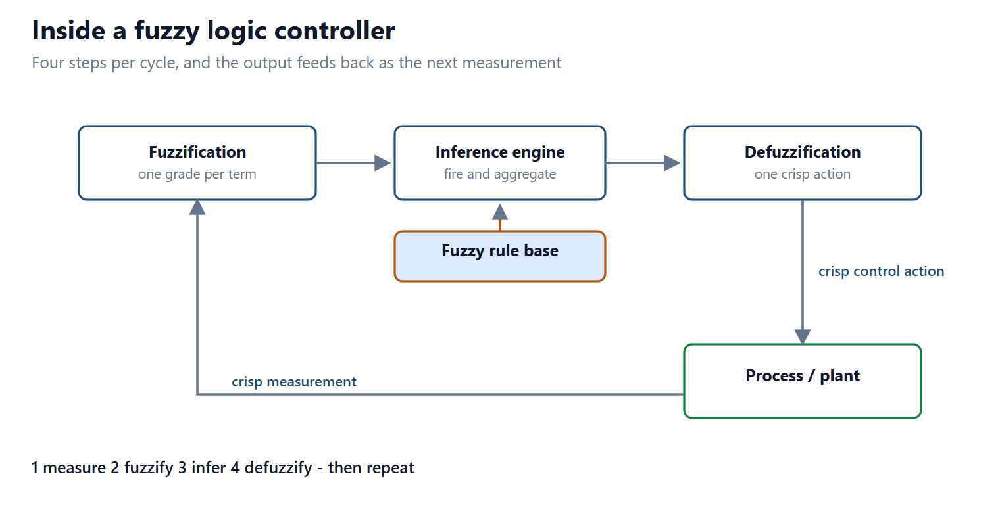
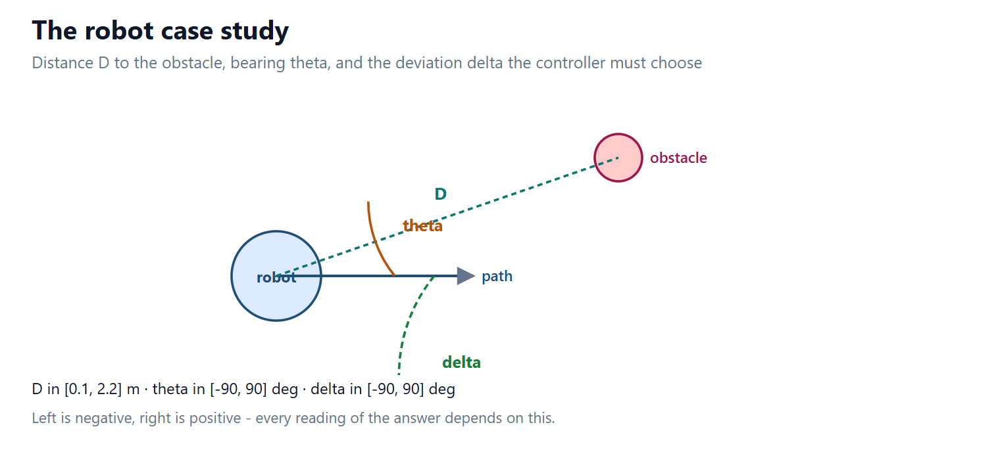
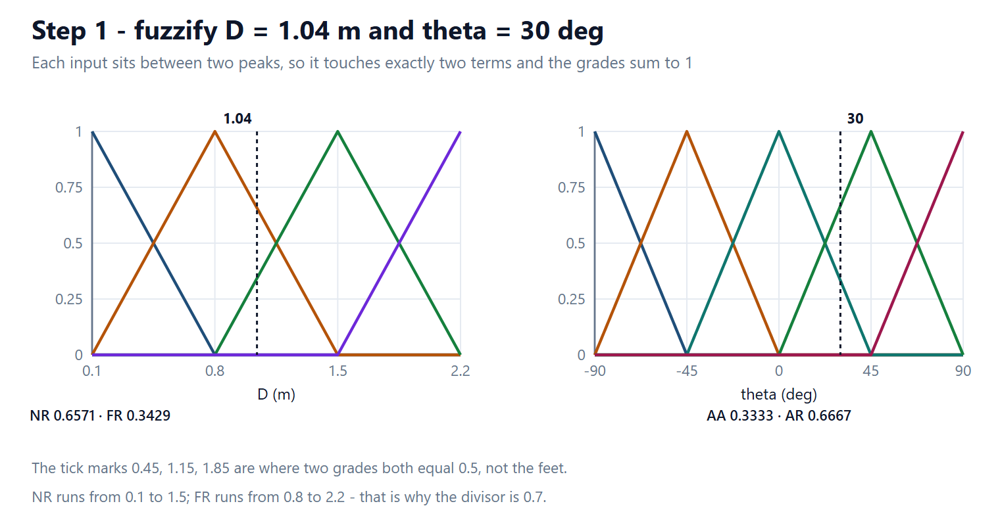
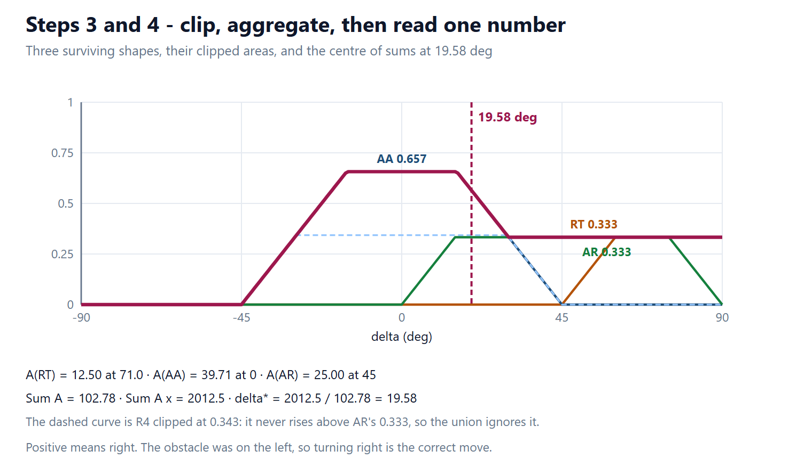

# الجزء 4 — متحكّم المنطق الضبابي

> **من وين جاي:** الجزء 3 خلّى عندنا آلة تحوّل مجموعة إلى رقم. هذا الجزء يركّب الآلة داخل **حلقة تحكّم** كاملة: قياس ← تضبيب ← استدلال ← إزالة تضبيب ← فعل ← قياس جديد.

---

## 1. متى يكون المتحكّم الضبابي هو الأداة الصح (ص 46)

ثلاث حالات ينجح فيها FLC وينفشل فيها التحكّم الكلاسيكي:

| الحالة | المشكلة | لماذا يفشل PID |
|:---|:---|:---|
| **Nonlinear** | العلاقة بين الدخل والخرج منحنية بلا معادلة نظيفة | يحتاج نموذجاً خطياً |
| **Time-varying** | النظام يتغيّر أثناء التشغيل | معايرة ثابتة تصير قديمة |
| **Noisy** | القياسات مضطربة | يضخّم الضجيج |

**FLC = نظام خبير صغير**، بجزأين:

| الجزء | المحتوى | المصدر |
|:---|:---|:---|
| **Knowledge base** | قواعد IF–THEN مكتوبة بخبير بشري | الخبرة |
| **Inference engine** | يقيّم القواعد على الدخل الحالي | الحساب |

**تطبيقات من المصدر:** مكيّفات وغسّالات · تركيز الكاميرا وتثبيت الصورة · ناقل حركة أوتوماتيكي وفرامل ABS وثبات السرعة · ملاحة الروبوتات.

**🧠 مرساة:** قوة FLC ليست في الدقة العددية — بل في أنه **يعمل بدون نموذج رياضي**. تعطي القواعد، فيتصرّف.

---

## 2. معمارية المتحكّم (ص 47)

**أربع خطوات، بهذا الترتيب:**

**1)** قياس المدخلات — قيم صريحة.

**2)** تضبيب: درجة عضوية لكل مصطلح لغوي.

**3)** استدلال: إشعال القواعد ودمج مخرجاتها.

**4)** إزالة تضبيب: فعل صريح واحد — ثم تتكرّر الحلقة.

$$\text{crisp} \longrightarrow \text{fuzzy} \longrightarrow \text{fuzzy} \longrightarrow \text{crisp}$$

**⚠️ مصيدة:** الحلقة **مغلقة**. الخرج يصير دخلاً في الدورة التالية. لو نسيت التغذية الراجعة، تحلّ مسألة مفتوحة لا تحكّماً.

---

## 3. Mamdani مقابل ‎Takagi–Sugeno‎ (ص 48)

| | **Mamdani** | **‎Takagi–Sugeno‎** |
|:---|:---|:---|
| ناتج القاعدة | مجموعة ضبابية | **دالة**: $y = a_0 + a_1x_1 + \dots$ |
| أسلوب النمذجة | لغوي | عددي دقيق |
| القابلية للقراءة | **عالية** — أي شخص يفهم القواعد | منخفضة — المعنى في المعاملات |
| الدقة | أقل | **أعلى** |
| خطوة الخرج | تجميع ثم إزالة تضبيب | **متوسط موزون**، بلا مُزيل |
| السرعة | أبطأ | **أسرع** |

**مثال كل نوع:**

$$\text{Mamdani}: \quad \text{IF } D \text{ is } NR \ \wedge\ \theta \text{ is } AA \ \text{ THEN } \delta \text{ is } RT$$

$$\text{T–S}: \quad \text{IF } I_1 \text{ is } L \ \wedge\ I_2 \text{ is } FR \ \text{ THEN } y = I_1 + 2I_2$$

**الفكرة:** في Mamdani النتيجة **كلمة**، وفي T–S النتيجة **معادلة**. والكلمة تحتاج ترجمة (إزالة تضبيب)، والمعادلة تعطي رقماً مباشرة.

---

## 4. دراسة الحالة — قيادة روبوت متحرّك (ص 49)

| الرمز | المعنى | المدى |
|:---:|:---|:---|
| $D$ | المسافة إلى العائق | $[0.1,\ 2.2]$ m |
| $\theta$ | زاوية العائق نسبةً للروبوت | $[-90°,\ 90°]$ |
| $\delta$ | انحراف الروبوت عن مساره | $[-90°,\ 90°]$ |

**إشارة $\delta$:** اليسار **سالب**، اليمين **موجب**. وهذه ليست تفصيلة — كل تفسير للنتيجة يعتمد عليها.

**الافتراضات (NPTEL):** أربعة عوائق متحرّكة، متساوية الحجم والسرعة؛ وفي كل لحظة يقرّر المتحكّم $\delta$.

**⚠️ مصيدة:** $\theta$ و$\delta$ **يتقاسمان نفس المصطلحات الخمسة** بنفس الدوال. فما في «دالة زاوية» و«دالة انحراف» مختلفتان — هما مجموعة واحدة.

---

## 5. المصطلحات ودوال العضوية (ص 50)

### المسافة $D$ — أربعة مصطلحات

$$VN,\ NR,\ FR,\ VF$$

**القمم عند:** $0.1,\ 0.8,\ 1.5,\ 2.2$ — والفواصل عند $0.45,\ 1.15,\ 1.85$.

### الزاوية $\theta$ والانحراف $\delta$ — خمسة مصطلحات

$$LT,\ AL,\ AA,\ AR,\ RT$$

**القمم عند:** $-90°,\ -45°,\ 0°,\ 45°,\ 90°$.

### الحقيقة التي تختصر نصف الحساب

المثلثات المتجاورة **تتشارك الحافة كاملة**، فمجموع درجتيهما = **1** دائماً بين القمتين:

$$\mu_{NR}(d) + \mu_{FR}(d) = 1 \qquad \text{بين } 0.8 \text{ و } 1.5$$

$$\mu_{AA}(\theta) + \mu_{AR}(\theta) = 1 \qquad \text{بين } 0° \text{ و } 45°$$

**تحقّق عند $d = 1.15$:** الاثنان $0.5$ ← المجموع 1 ✓

**ليش هذا مهم؟** لأنه يخلّي نصف العرض $= 0.7$ متر لـ$D$ و$45°$ لـ$\theta$ — وهذان هما المقامان في كل حسابات الخطوة 1. ولو ما عرفت نصف العرض، ما تكدر تحسب أي درجة.

**⚠️ مصيدة:** $0.45$ و$1.15$ و$1.85$ **ليست** أقدام المثلثات — هي نقاط تقاطع الدرجتين عند $0.5$. مثلث $NR$ يمتد من $0.1$ إلى $1.5$، و$FR$ من $0.8$ إلى $2.2$.

---

## 6. قاعدة القواعد: $4 \times 5 = 20$ (ص 51)

| $D \backslash \theta$ | LT | AL | AA | AR | RT |
|:--:|:--:|:--:|:--:|:--:|:--:|
| **VN** | AA | AR | AL | AL | AA |
| **NR** | AA | AA | **RT** | **AA** | AA |
| **FR** | AA | AA | **AR** | **AA** | AA |
| **VF** | AA | AA | AA | AA | AA |

**العدد:** 4 مصطلحات مسافة × 5 مصطلحات زاوية = **20 قاعدة**. مو 9، ومو 4+5.

### قراءة المصفوفة

| الحالة | القاعدة | المعنى |
|:---|:---|:---|
| $D$ قريبة جداً و$\theta$ أمام | IF VN AND AA THEN **AL** | انحراف أمامي-يسار |
| $D$ قريبة جداً و$\theta$ أمام-يسار | IF VN AND AL THEN **AR** | انحراف أمامي-يمين |
| $D$ بعيدة أو بعيدة جداً | … THEN **AA** | استمرّ مستقيماً |

**فكرتها:** العائق القريب جداً والأمامي ← ابتعد. والعائق البعيد ← لا تفعل شيئاً.

**⚠️ مصيدة:** المصفوفة تعطي **المصطلح** لا الرقم. التحويل إلى رقم يصير في الخطوة 4.

---

## 7. الخطوة 1 — تضبيب $D = 1.04$ و$\theta = 30°$ (ص 53)

### المسافة: تلمس NR وFR

$$\mu_{NR}(1.04) = \frac{1.5 - 1.04}{1.5 - 0.8} = \frac{0.46}{0.7} = \mathbf{0.6571}$$

$$\mu_{FR}(1.04) = \frac{1.04 - 0.8}{1.5 - 0.8} = \frac{0.24}{0.7} = \mathbf{0.3429}$$

**افحص:** $0.6571 + 0.3429 = 1.0000$ ✓ — كما تتوقع من خاصية القسمة.

### الزاوية: تلمس AA وAR

$$\mu_{AA}(30) = \frac{45 - 30}{45 - 0} = \frac{15}{45} = \mathbf{0.3333}$$

$$\mu_{AR}(30) = \frac{30 - 0}{45 - 0} = \frac{30}{45} = \mathbf{0.6667}$$

**افحص:** $0.3333 + 0.6667 = 1.0000$ ✓

**اقرأ النتيجة:** «المسافة قريبة بدرجة 0.66 وقريبة جداً بدرجة 0.34» و«الزاوية أمام بدرجة 0.33 وأمام-يمين بدرجة 0.67». فالعائق أقرب للـ**يمين**.

**⚠️ مصيدة:** كل دخل يلمس **مصطلحين فقط** (لأنه بين قمتين). لو لمسته ثلاثة، فإما أنك أخطأت بالدالة، أو الدخل على نقطة مشتركة.

---

## 8. الخطوة 2 — الإشعال: $\alpha = \min$ (ص 54)

$$\alpha(R_i) = \min\big(\mu_{D_i}(D),\ \mu_{\theta_i}(\theta)\big)$$

الصفوف النشطة: $NR$ و$FR$. الأعمدة النشطة: $AA$ و$AR$. فالخانات النشطة **$2 \times 2 = 4$** من أصل 20.

| القاعدة | مصطلح $D$ | مصطلح $\theta$ | $\delta$ | $\alpha = \min$ |
|:--:|:---|:---|:--:|:--:|
| $R_1$ | NR = 0.6571 | AA = 0.3333 | RT | **0.3333** |
| $R_2$ | NR = 0.6571 | AR = 0.6667 | AA | **0.6571** |
| $R_3$ | FR = 0.3429 | AA = 0.3333 | AR | **0.3333** |
| $R_4$ | FR = 0.3429 | AR = 0.6667 | AA | **0.3429** |

**افحص $R_2$:** $\min(0.6571,\ 0.6667) = 0.6571$ ✓ — وهو أقوى القواعد الأربع. فالقاعدة المهيمنة هي *«قريبة + أمام-يمين ← استمرّ مستقيماً»*.

**⚠️ مصيدة العتبة:** المصدر يذكر خيار حذف القواعد التي $\alpha < 0.34$، وهذا يترك $R_2$ و$R_4$ فقط — وكلتاهما تعطي **AA** (متماثلة حول الصفر)، فيصير $\delta^* = 0°$ بدل $19.6°$. **فرق 20 درجة.** لا تطبّق عتبة إلا إذا طُلبت صراحةً؛ المصدر يحتفظ بالأربع.

---

## 9. الخطوة 3 — القصّ والتجميع (ص 55)

**القصّ — لكل قاعدة على حدة:**

$$C'_i = \min(\alpha_i,\ C_i)$$

| القاعدة | النتيجة | القصّ عند |
|:--:|:---|:--:|
| $R_1$ | RT | 0.333 |
| $R_2$ | AA | 0.657 |
| $R_3$ | AR | 0.333 |
| $R_4$ | AA | 0.343 |

**التجميع — اتحاد:**

$$C' = C'_1 \cup C'_2 \cup C'_3 \cup C'_4$$

$R_2$ و$R_4$ كلاهما على $AA$؛ الاتحاد يأخذ **الأعلى**:

$$\mu_{AA}' = \max(0.657,\ 0.343) = 0.657$$

**النتيجة:** ثلاثة أشكال مقصوصة فقط — $RT$ عند 0.333، $AA$ عند 0.657، $AR$ عند 0.333 — لأن قصّة $R_4$ **غرقَت** تحت قصّة $R_2$.

**⚠️ مصيدة:** $R_4$ **لم تُهمَل حسابياً** — هي موجودة، لكن أثرها صفر لأن $0.343 < 0.657$. لو كانت أعلى، لظهرت.

---

## 10. الخطوة 4 — إزالة التضبيب: $19.58°$ يميناً (ص 56)

$$x^* = \frac{\sum_i A_i\bar{x}_i}{\sum_i A_i}$$

### المساحة بصيغة واحدة

لأي مثلث ارتفاعه الكامل 1 وقُصّ عند $\alpha$، المساحة الباقية:

$$A = A_{\text{full}}\big[1 - (1-\alpha)^2\big]$$

**من وين؟** الجزء المقطوع أعلى $\alpha$ مثلث **مشابه** بنسبة $(1-\alpha)$، فمساحته $(1-\alpha)^2$ من الأصل. الباقي = $1 - (1-\alpha)^2$.

### الحساب

| القاعدة | الشكل | $A_{\text{full}}$ | $\alpha$ | $A$ | $\bar{x}$ | $A\bar{x}$ |
|:--:|:---|:--:|:--:|:--:|:--:|:--:|
| $R_1$ | RT (كتف يمين) | 22.5 | 0.333 | **12.50** | 71.0 | 887.5 |
| $R_2$ | AA (مثلث متماثل) | 45 | 0.657 | **39.71** | 0 | 0 |
| $R_3$ | AR (مثلث متماثل) | 45 | 0.333 | **25.00** | 45.0 | 1125.0 |
| $R_4$ | AA مقصوص بـ0.343 | 45 | 0.343 | **25.57** | 0 | 0 |
| | | | | **102.78** | | **2012.5** |

**افحص $R_2$:** $45[1-(1-0.657)^2] = 45[1-0.1176] = 39.71$ ✓

**افحص $R_1$:** الكتف يمتد من $45$ إلى $90$، فمساحته الكاملة $22.5$. وبعد القصّ:

$$22.5\big[1-(1-0.333)^2\big] = 22.5(0.5555) = 12.50$$

**مركز $R_1$ — لماذا 71 وليس 90؟** الشكل بعد القصّ = مثلث صغير من $45$ إلى $60$ + مستطيل من $60$ إلى $90$:

$$\bar{x} = \frac{2.5(55) + 10(75)}{12.5} = \frac{887.5}{12.5} = 71.0$$

**النتيجة:**

$$\delta^* = \frac{2012.5}{102.78} = \mathbf{19.58°}$$

$$19.58° \approx 20° \text{ إلى يمين المسار}$$

**قارن:** CoG على الاتحاد $= 19.4°$ — الفرق $0.2°$ فقط. الطريقتان متفقتان عملياً، وهذا **فحص ثقة** لا تناقض.

**⚠️ مصيدة الإشارة:** النتيجة **موجبة** ← الانحراف **يمين**. لو كانت سالبة لكان يساراً.

---

## 11. ‎Takagi–Sugeno‎ — قواعد بنتيجة معادلة (ص 57)

$$R_i: \ \text{IF } x_1 \text{ is } A_1^i \ \wedge\ \dots\ \wedge\ x_n \text{ is } A_n^i \ \text{ THEN } y^i = a_0^i + a_1^ix_1 + \dots + a_n^ix_n$$

**الوزن — حاصل ضرب، لا أصغر:**

$$w_i = \mu_{A_1^i}(x_1) \times \mu_{A_2^i}(x_2) \times \dots \times \mu_{A_n^i}(x_n)$$

**الخرج — متوسط موزون، بلا مُزيل:**

$$y = \frac{\sum_{i=1}^{N} w_i\,y^i}{\sum_{i=1}^{N} w_i}$$

**ما يوفّره المصمّم:** دوال عضوية للمدخلات، ومعاملات $a_0 \dots a_n$ لكل قاعدة. **وما يحتاجه:** لا مجموعات مخرج، ولا مُزيل — المتوسط الموزون صريح أصلاً.

**النتيجة الثابتة:** لو كانت النتائج **ثوابت** (كل $a_1 = \dots = 0$)، فـT–S يساوي **حرفياً** المتوسط الموزون مالت الجزء 3 §11.

**⚠️ مصيدة $\sum w = 1$:** ليست دائماً 1. تصير 1 فقط عندما تُشكّل درجات كل دخل **قسمة وحدة** (مجموعها 1). وإلا يجب القسمة على $\sum w$ — وهي موجودة في الصيغة أصلاً، فاستعملها دائماً.

---

## 12. T–S محسوباً: $I_1 = 6.0$ و$I_2 = 2.2$ (ص 58)

### استخراج القمم من الدرجات

السلايد تعطي الدرجات فقط، والقمم تُستنتج منها:

$$\mu_L(6) = 0.8,\ \mu_M(6) = 0.2 \quad\Longrightarrow\quad \text{القمم } 5,\ 10,\ 15$$

**تحقّق:** $\mu_L(6) = (10-6)/5 = 0.8$ ✓ و$\mu_M(6) = (6-5)/5 = 0.2$ ✓ والمجموع 1 ✓

$$\mu_{FR}(2.2) = 0.8,\ \mu_{VF}(2.2) = 0.2 \quad\Longrightarrow\quad \text{القمم } 1,\ 2,\ 3$$

**المعاملات:** $a = 1,2,3$ للـ$L,M,H$ و$b = 1,2,3$ للـ$NR,FR,VF$.

### القواعد الأربع

| القاعدة | IF | $w = \mu \times \mu$ | $y^i = aI_1 + bI_2$ | $w\,y^i$ |
|:--:|:---|:--:|:--:|:--:|
| $R_1$ | $L$ و$FR$ | $0.8(0.8) = 0.64$ | $1(6) + 2(2.2) = 10.4$ | 6.656 |
| $R_2$ | $L$ و$VF$ | $0.8(0.2) = 0.16$ | $1(6) + 3(2.2) = 12.6$ | 2.016 |
| $R_3$ | $M$ و$FR$ | $0.2(0.8) = 0.16$ | $2(6) + 2(2.2) = 16.4$ | 2.624 |
| $R_4$ | $M$ و$VF$ | $0.2(0.2) = 0.04$ | $2(6) + 3(2.2) = 18.6$ | 0.744 |
| | | **1.00** | | **12.04** |

$$y = \frac{12.04}{1.00} = \mathbf{12.04}$$

**لاحظ:** $R_1$ وحدها تحمل $0.64$ من الوزن الكلي — أي $64\%$ من القرار. وهذا طبيعي: الدخلان قريبان من قمتي $L$ و$FR$.

**⚠️ مصيدة:** $y = 12.04$ **مو** متوسط الأربع نتائج. المتوسط البسيط سيكون $14.5$ — خطأ كبير. الوزن هو اللي يرجّح $R_1$.

---

## 13. ورقة صيغ الجزء 4

| العنصر | الصيغة |
|:---|:---|
| خطوات FLC | قياس ← تضبيب ← استدلال ← إزالة تضبيب |
| عدد القواعد | (عدد مصطلحات الدخل 1) × (عدد مصطلحات الدخل 2) |
| تضبيب خطّي | $\mu = \dfrac{\text{المسافة إلى القمة}}{\text{نصف العرض}}$ |
| قوة الإشعال (Mamdani) | $\alpha_i = \min(\mu_{D_i},\ \mu_{\theta_i})$ |
| القصّ | $C'_i = \min(\alpha_i,\ C_i)$ |
| التجميع | $C' = \max_i C'_i$ |
| مساحة مثلث مقصوص | $A = A_{\text{full}}[1-(1-\alpha)^2]$ |
| CoS | $x^* = \sum A_i\bar{x}_i \big/ \sum A_i$ |
| وزن T–S | $w_i = \prod_j \mu_{A_j^i}(x_j)$ |
| خرج T–S | $y = \sum w_i y^i \big/ \sum w_i$ |
| نتيجة T–S | $y^i = a_0 + a_1x_1 + \dots + a_nx_n$ |

---

## 14. حلول مسائل الجزء 4

### Q6 — Mamdani أم ‎Takagi–Sugeno‎؟

> **نص المسألة:** *"Mamdani or ‎Takagi–Sugeno‎: which needs a defuzzifier, which is easier to read, and why?"*

**شنو المطلوب؟** ثلاثة أشياء: (1) أيّهما يحتاج مُزيلاً، (2) أيّهما أسهل قراءة، (3) **السبب**. الشقّ الثالث هو الدرجة الحقيقية — الجواب بـ«Mamdani» وحده نصف علامة.

**خطة الحل:**

**1)** حدّد نوع ناتج القاعدة في كل نوع.

**2)** استنتج حاجة كل نوع للمُزيل.

**3)** قارن القراءة.

**4)** اربط السبب بالمعمار.

**الحل:**

**الخطوة 1 — ناتج القاعدة.**

| | الناتج |
|:---|:---|
| Mamdani | مجموعة ضبابية: $\delta$ is $RT$ |
| T–S | دالة صريحة: $y = a_0 + a_1x_1 + \dots$ |

**الخطوة 2 — الحاجة للمُزيل.**

Mamdani **يحتاج**: الناتج مجموعة، والمجموعة لازم تصير رقماً ← تجميع ثم إزالة تضبيب.

T–S **لا يحتاج**: ناتج كل قاعدة رقم أصلاً، فيكفي متوسط موزون:

$$y = \frac{\sum w_i y^i}{\sum w_i}$$

**الخطوة 3 — القراءة.** Mamdani أسهل قراءةً، لأن ناتج القاعدة **كلمة** يفهمها أي إنسان: «انحراف يمين». أما T–S فناتجه معاملات: $y = I_1 + 2I_2$ — تفهمه أنت لأنك صمّمته، لا لأن الجملة واضحة.

**الخطوة 4 — السبب.** السبب بنيوي: في Mamdani **المعنى في المصطلح**، وفي T–S **المعنى في المعامل**. فكل ما زادت الدقة العددية، ضاع المعنى اللغوي.

**الأثر العملي:** Mamdani حيث يتدخّل الإنسان ويشرح القرار (تحكّم صناعي، أنظمة طبية). وT–S حيث تُلائم المعاملات من البيانات أو تُحسَّن رياضياً.

**جواب مختصر:** Mamdani يحتاج مُزيلاً لأن ناتجه مجموعة ضبابية؛ وT–S لا يحتاج لأن ناتجه دالة صريحة تُدمج بمتوسط موزون. وMamdani أسهل قراءةً لأن ناتج القاعدة مصطلح لغوي، بينما معنى T–S محمول في معاملاته.

### Q13 — تضبيب الروبوت عند $D = 0.9$ و$\theta = -20°$

> **نص المسألة:** *"Robot: D = 0.9 m and θ = −20°. Fuzzify both inputs, list the fired rules and their strengths α."*

**شنو المطلوب؟** ثلاث خطوات من الأربع: تضبيب الدخلين، تحديد القواعد التي تُشعل، وحساب $\alpha$ لكل واحدة. **ما مطلوب** إزالة التضبيب — توقّف عند $\alpha$.

**خطة الحل:**

**1)** حدّد المصطلحين المجاورين لكل دخل.

**2)** احسب الدرجتين بقانون الخط المستقيم.

**3)** اقرأ الخانات النشطة من المصفوفة.

**4)** احسب $\alpha = \min$ لكل قاعدة.

**الحل:**

**الخطوة 1 — المصطلحات.** $D = 0.9$ يقع بين قمتي $NR$ (0.8) و$FR$ (1.5). و$\theta = -20°$ يقع بين قمتي $AL$ (−45) و$AA$ (0). فالخانات النشطة $2 \times 2 = 4$.

**الخطوة 2 — الدرجات.**

$$\mu_{NR}(0.9) = \frac{1.5 - 0.9}{1.5 - 0.8} = \frac{0.6}{0.7} = \mathbf{0.8571}$$

$$\mu_{FR}(0.9) = \frac{0.9 - 0.8}{1.5 - 0.8} = \frac{0.1}{0.7} = \mathbf{0.1429}$$

$$\mu_{AA}(-20) = \frac{45 - 20}{45 - 0} = \frac{25}{45} = \mathbf{0.5556}$$

$$\mu_{AL}(-20) = \frac{0 - (-20)}{0 - (-45)} = \frac{20}{45} = \mathbf{0.4444}$$

**افحص:** مجموع الدرجتين في كل دخل يساوي 1 — كما تتوقع من خاصية القسمة.

$$0.8571 + 0.1429 = 1 \quad \checkmark \qquad 0.5556 + 0.4444 = 1 \quad \checkmark$$

**الخطوة 3 — القواعد النشطة من المصفوفة.** الصفّان $NR$ و$FR$، العمودان $AL$ و$AA$:

$$NR \times AL \to AA, \quad NR \times AA \to RT, \quad FR \times AL \to AA, \quad FR \times AA \to AR$$

**الخطوة 4 — القوى.**

| القاعدة | $D$ | $\theta$ | $\delta$ | $\alpha = \min$ |
|:--:|:--|:--|:--:|:--:|
| $NR \wedge AL$ | 0.8571 | 0.4444 | AA | **0.4444** |
| $NR \wedge AA$ | 0.8571 | 0.5556 | RT | **0.5556** |
| $FR \wedge AL$ | 0.1429 | 0.4444 | AA | **0.1429** |
| $FR \wedge AA$ | 0.1429 | 0.5556 | AR | **0.1429** |

**اقرأ النتيجة:** أقوى قاعدة هي $NR \wedge AA \to RT$ بقوة $0.5556$ — أي **انحراف يمين**. وهذا منطقي: العائق قريب (0.9 م) وعلى اليسار ($-20°$)، فالروبوت يبتعد يميناً.

**⚠️ مصيدة الإشارة:** $\theta = -20°$ يعني **يسار**، والنتيجة **يمين** — وهذا هو السلوك الصحيح، لا تناقض.

### Q14 — T–S عند $I_1 = 8$ و$I_2 = 1.5$

> **نص المسألة:** *"‎Takagi–Sugeno‎ example with I₁ = 8 and I₂ = 1.5: find every wⁱ and yⁱ, then y."*

**شنو المطلوب؟** ثلاثة مستويات: وزن كل قاعدة $w_i$، ناتجها $y^i$، ثم الخرج الكلي $y$. والفرق عن Mamdani إن الوزن **حاصل ضرب** لا أصغر.

**خطة الحل:**

**1)** ضبّب الدخلين (أربع درجات).

**2)** اكتب القواعد ذات الوزن غير الصفري.

**3)** احسب $w_i$ و$y^i$ لكل قاعدة.

**4)** احسب $\sum w$ و$\sum wy$ ثم اقسم.

**الحل:**

**الخطوة 1 — التضبيب.** القمم: $L,M,H$ عند $5,10,15$؛ و$NR,FR,VF$ عند $1,2,3$.

$$\mu_L(8) = \frac{10-8}{5} = \mathbf{0.4}, \qquad \mu_M(8) = \frac{8-5}{5} = \mathbf{0.6}, \qquad \mu_H(8) = \mathbf{0}$$

$$\mu_{NR}(1.5) = \frac{2-1.5}{1} = \mathbf{0.5}, \qquad \mu_{FR}(1.5) = \frac{1.5-1}{1} = \mathbf{0.5}, \qquad \mu_{VF}(1.5) = \mathbf{0}$$

**افحص:** مجموع كل زوج يساوي 1.

$$0.4 + 0.6 = 1 \quad \checkmark \qquad 0.5 + 0.5 = 1 \quad \checkmark$$

**الخطوة 2 — القواعد النشطة.** $H$ و$VF$ درجتاهما صفر ← تُستبعدان. يبقى $2 \times 2 = 4$ قواعد.

**الخطوة 3 — الأوزان والنواتج.**

| القاعدة | IF | $w_i$ | $y^i = aI_1 + bI_2$ | $w_i y^i$ |
|:--:|:---|:--:|:--:|:--:|
| $R_1$ | $L, NR$ | $0.4(0.5) = 0.2$ | $1(8) + 1(1.5) = 9.5$ | 1.90 |
| $R_2$ | $L, FR$ | $0.4(0.5) = 0.2$ | $1(8) + 2(1.5) = 11.0$ | 2.20 |
| $R_3$ | $M, NR$ | $0.6(0.5) = 0.3$ | $2(8) + 1(1.5) = 17.5$ | 5.25 |
| $R_4$ | $M, FR$ | $0.6(0.5) = 0.3$ | $2(8) + 2(1.5) = 19.0$ | 5.70 |

**الخطوة 4 — الخرج.**

$$\sum w_i = 0.2 + 0.2 + 0.3 + 0.3 = 1.0$$

$$\sum w_i y^i = 1.90 + 2.20 + 5.25 + 5.70 = 15.05$$

$$y = \frac{15.05}{1.0} = \mathbf{15.05}$$

**افحص المعقولية:** الخرج $15.05$ يقع بين أصغر ناتج ($9.5$) وأكبره ($19.0$) ✓ — وهذا شرط لازم لأي متوسط موزون. ولو طلع خارج المدى، فالحساب غلط.

**⚠️ لاحظ:** $\sum w = 1$ هنا **صدفة مريحة** سببها أن كل زوج درجات مجموعه 1. لو تغيّر الدخل إلى منطقة لا تُغطّيها الدوال كاملة، لصار المجموع أقل من 1 — والقسمة عليه ضرورية.

---

## 15. مصائد الامتحان

| # | المصيدة | الجواب الآمن |
|:--:|:---|:---|
| 1 | $\alpha$ = ضرب | ❌ في Mamdani $\alpha = \min$؛ الضرب في T–S |
| 2 | التجميع = جمع | ❌ **max** (اتحاد) |
| 3 | عدد القواعد = 4+5 | ❌ **4×5 = 20** |
| 4 | عتبة $\alpha$ بلا طلب | تحذف قواعد وتغيّر النتيجة جذرياً ($19.6° \to 0°$) |
| 5 | T–S يحتاج مُزيلاً | ❌ متوسط موزون مباشرة |
| 6 | $\sum w = 1$ دائماً | ❌ فقط مع قسمة وحدة — اقسم دائماً |
| 7 | $y$ = متوسط النواتج | ❌ **موزون** بالأوزان |
| 8 | $\delta$ سالب = يمين | ❌ سالب = **يسار** |
| 9 | خطوات بترتيب مختلف | قياس ← تضبيب ← إشعال ← قصّ/تجميع ← إزالة تضبيب |
| 10 | القصّ = القياس | القصّ $\min$ يسطّح · القياس $\alpha\mu$ يضغط |
| 11 | إهمال قاعدة ضعيفة | لا تُهمَل — أثرها صفر لكن وجودها يمنع الخطأ |
| 12 | تلمس ثلاثة مصطلحات | ❌ بين قمتين تلمس **اثنين** فقط |

---

## 16. Retrieval set

**1)** متى يكون FLC هو الأداة الصح؟

> عندما يكون النظام غير خطّي، أو متغيّراً مع الزمن، أو مضطرب القياسات — أي حين لا يتوفّر نموذج رياضي نظيف.

**2)** اذكر خطوات FLC الأربع.

> قياس ← تضبيب ← استدلال (إشعال + تجميع) ← إزالة تضبيب.

**3)** ما الفرق الجوهري بين Mamdani وT–S؟

> ناتج القاعدة: مجموعة ضبابية مقابل دالة صريحة. فالأول يحتاج مُزيلاً، والثاني متوسطاً موزوناً.

**4)** ليش عدد القواعد 20؟

> 4 مصطلحات مسافة × 5 مصطلحات زاوية = 20.

**5)** اكتب قانون الإشعال في Mamdani.

> $\alpha_i = \min(\mu_{D_i}(D),\ \mu_{\theta_i}(\theta))$.

**6)** اكتب قانون الوزن في T–S.

> $w_i$ = حاصل ضرب درجات كل المدخلات في القاعدة.

**7)** ليش $\sum w = 1$ في المثال؟

> لأن درجات كل دخل مجموعه 1 (قسمة وحدة)؛ فالضرب يعطي مجموعاً 1.

**8)** ما صيغة مساحة مثلث مقصوص عند $\alpha$؟

> $A = A_{\text{full}}[1-(1-\alpha)^2]$.

**9)** ليش مركز RT ليس 90؟

> لأن القصّ يحوّل الشكل إلى مثلث + مستطيل، فمركزه ينزاح إلى 71.

**10)** لماذا النتيجة $19.58°$ موجبة؟

> لأن الإشارة الموجبة تعني يميناً، والعائق على اليسار — فالابتعاد يمين.

**11)** ماذا يحدث لو طبّقنا عتبة $\alpha \ge 0.34$؟

> تُحذف $R_1$ و$R_3$، يبقى $AA$ متماثلاً، فيصير الانحراف $0°$ بدل $19.6°$.

**12)** متى يتساوى T–S مع المتوسط الموزون؟

> عندما تكون نتائج القواعد ثوابت (كل المعاملات $a_1 \dots a_n$ صفراً).
