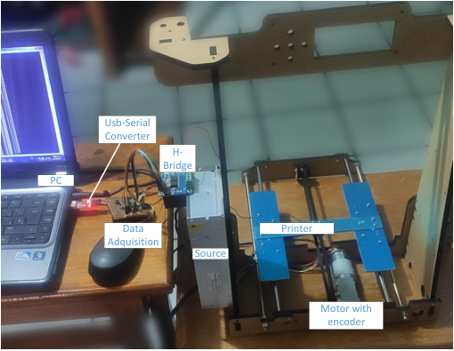
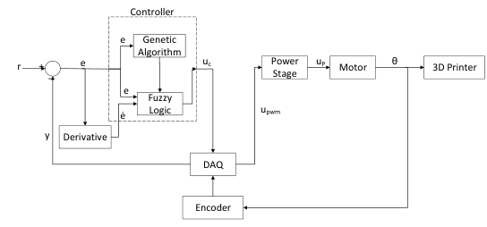

# Can evolution tune a fuzzy servo?

### A genetic algorithm tunes a fuzzy position controller for a physical 3D-printer carriage

**H. Torres-Salinas et al. · Micromachines (2022)**  
DOI: [10.3390/mi13040586](https://doi.org/10.3390/mi13040586)

9 parameters · 4 test scenarios · 1 physical platform

<!-- 0:00–0:35 | 35 seconds
Imagine a 3D-printer carriage that must stop at the right position even when the command changes or a load is added. This paper combines fuzzy logic, which turns control rules into motor commands, with a genetic algorithm, which searches for useful controller parameters. My question is focused: what did the authors tune, what did their experiment show, and how strong is the evidence? This is an original experimental study, not a review.
-->

---

# Manual tuning is the practical bottleneck

- Membership-function boundaries affect how the controller interprets position error.
- Engineers often set these parameters through trial and error.

**Research question**  
Can a genetic algorithm find useful parameters for a physical servo controller?

*Scope: selected parameter tuning, not automatic discovery of the full fuzzy system.*

<!-- 0:35–1:30 | 55 seconds
A fuzzy controller can work well, but its membership functions contain parameters that affect how sensor values are interpreted. Moving those boundaries changes which linguistic rules fire and how strongly they affect the motor. Engineers often tune those values by trial and error. The paper asks whether a genetic algorithm can search for better membership-function parameters for a servo position controller. The target is a real carriage, so the study is about physical position tracking rather than only a simulated benchmark. The scope matters: the authors optimize selected parameters, not the full fuzzy system.
-->

---

# A physical 3D-printer carriage closes the loop

- Motor drives the carriage; an encoder measures position.
- A data-acquisition system returns the signal to the controller.
- Sampling period: **5 ms**.

*Source: Figure 2, Torres-Salinas et al. (2022).*

<!-- 1:30–2:25 | 55 seconds
The test platform uses a 3D-printer carriage driven by a motor. An encoder measures the carriage position. A data-acquisition system reads the position and sends the controller output through a power stage to the motor. The sample time is five milliseconds. This matters because the algorithm is evaluated in a physical feedback loop rather than only on a static data set. The test also adds a five-pound load in some cases. The photograph is Figure 2 from the paper.
Source: Figure 2, Torres-Salinas et al. (2022), https://doi.org/10.3390/mi13040586.
-->

---

# The fuzzy controller maps motion error to motor action

- Inputs: position error and change in error.
- Fuzzy inference: 25 rules from five sets per input.
- The genetic algorithm tunes selected membership parameters.

*Source: Figure 1, Torres-Salinas et al. (2022).*

<!-- 2:25–3:25 | 60 seconds
The controller receives position error and the change in error. In plain language, error tells us how far the carriage is from its target; change in error tells us whether that gap is closing quickly or slowly. The fuzzy inference system combines these inputs through a 25-rule base, corresponding to five linguistic sets for each input. It then produces a crisp control signal for the motor. The genetic algorithm sits alongside this fuzzy controller and changes selected membership-function parameters. Figure 1 is the authors’ control-loop diagram.
Source: Figure 1, Torres-Salinas et al. (2022), https://doi.org/10.3390/mi13040586.
-->

---

# The search changes nine membership parameters

Three triangular sets contribute three adjustable points each.

| Position-error set | Left point | Peak | Right point |
|:--|:--:|:--:|:--:|
| Central set 1 | a₁ | b₁ | c₁ |
| Central set 2 | a₂ | b₂ | c₂ |
| Central set 3 | a₃ | b₃ | c₃ |

**3 sets × 3 points = 9 genes**

*The fuzzy rule base remains fixed.*

<!-- 3:25–4:25 | 60 seconds
Here is the key design choice. The algorithm encodes nine values: the left point, peak, and right point for each of three central triangular membership functions of the position-error input. You can think of these as nine adjustable landmarks that change how the controller interprets small, medium, and large errors. The rule base stays fixed, and the paper does not evolve every membership function. This limited search space makes the hybrid system easier to explain and helps us understand exactly what “the genetic algorithm optimized” means.
-->

---

# The genetic algorithm searches by minimizing position error

**Encode 9 values** → **Evaluate MSE** → **Tournament selection** → **PMX crossover + mutation** → **Repeat for 70 iterations**

Population size: **40**

- Fitness: mean squared error between target and measured position.
- Selection, crossover, and mutation search new parameter combinations.

<!-- 4:25–5:35 | 70 seconds
The genetic algorithm starts with candidate parameter sets. For each candidate, the controller runs and the authors compute mean squared error between the desired and measured position. Lower mean squared error gives a better candidate. Tournament selection favors stronger candidates, partially matched crossover combines parameter sets, and mutation introduces changes that may uncover a better configuration. The reported population size is 40, and the algorithm uses 70 iterations. In everyday terms, it keeps testing sets of nine landmarks, retaining useful combinations and changing them until its search budget ends.
-->

---

# Four cases vary both command pattern and load

| Case | Position command | Added load |
|:--:|:--|:--:|
| 1 | Single target | None |
| 2 | Multiple targets | None |
| 3 | Single target | 5 lb |
| 4 | Multiple targets | 5 lb |

Sampling period: **5 ms**

<!-- 5:35–6:30 | 55 seconds
The authors vary two factors. First, the carriage receives either one position command or multiple changing position commands. Second, the platform runs with no added load or with a five-pound load. Together these produce four test cases. The five-millisecond sampling period remains the same. The scenarios let us ask whether the tuned controller can track more than one simple target and whether it can operate under an added load. They provide useful coverage, although they do not replace a controlled baseline comparison.
-->

---

# The reported comparison needs careful reading

| Metric | Proposed study | Prior fuzzy-GA [45] |
|:--|--:|--:|
| Rise time | 0.19 s | 0.155 s |
| Overshoot | 15% | 4.84% |
| Settling time | 0.63 s | 0.252 s |

The prior-work row is numerically lower on all three metrics.

*The values come from separate studies, not a controlled head-to-head test.*

<!-- 6:30–7:40 | 70 seconds
The paper’s Table 3 reports a rise time of 0.19 seconds, overshoot of 15 percent, and settling time of 0.63 seconds for the proposed approach. The same table lists a prior fuzzy-GA result from reference 45 at 0.155 seconds, 4.84 percent, and 0.252 seconds. Each of those values is numerically lower in the prior-work row. The authors describe their result as competitive, while the conclusion makes a broader improvement claim. Since the comparator comes from another paper and may use a different platform or protocol, this table cannot settle which controller is better. It does tell us to avoid claiming universal superiority.
-->

---

# The experiment supports feasibility, not a general win

**Supported:** a fuzzy-GA controller ran on a physical carriage across four command/load cases.

**Not isolated:** how much gain came from GA tuning, because a same-platform untuned baseline is missing.

**Fair follow-up:** same carriage, same tasks, repeated trials, tuned versus untuned fuzzy control.

<!-- 7:40–9:05 | 85 seconds
The strongest contribution is a clear physical demonstration: a genetic algorithm can tune selected fuzzy membership parameters, and the resulting controller is tested under several command and load conditions. The main evidence limit is causal attribution. The paper does not give a same-platform, same-task comparison between an otherwise identical untuned fuzzy controller and the genetic-algorithm-tuned controller. That means we cannot isolate how much improvement came from the genetic search. The cross-paper comparison also mixes studies, so it is not a fair head-to-head benchmark. A stronger follow-up would run both controllers on the same carriage, with identical trajectories and loads, repeat each trial, and report variation as well as averages. The printed membership-function equation also appears to contain a likely boundary typo; the plotted triangle is standard, so we should not infer that the implementation used the typo.
-->

---

# A useful bridge from fuzzy systems to optimization

**Take-home:** a genetic algorithm can tune selected fuzzy-controller parameters for a real servo task.

- Demonstrates feasibility on the tested platform.
- Does not establish general superiority.
- Extends membership functions into evolutionary optimization.

**Discussion:** What same-platform experiment would show that GA caused the improvement?

## Reference
H. Torres-Salinas, J. Rodríguez-Reséndiz, E. E. Cruz-Miguel, and L. A. Ángeles-Hurtado, “Fuzzy Logic and Genetic-Based Algorithm for a Servo Control System,” *Micromachines*, 13(4), 586 (2022). [https://doi.org/10.3390/mi13040586](https://doi.org/10.3390/mi13040586)

<!-- 9:05–10:00 | 55 seconds
The take-home message is that a genetic algorithm can tune a compact set of fuzzy-controller parameters for a real servo task. This paper is a good seminar case because the fuzzy rules, the nine adjustable values, and the physical experiment can all be explained in ten minutes. Its results show feasibility on the tested platform; they do not establish that this controller is generally superior. That distinction is part of reading research carefully. The paper extends our course work on fuzzy membership functions by showing how evolutionary optimization can tune them. A question for discussion is: what same-platform baseline would convince us that the genetic algorithm caused the improvement?
Full citation: H. Torres-Salinas, J. Rodríguez-Reséndiz, E. E. Cruz-Miguel, and L. A. Ángeles-Hurtado, “Fuzzy Logic and Genetic-Based Algorithm for a Servo Control System,” Micromachines, 13(4), 586, 2022. https://doi.org/10.3390/mi13040586.
-->