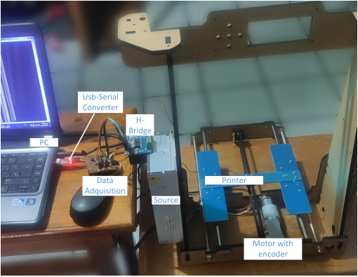
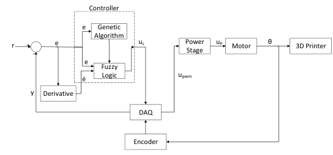

# How does a genetic algorithm tune fuzzy control?

### A simple explanation of a real servo-control study

**H. Torres-Salinas et al. · Micromachines (2022)**  
DOI: [10.3390/mi13040586](https://doi.org/10.3390/mi13040586)

9 adjustable values · 4 test cases · real 3D-printer carriage

<!-- SPEAKER NOTES
Today I will explain one research paper in simple steps. The authors built a fuzzy controller for a real 3D-printer carriage. Then they used a genetic algorithm to adjust some of its settings. You do not need to know genetic algorithms before this talk. I will explain each new word using the nine numbers that the paper actually changes. The main question is whether this search can help the carriage follow its target position. The paper is an original experiment, not a review.
Source: Torres-Salinas et al. (2022), https://doi.org/10.3390/mi13040586.
-->

---

# Fuzzy-controller settings need careful tuning

- Membership boundaries affect how the controller reads position error.
- Poor settings can make the motor move slowly or overshoot.

**Paper question**  
Can a search algorithm choose useful fuzzy-set boundaries automatically?

*The study changes selected controller settings on a real carriage.*

<!-- SPEAKER NOTES
A fuzzy controller contains membership functions. Their boundaries affect how the controller understands position error. If the boundaries are poorly chosen, the motor may move too slowly or overshoot. The authors ask a practical question: can a search method choose useful boundary values automatically? They test that idea on a physical carriage. The paper changes selected settings inside the fuzzy controller. It does not ask a computer to invent the complete rule system.
-->

---

# A real 3D-printer carriage is the test system

- Motor moves the carriage; an encoder reads its position.
- DAQ returns the measurement to the controller.
- Sampling period: **5 ms**.

*Source: Figure 2, Torres-Salinas et al. (2022).*

<!-- SPEAKER NOTES
This is the real test platform. A motor moves the printer carriage. An encoder measures where the carriage is, and a data-acquisition unit sends the measurement to the controller. The controller then sends a motor command through the power stage. The control loop samples every five milliseconds. In some tests, the researchers add a five-pound weight.
Source: Figure 2, Torres-Salinas et al. (2022), https://doi.org/10.3390/mi13040586.
-->

---

# Fuzzy control uses simple inputs and rules

- Error = target − actual; change in error shows whether the gap grows.
- Five fuzzy labels per input form **25 if-then rules**.
- The rules produce a motor command.

*The GA moves three selected error triangles. Source: Figure 1, Torres-Salinas et al. (2022).*

<!-- SPEAKER NOTES
Here is the fuzzy-control part we already know. Position error means target position minus actual position. The change in error tells us whether the gap is getting larger or smaller. The controller turns these numerical inputs into fuzzy labels, then applies if-then rules to produce a motor command. The paper uses five fuzzy sets for each input, so it has 25 rules. The genetic algorithm does not replace those rules. It changes the locations of three selected triangles that describe position error.
Source: Figure 1, Torres-Salinas et al. (2022), https://doi.org/10.3390/mi13040586.
-->

---

# One candidate contains nine adjustable numbers

Each candidate moves three triangles for position error.

| Error set | Left point a | Peak m | Right point b |
|:--|:--:|:--:|:--:|
| Negative error | a_ne | m_ne | b_ne |
| Zero error | a_zero | m_zero | b_zero |
| Positive error | a_pe | m_pe | b_pe |

**Gene = one number · Candidate = nine genes**

**Population = 40 candidates · Rule table stays fixed**

<!-- SPEAKER NOTES
Before the algorithm, let us map the new words to the table. One gene is one adjustable number. A candidate, also called an individual, is one complete set of nine numbers. The population is the group of 40 candidates the algorithm compares. The nine numbers set the left point, peak, and right point of three triangles: negative error, zero error, and positive error. Picture moving the three triangles left or right to change how the controller interprets an error. The fuzzy rule table remains fixed. The paper also leaves the derivative-input membership functions unchanged.
-->

---

# A genetic algorithm is repeated trial and selection

**Make 40 candidates** → **Score with MSE** → **Choose lower error** → **Mix and mutate** → **Repeat for 70 iterations**

MSE is the average squared gap between target and measured position. A smaller score is better.

- Selection: tournament
- Crossover: PMX combines candidates
- Mutation: randomly changes two genes

<!-- SPEAKER NOTES
A genetic algorithm is a repeated search. It starts with 40 candidate settings. It tests each setting by running the controller and calculating MSE, or mean squared error. MSE is the average of the squared gaps between the target position and the measured position. A smaller score means closer tracking. The algorithm selects better candidates using a tournament: it compares candidates and keeps the stronger one for reproduction. Crossover, called PMX in the paper, combines parts of two selected candidates. Mutation randomly changes two numbers. The search repeats for 70 iterations. Think of it as making many recipes for the triangle positions, scoring them, combining the better recipes, and trying again.
-->

---

# The tests vary target commands and added weight

| Case | Position command | Added load |
|:--:|:--|:--:|
| 1 | Single target | None |
| 2 | Multiple targets | None |
| 3 | Single target | 5 lb |
| 4 | Multiple targets | 5 lb |

Sampling period: **5 ms**

<!-- SPEAKER NOTES
The authors test four combinations. They ask the carriage to reach either one target or several changing targets. They also run each command pattern without an added weight and with a five-pound weight. That gives four cases. The tests ask whether the controller can follow different position commands and still work when the carriage has extra load. All cases use the same five-millisecond sample period.
-->

---

# Reported times, with a cross-study caveat

Scenario 1: single target, no added weight.

| Metric | Proposed study | Earlier fuzzy-GA [45] |
|:--|--:|--:|
| Rise time | 0.19 s | 0.155 s |
| Overshoot | 15% | 4.84% |
| Settling time | 0.63 s | 0.252 s |

The earlier result is lower on all three measures. Separate studies are not a direct test.

<!-- SPEAKER NOTES
The authors report that the controller reached the desired positions in all four cases. The table here gives the numerical comparison from Table 3. That comparison uses Scenario 1, a single target without added weight. The proposed controller reports a 0.19-second rise time, 15 percent overshoot, and 0.63-second settling time. The earlier fuzzy-GA result in reference 45 has smaller values for all three measures. These numbers come from separate studies, so the table is not a direct test on the same hardware. We should describe the result as a physical demonstration, not proof that this controller is always better.
-->

---

# The experiment shows feasibility on this carriage

**What worked:** the controller reached its targets in four physical test cases.

**What remains unclear:** no same-platform test isolates what the GA added.

**A stronger test:** compare tuned and untuned fuzzy control on the same carriage, commands, and loads, with repeated trials.

<!-- SPEAKER NOTES
The experiment shows that the fuzzy controller tuned by a genetic algorithm can run on a physical printer carriage across four command and load cases. It does not isolate how much difference the genetic algorithm made, because the paper does not compare the tuned controller with an otherwise identical untuned fuzzy controller on the same platform. A stronger follow-up would test both controllers on the same carriage, with the same target commands and loads. It would repeat the tests and report how much the results vary.
-->

---

# Fuzzy rules plus a search for better settings

Fuzzy logic supplies the rules. The genetic algorithm searches for better membership-function values.

- The paper demonstrates the method on a real servo.
- Its results do not establish general superiority.

**Discussion:** What comparison would show that GA tuning caused an improvement?

## Reference
H. Torres-Salinas, J. Rodríguez-Reséndiz, E. E. Cruz-Miguel, and L. A. Ángeles-Hurtado, “Fuzzy Logic and Genetic-Based Algorithm for a Servo Control System,” *Micromachines*, 13(4), 586 (2022). [https://doi.org/10.3390/mi13040586](https://doi.org/10.3390/mi13040586)

<!-- SPEAKER NOTES
The main idea is simple: fuzzy logic provides the controller rules, and the genetic algorithm searches for better values for selected membership-function points. The authors test this combination on a real servo system. The study is useful because it connects fuzzy systems to optimization. Its experiment supports feasibility on this platform. It does not establish general superiority over other controllers.
Full reference: H. Torres-Salinas, J. Rodríguez-Reséndiz, E. E. Cruz-Miguel, and L. A. Ángeles-Hurtado, “Fuzzy Logic and Genetic-Based Algorithm for a Servo Control System,” Micromachines, 13(4), 586 (2022). https://doi.org/10.3390/mi13040586.
-->