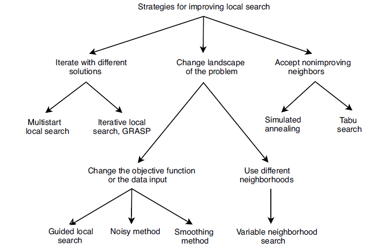
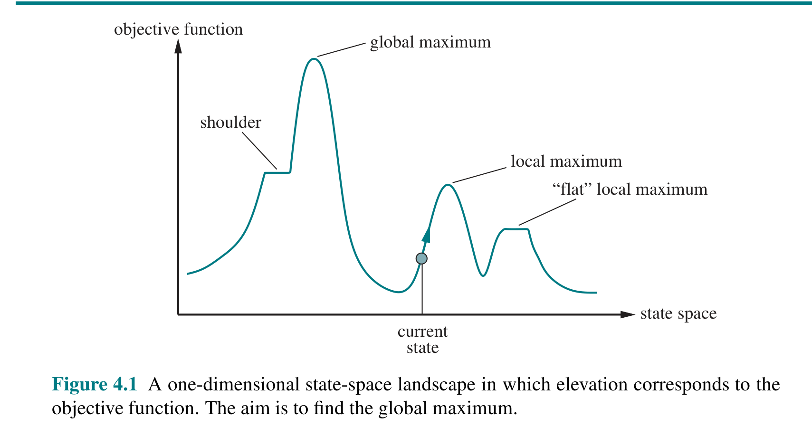
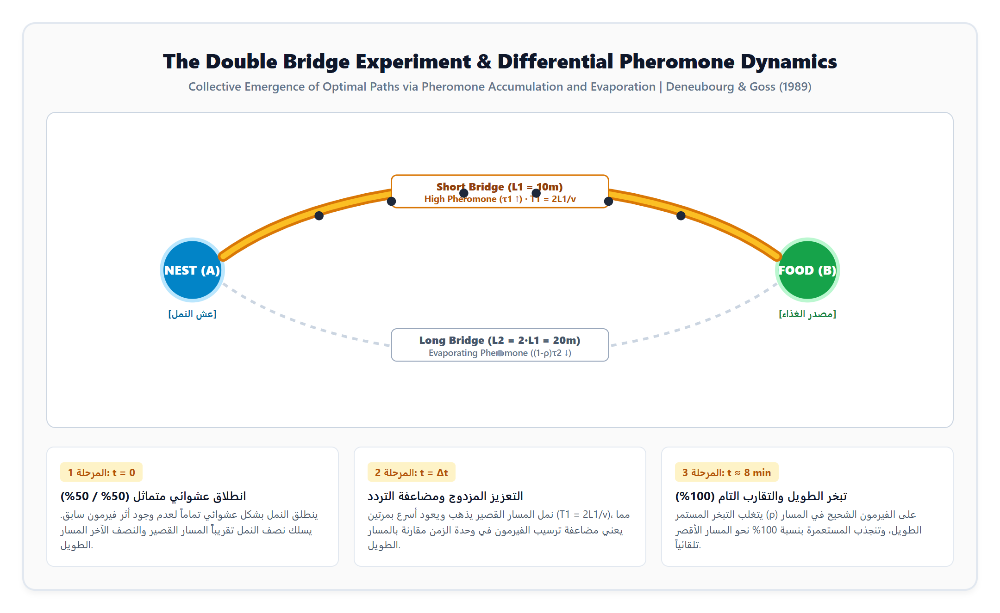
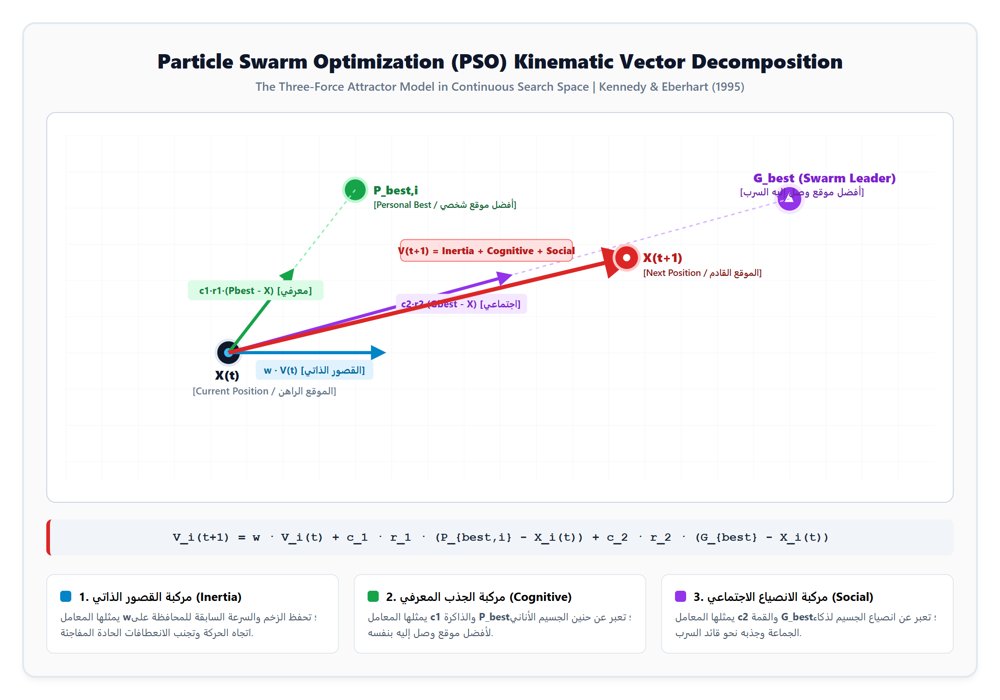
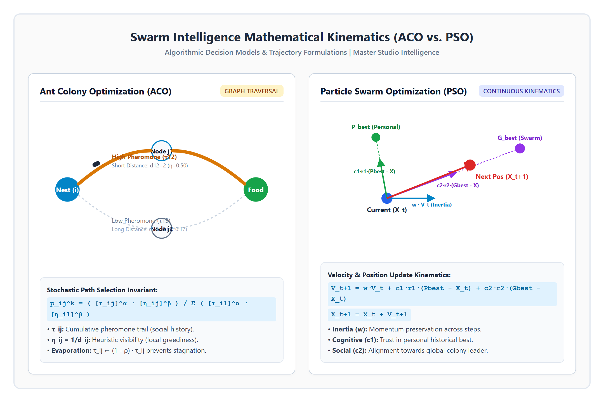

> **المصادر الأكاديمية المعتمدة والتوثيق المرجعي:**  
> 1. المرجع الأساسي المباشر لسلايدات الأستاذ الدكتور سيف علي السعيدي: **El-Ghazali Talbi, *Metaheuristics: From Design to Implementation* (John Wiley & Sons, 2009, Ch. 3, pp. 190–260)**.  
> 2. المرجع الكلاسيكي لذكاء الأسراب: **Eric Bonabeau, Marco Dorigo, Guy Théraulaz, *Swarm Intelligence: From Natural to Artificial Systems* (Oxford University Press, 1999)**.  
> 3. المرجع التأسيسي للمبادئ الخمسة: **H. Mark Millonas, *Swarms, phase transitions, and collective intelligence* (Santa Fe Institute, 1994)**.  
> 4. المرجع الرياضي لخوارزمية النمل: **Marco Dorigo & Thomas Stützle, *Ant Colony Optimization* (MIT Press, 2004)**.  
> 5. المرجع الأصلي لخوارزمية الطيور: **James Kennedy & Russell Eberhart, *Particle Swarm Optimization* (IEEE, 1995)**.  
>  
> **الهدف البيداغوجي للوثيقة:** بناء مادة دراسية أكاديمية متكاملة وشاملة تُغني الطالب تماماً عن مراجعة المراجع الأجنبية المتفرقة. تشمل هذه المادة التفكيك الفلسفي والرياضي من الصفر، تفصيل الخوارزميات خطوة بخطوة، معالجة المسائل الحسابية بمصفوفات رقمية كاملة، سد فجوة انطفاء الحاسبة أثناء الشرح، وتأصيل أنماط التهجين (*Hybridization*) التي تمثل عصب أسئلة الامتحانات التنافسية والنهائية لطلبة الماجستير.

---

## Where this sits: The Architectural Paradigm Shift

### 1. السياق البنائي للمادة (Context)
في المحاضرات التأسيسية السابقة، عولجت مسائل التحسين والبحث في فضاء الحالات عبر **خوارزميات الحل المنفرد (Single-Solution Metaheuristics)** مثل: البحث الموضعي (*Local Search / Hill Climbing*)، التلدين المحاكى (*Simulated Annealing - SA*)، والبحث المحظور (*Tabu Search - TS*). ورغم قدرة هذه الخوارزميات على إنجاز تحسينات محلية دقيقة (*Intensification / Exploitation*)، إلا أنها تعاني من عجز هيكلي حتمي: **الوقوع في فخاخ القمم المحلية الرديئة (Local Optima Trap)** وفقرها الشديد للاستكشاف العالمي الشامل (*Global Exploration*). لمعالجة هذا الانهيار، ينتقل الذكاء الاصطناعي إلى **خوارزميات المجتمعات وذكاء الأسراب (Population-Based Swarm Intelligence)** التي توزع مئات المستكشفين في فضاء الحلول وتصل للحل الأمثل عالمياً عبر الاتصال غير المباشر والتنظيم الذاتي.

> [!NOTE] **الشجرة التصنيفية لخوارزميات الحل المنفرد (من سلايدات المحاضرة — د. سيف، شريحة 3):**
> تُلخص الشجرة المستخرجة مباشرة من سلايدات الدكتور استراتيجيات تحسين البحث الموضعي الكلاسيكي عبر ثلاثة مسارات رئيسية: (1) التكرار بحلول ابتدائية متعددة (*Multistart, GRASP, Iterative Local Search*)، (2) تعديل تضاريس المسألة ودالة الهدف (*Guided Local Search, Smoothing, Noisy Methods*)، أو (3) قبول حلول أسوأ مؤقتاً للهروب من القمم المحلية (*Simulated Annealing, Tabu Search*). ورغم هذه التحسينات، يبقى النظام مقيداً بمسار حل واحد يفتقر للذكاء التوزيعي الجمعي.

### 2. السؤال الجوهري الذي تجيب عنه هذه الوحدة (The Core Question)
*كيف تستطيع مجموعة من الوكلاء البرمجيين البسطاء (مثل النمل الأعمى أو الطيور)، الفاقدين لأي وعي بالخريطة الكلية والفاقدين لأي قيادة مركزية، أن يتعاونوا من خلال تفاعلات موضعية آنية لإنتاج سلوك جمعي خارق الذكاء يحل مسائل استمثال معقدة وغير خطية ومستعصية حسابياً ($NP\text{-hard}$ Optimization Problems) في زمن قياسي؟*

### 3. السؤال الذي تسلمه هذه الوحدة للوحدة القادمة (The Handoff)
*إذا كانت خوارزميات الأسراب الطبيعية مصممة لإيجاد القيم المثلى للمعاملات والمسارات في فضاءات البحث المجهولة، فكيف نستثمر هذه القدرة الاستكشافية لتدريب وضبط نماذج تعلم الآلة الإشرافي (Supervised Machine Learning: KNN, SVM, Naive Bayes) في تصنيف البيانات والفصل بين الفئات بدقة هندسية عالية؟*

---

## Part I: Foundations of Metaheuristics & Swarm Intelligence

### 1.1 طبيعة فضاءات البحث ومشكلة الاستمثال (The Optimization Problem)
تُعرّف مسألة الاستمثال الرياضية العامة بالبحث عن متجه متغيرات $X^* = (x_1^*, x_2^*, \dots, x_D^*)$ يحقق أفضل قيمة لدالة الهدف $f(X)$ ضمن فضاء حلول ممكن $\Omega$:

$$
\text{Minimize or Maximize } f(X) \quad \text{subject to } g_i(X) \le 0, \quad h_j(X) = 0
$$

في مسائل علوم الحاسوب المتقدمة (مثل جدولة المهام في المعالجات الموزعة، مسألة البائع المتجول $TSP$، توجيه حزم الشبكات $Routing$، وضبط أوزان الشبكات العصبية):
* يكون فضاء البحث $\Omega$ ضخماً جداً وحجمه يتزايد أسياً مع حجم المسألة (تعقيد فلكي $O(n!)$ أو $O(2^n)$).
* يكون فضاء البحث **متعدد القمم (Multimodal)**؛ أي يحتوي على مئات القمم والقيعان الخادعة.
* تعجز خوارزميات الحساب الدقيق (*Exact Methods* مثل البرمجة الديناميكية والتفرع والتقييد *Branch and Bound*) عن حل المسألة في زمن منطقي. هنا يصبح استخدام **الميتاهيورستك (Metaheuristics)** حتمياً لتقديم حلول شبه مثالية (*Near-Optimal*) في زمن مقبول هندسياً.

> [!NOTE] **الشرح المفاهيمي لتضاريس فضاء الحالة — كتاب AIMA المنهجي (شكل 4.1):**
> يوضح الشكل المستخرج مباشرة من الكتاب المنهجي المعتمد طبيعة التحدي الحسابي في فضاءات البحث؛ حيث يمثل المحور الأفقي فضاء الحالات (*State Space*) ويمثل الارتفاع الرأسي قيمة دالة الهدف (*Objective Function*). تسقط خوارزميات الحل المنفرد (*Single-Solution*) الكلاسيكية في فخ **القمم المحلية (Local Maxima)** أو تتجمد حركتها في **الهضاب المسطحة (Flat Local Maxima / Plateaux)** و**الأكتاف (Shoulders)** بسبب غياب التدرج الحسابي، بينما تنجح خوارزميات أسراب الذكاء الاصطناعي (*Swarm Intelligence*) في تجاوز هذه العوائق واستكشاف فضاء البحث عالمياً للوصول إلى **القمة العالمية العظمى (Global Maximum)**.

---

### 1.2 تصنيف تالبي الشامل لخوارزميات الميتاهيورستك (Talbi's Taxonomy)
وفقاً للفصل الأول والثالث من مرجع الدكتور المعتمد (*Talbi 2009, pp. 6–10*)، تُصنف خوارزميات الميتاهيورستك وفق خمسة محاور مفصلية:

| محور التصنيف / Dimension | الخيار الأول (Option A) | الخيار الثاني (Option B) | الدلالة الهندسية والحسابية |
|:---|:---|:---|:---|
| **مصدر الإلهام (Inspiration Source)** | **مستوحاة من الطبيعة (Nature-Inspired)** | **غير مستوحاة من الطبيعة (Non-Nature)** | الأسراب، التطور الدارويني، والفيزياء مقابل خوارزميات Tabu Search و Local Search المجردة. |
| **عدد الحلول المتزامنة (Population Size)** | **حل منفرد (Single-Solution Metaheuristics)** | **مجتمع حلول (Population-Based)** | حل واحد يخضع للتطوير (استغلال موضعي Exploitation) مقابل أسراب تتعاون بالتوازي (استكشاف Exploration). |
| **استخدام الذاكرة (Memory Usage)** | **خوارزميات ذات ذاكرة (Memory-Based)** | **خوارزميات بلا ذاكرة (Memoryless)** | استخدام سجل تاريخي للحلول السابقة (مثل Tabu List وقوائم الفيرمون) مقابل البحث العشوائي اللحظي. |
| **طبيعة اتخاذ القرار (Determinism)** | **حتمية (Deterministic)** | **احتمالية / تصادفية (Stochastic)** | نفس البداية تعطي حتماً نفس المسار مقابل اعتماد قواعد احتمالية وتوزيعات عشوائية للهروب من القمم. |
| **آلية بناء الحل (Construction Strategy)** | **تكرارية تحسينية (Iterative)** | **بنائية جشعة (Greedy / Constructive)** | الانطلاق من حلول كاملة وتعديلها تكرارياً مقابل بناء الحل تدريجياً خطوة بخطوة من الصفر. |

---

### 1.3 المبادئ الخمسة الأساسية لذكاء الأسراب (Millonas's 5 Principles)
وضع العالم مارك ميلوناس (*Mark Millonas, 1994*) المبادئ الرياضية والسلوكية الخمسة التي تحكم ذكاء الأسراب الطبيعية والاصطناعية، والتي استشهد بها الدكتور سيف في محاضرته:

| المبدأ الجوهري | الوصف المفهومي | الدلالة الهندسية والحسابية |
|:---|:---|:---|
| **1. Proximity Principle** | التقارب المكاني والزماني | حسابات موضعية بسيطة وتجنب الاصطدام دون الحاجة لمركزية |
| **2. Quality Principle** | استشعار الجودة | الاستجابة لعوامل جودة البيئة (دالة اللياقة / الرحيق) |
| **3. Diverse Response** | تنوع الاستجابة | تنوع مسارات الحلول لمنع الانغلاق في مسار أحادي ضيق |
| **4. Stability Principle** | استقرار السلوك | ثبات هيكل السرب ونمطه ضد تقلبات البيئة الطفيفة |
| **5. Adaptability Principle** | مرونة التكيف | تغيير السلوك فقط عندما يبرر العائد كلفة الحساب |

#### 1. مبدأ التقارب (The Proximity Principle)
* **التعريف الأكاديمي:** يجب أن يمتلك أفراد المجتمع القدرة على إجراء حسابات فراغية وزمنية بسيطة تتناسب مع محيطهم المباشر.
* **التحليل الهندسي:** لا يحتاج الطائر أو النملة إلى معرفة إحداثيات القارة أو فضاء البحث بأكمله؛ بل يقيس سرعته وبعده عن جيرانه الملاصقين فقط. برمجياً، هذا يعني أن تعقيد حسابات الوكيل الواحد يبقى محدوداً جداً $O(1)$ أو $O(k)$ بالنسبة لعدد الجيران $k$، مما يسمح للنظام بالتوسع لملايين الوكلاء دون اختناق حسابي.

#### 2. مبدأ الجودة (The Quality Principle)
* **التعريف الأكاديمي:** يجب أن يستجيب المجتمع لعوامل الجودة المتغيرة في البيئة المحيطة.
* **التحليل الهندسي:** السرب لا يتحرك عشوائياً في فراغ أعمى، بل يمتلك مجسات تقيس "جودة" البقعة الحالية (وفرة الغذاء، قصر المسافة، تركيز الفيرمون). برمجياً، هذه هي **دالة اللياقة (Fitness Function)** التي تعطي وزناً أكبر للحلول المتميزة وتدفع السرب نحو أحواض الجذب المثالية.

#### 3. مبدأ تنوع الاستجابة (The Diverse Response Principle)
* **التعريف الأكاديمي:** يجب ألا يكرس المجتمع كافة موارده وأنشطته عبر قنوات شديدة الضيق والتماثل.
* **التحليل الهندسي:** إذا توجه كل النمل دفعة واحدة إلى أول مصدر طعام صغير اكتشفه، سيموت السرب جوعاً إذا نضب هذا المصدر. التنوع يفرض توزيع احتمالي للوكلاء: جزء يركز على أفضل الحلول الحالية (*Exploitation*)، وجزء آخر يستمر في التمشيط العشوائي للآفاق البعيدة (*Exploration*).

#### 4. مبدأ الاستقرار (The Stability Principle)
* **التعريف الأكاديمي:** يجب ألا يغير المجتمع نمط سلوكه العام مع كل تذبذب أو تقلب بيئي طفيف.
* **التحليل الهندسي:** يوفر هذا المبدأ حصانة برمجية ضد **الضوضاء الحسابية (Computational Noise)**. إذا ظهر حل وهمي متطرف ناتج عن خطأ قياس عابر، لا يجوز للسرب أن يتخلى عن تشكيله المترابط ويندفع خلفه.

#### 5. مبدأ التكيف (The Adaptability Principle)
* **التعريف الأكاديمي:** يجب أن يكون المجتمع قادراً على تعديل نمط سلوكه عندما يستحق المردود الحسابي دفع تكلفة التغيير.
* **التحليل الهندسي:** هو الوجه المكمل للاستقرار. إذا واجه السرب عائقاً حقيقياً أو إذا ثبت أن المسار القديم أصبح مسدوداً بالكامل، ينكسر الجمود الحسابي ويغير الوكلاء مساراتهم وسرعاتهم للتكيف مع الواقع الجديد.

> **تنبيه الأستاذ الدكتور سيف حول التمييز بين الاستقرار والتكيف (Exam Distinction):**  
> الاستقرار يعني **مقاومة التشتت والانجرار خلف الاضطرابات العابرة (Robustness against Noise)**، بينما التكيف يعني **المرونة في تغيير الإستراتيجية عند التيقن من فشل الحل الراهن (Plasticity upon Failure)**. الخوارزمية الناجحة هي التي توازن بين جمود الاستقرار وسيولة التكيف.

---

## Part II: Ant Colony Optimization (ACO) — Complete Mechanics

### 2.1 الإلهام البيولوجي وظاهرة الاتصال غير المباشر (Stigmergy)
النمل الحقيقي حشرة كفيفة وشبه عمياء، ومع ذلك تنجح مستعمرات النمل في شق أقصر الطرق الرابطة بين العش (*Nest*) ومصادر الغذاء (*Food Source*).  
تعتمد هذه المعجزة الحسابية على مفهوم وضعه عالم الأحياء بيير بول غراسي (*Pierre-Paul Grassé, 1959*) يسمى **التواصل غير المباشر عبر تعديل البيئة (Stigmergy)**:
* النمل لا يتحدث مع بعضه ولا يرسل رسائل موجهة.
* النملة المتحركة تفرز على الأرض قطرات مجهرية من سائل كيميائي متطاير يسمى **الفيرمون (Pheromone)**.
* تمثل مادة الفيرمون **ذاكرة خارجية موزعة في البيئة (External Distributed Memory)**.
* النمل اللاحق يمتلك قرون استشعار كيميائية ترصد تركيز الرائحة؛ فيفضل المسار الأكثر تشبعاً بالفيرمون.

---

### 2.2 تجربة الجسر المزدوج وتحليل التقارب الزمني (The Double Bridge Experiment)
أجرت مجموعة دنيبورغ وغوس (*Deneubourg & Goss, 1989*) تجربة مخبرية حاسمة أثبتت انبثاق الذكاء الجمعي رياضياً:
1. وُضعت مستعمرة نمل في نقطة $A$ ومصدر غذاء في نقطة $B$.
2. تم توصيل النقطتين بجسرين: **المسار القصير (طوله $L_1$)** و**المسار الطويل (طوله $L_2 = 2 \cdot L_1$)**.
3. **في اللحظة $t = 0$:** انطلق النمل عشوائياً. بحكم التماثل الأولي، اختار نصف النمل تقريباً المسار 1 والنصف الآخر المسار 2 ($p_1 \approx p_2 \approx 0.5$).
4. **في اللحظة $t = \Delta t$:** النملة التي سلكت المسار القصير وصلت للغذاء وعادت إلى العش في زمن قدره:
   $$
   T_1 = \frac{2 L_1}{v}
   $$
   بينما النملة السالكة للمسار الطويل كانت لا تزال في منتصف طريق الذهاب، لأن زمن رحلتها يتطلب:
   $$
   T_2 = \frac{2 L_2}{v} = 2 \cdot T_1
   $$
5. **التعزيز التراكمي المضاعف:** بما أن زمن الذهاب والإياب في المسار القصير يعادل نصف زمن المسار الطويل، فإن وتيرة مرور النمل في وحدة الزمن عبر المسار القصير أصبحت ضعف المسار الطويل. هذا أدى إلى تراكم الفيرمون بسرعة مضاعفة على المسار القصير.
6. **فعل التبخر الطبيعي:** الفيرمون مادة عضوية تتبخر بمعدل مستمر $\rho$. على المسار الطويل، التردد البطيء للنمل جعل معدل تبخر الفيرمون يفوق معدل ترسيبه، فبدأت رائحة المسار الطويل تتلاشى تدريجياً.
7. **النتيجة الحتمية:** خلال **8 دقائق فقط**، تحولت خيارات السرب من العشوائية (50/50) إلى الانجذاب الكامل والمطلق نحو المسار القصير بنسبة 100%.

---

### 2.3 الصياغة الرياضية لقاعدة الانتقال الاحتمالي العشوائي (AS Transition Rule)
عند نمذجة خوارزمية مستعمرات النمل لحل المسائل التوافقية (مثل مسألة $TSP$ على مخطط بياني ذي رؤوس $V$ وحواف $E$):
تقف النملة الحسابية $k$ عند العقدة أو المدينة $i$. لتحديد وجهتها التالية $j$، تُحسب احتمالية الانتقال $p_{ij}^k(t)$ وفق قانون الاختيار النسبي الاستدلالي:

$$
p_{ij}^k(t) = \begin{cases}
\frac{\left[\tau_{ij}(t)\right]^\alpha \cdot \left[\eta_{ij}\right]^\beta}{\sum_{l \in \mathcal{N}_i^k} \left[\tau_{il}(t)\right]^\alpha \cdot \left[\eta_{il}\right]^\beta} & \text{if } j \in \mathcal{N}_i^k \\
0 & \text{if } j \notin \mathcal{N}_i^k
\end{cases}
$$

#### التفكيك الهندسي والرياضي لكافة مكونات المعادلة:
1. $p_{ij}^k(t)$: احتمالية اختيار النملة $k$ الانتقال من العقدة $i$ إلى العقدة $j$ في التكرار الزمني $t$.
2. $\tau_{ij}(t)$: **كثافة أثر الفيرمون (Pheromone Trail)** على الحافة $(i, j)$ عند التكرار $t$. تمثل **الذاكرة التاريخية الجمعية للسرب** (مدى جودة هذا المسار بناءً على تجارب النمل السابق).
3. $\eta_{ij}$: **المعلومة الاستدلالية المباشرة (Heuristic Visibility)**، وتُعرّف بأنها مقلوب الكلفة أو المسافة بين العقدتين:
   $$
   \eta_{ij} = \frac{1}{d_{ij}}
   $$
   تمثل هذه القيمة **الجشع الموضعي اللحظي (Local Greedy Attractiveness)**؛ فكلما كانت المسافة أقصر كانت $\eta$ أكبر.
4. $\alpha \ge 0$: **معامل ضبط أثر الفيرمون (Pheromone Weight)**.
   * إذا كانت $\alpha = 0$: تُهمل الذاكرة التراكمية بالكامل، وتتحول الخوارزمية إلى خوارزمية جشعة كلاسيكية تعتمد فقط على أقرب جار (*Pure Greedy Algorithm*).
   * إذا كانت $\alpha \gg 1$: يتعاظم وزن الفيرمون القديم جداً، وينساق السرب بشكل أعمى خلف أول مسار اكتُشف، مما يؤدي إلى الجمود والانغلاق المبكر (*Premature Stagnation*).
5. $\beta \ge 1$: **معامل ضبط المعلومة الاستدلالية (Heuristic Weight)**.
   * إذا كانت $\beta = 0$: يُلغى تأثير المسافات الحقيقية بالكامل، ويتحول النمل إلى الانقياد الأعمى خلف رائحة الفيرمون السابقة دون أي تقييم استدلالي لجودة الخطوة.
6. $\mathcal{N}_i^k$: **مجموعة الجوار المتاحة (Feasible Neighborhood)** للنملة $k$ عند وجودها في العقدة $i$. تُدار هذه المجموعة برمجياً عبر استبعاد العقد المحفوظة في **قائمة الذاكرة المحظورة (Tabu List / Visited Memory)** لضمان زيارة كل مدينة مرة واحدة فقط وتفادي تشكل الدورات المغلقة (*Sub-tours*).

---

### 2.4 معادلات تبخر وتحديث الفيرمون (Pheromone Update Invariant)
لا يتم تحديث الفيرمون عشوائياً، بل يخضع لدورة تحديث دقيقة عند نهاية كل جولة بحثية (*Iteration*):

$$
\tau_{ij}(t+1) = (1 - \rho) \cdot \tau_{ij}(t) + \sum_{k=1}^{m} \Delta \tau_{ij}^k(t)
$$

حيث:
* $\rho \in (0, 1]$: **معدل تبخر الفيرمون (Pheromone Evaporation Rate)**. يمثل آلية النسيان الحسابي؛ فلو كانت $\rho = 0$ لتراكم الفيرمون إلى اللانهاية وفقدت الخوارزمية القدرة على الاستكشاف.
* $m$: عدد النمل في المستعمرة.
* $\Delta \tau_{ij}^k(t)$: كمية الفيرمون التي ترسبها النملة $k$ على الحافة $(i, j)$، وتُحسب وفق نموذج جودة المسار الكلي:
  $$
  Delta \tau_{ij}^k(t) = \begin{cases}
  \frac{Q}{L_k(t)} & \text{إذا استخدمت النملة } k \text{ الحافة } (i, j) \text{ في جولتها} \\
  0 & \text{بخلاف ذلك}
  \end{cases}
  $$
  * $Q$: ثابت ترسيب الفيرمون.
  * $L_k(t)$: طول المسار الإجمالي (أو الكلفة الكلية) للحل الذي أنجزته النملة $k$ في الجولة $t$.
  * **العلة الهندسية للقسمة على $L_k$:** تتناسب كمية الفيرمون المضافة **عكسياً** مع طول الجولة؛ فالنملة التي تكتشف مساراً ممتازاً ذا طول قصير $L_k$ تكافأ بحقن كمية فيرمون ضخمة على مسارها، بينما النملة التي قطعت مساراً طويلاً رديئاً ترسب كمية ضئيلة جداً.

---

### 2.5 دورة التنفيذ الخوارزمية ونظام الخطوات الـ 36 (The Algorithmic Cycle)
أشار الدكتور في المحاضرة إلى أن خوارزمية النمل المتكاملة تضم دورة برمجية صارمة تتألف من خطوات هيكلية منتظمة يمكن حصرها في خمس مراحل تنفيذية كبرى:

| المرحلة التنفيذية | النشاط الخوارزمي المتبع | الأثر الحسابي |
|:---|:---|:---|
| **المرحلة 1: التهيئة** | ضبط المصفوفات وتوليد مصفوفة الفيرمون الأولية $\tau_0$ | منع القسمة على صفر وإطلاق النمل بالتساوي |
| **المرحلة 2: بناء المسارات** | تطبيق قاعدة الانتقال الاحتمالي $p_{ij}^k$ وتحديث التابو | توليد حلول متوازية بدون تشكل دورات مفرغة |
| **المرحلة 3: تقييم الحلول** | حساب أطوال الجولات الكلية $L_k$ وتحديد النملة الفائزة | تحديد جودة الحل وتحديث $L_{\text{best}}$ عالمياً |
| **المرحلة 4: التبخر والتحديث** | إنقاص الفيرمون بمعدل $(1-\rho)$ وضخ التعزيز الفائز | محو المسارات الرديئة ومكافأة المسارات القصيرة |
| **المرحلة 5: فحص التوقف** | التحقق من بلوغ $T_{\max}$ أو ثبات التقارب الحسابي | إيقاف البحث وإرجاع المسار الأقصر تاريخياً |

#### تفصيل المراحل التنفيذية:
1. **التهيئة (Initialization):** قراءة مصفوفة المسافات $[d_{ij}]$، تهيئة مصفوفة الفيرمون الابتدائية بقيمة موجبة صغيرة متساوية $\tau_0 = \frac{1}{n \cdot L_{\text{greedy}}}$ لمنع القسمة على صفر، ووضع النمل على عقد بداية عشوائية.
2. **بناء الحلول (Solution Construction):** لكل نملة، وبشكل متوازٍ، يتم حساب مصفوفة الاحتمالات للمدن غير المزارة، وتطبيق آلية **عجلة الروليت (Roulette Wheel Selection)** لاختيار المدينة التالية، وإضافة المدينة المختارة إلى قائمة الذاكرة $Tabu_k$.
3. **التقييم (Evaluation):** حساب الكلفة الإجمالية للجولة $L_k = \sum d_{ij}$ لكل نملة، ومقارنة النتائج لتحديث أفضل حل تاريخي مكتشف حتى اللحظة $L_{\text{best}}$.
4. **تحديث الفيرمون (Pheromone Update):** خفض الفيرمون بنسبة $(1-\rho)$ على كافة الحواف، ثم إضافة الفيرمون الجديد للحواف التي سلكها النمل، مع إعطاء وزن إضافي للحل الأفضل.
5. **الإنهاء (Termination):** فحص معايير التوقف (بلوغ الحد الأقصى للتكرارات $t \ge T_{\max}$، أو ثبات جميع النمل على مسار موحد بنسبة انحراف معياري تقارب الصفر).

---

### 2.6 عائلة خوارزميات النمل المتقدمة وتطبيقاتها (ACO Variants)
لم يتوقف العلم عند خوارزمية النمل البسيطة (*Ant System*) التي عانت من بطء التقارب، بل ظهرت إصدارات معمارية متطورة حللت نقاط الضعف:

| الخوارزمية / Variant | المؤلف والسنة | الميزة المعمارية والفارق الرياضي | التطبيق الصناعي النموذجي |
|:---|:---|:---|:---|
| **نظام النمل الكلاسيكي (Ant System - AS)** | Dorigo 1992 | النموذج الأصلي؛ كل النمل يقوم بترسيب الفيرمون بالتساوي بعد انتهاء الجولة. | المسائل التعليمية والتأسيسية الصغيرة. |
| **نظام النمل النخبوي (Elitist AS - EAS)** | Dorigo 1996 | تمنح النملة صاحبة أفضل مسار تاريخي ($L_{\text{best}}$) وزناً إضافياً مضاعفاً ($e \cdot \Delta \tau_{\text{best}}$) عند الترسيب في كل تكرار. | تسريع التقارب نحو الحلول المكتشفة الممتازة. |
| **نظام النمل القائم على الرتب (Rank-Based AS)** | Bullnheimer 1999 | ترتيب النمل تصاعدياً وفق طول الجولة، ويسمح فقط لأفضل $w-1$ نملة بترسيب الفيرمون بأوزان تتناقص طردياً مع رتبتها. | تقليل الفوضى الناتجة عن الحلول الضعيفة. |
| **نظام النمل ذو الحدين الأقصى والأدنى (Max-Min AS - MMAS)** | Stützle & Hoos 2000 | حصر تركيز الفيرمون بدقة بين حدين $[\tau_{\min}, \tau_{\max}]$ لمنع طغيان مسار واحد، وحصر الترسيب فقط بالنملة الأفضل إطلاقاً. | حل مسائل $TSP$ المليونية وتفادي الجمود التام. |
| **خوارزمية شبكات النمل (AntNet)** | Di Caro & Dorigo 1998 | نمل متنقل عبر حزم الشبكات لتحديث جداول التوجيه (*Routing Tables*) ديناميكياً وفق ازدحام المسارات وزمن التأخير. | توجيه البيانات في شبكات الاتصالات والإنترنت. |

---

## Part III: Artificial Bee Colony (ABC) — Complete Mechanics

### 3.1 الإلهام البيولوجي ورقصة النحل (Karl von Frisch & Waggle Dance)
استوحى درويش كارابوغا (*Dervis Karaboga, 2005*) خوارزمية مستعمرات النحل الاصطناعية من النموذج البيولوجي الذي نال عنه عالم الأحياء كارل فون فريش جائزة نوبل:
* تعيش مستعمرة النحل على البحث عن مصادر الرحيق الأكثر حلاوة ووفرة.
* النحلة التي تكتشف زهرة غنية بالرحيق تعود إلى الخلية وتقوم برقصة اهتزازية هندسية على قرص العسل تسمى **رقصة النحل اللاهثة (Waggle Dance)**.
* زاوية الرقصة بالنسبة لقرص العسل تشير بدقة إلى اتجاه الزهرة بالنسبة للشمس، ومدة الاهتزاز والسرعة تعبر بدقة عن بعد المسافة ووفرة الرحيق!
* تشاهد النحلات الأخرى في الخلية هذه الرقصة وتتخذ قرار الطيران نحو المصدر الواعد.

---

### 3.2 تقسيم مجتمع النحل إلى ثلاثة أدوار وظيفية
تعتبر خوارزمية ABC مسألة البحث عن الحل الأمثل مساوية تماماً لمسألة **البحث عن مصدر الزهور الأغنى بالرحيق**.  
يُقسّم المجتمع الرياضي للنحل إلى ثلاثة أقسام متساوية ومتكاملة وظيفياً:

| طائفة النحل (Colony Role) | النسبة من السرب | الوظيفة الخوارزمية الأساسية | نمط البحث المعتمد |
|:---|:---:|:---|:---|
| **النحل الشغال (Employed Bees)** | 50% | ملازمة مصادر الزهور المكتشفة والبحث في جوارها | استغلال موضعي حاد (*Exploitation*) |
| **النحل المتفرج (Onlooker Bees)** | 50% | مراقبة رقصة النحل واختيار الزهور بنسبة اللياقة | استغلال ترجيحي موجه (*Intensification*) |
| **النحل الكشاف (Scout Bees)** | ديناميكي | ينشط عند نضوب زهرة وتجاوز عداد الفشل عتبة Limit | استكشاف عشوائي واسع (*Exploration*) |

#### 1. النحل الشغال (Employed Bees)
* يمثل نصف حجم السرب، حيث ترتبط كل نحلة شغالة بمصدر غذاء محدد $X_i = (x_{i1}, x_{i2}, \dots, x_{iD})$.
* تقوم النحلة الشغالة بتقييم جودة المصدر وحساب رحيقه (قيمة دالة اللياقة $Fitness_i$).
* تقوم برحلات استكشافية موضعية متكررة في جوار موقعها الحالي للبحث عن زهرة أفضل وفق معادلة التعديل الموضعي:
  $$
  v_{ij} = x_{ij} + \phi_{ij} \cdot (x_{ij} - x_{kj})
  $$
  حيث:
  * $j \in \{1, 2, \dots, D\}$: بعد عشوائي يتم اختياره من أبعاد المسألة.
  * $k \in \{1, 2, \dots, SN\}$: دليل نحلة أخرى مختارة عشوائياً بشرط ($k \ne i$).
  * $\phi_{ij} \in [-1, 1]$: رقم عشوائي حقيقي يحدد خطوة القفز واتجاهها.
* **آلية التحديث الجشع (Greedy Selection):** إذا كان الحل المقترح الجديد $V_i$ يمتلك لياقة أعلى من الحل الأصلي $X_i$، تستبدل النحلة موقعها القديم بالموقع الجديد وتصفر عداد المحاولات الفاشلة ($trial_i = 0$). أما إذا كان الحل الجديد أسوأ، تحتفظ بموقعها القديم وتزيد عداد المحاولات الفاشلة ($trial_i = trial_i + 1$).

#### 2. النحل المتفرج (Onlooker Bees)
* ينتظر في أرضية الخلية لمشاهدة رقصات النحل الشغال الراجع من الحقول.
* لا يختار الأزهار عشوائياً، بل يطبق **آلية الاختيار التناسبي مع اللياقة (Fitness-Proportional Selection)** عبر عجلة الروليت.
* احتمالية اختيار النحلة المتفرجة لمصدر الغذاء $i$ تُحسب بالمعادلة:
  $$
  p_i = \frac{fit_i}{\sum_{n=1}^{SN} fit_n}
  $$
  حيث $fit_i$ هي دالة اللياقة للحل $i$، وتُحسب لمسائل التصغير بالصيغة القياسية:
  $$
  fit_i = \begin{cases}
  \frac{1}{1 + f_i} & \text{if } f_i \ge 0 \\
  1 + |f_i| & \text{if } f_i < 0
  \end{cases}
  $$
* النتيجة الهندسية: الأزهار التي تمتلك لياقة فائقة ورحيقاً غنياً تحظى بإقبال هائل من النحل المتفرج لتركيز البحث في محيطها وتكثيف الاستغلال (*Intensification*).

#### 3. النحل الكشاف وعامل الهجران (Scout Bees & The Limit Parameter)
* إذا استمر النحل في محاولة تحسين زهرة معينة وفشل في إيجاد أي حل أفضل منها لعدد من المرات تجاوز حداً مسبق الضبط يُسمى **عتبة الهجران (Limit)**:
  $$
  trial_i \ge \text{Limit} \quad \text{where } \text{Limit} \approx SN \times D
  $$
* يُعتبر مصدر الرحيق هذا ناضباً، ويتم **هجران الحل (Abandonment)**.
* تتحول النحلة الشغالة فوراً إلى **نحلة كشافة (Scout Bee)**، وتقوم بحذف الحل بالكامل وتوليد حل عشوائي جديد تماماً يغطي فضاء البحث:
  $$
  x_{ij} = x_j^{\min} + \text{rand}(0, 1) \cdot (x_j^{\max} - x_j^{\min})
  $$
* **العلة البيداغوجية:** تحول النحلة إلى كشافة يمثل **صمام الأمان لمنع السقوط في القمم المحلية**؛ فبدلاً من الاستمرار في إهدار الحسابات على حل ميت، يقفز السرب عشوائياً لمسح فضاء جديد كلياً (*Pure Exploration*).

---

## Part IV: Particle Swarm Optimization (PSO) — Complete Kinematics

*(المحور الهندسي والرياضي الدقيق الذي انطفأت عنده حاسبة الدكتور وكان بصدد بسطه بالأرقام)*

### 4.1 الأصول الرياضية والنمذجة السلوكية (Kennedy & Eberhart 1995)
طُوّرت خوارزمية أسراب الجسيمات في مختبرات الهندسة والعلوم الاجتماعية بمحاكاة حركة أسراب الطيور وقطعان الأسماك:
* لا يحتاج السرب لقائد مطلق يوجه كل حركة.
* كل طائر يمثل حلاً يطير في فضاء متعدد الأبعاد ذي $D$ بُعداً.
* يمتلك كل جسيم $i$ في اللحظة الزمنية $t$ متجهين أساسيين:
  * **متجه الموقع (Position Vector):** $X_i(t) = \left(x_{i1}, x_{i2}, \dots, x_{iD}\right)$
  * **متجه السرعة (Velocity Vector):** $V_i(t) = \left(v_{i1}, v_{i2}, \dots, v_{iD}\right)$

---

### 4.2 معادلتا الحركة والتحديث الكينماتيكية (The Core Kinematics)
في كل تكرار زمني $t \rightarrow t+1$، تتحدث سرعة وموقع كل جسيم في فضاء البحث وفق معادلتين تكاملتين:

#### 1. معادلة تحديث السرعة المتجهية (Velocity Update Equation):
$$
V_i(t+1) = \underbrace{w \cdot V_i(t)}_{\text{1. القصور الذاتي (Inertia)}} + \underbrace{c_1 \cdot r_1 \cdot \left(P_{best, i} - X_i(t)\right)}_{\text{2. المكون المعرفي الأناني (Cognitive)}} + \underbrace{c_2 \cdot r_2 \cdot \left(G_{best} - X_i(t)\right)}_{\text{3. المكون الاجتماعي الجمعي (Social)}}
$$

#### 2. معادلة تحديث الموقع الفراغي (Position Update Equation):
$$
X_i(t+1) = X_i(t) + V_i(t+1)
$$

---

### 4.3 التفكيك الفيزيائي والرياضي لمركبات السرعة الثلاث

#### المركبة الأولى: القصور الذاتي (Inertia Component: $w \cdot V_i(t)$)
* تمثل استمرارية الحركة في نفس الاتجاه السابق ومقاومة الانحراف الحاد المفاجئ.
* $w$ هو **معامل القصور الذاتي (Inertia Weight)** الذي اقترحه شي وإيبرهارت (*Shi & Eberhart, 1998*).
* **إستراتيجية التناقص الخطي للقصور ($w$-decay strategy):**  
  لتحقيق التوازن البيداغوجي الأكاديمي، يُبرمج المعامل $w$ بحيث يتناقص خطياً مع توالي التكرارات من قيمة استكشاف كبرى ($w_{\max} = 0.9$) إلى قيمة استغلال صغرى ($w_{\min} = 0.4$) وفق القانون:
  $$
  w(t) = w_{\max} - \frac{t}{T_{\max}} \cdot (w_{\max} - w_{\min})
  $$
  * *الفلسفة الهندسية:* في بداية البحث ($t$ صغير)، تكون $w$ كبيرة لتشجيع الطيران الحر الواسع ومسح الفضاء (*Exploration*). وفي نهاية البحث ($t$ يقترب من $T_{\max}$)، تصغر $w$ لتثبيت الجسيم وجعله يدور بدقة متناهية حول القمة المثالية (*Exploitation*).

#### المركبة الثانية: الدافع المعرفي الذاتي (Cognitive Component: $c_1 \cdot r_1 \cdot (P_{best, i} - X_i(t))$)
* $P_{best, i}$ هو **أفضل موقع شخصي (Personal Best)** استطاع الجسيم $i$ الوصول إليه بنفسه منذ بدء التشغيل، ويقاس بأعلى قيمة لياقة ذاتية.
* $c_1$: **معامل التسارع المعرفي (Cognitive Acceleration Coefficient)**؛ يمثل درجة ثقة الجسيم بنفسه وتشبثه بقراره التاريخي المستقل.
* المتجه $(P_{best, i} - X_i(t))$ يمثل متجهاً هندسياً يسحب الجسيم عائداً إلى قمة مجده السابقة.

#### المركبة الثالثة: الجاذبية الاجتماعية الجمعية (Social Component: $c_2 \cdot r_2 \cdot (G_{best} - X_i(t))$)
* $G_{best}$ هو **أفضل موقع عالمي (Global Best)** توصل إليه أي فرد في السرب بأكمله حتى اللحظة الراهنة.
* $c_2$: **معامل التسارع الاجتماعي (Social Acceleration Coefficient)**؛ يمثل درجة انصياع الجسيم لذكاء المجتمع وتقليده لقائد السرب.
* المتجه $(G_{best} - X_i(t))$ يمثل متجهاً هندسياً يجذب كافة الجسيمات نحو البقعة التي ثبت للمجتمع أنها الأكثر خصوبة.

#### المتجهات العشوائية ($r_1, r_2 \sim \mathcal{U}(0, 1)$)
* مصفوفات أو أرقام حقيقية موزعة بانتظام بين 0 و 1.
* **العلة الهندسية:** بدون هذه الأرقام العشوائية، ستتحول حركة الجسيم إلى مسار خطي ميكانيكي حتمي يفقد مرونته ويسقط فوراً في أول قمة مصادفة. العشوائية تمنح الطيور مساراً تذبذبياً شبه فوضوي يمكنها من الإفلات من الفخاخ الموضعية.

---

### 4.4 معايير الضبط المتقدمة واستقرار السرب (Constriction & Topologies)
1. **تقييد السرعة القصوى (Velocity Clamping):** لمنع الجسيمات من الانفجار العددي والتحليق خارج حدود الفضاء المسموح، تُقيد السرعة دوماً ضمن مجال محدد:
   $$
   -V_{\max} \le V_i(t+1) \le V_{\max} \quad \text{where } V_{\max} = k \cdot (X_{\max} - X_{\min})
   $$
2. **صيغة كليرك للتضييق الحسابي (Clerc's Constriction Coefficient $\chi$):**  
   أثبت العالم موريس كليرك (*Maurice Clerc, 2002*) رياضياً أنه يمكن ضمان تقارب السرب واستقراره التام دون الحاجة لتقييد يدوي للسرعة عبر ضرب معادلة السرعة بمعامل التضييق $\chi$:
   $$
   V_i(t+1) = \chi \cdot \left[ V_i(t) + c_1 r_1 (P_{best} - X_i) + c_2 r_2 (G_{best} - X_i) \right]
   $$
   $$
   \chi = \frac{2}{|2 - \phi - \sqrt{\phi^2 - 4\phi}|} \quad \text{where } \phi = c_1 + c_2 > 4
   $$
   *(عند اختيار المعايير القياسية $\phi = 4.1 \Rightarrow c_1 = c_2 = 2.05$، ينتج رياضياً المعامل الشهير $\chi \approx 0.7298$).*

3. **طوبولوجيا الاتصال بالسرب (Swarm Topologies):**
   * **طوبولوجيا النجمة (Global Best / Star Topology):** كل جسيم متصل بجميع أفراد السرب ويقارن نفسه مع القائد العام $G_{best}$. *الميزة:* تقارب سريع جداً. *العيب:* خطر الوقوع في قمة محلية إذا كان فضاء البحث شديد التعقيد.
   * **طوبولوجيا الحلقة (Local Best / Ring Topology):** يتصل كل جسيم فقط بجيرانه المباشرين (اليمين واليسار)، ويسترشد بأفضل حل محلي في حيه الصغير $L_{best}$. *الميزة:* تنوع استكشافي هائل ومقاومة فائقة للقمم المحلية الخادعة. *العيب:* بطء التقارب النسبي.

---

## Part V: Cuckoo Search & Meerkat Sentinels

### 5.1 خوارزمية طائر الكوكو وقفزات ليفي (Cuckoo Search via Lévy Flights)
اقترحها شين-شي يانغ وسواش ديب (*Yang & Deb, 2009*) مستلهمين نمط التطفل التكاثري لطائر الوقواق:
1. **المطابقة الخوارزمية:**
   * كل عش يمثل حلاً مقترحاً للمسألة.
   * بيضة الكوكو تمثل حلاً جديداً يتم توليده.
2. **قفزات ليفي الحسابية (Lévy Flights):**
   بدلاً من البحث العشوائي التقليدي المعتمد على التوزيع الغاوسي البطيء، يولد طائر الكوكو حلوله الجديدة عبر مسار ليفي العشوائي الذي يتخلله قفزات مكانية ضخمة تتبع توزيعاً ذي ذيل ثقيل:
   $$
   X_i(t+1) = X_i(t) + \alpha \oplus \text{Lévy}(\lambda)
   $$
   $$
   \text{Lévy}(\lambda) \sim u = t^{-\lambda} \quad (1 < \lambda \le 3)
   $$
   *الفائدة الهندسية:* يجمع مسار ليفي بين خطوات استكشاف محلية دقيقة ومركّزة، تعقبها فجأة قفزة عريضة طويلة تنقل الطائر إلى وادٍ مختلف تماماً في فضاء البحث، مما يمنع انحصاره.
3. **اكتشاف البيض وهجران الأعشاش (Egg Discovery & Alien Elimination):**
   يكتشف الطائر الحاضن بيضة الكوكو الدخيلة باحتمالية $p_a \in [0, 1]$. إذا كُشفت، يقوم برميها أو هجر العش وبناء عش جديد كلياً في فضاء آخر، مما يضمن غربلة مستمرة للحلول الرديئة.

---

### 5.2 خوارزمية حراس الميركات (Meerkat Sentinel Optimization)
تحاكي هذه الخوارزمية السلوك الاجتماعي لحيوان النمس الأفريقي (الميركات):
* **تقسيم المهام الهيكلي:** بينما تنهمك أغلبية القطيع في النبش بالأرض والبحث عن الطعام برؤوس منكسة (*Local Foraging / Exploitation*)، يصعد فرد أو اثنان يسميان **الحراس (Sentinels)** إلى تلة مرتفعة لمراقبة الأفق (*Global Surveillance*).
* **إطلاق صافرات الإنذار (Alarm Calls):** إذا رصد الحارس حيواناً مفترساً أو تغيراً خطيراً في البيئة، يطلق نداءً صوتياً محدداً يجبر أفراد القطيع على وقف الحفر فوراً والتراجع إلى الجحور الآمنة.
* **الإسقاط البرمجي:** يُترجم هذا السلوك برمجياً بتخصيص خيوط معالجة ترصد تراجع كفاءة الحلول وتطلق مقاطعات تعيد توزيع الوكلاء في مناطق آمنة ذات دقة عالية.

---

## Part VI: High-Resolution Architecture & Visual Kinematics

تجسد هذه اللوحة الهندسية المعتمدة في الماستر ستوديو المقارنة الكينماتيكية بين آليتي اتخاذ القرار في مستعمرات النمل وأسراب الجسيمات:

### جدول التحليل والقراءة الهندسية للمخطط المعتمد
| اللوحة / المكون | العنصر الهندسي والرمزي | التفسير الفيزيائي والرياضي في علوم الحاسوب |
|:---|:---|:---|
| **اللوحة اليسرى (ACO)** | الحافة العلوية الصفراء السميكة ($\tau_{12}=3.0, d_{12}=2$) | مسار قصير وذو كلفة منخفضة، تتراكم عليه مادة الفيرمون بمعدل زمني سريع، مما يرفع احتمالية اختياره هندسياً إلى $p_{12} \approx 76\%$. |
| **اللوحة اليسرى (ACO)** | الحافة السفلية الرمادية المتقطعة ($\tau_{13}=0.5, d_{13}=6$) | مسار طويل ذو كلفة باهظة، يعاني من ظاهرة التبخر المستمر $\rho$ لتباعد زمن تردد النمل عليه، فتتضاءل احتمالية اختياره. |
| **اللوحة اليمنى (PSO)** | المتجه الأزرق الأفقي ($w \cdot V_t$) | **متجه القصور الذاتي:** يحافظ على سرعة واتجاه الجسيم السابقة لمنع التخبط الفوضوي الحاد. |
| **اللوحة اليمنى (PSO)** | المتجه الأخضر المتقطع ($c_1 r_1 (P_{best} - X)$) | **متجه الجذب المعرفي:** قوة جذب تشد الجسيم نحو نقطة نجاحه الذاتي التاريخية في فضاء البحث. |
| **اللوحة اليمنى (PSO)** | المتجه البنفسجي المتقطع ($c_2 r_2 (G_{best} - X)$) | **متجه الانصياع الاجتماعي:** قوة جذب تشد الجسيم نحو النقطة الذهبية التي اكتشفها قادة السرب. |
| **اللوحة اليمنى (PSO)** | المتجه الأحمر العريض ($V_{t+1} \rightarrow X_{t+1}$) | **محصلة الجمع المتجهي الثلاثي:** تحدد السرعة الفيزيائية الجديدة والموقع الفعلي للحل في الخطوة القادمة. |

---

## Part VII: Full Worked Numerical Walkthroughs (تطبيقات المسائل الرقمية)

> تأكيداً لنصيحة الدكتور الصريحة لطلبته: *"ما تفتهمها لو تقرأ 100 ساعة، إذا ما تحل أو تشوف مثال بالرياضيات... من تفهم بالرياضيات شفتها صوت وصورة"*، نستعرض هنا مسألتين رقميتين كاملتين بالمعطيات والخطوات والحسابات المصفوفية الدقيقة.

---

### التطبيق الأول: دورة كاملة لانتقال وتبخر فيرمون النمل (Comprehensive ACO Trace)

#### سيناريو المسألة والمصفوفات الابتدائية:
لدينا شبكة مكونة من 3 مدن $\{1, 2, 3\}$. تقف النملة $k$ عند المدينة رقم $1$.
* **مصفوفة المسافات الحقيقية بالكيلومتر $[d_{ij}]$ ومصفوفة الرؤية الاستدلالية المقابلة $[\eta_{ij} = 1/d_{ij}]$:**
  $$
  d_{12} = 5 \implies \eta_{12} = \frac{1}{5} = 0.20
  $$
  $$
  d_{13} = 2 \implies \eta_{13} = \frac{1}{2} = 0.50
  $$
* **مصفوفة كثافة الفيرمون الحالية $[\tau_{ij}]$ عند اللحظة $t$:**
  $$
  \tau_{12}(t) = 2.0 \quad (\text{تركيز عالٍ ناتج عن مرور نمل سابق})
  $$
  $$
  \tau_{13}(t) = 1.0 \quad (\text{تركيز منخفض مساوٍ لقيمة البداية})
  $$
* **المعاملات القياسية المضبوطة:**
  * وزن الفيرمون: $\alpha = 1.0$
  * وزن المسافة: $\beta = 2.0$
  * معدل التبخر: $\rho = 0.30$ (يتبخر 30% من الفيرمون في كل جولة)
  * ثابت الترسيب: $Q = 100$

#### الخطوة 1: حساب احتمالية اختيار النملة للمدينة القادمة
نطبق معادلة الانتقال العشوائي لحساب جاذبية كل حافة:
1. **بسط الحافة إلى المدينة 2 ($\text{Numerator}_{12}$):**
   $$
   \text{Num}_{12} = [\tau_{12}]^\alpha \cdot [\eta_{12}]^\beta = [2.0]^1 \cdot [0.20]^2 = 2.0 \cdot 0.04 = \mathbf{0.08}
   $$
2. **بسط الحافة إلى المدينة 3 ($\text{Numerator}_{13}$):**
   $$
   \text{Num}_{13} = [\tau_{13}]^\alpha \cdot [\eta_{13}]^\beta = [1.0]^1 \cdot [0.50]^2 = 1.0 \cdot 0.25 = \mathbf{0.25}
   $$
3. **المقام المشترك لكافة الخيارات المتاحة في الجوار:**
   $$
   \text{Denominator} = \sum_{l \in \{2, 3\}} [\tau_{1l}]^\alpha \cdot [\eta_{1l}]^\beta = 0.08 + 0.25 = \mathbf{0.33}
   $$
4. **الاحتماليات الرياضية الشرطية:**
   $$
   p_{12} = \frac{0.08}{0.33} = 0.2424 \implies \mathbf{24.24\%}
   $$
   $$
   p_{13} = \frac{0.25}{0.33} = 0.7576 \implies \mathbf{75.76\%}
   $$
* **التحليل البيداغوجي:** على الرغم من أن المسار $1 \rightarrow 2$ كان يمتلك ضعف الفيرمون التراكمي السابق، إلا أن القصر الشديد للمسار $1 \rightarrow 3$ والوزن التربيعي للمسافة $\beta=2$ جعل النملة تفضل المدينة 3 باحتمال كاسح (أكثر من 75%)!

#### الخطوة 2: حساب أثر التبخر والترسيب بعد انتهاء الجولة
افترض أن النملة اختارت المدينة 3، وأكملت جولتها الكلية عبر مسار قصير طوله الكلي $L_k = 10$ وحدات مسافة:
1. **حساب التبخر الموضعي على الحافتين (بمعدل $\rho = 0.30$):**
   * الفيرمون المتبقي على الحافة المهملة $(1, 2)$:
     $$
     \tau_{12}^{\text{after evap}} = (1 - \rho) \cdot \tau_{12} = (1 - 0.30) \cdot 2.0 = 0.70 \cdot 2.0 = \mathbf{1.40}
     $$
   * الفيرمون المتبقي على الحافة المسلوكة $(1, 3)$:
     $$
     \tau_{13}^{\text{after evap}} = (1 - \rho) \cdot \tau_{13} = (1 - 0.30) \cdot 1.0 = 0.70 \cdot 1.0 = \mathbf{0.70}
     $$
2. **حساب كمية الفيرمون الجديدة المترسبة من النملة ($\Delta \tau$):**
   $$
   \Delta \tau_{13} = \frac{Q}{L_k} = \frac{100}{10} = \mathbf{10.0}
   $$
   *(الحافة $(1, 2)$ لم يسلكها أحد، لذا $\Delta \tau_{12} = 0$).*
3. **مصفوفة الفيرمون النهائية للجولة القادمة $(t+1)$:**
   $$
   \tau_{12}(t+1) = 1.40 + 0 = \mathbf{1.40} \quad (\text{تناقص من 2.0 إلى 1.4 بسبب التبخر})
   $$
   $$
   \tau_{13}(t+1) = 0.70 + 10.0 = \mathbf{10.70} \quad (\text{قفز من 1.0 إلى 10.7 بفضل التعزيز الفائز})
   $$
وهكذا، في التكرار التالي، ستجد أي نملة قادمة أن مسار المدينة 3 أصبح يحظى بتركيز فيرمون كاسح ($10.7$ مقابل $1.4$) مما يحسم خيار السرب بالكامل نحو الحل الأمثل.

---

### التطبيق الثاني: دورة كينماتيكية لجسيم في فضاء ثنائي الأبعاد (Comprehensive PSO Trace)

#### سيناريو المسألة والمعطيات الحسابية:
لدينا مسألة تصغير دالة الهدف في فضاء ثنائي الأبعاد $D = 2$ (المتغيرات $x_1, x_2$).
يتحرك الجسيم رقم $i$ بالبيانات المتجهية التالية عند اللحظة $t$:
* **متجه الموقع الحالي:**
  $$
  X_i(t) = (x_1, x_2) = (3.0, -1.0)
  $$
* **متجه السرعة اللحظية الحالي:**
  $$
  V_i(t) = (v_1, v_2) = (0.5, 1.2)
  $$
* **متجه أفضل إنجاز شخصي تاريخي سجله هذا الجسيم:**
  $$
  P_{best, i} = (4.0, 1.0)
  $$
* **متجه أفضل إنجاز عالمي سجله السرب بأكمله حتى الآن:**
  $$
  G_{best} = (1.0, 2.0)
  $$
* **المعاملات الحسابية الثابتة:**
  * وزن القصور الذاتي: $w = 0.80$
  * معامل التسارع الذاتي: $c_1 = 1.50$
  * معامل التسارع الاجتماعي: $c_2 = 1.50$
* **المتجهات العشوائية المولدة لهذه الخطوة بالتحديد:**
  * للبعد الأول ($d=1$): $r_1^{(1)} = 0.40, \quad r_2^{(1)} = 0.60$
  * للبعد الثاني ($d=2$): $r_1^{(2)} = 0.50, \quad r_2^{(2)} = 0.80$

#### الخطوة 1: حساب السرعة الجديدة في البعد الأول ($x_1$)
1. **مركبة القصور الذاتي الأولية:**
   $$
   \text{Inertia}_1 = w \cdot v_1(t) = 0.80 \cdot 0.5 = \mathbf{0.40}
   $$
2. **مركبة الجذب المعرفي الذاتي:**
   $$
   \text{Cognitive}_1 = c_1 \cdot r_1^{(1)} \cdot (P_{best, 1} - x_1(t)) = 1.50 \cdot 0.40 \cdot (4.0 - 3.0) = 0.60 \cdot 1.0 = \mathbf{0.60}
   $$
3. **مركبة الجذب الاجتماعي الجمعي:**
   $$
   \text{Social}_1 = c_2 \cdot r_2^{(1)} \cdot (G_{best, 1} - x_1(t)) = 1.50 \cdot 0.60 \cdot (1.0 - 3.0) = 0.90 \cdot (-2.0) = \mathbf{-1.80}
   $$
4. **السرعة الجديدة للبعد الأول:**
   $$
   v_1(t+1) = \text{Inertia}_1 + \text{Cognitive}_1 + \text{Social}_1 = 0.40 + 0.60 + (-1.80) = \mathbf{-0.80}
   $$

#### الخطوة 2: حساب السرعة الجديدة في البعد الثاني ($x_2$)
1. **مركبة القصور الذاتي:**
   $$
   \text{Inertia}_2 = w \cdot v_2(t) = 0.80 \cdot 1.2 = \mathbf{0.96}
   $$
2. **مركبة الجذب المعرفي الذاتي:**
   $$
   \text{Cognitive}_2 = c_1 \cdot r_1^{(2)} \cdot (P_{best, 2} - x_2(t)) = 1.50 \cdot 0.50 \cdot (1.0 - (-1.0)) = 0.75 \cdot 2.0 = \mathbf{1.50}
   $$
3. **مركبة الجذب الاجتماعي الجمعي:**
   $$
   \text{Social}_2 = c_2 \cdot r_2^{(2)} \cdot (G_{best, 2} - x_2(t)) = 1.50 \cdot 0.80 \cdot (2.0 - (-1.0)) = 1.20 \cdot 3.0 = \mathbf{3.60}
   $$
4. **السرعة الجديدة للبعد الثاني:**
   $$
   v_2(t+1) = \text{Inertia}_2 + \text{Cognitive}_2 + \text{Social}_2 = 0.96 + 1.50 + 3.60 = \mathbf{6.06}
   $$

#### الخطوة 3: تجميع متجه السرعة الكلي وتحديث الموقع الفعلي
* **متجه السرعة المحدث:**
  $$
  V_i(t+1) = (-0.80, 6.06)
  $$
* **تحديث الموقع الفراغي الجديد للجسيم للخطوة $(t+1)$:**
  $$
  x_1(t+1) = x_1(t) + v_1(t+1) = 3.0 + (-0.80) = \mathbf{2.20}
  $$
  $$
  x_2(t+1) = x_2(t) + v_2(t+1) = -1.0 + 6.06 = \mathbf{5.06}
  $$
* **متجه الموقع المحدث:**
  $$
  X_i(t+1) = (2.20, 5.06)
  $$
* **الاستنتاج التحليلي:** نلاحظ أن الجسيم كان يتحرك في الاتجاه الموجب في البعد الأول ($v_1 = 0.5$)، لكن قوة الجذب الاجتماعي الكبيرة نحو $G_{best, 1} = 1.0$ (الواقع خلف الجسيم) عكست اتجاه سرعته وجعلتها سالبة ($-0.80$) لتعيد توجيهه نحو قمة السرب!

---

## Part VIII: The Hybridization Blueprint (سؤال الامتحان الأكاديمي المؤكد)

> أكد الدكتور سيف مراراً في المحاضرة أن السؤال الحقيقي في الامتحان لطلبة الماجستير ليس حفظ المعادلات، بل: **"اقترح فكرة تطوير لخوارزمية النحل أو النمل"** أو **"اقترح مخطط تهجين (Hybridization) متكامل لخوارزمية كذا"**.

### 8.1 التصنيف المعماري الرسمي للتهجين عند تالبي (Talbi's Hybrid Taxonomy)
يُعرّف تالبي (*Talbi 2009, Ch. 5*) التهجين بأنه دمج خوارزميتين أو أكثر للحصول على أداء هجين يتفوق على أداء كل خوارزمية منفردة. ويصنف التهجين وفق محورين هرميين:

| محور التصنيف الهجين | النمط الأول | النمط الثاني |
|:---|:---|:---|
| **مستوى التضمين (Level)** | **عالي المستوى (High-Level):** تحتفظ كل خوارزمية بهيكلها الخارجي المستقل وتتواصلان سطحياً. | **منخفض المستوى (Low-Level):** استبدال مشغل داخلي في خوارزمية بمشغل من خوارزمية ثانية. |
| **نمط التنفيذ (Execution)** | **تتابعي مرحلي (Relay / Pipeline):** خوارزمية تسلم مخرجاتها كمدخلات للأخرى تعاقبياً. | **تكافلي متزامن (Cooperative):** خوارزميات تعمل معاً وتتبادل أفضل الحلول دورياً. |

---

### 8.2 أربعة مقترحات هندسية متكاملة تجيب عن سؤال الامتحان بامتياز

| المقترح الهجين | التصنيف الأكاديمي | مشكلة الخوارزمية الفردية التي يعالجها | المخطط المعماري وآلية العمل المقترحة |
|:---|:---|:---|:---|
| **المقترح 1: التهجين التعاقبي (PSO + SA)** | *High-Level Relay Hybrid (HRH)* | بطء وتذبذب الـ PSO في ضبط الفواصل العشرية الدقيقة للحل في مراحله النهائية. | تشغيل PSO لعدد محدد من التكرارات لمسح الفضاء وتحديد الحوض الأفضل، ثم أخذ $G_{best}$ وتمريره كمدخل أولي لخوارزمية **Simulated Annealing** لتتولى الاستغلال الموضعي الحاد (*Intensification*) والوصول لأقصى دقة. |
| **المقترح 2: التهجين بالاستبذار (ACO + ABC)** | *High-Level Relay Hybrid (HRH)* | إهدار خوارزمية النحل لمئات التكرارات في البداية نتيجة توليد المجتمع الأول عشوائياً. | تشغيل خوارزمية **ACO** أو خوارزمية جشعة سريعة (GRASP) لبناء مسارات معقولة مسبقاً، واستخدام هذه المسارات لتغذية مصفوفة البداية (*Seeding Initial Population*) للنحل الشغال، مما يوفر 40% من زمن التقارب. |
| **المقترح 3: التهجين المنخفض (ABC مع مشغل Cauchy)** | *Low-Level Co-evolutionary* | ضعف النحل الكشاف في الاستكشاف عندما تكون أبعاد المسألة ضخمة جداً ($D > 100$). | استبدال مشغل القفز العشوائي المنتظم للنحل الكشاف بمشغل طفرة يعتمد على **توزيع كوشي (Cauchy Mutation)** أو **قفزات ليفي (Lévy Flights)** لتمكين النحلة من القفز فوق الحواجز الجبلية المعقدة في فضاء الحلول. |
| **المقترح 4: ذكاء الأسراب لتعلم الآلة (PSO-SVM / ACO-KNN)** | *Optimization-Driven Machine Learning* | عجز خوارزميات التصنيف الكلاسيكية عن اختيار أفضل الميزات وضبط المعاملات الفائقة يدوياً. | **1. مع SVM:** يمثل كل جسيم في PSO زوجاً من المعاملات الفائقة $(C, \gamma)$، وتكون دقة التصنيف على بيانات التحقق هي الـ Fitness. **2. مع KNN:** يمثل النمل في ACO متجهاً ثنائياً $(0, 1)$ لاختيار مجموعة الميزات الأهم (*Feature Selection*) لتقليل أبعاد البيانات ومنع لعنة الأبعاد (*Curse of Dimensionality*). |

---

## Part IX: Academic Glossary & Professor's Exam Traps (مصائد الامتحان)

| المصطلح الأكاديمي | المرجع وسنة التأصيل | التعريف الدقيق المعتمد | الفخ الامتحاني وكيف يتلاعب الدكتور بالخيارات |
|:---|:---|:---|:---|
| `Stigmergy` | Grassé 1959 | اتصال غير مباشر بين الوكلاء عبر التعديل الفيزيائي للبيئة المحيطة. | **فخ الامتحان:** صياغة خيار يزعم أن النمل يرسل رسائل موجهة لبعضه بالراديو أو الصوت! الفخ هو أن النمل **لا يتصل مباشرة أبداً**؛ الاتصال حصري عبر الفيرمون المترسب في البيئة. |
| `Pheromone Evaporation` | Dorigo 1992 | التلاشي التدريجي المنظم لتركيز الفيرمون بمعدل زمني $\rho$. | **فخ الامتحان:** الادعاء بأن التبخر عيب حسابي يؤدي لفقدان البيانات. الحقيقة أن التبخر **ضرورة إلزامية مطلقة**؛ بدونه يعلق السرب في أول مسار سلكه ويستحيل استكشاف مسارات جديدة. |
| `Pbest vs. Gbest` | Kennedy 1995 | $P_{best}$ أفضل إنجاز ذاتي تاريخي للجسيم؛ $G_{best}$ أفضل إنجاز مسجل في تاريخ السرب. | **فخ الامتحان:** عكس الأدوار في معادلة السرعة. المعامل $c_1$ يضرب دائماً في $(P_{best} - X)$ لأنه الدافع المعرفي الذاتي، بينما $c_2$ يضرب في $(G_{best} - X)$ لأنه الجذب الاجتماعي. |
| `Limit Parameter` | Karaboga 2005 | عتبة تكرار المحاولات الفاشلة قبل إعلان هجران مصدر الرحيق في ABC. | **فخ الامتحان:** السؤال عما تفعله النحلة إذا كان $trial_i < Limit$. الإجابة: تبقى شغالة؛ لا تتحول النحلة إلى كشافة (*Scout*) إلا **حصراً بعد تجاوز عتبة الـ Limit**. |
| `Inertia Weight (w)` | Shi & Eberhart 1998 | معامل يضبط حصة السرعة السابقة في تشكيل السرعة اللاحقة. | **فخ الامتحان:** السؤال عن أثر تثبيت $w$ بقيمة صغيرة جداً طوال البحث ($w=0.1$). الفخ: هذا يؤدي لتقارب محلي كارثي ومبكر (*Premature Convergence*) لأن الجسيم يفقد القدرة على الاستكشاف العام. |
| `Constriction Factor` | Clerc 2002 | معامل رياضي يضمن تقارب معادلة سرعة الـ PSO دون حاجة لقص السرعة يدوياً. | **فخ الامتحان:** الزعم بأنه بديل لـ $P_{best}$ أو $G_{best}$. الحقيقة أنه معامل تحجيم جبري $\chi$ يضرب في كامل معادلة السرعة لضمان الاستقرار الرياضي. |
| `Lévy Flights` | Yang & Deb 2009 | حركة عشوائية تتبع توزيعاً احتمالياً ذا ذيل ثقيل يتخلله قفزات مكانية شاسعة. | **فخ الامتحان:** القول بأنها تتبع التوزيع الغاوسي العادي. الفخ: التوزيع الطبيعي خطواته قصيرة ومتماثلة ولا يحوي قفزات طويلة، بخلاف ليفي ذات الذيل الثقيل. |
| `Diverse Response` | Millonas 1994 | ضمان عدم تماثل ردود أفعال الأفراد وانحصار نشاط السرب في مسار وحيد. | **فخ الامتحان:** الخلط بين التنوع والاستقرار. التنوع يهدف لتغطية فضاءات متعددة بالتزامن، بينما الاستقرار يهدف لمقاومة الاضطرابات التافهة. |

---

## Part X: Master-Level Retrieval Set (بنك الأسئلة والشفهي)

> تدرب على حل هذه الأسئلة التحليلية العميقة ذهنياً لتثبيت أركان المادة وضمان الجاهزية التامة للمناقشة والامتحانات التنافسية.

**1. علل هندسياً: لماذا تفشل خوارزميات الحل المنفرد (مثل تسلق التلال والبحث المحلي) في معالجة فضاءات البحث المعقدة متعددة القمم (Multimodal Landscapes)؟**  
> لأن خوارزميات الحل المنفرد تدير حلاً واحداً فقط وتعتمد على مبدأ الصعود المستمر وفق التدرج الموضعي (*Greedy Gradient Ascent*). فإذا وصل هذا الحل الوحيد إلى قمة محلية (*Local Optimum*) محاطة بمنحدرات هابطة من كافة الاتجاهات، تعجز الخوارزمية عن التمييز بين هذه القمة الموضعية المتواضعة وبين القمة العالمية الكبرى (*Global Optimum*)، وتستقر نهائياً في هذا الفخ الميت. خوارزميات الأسراب تعالج هذا العجز بنشر عشرات الحلول المتوازية التي تستكشف الفضاء بشكل متزامن. *(Talbi pp. 191–193)*

**2. في معادلة انتقال النملة الاحتمالية $p_{ij}^k(t)$، ما هي النتيجة الرياضية والسلوكية المترتبة على اختيار المعاملات $\alpha = 0$ و $\beta = 1$؟ وماذا يحدث في الحالة العكسية $\alpha = 1$ و $\beta = 0$؟**  
> * **الحالة الأولى ($\alpha = 0, \beta = 1$):** يلغى تأثير الفيرمون نهائياً $[\tau_{ij}]^0 = 1$، وتصبح الاحتمالية معتمدة كلياً على مقلوب المسافة $\eta_{ij} = 1/d_{ij}$. تتحول الخوارزمية حينئذ إلى **خوارزمية جشعة عادية (Pure Greedy Heuristic)** تختار دوماً أقرب جار دون أي استفادة من الذكاء الجمعي وتاريخ النمل السابق.  
> * **الحالة الثانية ($\alpha = 1, \beta = 0$):** يلغى تأثير المسافات الحقيقية $[\eta_{ij}]^0 = 1$، وتصبح الاحتمالية تابعة حصراً لتركيز الفيرمون التاريخي. يتحول النمل إلى **سلوك انقيادي أعمى (Pure Random Pheromone Following)** يتبع مسارات السابقين حتى لو كانت مسارات بالغة الطول والتعقيد. *(Dorigo & Stützle p. 71)*

**3. لماذا يُصنف تبخر الفيرمون بمعدل $\rho$ بأنه "أهم ميزة استكشافية" في خوارزمية ACO بدلاً من اعتباره خسارة وفقداناً للمعلومات؟**  
> لأن الفيرمون يمثل ذاكرة السرب الديناميكية، وغياب التبخر يعني تراكم الفيرمون إلى اللانهاية على أول مسارات عشوائية سلكها النمل الأولي. هذا التراكم اللانهائي سيخلق قوة جذب جارفة تمنع أي نملة قادمة من تجربة أي مسار بديل، مما يحكم على الخوارزمية بالجمود التام (*Stagnation*). التبخر هو آلية "النسيان السلبي المنظم" التي تمحو المسارات السيئة تدريجياً وتسمح للسرب بتغيير وجهته واكتشاف مسارات أحدث وأقصر. *(Bonabeau et al. p. 43)*

**4. في خوارزمية PSO، ماذا يحدث لحركة وسلوك الجسيمات إذا ضُبط المعامل الاجتماعي $c_2 = 0$ بينما $c_1 > 0$؟ وماذا يحدث في الحالة العكسية $c_1 = 0$ و $c_2 > 0$؟**  
> * **إذا كانت $c_2 = 0$ و $c_1 > 0$:** ينعدم التفاعل الاجتماعي بالكامل ويفقد السرب قيادته الموحدة ($G_{best}$). يتصرف كل جسيم كأناني منعزل يتحرك فقط متأرجحاً بين سرعته الذاتية وأفضل موقع شخصي وصل له في ماضيه ($P_{best}$)، مما يشتت السرب ويفقده القدرة على التقارب الجمعي.  
> * **إذا كانت $c_1 = 0$ و $c_2 > 0$:** يفقد الجسيم ذاكرته وتجربته الفردية بالكامل، وتنجذب كافة أفراد السرب انصياعاً أعمى خلف موقع القائد الحالي $G_{best}$. يؤدي هذا إلى سرعة تقارب فائقة جداً ولكن على حساب مخاطرة كارثية بالوقوع في فخ قمة محلية سقط فيها القائد. *(Kennedy & Eberhart 1995)*

**5. كيف تحقق خوارزمية مستعمرات النحل (ABC) الموازنة بين الاستكشاف (Exploration) والاستغلال (Exploitation) عبر تقسيم الأدوار؟**  
> يتحقق **الاستغلال الموضعي الدقيق (Exploitation)** من خلال **النحل الشغال والنحل المتفرج**؛ فالشغال يقوم بعمليات بحث واهتزاز موضعي حول الزهور الحالية الواعدة، والمتفرج ينجذب بكثافة للأزهار الأكثر حلاوة عبر عجلة الروليت لتركيز البحث فيها. بينما يتحقق **الاستكشاف الواسع (Exploration)** حصرياً عبر **النحل الكشاف** الذي ينشط فور نضوب رحيق زهرة وتجاوزها عتبة الـ $Limit$، فيتخلى عنها ويقفز عشوائياً في الفضاء المجهول لفتح آفاق بحثية جديدة. *(Karaboga 2007)*

**6. اشرح الفارق الرياضي بين توزيع ليفي (Lévy Flights) والتوزيع الغاوسي الطبيعي، ولماذا يُفضل ليفي في خوارزمية طائر الكوكو؟**  
> التوزيع الغاوسي هو توزيع متماثل ذو تلاشٍ أسي سريع للذيل، مما يجعل معظم قفزاته محصورة حول المتوسط في نطاق مكاني ضيق ونادراً جداً ما ينتج قفزة عريضة. أما توزيع ليفي فهو **توزيع ذو ذيل ثقيل (Heavy-Tailed Distribution)** وفق قانون القوة $t^{-\lambda}$. هذا التوزيع يولد سلسلة من الخطوات الموضعية القصيرة يعقبها بين الحين والآخر قفزة طويلة وشاسعة للغاية تنقل الوكيل فوراً إلى منطقة جديدة، مما يمكن الخوارزمية من القفز فوق الحواجز الطبوغرافية المنيعة في فضاء الحلول. *(Yang & Deb 2009)*

**7. كيف تصمم معمارية هجينة تعتمد على ذكاء الأسراب لتحسين أداء نموذج K-Nearest Neighbors (KNN)؟**  
> نعالج مشكلة حساسية خوارزمية KNN لـ **لعنة الأبعاد (Curse of Dimensionality)** والسمات الزائدة المشوشة عبر استخدام خوارزمية النمل (ACO) أو (PSO) كمرشح لاختيار الميزات (*Feature Selection*):  
> يمثل كل مسار نملة متجهاً ثنائياً من الأصفار والآحاد بطول عدد سمات البيانات الكلية، حيث يشير الرقم 1 إلى اختيار السمة والرقم 0 إلى استبعادها. يتم تدريب نموذج KNN فقط بالميزات المختارة وحساب دقة التصنيف على بيانات الفحص (*Validation Accuracy*)؛ وتُعتبر هذه الدقة هي دالة اللياقة (*Fitness*) التي تكافئ النمل الذي عثر على أصغر مجموعة ميزات تعطي أعلى دقة تصنيف. *(Talbi p. 251)*

**8. ما هي وظيفة مصفوفة التابو (Tabu List) في خوارزمية النمل الحسابية، ولماذا تغيب عن خوارزمية PSO؟**  
> مصفوفة التابو تمثل الذاكرة قصيرة المدى للنملة الفردية التي تسجل أرقام المدن التي تمت زيارتها خلال الرحلة الراهنة لمنع تكوّن الدورات المغلقة (*Sub-tours*) وضمان استيفاء شرط المرور بكل مدينة مرة واحدة في المسائل التوافقية المتقطعة ($TSP$). أما في خوارزمية PSO، ففضاء البحث مستمر ومرن والجسيم يبحث في إحداثيات حقيقية متصلة $\mathbb{R}^D$ دون وجود قيود على إعادة زيارة المناطق، وتقتصر ذاكرته على تذكر نقطة $P_{best}$ فقط. *(Dorigo & Stützle p. 68)*

**9. في خوارزمية PSO، ما هو الأثر الفيزيائي والرياضي لاستخدام إستراتيجية تناقص وزن القصور الذاتي الخطي ($w$-decay strategy)؟**  
> تضمن هذه الإستراتيجية انتقالاً سلساً وهندسياً من **مرحلة الاستكشاف الواسع (Exploration)** إلى **مرحلة الاستغلال الدقيق (Exploitation)**؛ فعندما تبدأ الخوارزمية بـ $w = 0.90$، تكون قدرة الجسيمات على الطيران السريع وتجاهل الشد نحو القادة عالية، مما يمكنها من مسح أرجاء فضاء البحث بالكامل. ومع تقدم التكرارات وانخفاض $w$ تدريجياً حتى $0.40$، تفقد الجسيمات زخم طيرانها الحر وتصبح منجذبة بقوة ودقة شديدة حول القمة الذهبية التي عثر عليها السرب، مما يمنع تشتتها ويحسم دقة النتيجة النهائية. *(Shi & Eberhart 1998)*

**10. ماذا قصد الأستاذ الدكتور سيف بتصريحه: "ما تفتهمها لو تقرأ 100 ساعة إذا ما تحل مثال بالرياضيات للأرقام"؟**  
> قصد الدكتور أن خوارزميات الميتاهيورستك ليست مجرد قصص وتشبيهات بيولوجية مسلية عن الحشرات والطيور، بل هي **نماذج كينماتيكية ومصفوفية تعتمد على حساب الاحتمالات الشرطية والمتجهات المكانية والتحديث الجبري في كل خطوة زمنية**. الفهم السطحي للكلام لا يكفي لإدراك كيف يتصرف النظام عند تعارض الفيرمون مع المسافة أو كيف توجه معاملات القصور والجاذبية الاجتماعية مسار الحلول، والحل الرقمي بالمصفوفات هو المقياس الحقيقي لرسوخ المفهوم في عقل باحث الماجستير. *(Dossier Intelligence 2026-10-20)*