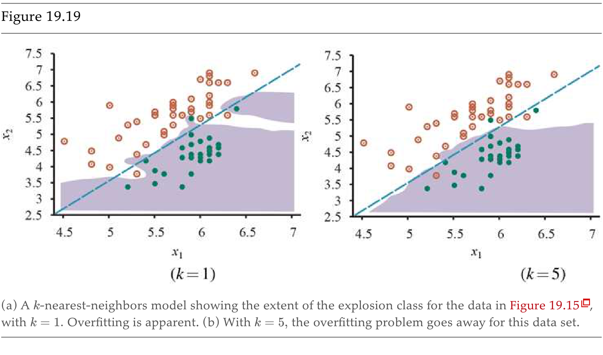
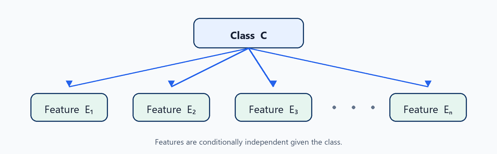
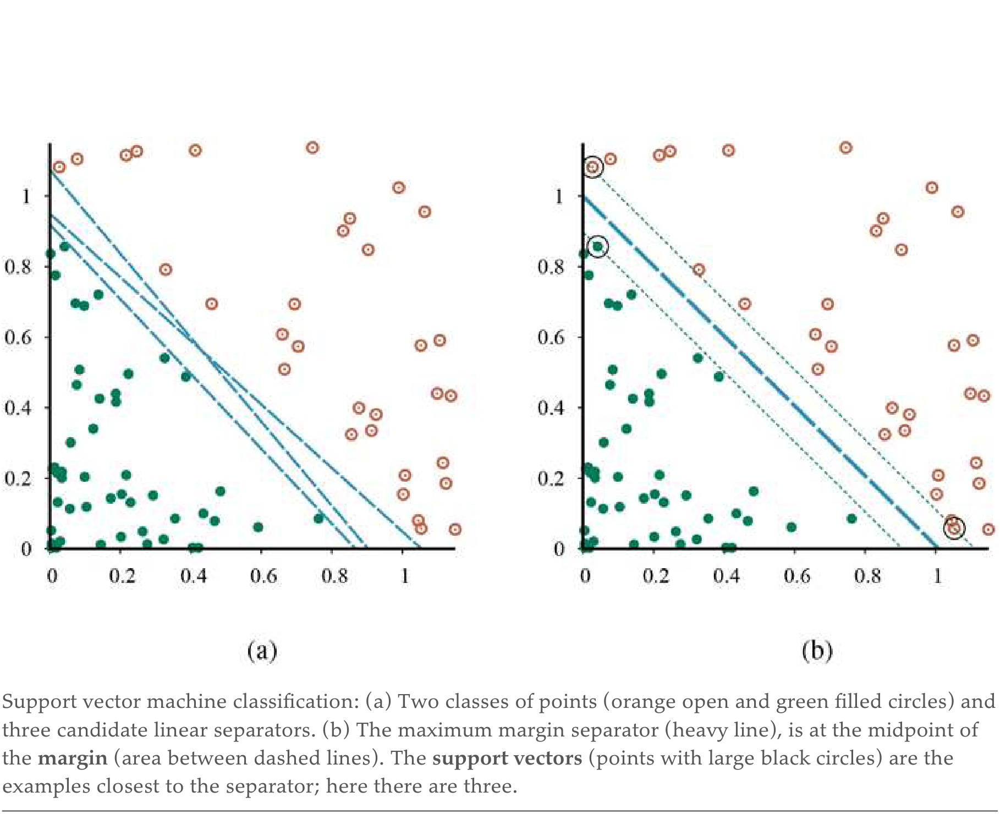
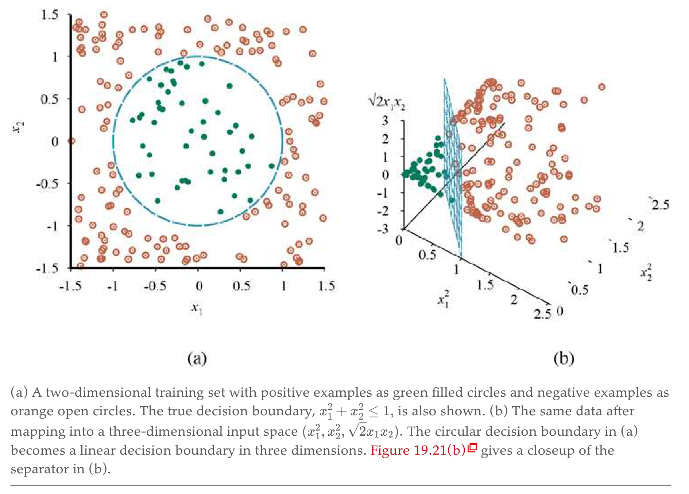

<!-- _class: lead -->
# Supervised Machine Learning: Classification
## K-Nearest Neighbors · Naive Bayes · Support Vector Machines

Artificial Intelligence — Student-Led Lecture  
College of Computer Science & Information Technology  
University of Wasit  
Source framework: Russell and Norvig, Artificial Intelligence: A Modern Approach, 4th ed.

---

# Learning Objectives

- Define a classification problem using labeled examples.
- Explain how KNN, Naive Bayes, and SVM produce a class prediction.
- Work through one small numerical example for each classifier.
- Identify the assumptions, strengths, and failure modes of each method.
- Select a method based on the data representation and task.

Source: AIMA 4e, Chapters 12 and 19. [Foundational Knowledge / Standard Concept]

---

# Classification: The Learning Task

- Input: an example described by features, x = (x₁, x₂, …, xₙ).
- Output: one label from a finite set of classes, y ∈ {C₁, …, Cₘ}.
- Training data: examples paired with known labels, (xᵢ, yᵢ).
- Goal: predict a plausible label for a new, unseen example.
- The three algorithms differ in how they represent evidence and form a decision.

Source: AIMA 4e, Ch. 19 (learning from examples); §12.6.1. [Foundational Knowledge / Standard Concept]

---

# Three Different Ways to Decide

Evidence and decision rules differ across the three models. Source: AIMA 4e, §§12.6, 19.7.1, 19.7.5.

| Classifier | Evidence used | Decision rule |
|:--|:--|:--|
| KNN | Nearby labeled examples | Majority label among the k nearest points |
| Naive Bayes | Class priors and feature likelihoods | Largest posterior probability |
| SVM | Closest examples around a boundary | Maximum-margin separating hyperplane |

---

# KNN: Let Nearby Examples Vote

- K-Nearest Neighbors (KNN) is an instance-based, nonparametric method.
- It stores labeled training examples rather than fitting one global equation.
- For a query point xq, find its k nearest examples.
- Predict the most frequent class among those neighbors.
- For binary classification, odd k is commonly used to reduce voting ties.

Source: AIMA 4e, §19.7.1 (digital PDF pp. 1269–1271).

---

# KNN: Classification Procedure

Input: labeled examples D, query q, neighbor count k, distance function d.

1. Measure d(q, xᵢ) for every labeled training example.
2. Select the k examples with the smallest distances.
3. Collect the class label of each selected neighbor.
4. Return the most frequent label; use a stated tie rule if needed.

A direct scan takes O(N) distance evaluations per query; AIMA discusses data structures for faster search. Source: AIMA 4e, §§19.7.1–19.7.3.

---

# KNN: Distance Defines “Nearby”

- Euclidean distance (L²): d(x,z) = √Σᵢ(xᵢ − zᵢ)².
- Manhattan distance (L¹): d(x,z) = Σᵢ|xᵢ − zᵢ|.
- Hamming distance counts differing Boolean attributes.
- The feature scale and chosen metric can change which examples are nearest.
- Normalize numeric features when their units or ranges are not comparable.

Source: AIMA 4e, §19.7.1 (digital PDF pp. 1271–1272).

---

# KNN: Worked Numerical Example

Query q = (0, 0); use Euclidean distance and k = 3. The three nearest labels vote Red, Blue, Red, so the prediction is Red (2–1). Source: AIMA 4e, §19.7.1. Values below are an original teaching example.

| Training point | Class | Distance from q |
|:--|:--:|--:|
| (1, 0) | Red | 1.00 |
| (0, 2) | Blue | 2.00 |
| (2, 2) | Red | 2.83 |
| (3, 0) | Blue | 3.00 |

---

# KNN: Choosing k and Managing Cost

- Small k creates a flexible boundary and can overfit noise or outliers.
- Large k smooths the boundary; an excessively large k can underfit.
- Select k with cross-validation on training data.
- A direct query scans the stored examples; prediction can be costly at scale.
- AIMA also describes k-d trees and locality-sensitive hashing as search accelerators.

Source: AIMA 4e, §§19.7.1–19.7.3 (digital PDF pp. 1270–1278).

---

# KNN: Why k Changes the Boundary

- At k = 1, a single nearby outlier can create a local island in the boundary.
- At k = 5 in this AIMA example, the boundary is smoother.
- Increasing k too far can erase real local structure and underfit.
- The figure compares the same earthquake examples under two choices of k.
- Choose k by cross-validation rather than by the training picture alone.

Source: AIMA 4e, Fig. 19.19, §19.7.1, digital PDF p. 1271.

---

# Naive Bayes: Combine Prior and Evidence

- Let C be a class and E₁, …, Eₙ be observed features.
- Bayes’ rule updates the prior P(C) using the observed evidence.
- Naive Bayes assumes features are conditionally independent given the class.
- “Naive” names this simplifying assumption; real features may be dependent.
- For prediction, choose the class with the largest posterior probability.

Source: AIMA 4e, §12.6 and Eq. (12.21) (digital PDF pp. 765–767).

---

# Naive Bayes: Dependency Structure

- The class is the common parent of the observed features.
- Given the class, the model treats each feature as conditionally independent.
- This structure makes the joint calculation a product of smaller likelihoods.
- Natural language features often violate the independence assumption.

Diagram drawn from the model structure in AIMA 4e, §12.6, Eq. (12.20).

---

# Naive Bayes: The Classification Calculation

For each candidate class c:

P(c | e₁, …, eₙ) ∝ P(c) × ∏ᵢ P(eᵢ | c)

- P(c): prior probability of the class.
- P(eᵢ | c): likelihood of feature evidence under that class.
- Normalize the class scores if actual posterior probabilities are needed.
- For a single predicted label, compare the unnormalized scores.

Source: AIMA 4e, §12.6, Eq. (12.21).

---

# Naive Bayes: Training and Prediction Procedure

Training:

1. Count examples in each class and estimate each prior P(c).
2. For each class and feature, estimate P(eᵢ | c) from the class examples.
3. Reserve probability for unseen features when the application requires smoothing.

Prediction:

1. For each class, multiply its prior by the observed feature likelihoods.
2. Normalize the scores if calibrated posterior values are required.
3. Return the class with the largest score.

Source: AIMA 4e, §§12.6–12.6.1; smoothing note in §12.6.1 and Ch. 20.

---

# Naive Bayes: Worked Example

Original toy counts; add-one smoothing is used. Source for the model: AIMA 4e, §12.6; smoothing is a standard extension noted in §12.6.1 and Ch. 20.

| Class | Training cases | P(offer = 1 | class) | P(meeting = 0 | class) |
|:--|--:|--:|--:|
| Spam | 3 | 3/5 | 3/5 |
| Ham | 3 | 2/5 | 2/5 |

---

# Naive Bayes: Completing the Example

- Query: offer = 1 and meeting = 0; each class prior is 1/2.
- Spam score = 1/2 × 3/5 × 3/5 = 9/50.
- Ham score = 1/2 × 2/5 × 2/5 = 4/50.
- Normalize: P(Spam | x) = 9/13; P(Ham | x) = 4/13.
- Prediction: Spam. The counts are a teaching example, not AIMA data.

Source for the posterior rule: AIMA 4e, §12.6, Eq. (12.21).

---

# Naive Bayes: Strengths and Cautions

- Efficient: the prediction calculation grows linearly with observed features.
- Useful for text categorization, language identification, and spam filtering.
- Conditional independence is often false; posterior probabilities may become overconfident.
- A zero likelihood can erase the evidence from every other feature.
- Reserve probability for unseen features; smoothing is a standard remedy.

Source: AIMA 4e, §§12.6–12.6.1 (digital PDF pp. 765–767).

---

# SVM: Separate Classes with a Wide Margin

- A Support Vector Machine (SVM) seeks a separating hyperplane.
- Among separating boundaries, it selects one with the largest margin.
- The margin is the distance between the two boundary-parallel margin edges.
- Support vectors are the training examples closest to the separator.
- These closest examples determine the fitted boundary.

Source: AIMA 4e, §19.7.5 (digital PDF pp. 1279–1281; Fig. 19.21).

---

# SVM: A One-Dimensional Margin Example

- The maximum-margin separator lies at x = 0.
- The nearest examples (x = −1 and x = +1) are the support vectors.
- Each is one unit from the boundary; total margin width = 2.
- This illustrates the rule in AIMA 4e, §19.7.5; the points are newly constructed.

| Point | −2 | −1 | +1 | +2 |
|:--|:--:|:--:|:--:|:--:|
| Class | −1 | −1 | +1 | +1 |

---

# SVM: Linear Decision Rule

- A linear separator is defined by w · x + b = 0.
- The predicted class is sign(w · x + b), using labels −1 and +1.
- AIMA presents an optimization formulation and its dual representation.
- In the dual form, examples appear through pairwise dot products.
- Only support vectors have nonzero weights in the final representation.

Source: AIMA 4e, §19.7.5, Eqs. (19.10)–(19.11).

---

# SVM: Training and Prediction Procedure

Training:

1. Represent examples with labels yᵢ ∈ {−1, +1}.
2. Choose the original feature representation or a kernel function.
3. Solve the maximum-margin dual optimization problem.
4. Retain examples with nonzero αᵢ; these are the support vectors.

Prediction:

1. Compare a query with the support vectors using dot products or a kernel.
2. Evaluate the learned decision score and return its sign.

Conceptual procedure based on AIMA 4e, §19.7.5, Eqs. (19.10)–(19.11).

---

# SVM: Linear and Kernelized Decision Boundaries

- Linear SVM: a hyperplane separates examples in the original feature space.
- Kernelized SVM: map inputs to a feature space where a linear separator may exist.
- The kernel trick computes required feature-space dot products without explicitly building every mapped vector.
- In the original input space, the resulting decision boundary can be nonlinear.
- AIMA illustrates this with a circular class region and a higher-dimensional feature map.

Source: AIMA 4e, §19.7.5, Eq. (19.12) and Fig. 19.22 (digital PDF pp. 1281–1283).

---

# What “SVM Types” Means in This Source

The source distinguishes the following decision-boundary forms; its §19.7.5 is not a survey of named hard-margin and soft-margin variants.

| Distinction supported by AIMA §19.7.5 | Meaning |
|:--|:--|
| Linear SVM | Separating hyperplane in the original input representation |
| Kernelized / nonlinear SVM | Linear separation after an implicit feature-space mapping |

---

# Comparing the Three Classifiers

The comparison synthesizes AIMA 4e, §§12.6, 19.7.1, and 19.7.5.

| Question | KNN | Naive Bayes | SVM |
|:--|:--|:--|:--|
| Main evidence | Neighbor labels | Priors and likelihoods | Boundary-defining examples |
| Core assumption | Similar points share labels | Conditional feature independence | A useful maximum-margin separator exists |
| Prediction | Vote among k neighbors | Maximum posterior class | Sign of decision function |
| Sensitive to | Metric, scaling, k | Probability estimates, dependence | Kernel and feature representation |

---

# A Practical Selection Guide

- Choose KNN when a meaningful distance and local similarity are available.
- Choose Naive Bayes when a fast probabilistic baseline is useful, especially for feature-rich text.
- Choose SVM when a maximum-margin boundary fits the task and kernel computation is appropriate.
- Keep preprocessing and model selection inside the training-validation workflow.
- Compare candidates on held-out data; no classifier is best for every dataset.

The final selection guidance is a synthesis of the methods’ properties in AIMA 4e, not a universal ranking.

---

# Take-Home Messages

1. KNN predicts from nearby labeled examples; distance and k shape its behavior.
2. Naive Bayes predicts by combining class priors with conditionally independent feature likelihoods.
3. SVM predicts using a maximum-margin separator; kernels enable nonlinear boundaries.
4. Worked examples reveal each model’s decision mechanism and assumptions.
5. Evaluation on unseen data is essential before trusting a classifier.

Source: AIMA 4e, §§12.6, 19.7.1, 19.7.5. [Foundational Knowledge / Standard Concept]

---

# References

Russell, S. J., and Norvig, P. Artificial Intelligence: A Modern Approach. 4th ed., Pearson, 2021.

- §12.6, “Naive Bayes Models,” and §12.6.1, “Text Classification with Naive Bayes,” digital PDF pp. 765–767.
- §19.7.1, “Nearest-Neighbor Models,” digital PDF pp. 1269–1272.
- §§19.7.2–19.7.3, nearest-neighbor search accelerators, digital PDF pp. 1272–1278.
- §19.7.5, “Support Vector Machines,” digital PDF pp. 1279–1283.

Classification mechanisms and worked explanations in this deck are paraphrased or newly constructed illustrations based on these sections. [Foundational Knowledge / Standard Concept]

---

# Questions for Discussion

- Why can changing feature units change a KNN prediction?
- Why can Naive Bayes still classify well when feature independence is imperfect?
- Which training examples influence an SVM boundary, and why?

Thank you.
